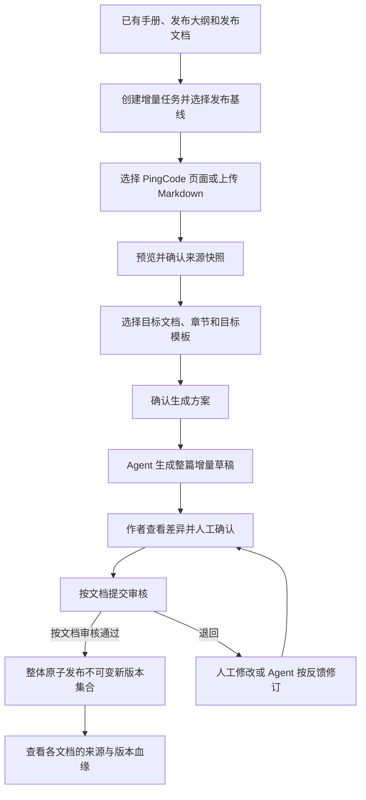
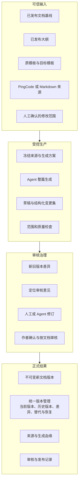
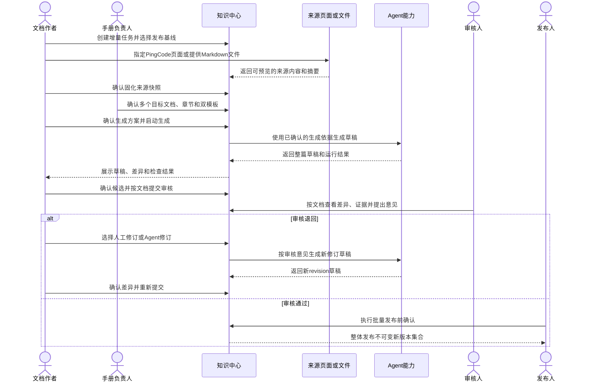
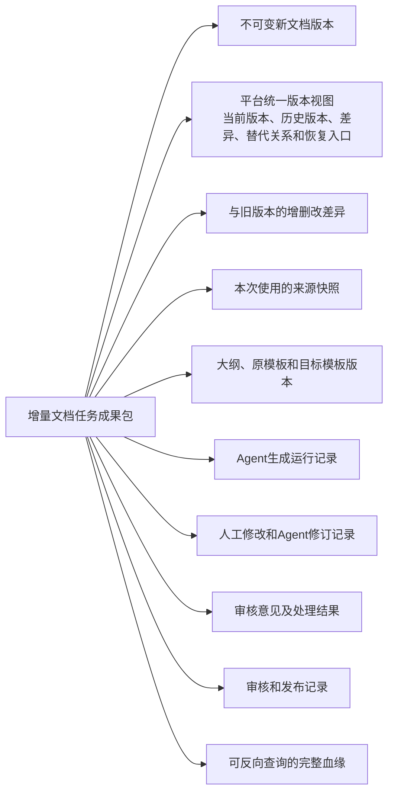
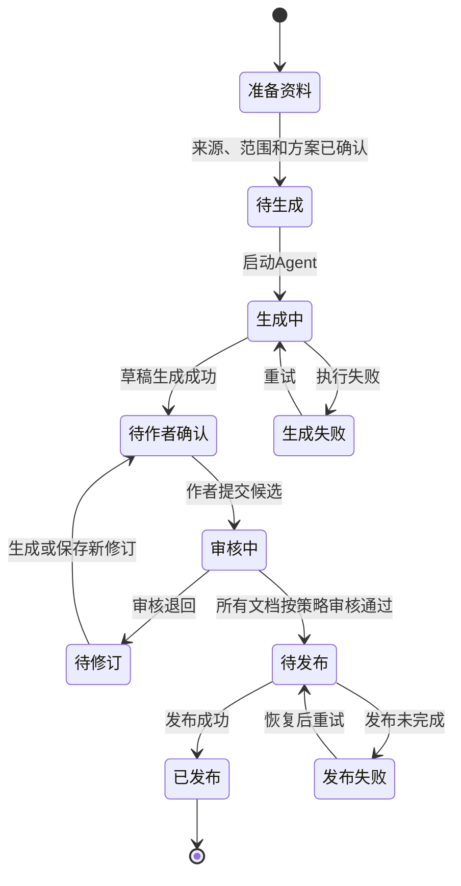

# 增量文档构建 MVP 需求

> 文档类型：产品需求
> 需求编号：KC-DOC-INC-MVP
> 状态：评审中
> 版本：3.3.0
> 更新日期：2026-09-22
> 关联概要设计：`../02-概要设计/知识中心-文档生产-增量构建垂直业务-概要设计文档.md`
> 关联页面详细设计：`../03-详细设计/知识中心-文档生产-手册级文档生成页面-前端详细设计文档.md`
> 关联开发任务：`../04-开发任务/知识中心-文档生产-增量文档构建MVP-开发任务文档.md`

## 一、一句话产品承诺

面向需要把研发变更转化为官方文档的作者，平台基于已发布文档、明确来源、大纲和模板生成可审核的增量草稿，经过差异确认、反馈修订和按文档审核后，以一次原子发布形成可追溯、不可变的新文档版本集合。

MVP 的用户可感知终点是：

> **知识中心内成功发布一批不可变的新文档版本，并能从每个新版本反向查看来源、生成、修订、审核和发布证据。**

GitLab 提交、MR 和外部文档仓库交付不属于本次 MVP 完成条件。

## 二、为什么建设

研发完成一项用户可感知的功能后，需要将特性设计内容重新组织为符合官方手册规范的文档。用户可感知变化包括 SQL 行为、对外约束、配置参数、运维工具以及版本兼容性变化。

当前代码仓库和官方文档仓库独立运行，研发变更主要通过 PingCode 电子流传递。研发人员需要人工查找资料、理解模板并重写文档，审核人员再依赖经验识别遗漏、错误和规范问题。

| 维度 | 当前方式 | MVP 目标效果 |
|---|---|---|
| 资料整理 | 人工查找设计文档和 PingCode 页面 | 选择、预览并冻结本次使用的真实来源 |
| 文档撰写 | 人工理解模板并重新组织语言 | Agent 基于基线、来源、大纲和模板生成草稿 |
| 变更确认 | 审核人通读全文寻找变化 | 直接查看新增、删除、修改和移动内容 |
| 反馈修订 | 审核意见在线下或多个入口间传递 | 意见定位到具体内容，并支持人工或 Agent 修订 |
| 版本管理 | 当前版本、历史版本和恢复关系依赖人工判断 | 平台统一维护当前生效版本、历史版本、差异、替代关系和恢复入口 |
| 发布追溯 | 难以说明版本为什么发生变化 | 新版本可追溯来源、生成、修订、审核和发布过程 |
| 失败恢复 | 页面关闭或生成失败后依赖人工判断 | 任务可恢复，失败不覆盖上一份可用结果 |

## 三、为谁建设

| 角色 | 核心任务 | 成功结果 |
|---|---|---|
| 文档作者 | 选择来源和范围，生成、编辑并提交文档 | 获得可提交审核的增量草稿 |
| 审核人 | 阅读证据和差异，提出意见并作出审核决定 | 明确判断变更是否准确、完整且符合规范 |
| 手册负责人 | 确认基线、大纲、模板和修改范围 | 变更没有超出预期手册和章节范围 |
| 发布人 | 验证审核和质量门禁并执行批量发布 | 形成不可变的新文档版本集合，旧版本仍可追溯 |
| Agent | 按冻结上下文生成或修订草稿 | 产生候选内容，不拥有审核和发布权限 |

## 四、手册级文档生成页面

每本手册对应一个独立的文档生成页面。作者进入手册后，在左侧查看当前手册目录，在右侧编辑当前选中的一个文档。

产品规则：

- 一次只编辑一个文档；
- 目录支持“全部文档”和“只看我负责”两种呈现方式；
- MVP 先支持人工 Markdown 正文修改，采用手动保存；
- 参考资料绑定当前文档草稿，不绑定整个手册；
- 上传参考文档的 MVP 格式为 Markdown；
- PingCode 页面作为只读参考来源；
- 多个已修改文档可以组成一个提交批次；
- 一个批次包含多个文档级审核对象，审核按文档进行；
- 提交成功后进入审核与发布页面；
- 文档生成页面不执行审核决定和正式发布。

## 四、增量构建主流程与产品全景

### 4.1 用户主流程

“新增手册”是已有的知识资产能力，是进入本流程的前置条件，不是本次 MVP 新增步骤。

### 4.2 产品能力全景

## 五、角色协作和人工决策点

### 5.1 角色泳道

### 5.2 五个人工门禁

Agent 不得自动扩大来源、自动决定修改范围、自动提交审核、作出人工审核决定或自动发布正式版本。

## 六、用户输入与预期结果

| 用户提供或选择 | 平台应完成 | 用户获得 |
|---|---|---|
| 已发布文档 | 确认本次修改基于哪个版本 | 可识别的发布基线 |
| PingCode 页面或 Markdown | 读取、预览并等待用户确认 | 本次任务固定使用的来源 |
| 发布大纲、多个目标文档和章节 | 确认允许修改的范围 | 清晰的文档级和章节级修改范围 |
| 原模板和目标模板 | 展示续写与变更所遵循的模板 | 可理解的模板依据 |
| 用户补充要求 | 纳入本次生成说明并展示给用户确认 | 可解释的生成依据 |
| 生成结果 | 形成草稿、差异和质量提示 | 可编辑、可审阅的增量草稿 |
| 审核意见 | 支持人工或 Agent 形成新修订 | 可比较的新 revision |
| 各文档审核通过的候选 | 执行批量发布前检查并确认整体版本切换 | 整体成功或整体失败的不可变新文档版本集合 |

原模板表示发布基线形成时使用的模板；目标模板表示本次新增或修改内容需要遵循的模板。目标模板只约束本次修改范围，不自动重排未修改正文，也不触发整篇模板迁移。

平台统一提供版本维护体验：用户可以查看每个文档的当前生效版本和历史版本、比较版本差异、查看版本替代关系，并从历史版本发起恢复。恢复必须形成新的草稿或新版本，不覆盖原有历史版本；历史引用不能因新版本发布而失效。

一次增量任务可以包含多个目标文档和多个章节。审核按文档分别进行；只有任务内全部目标文档都满足审核和质量门禁时，才允许执行一次整体发布。任一文档发布失败，整批发布失败且不改变任何文档的当前生效版本。

## 七、最终成果包

一次成功的增量文档任务不是只生成一个 Markdown 文件，而是形成完整成果包：

## 八、黄金业务样例

PingCode 中新增了一个数据库配置参数。作者选择当前发布版《系统参数手册》作为基线，引用对应的 PingCode 设计页面，选择“参数说明”章节，并为本次新增参数选择新的参数模板。若同一研发变更同时影响《系统参数手册》和《运维手册》，作者可以在同一个增量任务中选择两个目标文档。

平台冻结来源、基线、大纲、原模板、目标模板和修改范围后，由 Agent 生成包含参数定义、默认值、取值范围、影响、示例和注意事项的整篇候选文档。系统只把人工确认范围内的变化登记为变更集，并展示与旧版本的差异。

审核人按文档查看差异。某个文档缺少升级兼容性说明时，审核人在该文档的具体内容位置提出阻断意见。作者选择“Agent 根据反馈修订”，平台生成该文档的新 revision 草稿。所有目标文档分别通过审核后，发布人最终一次性发布新的不可变文档版本集合。

最终应能回答：为什么修改、使用了哪些来源和基线、每个文档改了什么、审核意见如何处理、谁完成审核和发布，以及每个新版本替代了哪个旧版本。

## 九、用户状态和失败恢复

### 9.1 用户可见主状态

### 9.2 失败保障

- 来源读取失败时不生成空快照，也不声称来源已经校验；
- Agent 生成失败时保留上一份可用草稿；
- 页面关闭、重新登录或服务恢复后可以继续查询任务和会话；
- 未授权范围发生变化时阻断候选提交并定位问题；
- 审核退回后按对应文档创建新 revision，不覆盖原候选；
- 批量发布任一文档失败时不改变任何文档的当前正式版本；
- 同一请求重试不产生重复快照、草稿或发布版本；
- 未知、过期或部分成功不得显示为成功。

## 十、产品边界

### 10.1 进入条件

- 知识资产中已经存在手册；
- 已存在发布版大纲；
- 已存在正式发布文档；
- 发布文档使用的原模板版本可追溯；
- 当前用户拥有对应手册、文档或章节的生产权限。

### 10.2 MVP 包含

- PingCode 页面真实只读接入和 Markdown 文件上传；
- 不可变发布基线；
- 大纲版本、原模板、目标模板和人工修改范围冻结；
- 整篇文档一次生成；
- 用户与任务维度的持久 Agent 会话；
- Agent 输出转换为增量草稿和结构化变更集；
- 新旧文档增删改对比；
- 人工修订和 Agent 反馈修订；
- 作者确认、按文档审核和不可变批量发布；
- 多文档、多章节任务按文档审核并整体原子发布；
- 来源、生成、审核和发布的完整追溯。

### 10.3 MVP 不包含

- 首次全量文档生成；
- Word、PDF 等非 Markdown 文件上传；
- Agent 自动决定允许修改范围；
- 整篇旧文档模板迁移；
- Agent 自动提交审核或自动发布；
- 多人实时协同编辑；
- GitLab 自动提交、MR 或外部文档仓库交付闭环。

## 十一、OR 产品需求

| OR | 产品结果 | 输入 | 输出 | 核心规则 |
|---|---|---|---|---|
| OR-01 | 从正式发布版本建立多文档增量任务 | 手册、发布大纲、多个发布文档 | 任务和各文档基线引用 | 没有发布文档不能创建；所有文档提交与整体发布前必须确认对应基线仍有效 |
| OR-02 | 真实来源可预览并冻结 | PingCode 页面或 Markdown | 不可变来源快照 | 不能只保存链接；任务不能直接依赖后续会变化的来源 |
| OR-03 | 明确修改什么、按什么模板修改 | 大纲、目标范围、双模板 | 范围和模板确认结果 | 目标模板只约束修改范围；未选正文不自动重排 |
| OR-04 | 用户可持续与 Agent 协作 | 用户、任务和会话消息 | 可恢复的会话和生成进展 | 不同用户和任务之间相互隔离；重新登录后可继续 |
| OR-05 | 一次生成可解释、可复现 | 基线、来源、范围、模板和指令 | 可查看的生成方案 | 平台统一展示本次生成依据；用户指令不能突破权限和修改范围 |
| OR-06 | Agent 生成受控增量草稿 | 已确认的生成方案 | 草稿、变更集和检查结果 | 输出只能作为草稿；超出确认范围必须被发现并阻止提交 |
| OR-07 | 作者能够安全修改草稿 | Agent 草稿和人工修改 | 新草稿版本和质量结果 | 已提交审核的候选不能被静默覆盖；质量问题必须明确定位 |
| OR-08 | 审核人按文档判断改了什么 | 各文档基线、候选和来源证据 | 文档级差异、意见和审核决定 | 未解决的阻断意见不能通过；每个目标文档都必须完成审核 |
| OR-09 | 审核反馈形成按文档可控修订 | 退回文档候选和审核意见 | 对应文档的新 revision 草稿 | 人工和 Agent 为并列入口；作者确认后才能重新提交 |
| OR-10 | 多文档审核通过后安全发布 | 全部文档候选、各文档审核决定和批量发布确认 | 不可变新文档版本集合 | 角色可由同一人承担，但必须满足权限和审核策略；整体发布只能全部成功或全部失败；历史版本保持可读 |
| OR-11 | 平台统一维护版本生命周期 | 当前版本、历史版本和恢复请求 | 当前生效版本、版本差异、替代关系和恢复结果 | 恢复必须形成新草稿或新版本，不覆盖历史版本；历史引用保持有效 |
| OR-12 | 全过程可追溯、可恢复 | 来源、生成、修订、审核和发布记录 | 可查询的过程证据和恢复入口 | 重试不产生重复结果；失败保留上一可用结果；敏感信息不进入记录 |

## 十二、MVP 验收

### 12.1 真实黄金路径

至少完成以下两条真实链路：

1. 使用已有手册、发布大纲和发布文档，以 Markdown 为来源完成生成、审核、修订和发布；
2. 使用真实 PingCode 页面完成同样的生成、审核、修订和发布。

两条来源链路都必须证明来源经过真实读取和快照固化、生成过程使用已确认的上下文、草稿形成可审阅的变更集、越界修改被阻断、审核退回后按文档形成新 revision、作者确认后才能重提、权限和审核策略阻止无权决定、所有文档通过后整体发布产生不可变新版本集合，并且每个新版本可以反向查询全部证据。

版本管理还必须证明：平台明确展示当前生效版本和被替代版本；用户可以查看历史版本并比较差异；从历史版本恢复不会覆盖原版本，而是形成新的草稿或新版本；新版本发布后历史引用仍能指向原版本。

### 12.2 什么不算完成

- 只生成一个 Markdown 文件；
- 只记录 PingCode 链接，没有读取正文；
- Agent 输出没有进入增量草稿；
- 能展示差异但不能处理审核意见；
- 审核通过但不能发布正式版本；
- 发布后不能追溯来源、生成和审核证据；
- 发布后无法明确当前生效版本、历史版本和替代关系；
- 从历史版本恢复时覆盖原版本或使历史引用失效；
- 多文档批量发布部分成功，导致部分文档切换版本；
- 通过模拟状态声称真实外部系统已经成功。

### 12.3 效果指标

首轮先建立统计口径，目标值必须通过真实样例评估后确定，不在需求中凭经验硬编码。

| 指标 | 说明 |
|---|---|
| 增量任务完成时间 | 从创建任务到发布新版本的总时长 |
| 作者人工重写比例 | 最终正文中需要人工重写的内容比例 |
| 审核定位时间 | 审核人定位主要变化和风险所需时间 |
| 首轮审核通过率 | 首次提交即通过的任务比例 |
| 平均修订次数 | 每个任务从首次提交到通过的 revision 数量 |
| 来源引用完整率 | 变更内容具备有效来源引用的比例 |
| 越界修改发现率 | 未授权范围变化被可靠发现并阻止提交的比例 |
| 血缘完整率 | 发布版本能够完整反查必要证据的比例 |
| 失败恢复成功率 | 中断或失败任务成功恢复且未产生重复事实的比例 |
| 版本事实一致率 | 平台展示的当前版本、历史版本和替代关系与正式版本事实一致的比例 |

## 十三、已确认的产品决策

- Markdown 和 PingCode 同时作为 MVP 的真实来源类型；两条来源链路都必须通过真实读取、快照、生成、审核和发布验收。
- 一个增量任务可以包含多个目标文档和多个章节；审核按文档进行，发布按任务整体原子执行，任一文档失败则整批回滚。
- 作者、手册负责人、审核人和发布人可以由同一人承担，是否允许具体操作由权限角色和审核策略决定。
- 基线漂移时禁止静默覆盖，只允许重新生成或人工处理冲突。
- 无有效变化时不创建审核候选，不发布新版本，但保留生成和检查记录。
- 历史版本恢复先形成新草稿，重新执行差异检查、审核和发布，不覆盖历史版本。
- Agent 只能修改用户确认的文档和章节范围，来源没有证据支持的内容必须标记为待确认，不能作为已验证事实提交。
- GitLab、MR 和外部文档仓库交付不属于 MVP 完成条件。

## 十四、仍需在概要设计中冻结的细节

- 版本号和业务版本标签的具体规则；
- 文档级审核结果如何汇总为任务级批量发布门禁；
- 多文档发布事务失败后的重试和人工接管方式；
- 版本差异默认展示到文档、章节、段落还是行；
- 权限策略如何表达同一用户承担多个角色时的允许和禁止组合。
