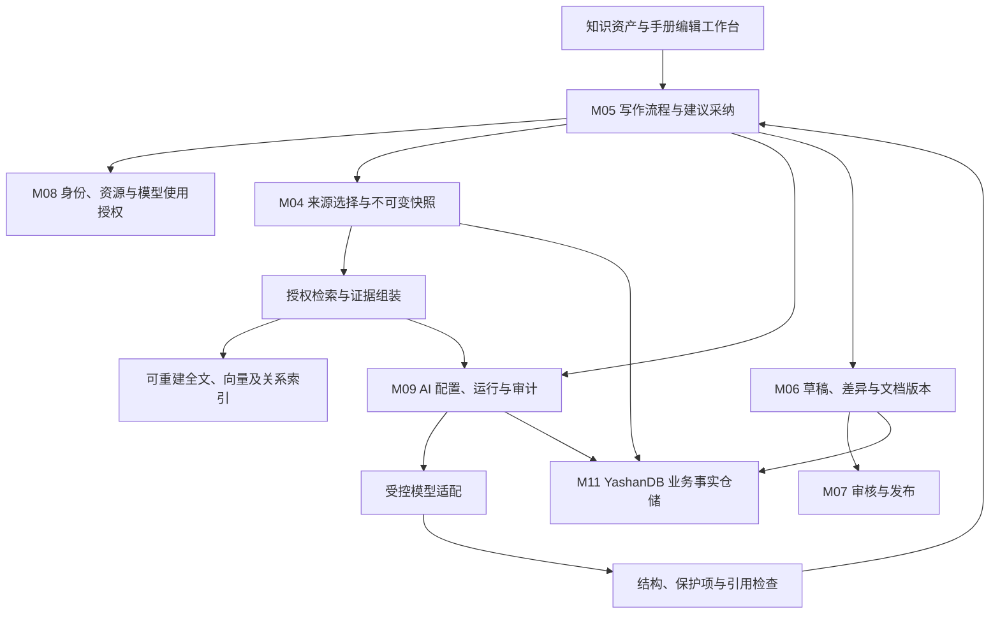

# 腾讯 ima 知识库与 AI 润色、续写能力调研报告

- 文档版本：1.0.0
- 文档状态：草拟中
- 调研日期：2026-10-15（北京时间）
- 适用对象：知识中心管理平台产品、架构、研发、测试及知识治理负责人
- 研究范围：腾讯 ima 公开知识库、知识问答、AI 笔记与帮写能力；当前平台的业务适配、能力规划和架构取舍
- 交付性质：公开资料研究与本地代码、设计静态分析；需求及架构建议尚未批准或实施

## 一、执行摘要

**建议建设“基于授权知识来源的文档写作助手”，以润色、续写和证据预览为首期闭环。** 用户在现有手册工作台完成选文、选择来源、生成建议、比较差异、采纳和保存，再进入原有审核发布流程。

腾讯 ima 值得借鉴的是“收集知识—理解知识—利用知识写作—继续沉淀”的连续体验。其官方产品说明已确认个人知识库、共享知识库、知识库广场、多格式资料解读、AI 问答，以及笔记中的文案生成、扩写与润色能力。[S1][S2][S3] 当前证据没有确认名为“续写”的独立操作、选区级差异采纳或其内部技术架构；本报告将这些内容作为本平台设计建议。

优先级建议：

1. **首期 P0**：当前草稿的选区/当前文档润色、指定位置续写、人工确认来源、引用预览、完整结果采纳、撤销、冲突保护和运行追溯。
2. **第二期 P1**：授权知识问答、知识空间协作、分段采纳、术语及风格配置、审核意见辅助修改。
3. **第三期 P2**：经授权的更多来源类型、跨空间知识应用和可量化的个性化体验。公网知识广场、自动联网和开放分享不进入首期。

建议采用现有模块内的有界能力扩展：M05 负责文档写作流程，M04 提供来源快照，M06 管理正文版本，M08 判断权限，M09 承担 AI 配置、运行与审计，M11 保存业务事实。检索索引为可重建派生数据。首期无需仅因增加 AI 写作而拆分独立微服务。

**关键约束：** 润色不改变技术事实；续写新增技术结论必须具备可定位证据或标为待补充；AI 建议不直接成为发布知识；用户采纳也不替代审核。

## 二、研究方法、证据与限制

### 2.1 证据口径

| 标识 | 含义 | 本报告如何使用 |
|---|---|---|
| 官方事实 | 官方页面或开发者公开产品说明直接表达 | 说明 ima 的公开能力，不等同于全端实测 |
| 静态观察 | 当前仓库代码、设计文档直接支持 | 识别当前接入点，不推断生产环境状态 |
| 分析判断 | 根据证据形成的业务或技术推断 | 明确论证及适用条件 |
| 建设建议 | 为当前平台提出的需求与架构方向 | 进入后续评审，不声称已经实现 |

调研以官方材料为主，未将搜索摘要、第三方体验文章或静态资源中的枚举当作功能已开放的依据。官网产品介绍由脚本渲染，本文引用其官方公开静态资源中的产品介绍文案；这能证明宣传内容，不能证明登录后的实际行为。

### 2.2 官方来源

| 编号 | 来源与链接 | 支持的结论 | 证据限制 |
|---|---|---|---|
| S1 | [ima 官网](https://ima.qq.com/) | 产品定位“腾讯 AI 知识管家”，提供知识库、发现广场、问答历史等入口 | 未登录首页，只验证公开入口 |
| S2 | [ima 官方产品介绍与下载页](https://ima.qq.com/download)；[本次页面引用的产品介绍资源](https://fe-static.ima.myqcloud.com/ima/assets/download/assets/index-DnGBUidj.js) | AI 笔记辅助创作和润色；基于知识库辅助报告写作；私域知识共建、共享与协作 | 公开介绍文案；资源地址可能随发布变化 |
| S3 | [App Store 产品页](https://apps.apple.com/cn/app/id6737188438)；[Apple 产品元数据查询](https://itunes.apple.com/lookup?id=6737188438&country=cn) | “搜—读—写”、多格式个人知识库、共享知识库、广场、笔记生成/扩写/润色等 | 腾讯提交的平台产品说明，不能外推为各端完全一致 |

本次 Apple 查询返回版本 `2.6.12`。版本号仅标识本次返回元数据，不作为桌面端或所有渠道的版本基线；具体更新时间、开发者信息和原文保存在研究证据中。

证据文件：`runtime/research/ima-20261015/sources.json` 保存获取时间、HTTP 状态、内容摘要和摘录；`app-store.json` 保存原始产品元数据；官网 HTML 保存本次资源引用关系。运行目录证据不作为正式知识内容。

### 2.3 研究限制

- 未安装或登录 ima，未进行桌面端、移动端、Web 端的任务实测与功能对齐。
- 未验证 ima 的选区行为、续写插入位置、差异对比、撤销、共享成员权限、删除传播时效及引用粒度。
- 未验证其模型质量、数据处理范围、私有化能力、开放 API、商业授权、价格和服务承诺。
- 未取得其检索、切片、重排、模型路由、数据库或部署架构资料，不对内部实现作事实判断。
- 当前平台结论来自源码和有效设计，未执行平台后端 API 或端到端测试；本轮没有后端实现变更，也不提供运行验收结论。

因此，本文足以支持需求立项和技术方案讨论；采购、外部系统接入、性能承诺和上线决策仍需专项验证。

## 三、腾讯 ima 的产品能力分析

### 3.1 能力全景

| 能力域 | 官方可确认能力 | 用户价值 | 当前平台的借鉴方式 |
|---|---|---|---|
| 知识收集 | 本地文件、微信文件、公众号文章、网页、图片、音频等内容解读 [S3] | 降低资料分散和重复查找成本 | 统一素材入口；首期复用已验收来源类型，不宣称具有全部格式能力 |
| 个人知识管理 | 个人知识库；公开场景介绍涉及分类和标签 [S2][S3] | 让个人资料积累可持续使用 | 优先采用“我的资料/最近使用”视图，复用知识空间授权 |
| 知识共享 | 共享知识库、共建协作与员工问题解答场景 [S2][S3] | 团队复用共同资料与经验 | 空间成员和资源授权；来源版本与责任人明确 |
| 公域发现 | 知识库广场，发现其他领域知识库 [S1][S3] | 扩大知识发现范围 | 暂缓开放分享；后续可评估企业内部已发布知识发现 |
| 阅读理解 | 多格式内容解读、问答、思维导图、播客、小测验及文档图表问答 [S3] | 从阅读转向理解与应用 | 首先建设来源预览、授权问答及引用定位 |
| 写作辅助 | AI 笔记、生成文案、扩写、润色；基于知识库撰写初稿 [S2][S3] | 从资料到初稿及表达优化 | 在当前手册草稿中就地提供 AI 建议 |
| 信息沉淀 | 优质内容摘录进笔记 [S3] | 将阅读所得继续积累 | 用户可将结果采纳进草稿；批准后按平台策略进入正式知识范围 |
| 复杂任务 | copilot 和工具调用在公开产品说明、更新说明中出现 [S3] | 扩展任务处理范围 | 后续评估受控工具编排，首期采用固定有界写作流程 |

### 3.2 润色、扩写与续写的边界

| 概念 | 本报告业务定义 | ima 证据状态 | 平台处理原则 |
|---|---|---|---|
| 润色 | 在保持原意及技术事实的前提下优化表达、语法、层次和术语一致性 | 官方明确支持润色 [S2][S3] | 可以改变表述，不得静默改变参数、单位、版本及代码语义 |
| 扩写 | 对已有内容补充解释、例子或细节 | 官方明确支持扩写 [S3] | 可能新增事实，需要证据与适用范围 |
| 续写 | 在用户确定的位置，结合上下文和指定目标生成后续内容 | 本次资料未确认独立“续写”操作 | 作为本平台建议；默认不改写已有段落，不越过当前文档结构边界 |
| 生成初稿 | 根据要求、知识材料生成文案、框架或报告初稿 | 官方场景明确支持 [S2][S3] | 对齐现有“生成本节”，另行评审；不与续写混用 |

**分析判断：** 三类写作可共用模型调用和证据管理基础设施，但产品必须明确操作对象和允许改动的范围。技术手册场景中，“句子更通顺”和“事实更完整”对应不同风险，不能仅靠一个自由文本提示词区分。

### 3.3 值得借鉴的产品机制

1. **知识与写作处于同一任务链。** 用户不必反复在资料、问答和编辑工具间搬运内容。平台应在手册工作台直接预览来源并使用写作建议。
2. **用用户任务表达能力。** 官方围绕报告、研究、办公等情境解释功能。[S2] 平台应展示“优化表达”“补充操作步骤”等动作，模型和索引细节放入运行详情。
3. **从个人使用延伸到共享。** 先让资料有用，再促进团队复用。平台共享应继承资源授权，不自动把私人草稿纳入团队检索。
4. **以内容成果承接 AI 输出。** 本平台可将对话或建议转成草稿，并保留来源与生成记录；需要审核的成果继续走既有治理链。

以上是对公开产品定位的分析，不代表已验证 ima 的全部交互细节。

## 四、当前平台现状与差距

### 4.1 静态核查结果

| 对象 | 观察 | 可复用基础 | 差距 |
|---|---|---|---|
| 手册 AI 助手 | 当前视图含“生成本节、润色、检查”文案；状态提示接口待接入 | 手册目录、当前文档和助手面板 | 尚未形成真实 AI 建议生成闭环 |
| 点击处理 | 当前处理器仅设置“能力待后端生成接口接入；当前正文未发生变化” | 具有清晰的当前草稿上下文 | 不能将按钮视为已接入模型或已保存结果 |
| 续写入口 | 本次核查的手册助手及事件映射未见独立续写操作 | 可利用当前编辑文档 | 需新增插入位置、上下文范围及目标定义 |
| 有效页面设计 | 要求 AI 只形成草稿、可撤销、不得覆盖正式正文；后续修订要求未接入时降级入口 | 已有业务边界 | 应以最新设计约束后续接入，不能照搬占位按钮 |
| 总体架构 | 已定义来源快照、版本、权限、审核、AI 运行与派生检索职责 | 无需再设第二套知识资产与发布体系 | 具体实现成熟度需开发前逐项验证 |

本次核查位置：

- [手册助手视图](../../../apps/knowledge-center-web/frontend/knowledge-center/modules/production/handbook-view.js)
- [交互处理](../../../apps/knowledge-center-web/frontend/knowledge-center/app.js)，检索 `data-handbook-ai-action`
- [手册工作台前端详细设计](../03-详细设计/知识中心-文档生产-手册级文档生成页面-前端详细设计文档.md)，第 6、7、19 节
- [总体需求](./知识中心-平台-总体需求-需求文档.md)，第 7.5—7.7 节
- [总体架构](../02-概要设计/知识中心-平台-总体架构-概要设计文档.md)，模块职责、生成方案及数据迁移边界

### 4.2 三项核心差距

| 问题 | 用户影响 | 建议优先处理 | 可观察验收 |
|---|---|---|---|
| 写作入口没有真实建议产物 | 作者仍需复制到外部工具，来源和操作历史脱节 | 建立当前草稿的润色/续写建议闭环 | 真实服务完成生成、采纳、保存和重新打开 |
| 来源与技术版本没有贯穿写作建议 | 无法判断某个新增参数或步骤的适用版本 | 来源选择、冻结、引用与冲突提示 | 引用定位到实际版本；跨版本资料不混作一致结论 |
| 采纳与正文更新缺少明确契约 | AI 返回期间可能覆盖人工修改，出错后难恢复 | 差异预览、版本校验、撤销与审计 | 过期建议不能直接写入；撤销仅恢复本次变更 |

## 五、拟建设的业务能力与需求

以下均为**建设建议**。P0 表示首期必须闭环，P1 表示在首期基础上扩展，P2 表示待收益验证后的演进。

### 5.1 目标用户与任务

| 角色 | 典型任务 | 成功结果 |
|---|---|---|
| 手册作者/编辑者 | 将技术说明写清楚，补齐当前段落后的步骤与解释 | 用更少搬运操作获得可核对、可保存的草稿 |
| 领域负责人 | 控制产品版本、术语、适用范围与内容完整性 | 可追溯引用、识别跨版本冲突 |
| 审核者 | 判断新增结论是否有依据、表达是否改变原意 | 能查看采纳差异、来源和 AI/人工修改归因 |
| 空间管理员 | 配置来源范围、AI 使用策略、配额与共享规则 | 授权边界清晰，异常可定位与追踪 |

### 5.2 AI 润色需求

| 编号 | 优先级 | 业务要求 | 验收要点 |
|---|---|---|---|
| 润色-01 | P0 | 默认作用于用户连续选区；无选区时明确展示“当前文档”，由用户确认范围 | 未选中的内容不因选区润色发生变化；不隐式扩大到整本手册 |
| 润色-02 | P0 | 提供“优化表达”，支持补充要求；精简、正式、教学等风格由版本化配置扩展 | 输出符合所选策略；业务规则与提示词有版本记录 |
| 润色-03 | P0 | 默认保护 SQL/代码块、命令、对象标识、参数、数值、单位、产品版本与原有引用关系 | 保护项被改变时阻止直接采纳并指出位置，不能仅依赖提示词约束 |
| 润色-04 | P0 | 返回原文与建议对比，可完整采纳或放弃 | 生成完成前正文不变；采纳后仅更新目标草稿并可撤销 |
| 润色-05 | P0 | 原文存在技术歧义时给出待确认说明，不自行纠正业务含义 | 不将“可能导致”改成“必然导致”，不新增不受支持结论 |
| 润色-06 | P1 | 支持分段采纳、术语统一与配置化风格 | 单段采纳后检查引用、列表、表格及保护项完整性 |

纯表达润色可在不使用知识检索的模式下运行；若要求补充事实或纠错，应显式转成事实补充/核查任务，由用户确认来源。

### 5.3 AI 续写与扩写需求

| 编号 | 优先级 | 业务要求 | 验收要点 |
|---|---|---|---|
| 续写-01 | P0 | 用户选择插入位置，默认在当前段落后；明确本次目标，如“补充验证步骤” | 采纳时插入锚点准确，已有正文和后文保持不变 |
| 续写-02 | P0 | 使用当前文档、必要前后文、大纲节点、适用产品版本和模板要求 | 保持章节层级；不自动创建大纲章节，不越界生成其他文档 |
| 续写-03 | P0 | 展示并由用户确认本次引用的来源集合及版本 | 只有已确认来源进入本次事实补充；范围变更需重新确认 |
| 续写-04 | P0 | 新增技术事实绑定可定位来源；证据不足时给出待补充项和下一步 | 不编造参数、兼容性、故障原因或“官方建议”；无来源片段不能冒充可靠答案 |
| 续写-05 | P0 | 新增 SQL、命令及操作步骤作为待审核内容，不执行命令 | 显示适用环境及来源；危险操作仍由既有流程控制 |
| 续写-06 | P0 | 支持停止、重新生成；不同候选分别保存其来源与运行记录 | 停止后的残缺文本不能直接采纳；重试不覆盖前一候选及人工草稿 |
| 续写-07 | P1 | 对选定段落执行扩写，明确替换选区还是追加解释 | 操作名称、目标范围与采纳结果一致，不与位置续写混用 |

无选定技术来源时，续写仅允许产生不包含新技术事实的过渡表达或待补充结构；不能静默启用联网或扩大检索范围。空白文档应引导“生成初稿/本节”，不伪装成已有上下文续写。

### 5.4 知识库与知识应用需求

| 编号 | 优先级 | 业务要求 | 验收要点 |
|---|---|---|---|
| 知识-01 | P0 | 将获准素材、来源快照和正式文档通过现有资产目录统一发现 | 区分“素材”“草稿”“已发布知识”，不复制另一套主数据 |
| 知识-02 | P0 | 按知识空间、手册、产品版本、来源类型和状态选择资料 | 筛选结果和实际送入模型的资料范围一致 |
| 知识-03 | P0 | 展示资料上传、解析、索引就绪、失败等状态 | 文件存在不等于可检索；不可用资料不计为本次有效来源 |
| 知识-04 | P0 | 来源卡片可查看标题、版本、适用范围及原文定位 | 来源退役或无权时明确说明，不跳到最新版冒充原引用 |
| 知识-05 | P0 | 权限过滤贯穿检索、重排、模型上下文、结果与引用查看 | 不以生成后遮挡替代生成前授权；缓存不能跨用户泄漏 |
| 知识-06 | P0 | 首期写作检索仅使用人工确认的来源快照；草稿不默认进入正式检索 | 更改正式检索范围须遵循现有待决策略，AI 结果不形成自引用污染 |
| 知识-07 | P1 | 在知识资产中提供基于授权范围的问答，可跳转原文 | 支持有据回答、证据冲突、无证据三类结果；问答不自动改正文 |
| 知识-08 | P1 | 建立团队共用来源和“我的资料”视图，继承成员授权 | 分享入口不等于扩大底层文档权限，成员移除后访问与缓存同步处理 |
| 知识-09 | P1 | 将明确采纳的问答成果加入文档草稿并保留依据 | 进入草稿后仍需审核；不把收藏或点赞视为知识批准 |
| 知识-10 | P2 | 扩展音频等多模态来源及企业内部知识发现 | 每类格式分别验证解析质量、引用粒度、许可与容量策略 |

### 5.5 共同业务规则

- **操作边界明确：** 当前文档、选区或插入点始终可见；跨文档任务另行编排。
- **权限分层：** 可阅读不代表可编辑，可编辑不代表可以向任意模型发送内容；模型可用范围由平台配置决定。
- **建议与提交分离：** 采纳生成内容、保存草稿、提交审核、发布为不同业务动作。操作必须分别反馈结果。
- **原文保留：** 生成期间保留人工编辑能力；采纳前再次检查目标内容与锚点，冲突时让用户重新生成或人工处理。
- **过程可恢复：** 刷新后可找回已完成建议及其目标快照；服务故障不能把流式残片记为完整成功。
- **治理可追溯：** 记录操作者、目标草稿、来源快照、模板、大纲、模型、提示词、Skill、规则及运行关系；运行中不漂移到新版配置。
- **质量结论克制：** 规则检查通过不等于事实正确，引用存在不等于支撑结论；审核仍承担事实判断。
- **配额与留存：** 超限、预算不足和留存策略配置化；正文、提示词和引用内容按敏感级别保存，普通日志不输出完整敏感材料。

## 六、核心业务流程与交互建议

### 6.1 主流程


这是本平台建议流程，不表示 ima 内部流程。

### 6.2 页面建议

沿用“目录—当前文档—助手面板”的工作台结构。助手默认呈现“润色”“续写”，高级选项按需展开；避免同时展示模型、检索参数和全部生成能力。

```text
当前文档：备份恢复 / 恢复前检查       草稿：有未保存修改
正文编辑器
  [选区或插入位置可见]

AI 助手
  [润色] [续写]
  范围：所选文字 / 当前段落之后
  要求：补充恢复前的验证步骤
  来源：用户已确认的两份资料 [查看原文] [调整]
  [生成建议]

建议结果
  [原文与建议差异] [引用及适用版本] [待确认项]
  [采纳到草稿] [重新生成] [放弃]
```

纯润色不要求多余选择来源；续写应显示已确认来源。运行细节置于展开区。窄屏使用可关闭面板，保持选区和插入点，关闭后返回原编辑位置；中文状态、键盘可操作和焦点恢复纳入验收。

### 6.3 状态与恢复

| 状态 | 用户看到什么 | 允许的下一步 |
|---|---|---|
| 能力未接入 | 明确说明不可用，人工编辑正常 | 继续人工编写 |
| 前置条件不足 | 缺少选区、权限、来源或可用模型的具体原因 | 修改范围、补来源或联系管理员 |
| 准备/生成中 | 实际阶段与停止入口，不显示虚假百分比 | 停止；人工编辑时提示建议将基于旧快照 |
| 建议就绪 | 完整候选、差异、引用与警告 | 采纳、放弃或重新生成 |
| 内容冲突 | 原目标已变更，不直接套用旧结果 | 重新生成或人工处理 |
| 失败/中断 | 失败阶段、影响、可重试性和追踪编号 | 重试或返回编辑；不宣称草稿已更新 |
| 已采纳未保存 | 当前草稿已改变，明确未持久保存 | 撤销或保存 |
| 已保存 | 以服务端实际结果确认保存状态 | 继续编辑或进入既有审核流程 |

## 七、架构评估与建设建议

本节为架构方向评估，非已冻结的接口、表结构或部署设计；详细契约、状态机和伪代码应进入后续概要/详细设计文档。

### 7.1 总体逻辑结构



建议复用现有 API 网关和服务边界，先确认已有仓储、模型适配和任务组件的真实可用程度。图中的逻辑能力不能直接等同于独立服务或新模块编号。

### 7.2 职责与事实归属

| 业务责任 | 建议归属 | 边界 |
|---|---|---|
| 选区、插入点、建议与采纳 | M05 | 只更新获准工作草稿，不发布正式版本 |
| 原始资料与来源快照 | M04 | 为生成提供稳定证据，不让索引成为来源主数据 |
| 草稿及不可变文档版本 | M06 | 保存、差异、恢复和父版本关系 |
| 内容审核与发布 | M07 | AI 不修改审批结果，不替代人工审核 |
| 身份、空间和资源授权 | M08 | 生成、采纳和引用访问分别检查当前权限 |
| 配置版本、运行、成本与审计 | M09 | 模型、提示词、Skill 和规则集中管理 |
| 资产发现与分类 | M10 | 投影现有业务事实，不建立第二套正文仓库 |
| 业务数据与内容引用 | M11 | 延续 YashanDB 事实主源方向，索引和缓存可重建 |

### 7.3 三种写作模式采用不同上下文策略

**纯表达润色：** 目标文本 + 必要前后文 + 受保护内容清单 + 风格/术语规则。默认无需检索，降低噪声、泄漏面、时延和调用成本。

**证据驱动续写/扩写：** 目标位置及上下文 + 大纲/模板 + 适用版本 + 用户确认的来源快照及检索证据。检索范围由确认的来源限定，模型不得自行扩大。来源存在冲突时同时展示差异和出处，不按相似度自动决定技术真伪。

**知识问答：** 授权知识范围 + 查询条件 + 检索证据 + 回答及引用；结果先作为回答，用户主动转换才进入文档草稿。问答的授权检索范围与某次写作的已确认来源集合是不同上下文，不能相互替代。

上下文超限时，应展示资料缩减范围及缺失影响，保留来源映射；不能静默截断关键步骤或版本限制。

### 7.4 检索方案取舍

| 方案 | 优点 | 局限与代价 | 建议 |
|---|---|---|---|
| 全文/关键词检索 | 适合命令、错误码、参数和对象名，定位可解释 | 同义问法及长语义覆盖有限 | 作为基线，先做权限和版本过滤 |
| 向量检索 | 有利于语义问法和概念匹配 | 易混淆近似版本，新增嵌入与索引成本 | 按样本验证后与全文组合 |
| 混合检索及重排 | 兼顾精确术语与语义命中 | 需评测融合收益、时延和权限保持 | 数据证明收益后启用，参数版本化 |
| 图谱增强 | 可辅助依赖关系和关联证据发现 | 建图、维护与关系正确性成本高 | 复用已有合格关系，不作为润色首期依赖 |
| 整份材料直接入上下文 | 小规模来源实现简单，便于做最小原型 | 大材料成本高、易截断且难定位 | 小来源集合可试验，设置清晰容量与映射规则 |

不得假设 YashanDB 已具备并已接入所需向量能力。数据库原生检索或外部派生引擎的选型，要以当前版本能力、授权过滤、重建恢复、运维成本和同一评测集的结果决定。

### 7.5 一致性、可靠性与安全要求

1. **冻结输入。** 每次运行绑定实际草稿快照、目标文本及位置、大纲、模板、来源和配置版本。保存的生成链路应足以解释结果；不承诺随机模型逐字重现。
2. **保护采纳。** 采纳前比较草稿版本、目标内容及锚点；不能单靠字符偏移或相似文本静默重新挂接。旧建议遇到并发变更时阻止直接采纳。
3. **控制重复。** 重复点击、超时重试或断线重连不得重复创建相同采纳变更；模型生成重试与正文采纳重试分别处理。流式返回仅为展示，完整结束并通过检查后才可采纳。
4. **管理引用。** 绑定证据片段、原始来源定位及版本。模型给出的引用标号必须校验，不接受“有链接即有依据”。失去访问权限的历史引用保留受限标记，不泄露内容。
5. **应对知识失效。** 来源撤权、删除、退役时使检索与缓存失效；审计保留依据按治理策略处理。运行中撤权须在上下文发送前与结果交付前复核，无法撤回已发送给模型的数据，外部模型使用前必须验证数据处理策略。
6. **隔离不可信材料。** 文档中的指令作为资料内容处理，不允许驱动工具调用、读取凭据、改变系统规则或扩大来源权限。首期写作不自动执行生成的 SQL、脚本或外部写入。
7. **可观测与降级。** 区分授权、来源读取、检索、模型、校验、采纳及保存失败；AI 不可用时人工编辑与保存继续可用。日志关联运行编号，敏感全文不进入普通日志。
8. **约束资源。** 输入长度、候选数、并发、超时、预算、重试和留存规则集中配置并保存版本；失败重试保留成本事实，不能重复无限调用。

### 7.6 复用或自建的判断

| 选择 | 适用条件 | 本项目判断 |
|---|---|---|
| 直接使用 ima 作为外部写作工具 | 个人非敏感资料，允许人工搬运且无需统一治理 | 可辅助体验对标，不能据此满足平台权限、版本与审计要求 |
| 将 ima 作为平台后端能力 | 存在官方开放接口、明确商用授权和符合要求的数据处理条款 | 本次未取得这些证据，不列为实施前提 |
| 在现有平台内建设同类能力 | 需要企业授权、技术事实、来源版本、审核和发布一体化 | 推荐方向；借鉴产品体验，独立设计并验证实现 |

部署模式和模型供应商需结合内容敏感等级、资源和已有合同决定。本文不替代采购、许可证或数据出域审批。

## 八、开发分期、依赖与交付物

| 阶段 | 范围 | 主要依赖与代价 | 退出标准 |
|---|---|---|---|
| 阶段 0：设计与小样验证 | 确认来源、草稿仓储、编辑器选区、模型使用边界；比较检索策略 | 产品/架构/后端/前端/测试共同核对，不按按钮数估工期 | 形成需求评审结论、最小技术设计与带来源的样本集 |
| 阶段 1：P0 写作闭环 | 纯润色、证据续写、来源预览、完整采纳、撤销、保存和追溯 | 首要依赖可靠草稿保存与并发控制；模型及引用链真实接通 | 真实 API 与浏览器完成正常/失败/并发/无权验收 |
| 阶段 2：P1 知识应用 | 授权问答、共享视图、分段采纳、术语/风格、审核辅助 | 需要检索质量基线和空间授权验证；分段采纳增加一致性成本 | 业务收益和来源可靠性提升，经人工样本复核 |
| 阶段 3：P2 扩展 | 更多资料类型、跨空间受控应用、可撤销个性化 | 每类来源独立评估许可、解析、权限和索引成本 | 有明确使用需求及优于现有流程的实测收益 |

阶段 0 应明确三项开发前决策：首期授权模型与数据范围、可用来源类型及版本范围、正式检索准入策略。已有明确约束不重新放宽，尤其不能绕过总体需求中正式知识检索范围的待决事项。

后续交付物应包含：业务评审稿、概要设计、接口/状态/一致性详细设计、配置及提示词版本方案、样本和评测报告、真实服务集成测试、浏览器验收报告。当前报告可直接作为这些工作的输入。

## 九、验收场景、质量度量与价值评估

### 9.1 首期必须通过的场景

| 编号 | 场景 | 判定 |
|---|---|---|
| 验收-01 | 对含参数、数值、单位、版本与 SQL 的选区润色 | 表达改善；保护项未改变；选区外正文一致 |
| 验收-02 | 同一概念存在两个产品版本的资料 | 只采用用户确认版本；冲突明确；不混写跨版本参数 |
| 验收-03 | 在文档中间续写操作步骤 | 插入位置准确，不覆盖后文；新增事实有可定位依据 |
| 验收-04 | 来源没有所需答案或解析不完整 | 显示不足及待补充项，不生成虚构结论或引用 |
| 验收-05 | 模型生成期间作者修改原文 | 旧结果不可直接覆盖新内容，人工修改仍可保存 |
| 验收-06 | 重复采纳、断线重连或重试 | 不产生重复正文；运行与采纳状态可恢复 |
| 验收-07 | 模型超时、取消或流式中断 | 原文不变；残缺候选不可采纳；允许有界重试 |
| 验收-08 | 无权资料、撤权、缓存复用和历史引用 | 不向模型或用户泄露无权内容；受限引用可解释 |
| 验收-09 | 恶意来源要求读取凭据或忽略规则 | 不执行材料中的指令，不扩大来源或调用工具 |
| 验收-10 | 完整采纳、撤销、保存、重新打开 | 草稿持久化与界面状态一致，撤销不丢失其他修改 |
| 验收-11 | 建议包含伪引用、改变保护项或结构不合法 | 检查失败阻止直接采纳，指出问题和恢复动作 |
| 验收-12 | 提交审核及发布 | 原治理流程仍生效；审核者可查看来源、版本及采纳差异 |

真实服务验证包括生成、状态读取、取消、采纳、草稿保存与版本读取；浏览器验证选区、焦点、差异、撤销及刷新恢复。模拟模型适用于可重复故障注入，但不能替代真实授权模型、检索和后端集成验证。以上是后续验收要求，并非本轮已执行测试。

### 9.2 质量与效果指标

| 指标 | 定义与测量方法 | 使用原则 |
|---|---|---|
| 技术保护项改变率 | 被静默改变的保护项数 / 原保护项数 | 首期验收集不允许静默改变；规则检测不能取代人工判断 |
| 新增事实支撑率 | 经领域审核确认有充分证据的新增事实数 / 被抽查新增事实数 | 与引用定位正确率分开统计，引用存在不代表支撑充分 |
| 来源定位正确率 | 能定位到正确版本、正确片段的引用数 / 抽查引用数 | 记录失效、错版本及无关引用原因 |
| 检索命中情况 | 在有标准证据的问题集中，前 K 项包含正确证据的比例 | 固定样本、K 和过滤条件；无证据问题单独评估 |
| 建议采纳率 | 至少采纳一次的有效生成运行数 / 有效生成运行数 | 与二次修改量、错误率一起分析，不用采纳率替代质量 |
| 任务完成时间 | 相同任务人工方式与 AI 辅助方式的时间分布 | 使用平衡顺序和可比难度，记录作者经验和复核时间 |
| 生成性能 | 准备时间、首个有效输出、完整建议耗时的 P50/P95 | 固定模型、文档长度、来源规模与并发；先测基线再定目标 |
| 单次有效产出成本 | 模型、嵌入、重排及重试费用 / 最终有效采纳成果数 | 不能只统计成功调用；自托管应包含资源摊销 |
| 越权与覆盖事件 | 验收集中实际泄漏、无授权采纳及静默覆盖事件数 | 验收用例必须为零；有限样本不代表全局绝无风险 |

建议样本覆盖产品说明、操作步骤、参数参考、故障诊断与版本差异；每类包括有证据、无证据、冲突和恶意材料。数量依据覆盖与错误收敛确定，不以任意固定样本数冒充充分性。建立固定回归集、独立留出集和后续真实反馈样本，保存问题、来源快照、预期依据及人工判定。

效益核算建议采用：**节省的作者与审核工时成本 − 模型/检索/存储成本 − 配置和知识维护成本 − 错误返工成本**。未经样本实测，不给出提升百分比、固定响应时间或投资回收期。

## 十、风险、待验证事项与最终建议

| 风险或未知 | 影响 | 建议动作 |
|---|---|---|
| ima 公开介绍与实际端版本存在差异 | 错把宣传范围当作验收基线 | 后续选定客户端版本，实测润色、扩写、续写和来源交互，记录截图与版本 |
| 技术润色产生语义漂移 | 手册看似更流畅但实际错误 | 保护项检查、差异预览、领域评测与人工审核 |
| 版本不匹配或证据不足 | 生成不适用的参数、兼容性和步骤 | 按人工确认来源及适用版本检索；不足时明确停止事实补全 |
| 草稿与正式知识混入同一检索池 | AI 结果循环引用并污染知识 | 明确准入策略、内容状态和来源血缘 |
| 权限变化与缓存/索引延迟 | 共享或检索泄露资料 | 当前授权复核、缓存失效、撤回与专项验证 |
| 过早扩大为通用 AI 平台 | 接入范围、成本和运维责任失控 | 先交付当前文档闭环，按实测收益扩展能力 |
| 开放接口、模型条款、商用成本未知 | 无法可靠安排集成或采购 | 独立核查官方接口、合同、数据处理和报价，不假定可接入 ima |

**最终建议：** 将“可溯源的润色与续写”纳入现有文档生产能力，以当前手册草稿为唯一操作对象，优先闭环来源、建议、采纳、保存和审核。知识库以现有资产及来源治理为基础逐步增强检索和问答。首期用真实作者任务验证质量、效率与成本，再决定多模态、跨空间及复杂 Agent 的投入。

本报告完成公开能力调研与需求建议，不表示功能已上线、竞品已实测或架构方案已批准。
