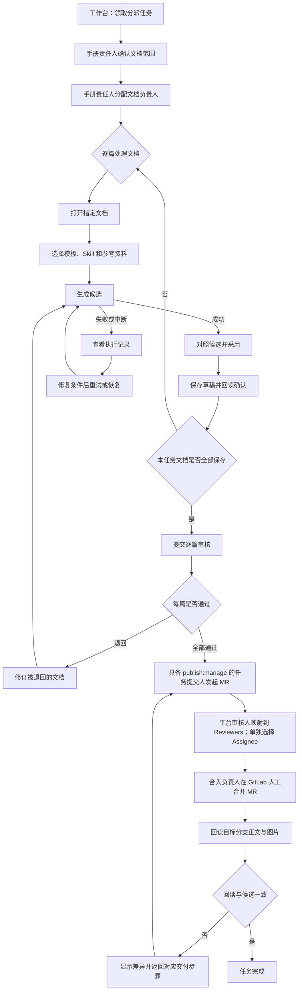

# 知识中心任务执行端到端流程与下一步引导

日期：2026-11-05
状态：四类角色与交接规则已确认；按钮驱动版效果稿待用户确认，确认前不改产品代码

## 1. 目标

用户从工作台领取一项文档任务后，应始终能在当前页面看清任务进度、当前文档、责任人和唯一主操作。完成当前操作后，平台根据真实服务端状态跳转到下一项具体业务对象；用户不必猜该进入哪个模块。按钮名称直接说明执行动作，不依赖旁边的小字解释。

本设计不复制文档、审核或 GitLab 的业务状态。源模块仍是业务事实的权威来源；任务执行页负责展示关联关系、跨阶段进度、下一步深链和返回上下文。

## 2. 业务流程图

### 状态边界

- 每篇文档分别记录编写、保存、审核结论；只有任务范围内每篇文档均审核通过，才能进入创建 MR。
- 某篇文档被退回，只使该篇的旧审核结论失效；已通过的其他文档保留结论，但交付仍等待全部通过。
- MR 创建成功不代表任务完成。只有人工合并后，目标分支正文和图片回读一致，任务才完成。
- 等待他人审核、合并或回读时，任务进入“跟进中”，不显示为当前用户可执行动作；产生当前用户动作后再回到“待我处理”。
- AI 生成失败或中断时，任务仍停留在该文档的编写步骤；保留输入、来源和已产生的执行记录，展示恢复/重试入口，不伪装为文档已完成。

## 3. 页面方案

采用现有知识中心应用外壳与已有模块页面：工作台继续用“我的工作”列表发现事项，文档编写继续使用现有文档目录、正文编辑器和右侧 AI 对话，审核继续使用“审核与发布”工作区。各登录用户只看到分派给本人且具备权限的角色事项；同一用户兼任多个角色时，每种职责分别进入对应模块和任务视图，不把不同角色的操作混排到一张跨角色待办清单。

效果稿 HTML 顶部的角色切换仅用于预览四个登录视角，不是线上产品的新增角色切换控件。线上按当前会话权限、资源责任及审核/MR 分派计算可见内容。

### 用户类型与主要工作项

| 工作视角 | 权威职责依据 | 主要工作项 | 主要按钮/动作 | 交接条件 |
|---|---|---|---|---|
| 手册责任人 | 对整本手册交付、责任分工及生产批次负责 | 先确认本次文档范围，再为范围内文档分配负责人并跟踪逐篇状态 | “确认文档范围”“分配文档负责人” | 范围确认后才开放负责人分配；分配完成后进入文档撰写人待办 |
| 文档撰写人 | 编写被分配的文档/章节 | 阅读文档、调用 AI 生成/修订/续写、比较候选、保存草稿、提交审核 | “打开文档编辑器”“生成候选”“保存草稿”“提交审核” | 保存的指定 revision 被提交后，建立逐篇审核事项 |
| 文档审核责任人 | 对被分配的固定候选版本逐篇审核 | 阅读冻结候选与依据、提交意见、逐篇通过或退回 | “通过本篇”“退回修改” | 范围内每篇均通过后，授权提交人可发起 MR；退回仅回到对应撰写人 |
| GitLab 合入负责人 | MR 的 Assignee，不是知识中心全局业务角色 | 在 GitLab 处理被指派 MR；人工合并后回到平台刷新交付状态 | “打开 GitLab MR”“刷新合并与回读状态” | 平台回读目标分支正文及图片一致后，交付完成 |

其他职责边界：大纲责任人与模板责任人的工作不属于上述文档交付任务，不放入这四个视图。平台发布者也不纳入本次范围。MR 创建者不是新增平台角色：服务端依据 `publish:manage` 决定是否可创建；有权限的任务提交人创建 MR，并在该动作中单独选择合入负责人。平台审核指派去重映射为 GitLab Reviewers，所选合入负责人映射为 GitLab Assignees；合入负责人不自动获得平台发布权限，平台不自动合并。

### 页面区域

1. **沿用现有导航与页面标题**：使用知识中心管理现有侧栏、导航名称、页面宽度、表格/白底工作区、颜色和组件，不另造品牌侧栏或第二套设计系统。
2. **角色独立工作视图**：每个视图只呈现该责任人的待办、对象及动作。关系信息用工单→手册→文档上下文提供，不把责任人不同的事项混成一个可操作清单。
3. **文档撰写视图复用现有写作页**：保留平台文档目录与富文本编辑区；右侧 AI 对话显示当前生成状态、历史、失败执行记录、重试和候选操作。不能重新创建一套与平台编辑器无关的演示工作台。
4. **审核视图复用现有审核工作区**：逐篇展示冻结候选、差异、意见与审核决定；不在作者或 MR 合入负责人视图代办审核。
5. **MR 合入视图使用已有交付记录**：显示 GitLab Reviewer、Assignee、MR 状态和目标分支回读；在 GitLab 人工合并，不在平台画一个虚假的“合并”写操作。
6. **动作只属于当前责任人**：显示当前责任人的具体主按钮和已满足/未满足门禁；无权限角色显示只读状态或不显示操作，不用小字解释其他人的工作。

### 页面引导方案比较与选择

| 方案 | 页面做法 | 优点 | 代价 | 评估 |
|---|---|---|---|---:|
| A. 全链路进度图 | 每个任务页顶部重复显示范围、写作、审核、MR、回读等步骤 | 全流程可见 | 抢占页面首屏；角色页面重复显示无权执行的阶段；手机端易挤压/横滚 | 72/100 |
| B. 独立任务进度侧栏 | 从任务页打开侧栏查看阶段、负责人和历史交接；页面主操作仍独立 | 全貌清晰，适合手册责任人跟进 | 用户需额外打开侧栏；不直接完成交接 | 84/100 |
| C. 按真实状态开放交接按钮（选用） | 当前角色完成操作后，通过按钮进入下一业务对象；无权阶段不展示为操作；页面只保留任务状态、当前对象和主按钮 | 操作本身构成路径；不用解读流程图；页面空间留给当前工作 | 需要后端状态、权限和深链契约可靠，跨角色任务仍需在待办中通知下一责任人 | 93/100 |

选用 C。完整流程图只保留在设计文档中；产品页面不重复展示图形步骤条。状态只回答“当前是什么状态”，按钮回答“我现在能做什么”。例如：“范围待确认”旁为“确认文档范围”；确认后“分配文档负责人”开放；作者保存后可“提交审核”；审核人逐篇处理；全部通过后仅具 `publish:manage` 的任务提交人看到“创建 GitLab MR”；合入负责人处理 MR 后点“刷新合并与回读状态”。交接按钮必须携带任务/文档/MR 稳定标识，并深链到下一业务对象，禁止只跳模块首页。

效果稿角色切换条仅用于评审批量查看四类权限视图，线上不增加该控件。按钮点击反馈用于模拟交接；真实产品需由服务端返回状态、深链和权限，不以前端本地状态当作业务事实。

### 术语与按钮规则

- 使用动作 + 对象，例如“确认文档范围”“分配文档负责人”“生成候选”“保存草稿”“提交审核”“通过本篇”“退回修改”“创建 GitLab MR”“打开 GitLab MR”“刷新合并与回读状态”。
- 操作未满足前置条件时不提供可点击按钮；必要时显示当前状态，避免用一排灰色按钮或进度图解释不可用原因。
- 失败提示直接使用可执行结果，例如“生成失败”“查看执行记录”“重新生成候选”。详细错误放入执行记录，保留错误码、阶段、requestId 和恢复动作。
- 不使用“下一步”“去处理”“继续”等依赖上下文猜测的按钮名称。

### 自适应布局

- 宽屏：任务关系/文档目录、当前工作区、操作区三栏；AI 对话栏可拖动调整并可收起。当前阶段和主操作保持可见。
- 中等宽度：目录收为可展开抽屉；正文与 AI 对话并列，操作区固定在 AI 面板底部。
- 窄屏：使用单栏当前任务内容；主操作在当前工作区可见且不遮挡正文和键盘焦点。桌面工作区采用容器宽度响应布局，不只依据浏览器 viewport。
- 文档正文与 AI 对话各自纵向滚动；滚动条样式浅且位于所属内容边界内，不能造成正文被遮挡或分栏误读。

## 4. 效果稿

[打开按四类责任视图分开的完整效果稿](./知识中心-任务执行-端到端任务工作区-效果稿.html)

桌面与窄屏截图（均为效果稿演示数据，不代表平台真实任务）：

- `runtime/test-results/task-flow-button-led-review-final-20261105/01-owner-confirm-scope.png`
- `runtime/test-results/task-flow-button-led-review-final-20261105/02-owner-assign-author.png`
- `runtime/test-results/task-flow-button-led-review-final-20261105/03-author-mobile-before-submit.png`
- `runtime/test-results/task-flow-button-led-review-final-20261105/04-author-desktop-before-submit.png`
- `runtime/test-results/task-flow-button-led-review-final-20261105/05-reviewer.png`
- `runtime/test-results/task-flow-button-led-review-final-20261105/06-authorized-submitter-task-detail.png`
- `runtime/test-results/task-flow-button-led-review-final-20261105/07-select-mr-assignee.png`
- `runtime/test-results/task-flow-button-led-review-final-20261105/08-merge-owner.png`
- `runtime/test-results/task-flow-button-led-review-final-20261105/09-waiting-manual-merge.png`

效果稿按确认的四类责任逐屏展示，移除撰写页顶部流程条，改为显示当前文档、负责人及草稿状态；每页只提供该角色当前可执行动作。演示原型可点击确认范围→分配负责人→保存草稿/提交审核→逐篇审核→从任务详情由具备 `publish:manage` 的任务提交人选择 Assignee 并创建 MR→合入负责人刷新回读，检验交接路径和页面表现。MR 创建入口不放在手册责任人的任务列表；状态刷新不会虚构 GitLab 已合并，只有真实服务端回读确认后才显示完成。所有任务、人员、MR 均为虚构演示数据。

## 5. 评分与验收

### 效果稿预评估：93/100（静态方案评估，未经过目标用户可用性测试）

| 维度 | 得分 | 依据 |
|---|---:|---|
| 平台视觉与导航一致 | 24/25 | 沿用知识中心导航、模块名及编辑/审核工作区，不在产品页重复放流程图 |
| 角色与权限边界 | 24/25 | 四种责任视图独立；MR 创建按 `publish:manage` 控制，不把审核与合入混为同一权限 |
| 流程与主操作清晰 | 24/25 | 实际按钮从状态门禁进入下一业务对象；完整链路和异常分支写入设计文档 |
| 响应式与可访问性 | 21/25 | 有响应式布局、语义按钮与焦点状态；仍需真人、读屏器和真实权限/API 验收 |

93 分是设计评审量表的预估分，表示方案目标超过 90 分，不等于保证用户实测得分。最终分数需至少 5 名目标用户按职责完成任务后测量；未实测前不能宣称真实体验已达到 90 分。用户确认本效果稿后，再进入产品实现。

### 90 分验收门槛

- 至少 5 名未参与设计的目标用户分别按其职责使用视图，至少 4 人无需口头提示完成自己角色的关键操作；不同角色不得互相误点代办。
- 每个关键阶段用户都能在 5 秒内说出当前步骤、责任人和唯一主操作；按钮不依赖说明小字才能理解。
- 逐篇审核退回、生成失败/中断、MR 创建失败、人工合并等待、回读不一致均能回到正确对象和动作；不丢失已确认来源、草稿或审核结论。
- 真实 API 验证每个阶段状态和深链；创建 MR 后不自动合并，只有目标分支正文与图片回读一致才标记完成。
- 1440px、1024px、768px、390px 下无内容遮挡或页面横向溢出；键盘可完成阶段切换、主要动作和返回。

## 6. 实施顺序

1. **P0 任务与动作契约**：逐项核对任务、手册、文档、审核、MR 和回读对象的稳定 ID、权威状态、当前责任人、主操作 API 与返回路由；补齐失败原因和执行记录关联 ID。未具备真实来源的下一步不得在界面假造完成态。
2. **P1 页面工作区**：根据本概要设计细化任务工作区，连接现有模块深链；确保每个状态只有明确的主操作。
3. **P1 端到端验证**：以隔离测试工单覆盖成功、失败、退回和等待；真实 API 回读正文/图片；MR 只创建不合并。
4. **P2 人因与容量**：新手可用性走查、视口自适应与辅助技术检查、真实账号性能及任务量压测。

本效果稿只交付流程和界面方案，没有修改产品页面或声称端到端已完成。
