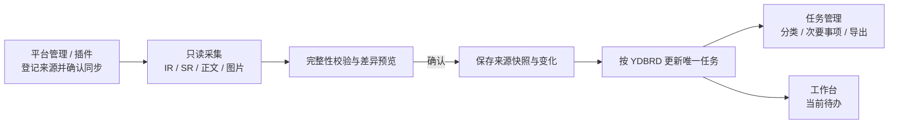
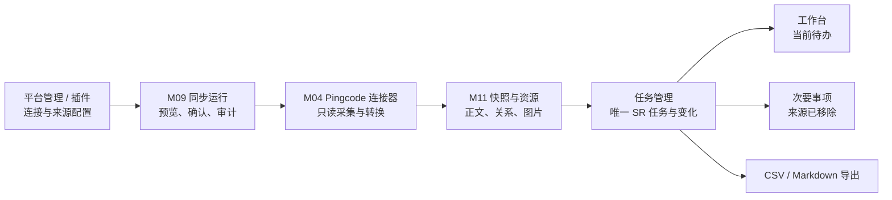
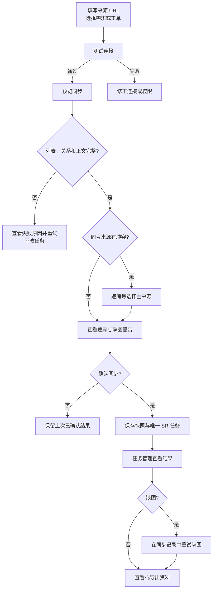
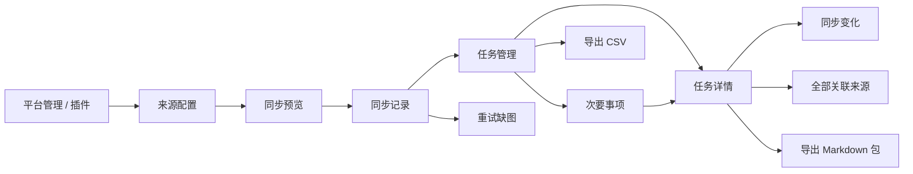
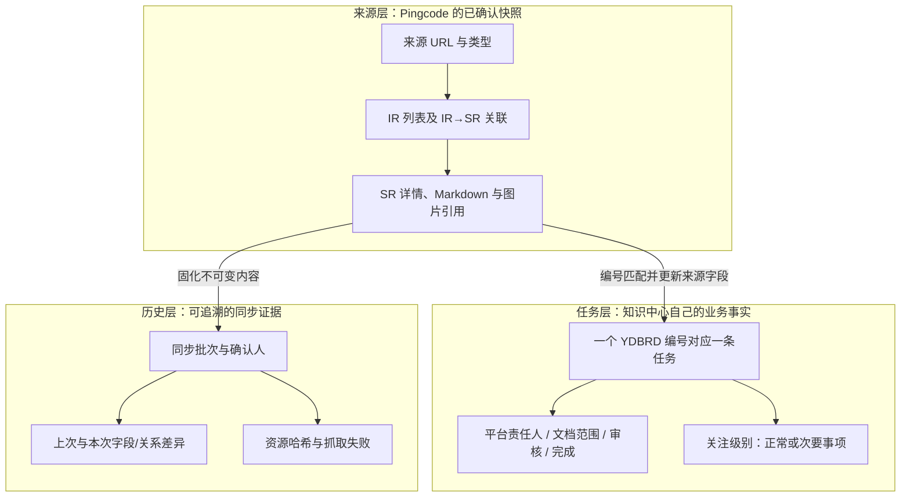
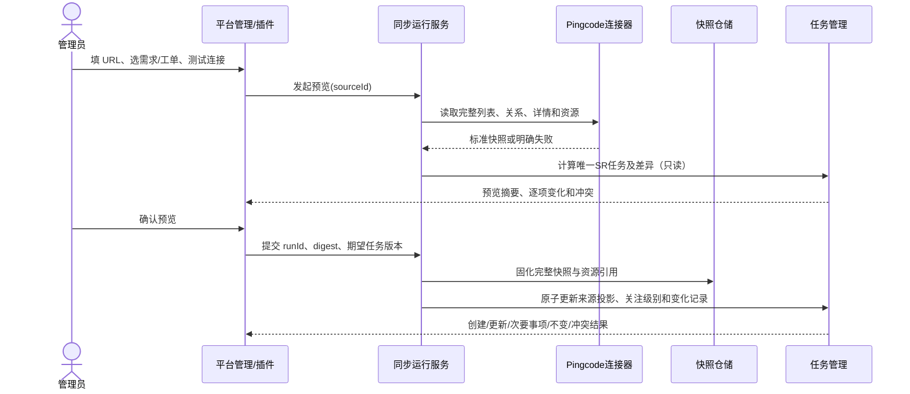

# 知识中心任务管理：Pingcode 需求基线同步概要设计

> 版本：0.8.2（实施基线）
> 日期：2026-11-11
> 状态：业务裁决与确认门槛已明确；结构化关联和工单视图接口已只读实测，按所选视图筛选结果同步

## 1. 目标与边界

用户输入 Pingcode URL 并选择“需求”或“工单”，平台读取来源内的用户需求（IR，`YASHAN-*`）及其**实际关联**的系统需求（SR，`YDBRD-*`），预览后按 SR 生成或更新任务。两类来源均以全局唯一的 `YDBRD-*` 为任务粒度；同一编号只保留一条当前任务，并可查看上次与本次同步的差异。已在知识中心完成的 SR 保持“完成”，后续同步不能使其重新进入待办。当前来源不再需要处理的未完成任务保留，进入单独的“次要事项”页面，默认主列表不展示。任务可按类型分类查看，可导出 CSV；每条 SR 的描述可导出带图片的 Markdown 包，正文与资源快照保存在平台，供后续文档生产引用。

不以 IR 为任务最小粒度，不从 IR 正文中的 `YDBRD-*` 字样推断关联，不自动改动 Pingcode。现有 Excel/JSON 导入继续可用；本设计不改变文档审核和 GitLab 交付门禁。页面打开遵循仓库的 100ms 约束：先呈现已有列表，远程同步与资源抓取走显式异步操作，不计作页面首屏等待。

### 术语与已知事实

| 术语 | 本设计含义 | 证据/状态 |
|---|---|---|
| IR | Pingcode 基线里的 `YASHAN-*` 用户需求 | 用户定义；现有基线接口能读取 IR 列表 |
| SR | IR 关联的 `YDBRD-*` 系统需求；任务创建粒度 | 用户定义；**关联接口及字段尚未验证** |
| 工单 | 导入者填写 URL 时指定的来源类型，同样以 `YDBRD-*` 建任务 | 用户已确认；不能仅由编号推断 |
| 来源快照 | 一次同步读到的结构化字段、原始正文、规范化 Markdown、资源及读取时间 | 拟新增；不能冒充已实现 |

只读实测：`y28FbpmM` 基线接口返回 59 条 IR，`FamqqMdv` 返回 35 条 IR。基线需求详情中的版本 ID 和 IR 主体 ID 可用于 `GET /api/ladon/relation/related-items?principal_id={ideaId}&principal_name=idea&target_name=work_item&version_id={versionId}`；响应 `data.value` 返回关联工作项的稳定 `_id`、`whole_identifier`、`project_id` 和正文。样本 `YASHAN-1473` 关联 `YDBRD-55130`。旧参考接口只返回合并 Markdown，不能用于关系同步。工单地址 `/pjm/projects/YDBRD/defect/nGn-Krlo` 是缺陷**列表视图**，其 `nGn-Krlo` 是视图 ID；`POST /api/agile/projects/{projectId}/defect/views/{viewId}/content` 返回 `count/page_count/page_index/page_size/value`。用户确认只同步该视图当前筛选结果，不扩大为项目的全部约 47136 条缺陷。连接器必须复核视图归属、完整分页及所返回的 `YDBRD-*` 身份。

## 2. 业务全貌与能力边界

这项需求从管理员登记来源开始，到业务人员查看任务和导出资料结束。平台只读取 Pingcode；**同步完成**表示本次来源已完整抓取、预览经过确认、任务和快照已保存，不表示文档已编写或任务已完成。

| 阶段 | 使用者与入口 | 必须得到的结果 | 能力边界与失败处理 |
|---|---|---|---|
| 1. 登记来源 | 管理员，平台管理 → 插件 | 一条带连接实例、URL、人工指定类型的来源配置 | 仅登记受支持的只读来源；URL 不等于授权。未验证连接不能启动同步 |
| 2. 抓取来源 | 管理员发起，连接器后台执行 | 需求来源得到完整 IR 列表及结构化 IR→SR 关系；工单来源得到完整 YDBRD 列表；逐条取得详情、正文和资源 | 不从文本猜关联；分页、权限或关键字段不完整时标记失败，不能生成可确认的任务差异 |
| 3. 预览变化 | 管理员，插件 → 同步预览 | 按编号展示新增、来源字段变化、关系变化、移入/恢复次要事项、冲突和失败 | 预览只读；未确认不改任务；同号来源冲突必须裁决 |
| 4. 确认同步 | 管理员，插件 → 确认同步 | 每个 YDBRD 最多一条任务，保存本次不可变来源快照和前后差异 | 平台责任人、审核、MR、完成状态不由 Pingcode 改写；预览过期返回冲突并重新计算 |
| 5. 使用结果 | 任务人员，任务管理和工作台 | 按需求/工单及 IR 查询；来源移除的未完成任务在次要事项；可查看变化与原始资料 | 次要事项不是完成或删除；未授权用户不能通过详情、导出、资源 URL 绕过任务可见性 |
| 6. 导出 | 有任务查看权限的人员 | 当前筛选结果 CSV；单条 SR 的 Markdown 或含图片 ZIP | 导出使用已确认快照，不临时重抓网页；字段、资源和失败格式遵循第 8 节 |



**业务不变量**：`YDBRD-*` 全局唯一；IR 是上游关联信息而非任务；每条来源的类型由配置指定，任务当前类型由主来源决定；同一 SR 跨来源只保留一条任务；已完成任务不复活；来源负责人不改派平台责任人；同步失败不移走任务；来源移除只改变关注级别，不改变业务完成状态。现有 Excel/JSON 导入是并行入口，遇到同号任务也须使用相同唯一键并在预览中说明来源冲突。

**一次同步的完成定义**：指定来源的列表、关系和 SR 关键正文读取完整，冲突已处理，管理员确认，任务与不可变来源快照一同提交。图片读取失败可以带警告确认，但不得显示“资料完整”；资源修复另记版本。任务的“完成”仍只由现有文档交付规则决定。

**不在本期能力内**：写回 Pingcode、自动完成/关闭任务、自动调整文档范围或审核决定、凭正文关键字推断 IR→SR、管理员上传任意执行代码插件、无确认的定时自动同步。后续平台接入可复用连接器能力声明和快照契约，但不能因此承诺所有外部平台均能提供 IR→SR 关系。

## 3. 模块归属与页面落点

本设计沿用[平台总体架构](./知识中心-平台-总体架构-概要设计文档.md)的 M01/M04/M09/M11/M12 边界。用户所说的“平台治理”在当前界面对应“平台管理”，其中现有“系统治理、人员管理、用户权限、GitLab 仓库、Agent&模型服务”标签；本需求在同级新增 **“插件”标签**，建议路由为 `/knowledge-center/platform?tab=plugins`，不增加一级导航。旧的“导入工单”保留为任务管理中的文件导入入口。

| 模块/现有归属 | 本需求承接的功能 | 不承接的功能 |
|---|---|---|
| 平台管理 / 插件（M12） | 登记 Pingcode 连接实例；配置来源 URL、来源类型（需求/工单）、同步策略和能力权限；测试连接、发起预览和确认同步；查看运行记录 | 不保存文档任务的业务分派或正文副本，不直接持有浏览器可见凭据 |
| 来源管理与连接器运行（M04） | 按已登记插件能力调用 Pingcode，只读抓取 IR、关联 SR、详情及图片；转换标准化快照，校验完整性 | 不决定平台任务的责任人、完成状态或优先级 |
| 平台长任务与审计（M09） | 分页抓取进度、取消/重试、失败原因、确认记录与审计 | 不解析 Pingcode 私有字段 |
| 任务管理（现有 `document-tasks`；与 M01 待办投影衔接） | 以 `YDBRD-*` 唯一任务键确认导入；显示 IR 与类型列、次要事项、同步变化；导出 CSV 和 SR Markdown | 不保存连接密码，不直接访问 Pingcode API，不在列表页配置同步 URL |
| 工作台（M01 投影） | 显示当前需处理任务，不计入次要事项；深链进入任务详情 | 不另建一套来源状态 |
| 持久化与资源仓储（M11） | 保存快照正文、结构化关系、差异元数据、图片资源引用及审计；提供一致性读取 | 不根据表内字段自行判定业务任务完成 |

下图只表示**模块交接和数据去向**；各模块的责任边界以上表为准。



“插件”首屏为连接实例清单，列为插件名称、提供方、启用能力、连接状态、最近同步和操作；选中 Pingcode 后进入“连接配置 / 来源配置 / 同步记录”视图。来源配置一行一个 URL，必须手选“需求”或“工单”，显示解析出的产品/基线或列表标识、最近完整同步时间、SR 数和状态。主要操作是“测试连接”“预览同步”“确认同步”；确认前展示新增、更新、移入次要事项、恢复、失败及字段差异。任务管理页只提供“查看来源配置”深链，不能再次出现一套 URL 配置表单。插件名称是受控连接器版本，不开放管理员上传任意可执行代码；后续平台按同一能力声明接入其他系统。

| 插件来源配置字段 | 必填 | 校验/显示规则 |
|---|---|---|
| 连接实例 | 是 | 选择已授权、已启用的 Pingcode 连接；无权时只显示不可用状态 |
| 来源名称 | 是 | 管理员可读名称，同一连接内不重复 |
| 来源类型 | 是 | 单选 `需求` / `工单`；任务列表“类型”列取主来源的此字段，不从编号推断 |
| 来源 URL | 是 | 服务端按连接器类型校验主机、路径、产品归属；规范化后作为来源唯一键的一部分 |
| 同步方式 | 是 | 首版仅“手动预览并确认”，避免未验收的自动写入 |
| 最近同步 | 系统生成 | 完整抓取时间、确认人、成功/失败、IR/SR 数；失败保留上次成功快照 |

连接状态为“未配置、可连接、已停用”；同步运行状态由第 4 节定义，两者不进入任务业务“状态”列。配置被停用时保留任务、快照和历史，停止新的读取；不会把所有关联任务误标记为来源已移除。

插件最小能力声明拟为 `listItems`（完整分页）、`getItem`（详情与更新时间）、`listRelations`（IR→SR，仅需求型来源）、`fetchResource`（图片/附件）、`healthCheck`。这些是平台内部接口，不假定 Pingcode 官方 API 与其同名；其他平台可以只实现适用能力，未实现关系能力时不能宣称支持需求基线任务同步。连接器返回标准快照，模块间不传浏览器 Cookie 或原始访问令牌。

## 4. 用户流程与确认门槛

下图表示**管理员实际操作与阻断分支**；缺图允许带警告确认，结构化关系或关键正文缺失则不能确认。



| 用户所见动作 | 页面立即显示 | 后台完成后可做什么 | 不可确认的情况 |
|---|---|---|---|
| 测试连接 | 连接、来源类型和 URL 校验结果 | 成功后可预览同步 | 身份、权限或来源归属无法验证 |
| 预览同步 | `runId`、进度、取消入口；完成后展示差异和缺图清单 | 完整预览且冲突已裁决时可确认 | 列表/关系/关键正文不完整，或预览过期 |
| 选择主来源 | 同号 SR 的各来源类型、标题、更新时间、正文差异与既有选择 | 保存逐编号裁决到当前预览，再重新计算摘要 | 有同号异类型/来源字段冲突却未选择 |
| 确认同步 | 新增、更新、未变化、次要事项、警告数量及批次链接 | 可在任务详情查看来源、变化和资源 | 权限不足、任务版本变化、摘要不匹配或资源暂存失败 |
| 重试缺图 | 原失败原因、资源重试进度和结果 | 资源修复成功后可导出完整资源包 | 不改任务字段、IR 关系、类型或原确认快照 |

取消仅终止未确认的后台采集。同步记录必须区分“采集中、待确认、已确认、已确认有缺图、失败、已取消”，并保留上次成功批次；缺图警告是资料完整性，不是任务业务状态。

预览必须先显示：来源类型、来源名称、SR 去重数、创建/更新/不变/来源变化/冲突/失败数；需求基线另显示 IR 总数、有关联 SR 的 IR 数和无 SR 的 IR 数。无 SR 的 IR 仅在预览列出，不创建任务。单条 SR 显示编号和标题、关联 IR（工单无 IR 时为空）、类型、来源链接、将更新的来源字段、上次值与本次值、是否已完成、缺失资源及错误原因。分页不全、关系读取不全时本次预览标记为不可确认；不把部分数据伪装成完整同步。

## 5. 页面信息结构

下图表示**从配置到结果的页面入口**，不重复第 4 节的采集与确认判定。



| 页面 | 默认关注内容 | 次级入口 |
|---|---|---|
| 平台管理 → 插件 | 连接、来源、最近同步和“预览同步” | 同步记录、缺图重试、来源配置 |
| 同步预览 | 新增/变化/冲突/缺图的数量，逐编号差异和“确认同步” | IR 无 SR 清单、失败明细、主来源选择 |
| 任务管理 | 当前任务列表、IR 与类型筛选、来源和状态 | 次要事项、CSV 导出、来源配置深链 |
| 任务详情 | 当前业务状态、关联 IR、主来源、正文与资源 | 同步变化、全部关联来源、Markdown 包 |

主列表维持现有字段顺序，在“编号”后增加 **IR**，在“来源”前增加 **类型**：编号、IR、描述、责任人、产品、版本、状态、开始时间、结束时间、输出件、类型、来源。IR 多值时显示编号及数量，详情列出全部 IR 和所属基线；不能为满足单列表格列而丢弃多对多关系。来源类型由导入者在填写 URL 时选择；任务类型取已确认的主来源，不从编号推断；类型筛选默认“全部”。同一 SR 跨来源再次同步后，列表仅展示主来源的当前值，详情的“同步变化”展示所有来源的历史批次、字段、上次值、本次值、变更时间和来源 URL。

“次要事项”是任务管理内的独立页面入口，默认不打开，不占主列表与工作台待办；页面集中显示标记为“来源已移除 · 当前无需处理”的未完成任务、原状态、最后出现的来源、移入时间和来源变化入口，供责任人按需人工处理。点击仍进入原任务详情，不复制任务，也不自动关闭。已完成任务按原“完成”展示，不能因来源消失改成次要待办。导出 CSV 使用当前页面的过滤条件与固定列顺序；主列表导出默认不含次要事项，次要事项页面可单独导出，并对换行、引号和公式前缀做安全转义。

## 6. 数据与职责

本节说明**哪一层保存什么事实**，不提前规定数据库表名。一个来源可包含多个 IR，一个 IR 可关联多个 SR；同一 SR 可出现在多个 IR 或来源中，但平台始终只有一条编号相同的当前任务。关系的每次变化属于来源历史，不能靠覆盖当前任务行来保存。



| 事实 | 唯一归属 | 保存内容 | 更新与读取约束 |
|---|---|---|---|
| 来源配置 | 平台管理 / 插件（M12） | 连接实例、规范化 URL、人工类型、启用状态 | 管理员维护；停用只停止读取，不等于来源移除 |
| 来源快照 | 连接器与仓储（M04/M11） | 本次完整 IR/SR 集合、结构化关系、SR 原始详情（脱敏）、Markdown、抓取时间、版本/哈希 | 确认后不可变；不同来源/批次分开存；当前任务仅引用最新已确认快照 |
| 图片资源 | 公共资源仓储（M11） | MIME、大小、SHA-256、受控引用、抓取结果；二进制按哈希保存 | 不向浏览器暴露上游 Cookie、令牌或永久公开资源路径；按任务可见性回读 |
| 同步运行与差异 | 平台长任务与仓储（M09/M11） | 批次、操作者、预览摘要、确认结果、上次/本次字段和 IR 关联差异 | 失败批次可查但不成为“当前”；变化列表须能追溯来源及确认时间 |
| 当前任务 | 任务管理 | 全局唯一编号、主来源决定的类型与来源字段、全部关联 IR 的当前投影、平台责任人、业务状态、审核与交付事实 | 来源字段按主来源已确认快照更新；平台分派、已完成、审核和 MR 不因同步重置 |
| 关注级别 | 任务管理 | `normal` / `secondary`、原因 `source_removed`、移入时间和判定批次 | 与任务状态正交；次要事项默认从主列表/工作台排除，人工仍能进入详情 |

**一次确认的写入顺序**：先验证快照完整性、主来源裁决、预览摘要与任务版本，再在平台存储事务中固化来源快照、关系变化、任务来源投影和同步审计；已抓取的图片二进制先完成受控暂存和哈希核对，事务提交后才让资源引用对外可读。缺图只固化失败记录，不生成虚假的资源引用。任何一步失败都不能出现“任务已更新但快照不存在”。跨数据库与资源仓储的提交/清理策略、具体表名及迁移在详细设计确定。

存储目标为 YashanDB：保存脱敏结构化响应、Markdown 正文、关系、资源元数据、同步批次和差异。图片二进制暂按哈希存受控资源仓储，数据库保存稳定引用；是否强制 BLOB 入库、保存期限及容量预算仍待确认。运行中的临时文件只写 `runtime`，知识资源归档遵循 `knowledge` 边界，`external` 独立。

### 已调研能力的复用决定

| 能力 | 已核对的一手依据 | 本设计处理方式 |
|---|---|---|
| Pingcode 读取 | 仓库 `PingCodeAPIClient` 已有会话、产品/基线验证和完整分页；现有参考接口只返回合并 Markdown | 复用客户端和基线读取；IR→SR 关系与工单列表接口须在企业实例只读探测，未证实前不生成任务 |
| HTML/表格转 Markdown | 仓库已有 `html_to_markdown`、Cheerio HTML 适配器；[Turndown](https://github.com/mixmark-io/turndown) 与 [GFM 插件](https://github.com/mixmark-io/turndown-plugin-gfm) 支持转换与普通表格 | 用同一真实 SR 样本比较现有转换器与候选库；复杂合并单元格保留安全 HTML 表格，质量提升且依赖获准时才引入新包 |
| 图片 | 仓库 `source-image-resources.js` 已做哈希、MIME 与大小校验，Pingcode 客户端有受控图片下载 | 抽取公共受控资源层；任务快照与文档生产各自持有权限，不复用文档生产专属 URL |
| CSV | 现有 XLSX 导入能力；[node-csv](https://github.com/adaltas/node-csv) 的 [公式转义选项](https://csv.js.org/stringify/options/escape_formulas/) | 固定下述字段契约，比较现有 XLSX 导出与 `csv-stringify` 的转义/流式能力；不自行实现 CSV 解析与序列化 |
| 集成框架 | [Nango](https://github.com/NangoHQ/nango) 提供 Auth/Proxy/Functions，[Airbyte](https://github.com/airbytehq/airbyte) 提供连接器和同步治理；[社区 Pingcode Skill](https://github.com/situjunjie/pingcode-skill) 有工作项 API 示例 | 借鉴连接配置、运行历史和能力声明；当前仓库已有 M12/M04/M09，不整体引入额外服务。社区 Skill 未证明基线关系能力且许可证未核实，不复制代码 |

逐项来源、许可证及验证矩阵见[开源能力调研](../11-参考资料/知识中心-Pingcode需求同步与内容导出-开源能力调研-20261111.md)。没有证据支持“现成开源项目可直接完成本平台的 IR→SR→任务分派闭环”；重用成熟转换/序列化组件与现有连接器，并保留本平台特有的任务规则。

## 7. 采集与转换方案

1. **地址校验**：在“平台管理 / 插件”配置来源。需求基线只接受允许的 HTTPS Pingcode 主机与 `/ship/products/{product}/baselines/{id}/ideas` 路径；工单 URL 路径待样例验证后加入白名单。拒绝凭据 URL、任意跳转与内网任意地址。服务端按当前已授权 Pingcode 会话读取，权限失败提示重新授权。
2. **来源与关系**：需求基线复用产品/基线归属和完整分页校验，按每条 IR 的版本 ID 与主体 ID 读取 `target_name=work_item` 的结构化关联，再按稳定工作项 ID 核对 SR 详情；只接受项目 `YDBRD` 的 `YDBRD-*` 项。工单来源只接受项目 `YDBRD` 的缺陷视图 URL，按视图当前筛选条件完整读取 `content` 分页，不能退化为整个项目的全部缺陷。若归属、关系、分页或关键字段无法验证，停止确认并保留预览诊断。
3. **正文与资源**：把现有网页来源的 HTML/结构化正文转 Markdown、表格处理和图片抓取/托管提炼成公共来源快照能力。保留表格行列及链接；图片统一变为平台可读的资源引用，并记录原 URL、哈希和抓取失败原因。所有下载受 MIME、大小、数量、超时、重定向和权限限制；Markdown 渲染进行安全清理。
4. **预览与确认**：由平台管理“插件”标签发起；复用当前 `/document-tasks/import?preview=true` 的“预览摘要 + 摘要校验 + 确认”思想，但 Pingcode 同步需独立的异步采集与快照契约，不能把浏览器请求保持到全部图片下载结束。确认时校验预览版本、任务修订和上游基线状态；过期则要求重新预览。
5. **最新值与幂等合并**：以全局唯一的 `YDBRD-*` 编号定位现有任务；同一 SR 跨基线只保留一条当前任务。每个来源独立保存本次 Pingcode 标题/描述、上游负责人、上游日期等最新字段；任务当前投影只取已选主来源的最新已确认快照，并形成可查询的逐字段变化记录，未变化不重复记差异。平台责任人是任务分派结果，**不因 Pingcode 负责人变化而改派**；已完成任务继续标记完成，任务范围、审核意见、MR 和交付事实也不因来源同步重置。任务编号或来源身份冲突逐条展示，不静默新建副本。
6. **来源消失与次要事项**：以一次“来源核对轮次”判断消失：管理员从同步预览选择“核对关联来源”，系统将该 SR 曾关联的所有仍启用来源纳入同一轮次；这些来源都取得完整且已确认的快照后，才能比较是否仍包含该 SR。单独同步一个来源不会触发移入次要事项。一个来源不再包含 SR 时，仅记录该关联变化；另一来源仍包含它时保持正常。全部关联来源都不再包含且任务未完成时，保留任务和历史，设置 `TaskAttention=secondary`，显示“来源已移除 · 当前无需处理”，从主列表和工作台待办移入独立次要事项页面，供人工处理；这不是“已完成”、自动关闭或删除。来源停用、同步失败、分页不全、来源未同步或只读权限失效均使本轮结论保持“未知”，不能据此判定“消失”。后续完整轮次再次出现并确认后恢复 `normal`，保留原业务阶段和审核/交付事实；已完成任务不复活。Pingcode 全局删除与从某基线移除关系分别记录。
7. **导出**：CSV 从已确认任务投影生成。单个 SR 导出 `YDBRD-xxx.md` 和其 `assets/` 图片文件的 ZIP 包，Markdown 使用相对路径，附来源 URL、快照时间和资源清单；导出失败项和缺图清单可见。纯文本无资源时可直接下载 `.md`。

### 跨来源裁决规则

同号 SR 可以同时属于多条 IR 和多个来源；**来源关联不等于任务类型**。用户确认采用“管理员选择主来源”：主来源决定任务当前类型、标题、正文、来源 URL 和可导出的默认正文；其他来源及其 IR 关系继续保存并可在详情中查看。选择按 `YDBRD` 编号持久化，不能因下一次同步的先后顺序自动改变。

| 情形 | 预览处理 | 确认后结果 |
|---|---|---|
| 首次只有一个来源 | 自动将其设为主来源并显示 | 按该来源类型和字段建立唯一任务 |
| 新增同类型来源，字段相同 | 显示新增关联，不阻断 | 保持原主来源；IR 关系取所有当前有效需求来源的并集 |
| 新增异类型来源，或同号来源字段冲突 | 标记冲突；管理员必须逐编号选择主来源并看到字段差异 | 类型和来源字段取选定主来源；保留其他来源快照和裁决人、时间、批次 |
| 已选主来源更新 | 显示上次/本次字段差异 | 按主来源最新已确认值更新来源字段；不自动改派平台责任人 |
| 主来源从其基线移除，但其他来源仍有 SR | 提示原选择已失效；要求重新选择当前有效主来源 | 只在选择后改变类型和来源字段，不移入次要事项 |
| 无任何有效来源或核对轮次不完整 | 无有效来源且本轮完整时标记移入次要事项；轮次不完整时标记“待核对” | 前者仅改变关注级别，后者保持上次已确认任务投影 |

管理员选择写入预览摘要，确认时服务端再次校验可选来源、配置版本和任务版本；重复确认同一批次只返回原结果。若同一个 `YDBRD` 对应两个不同的稳定上游工作项 ID，先按身份冲突阻断该编号，不能只凭编号合并。现有 Excel/JSON 导入同号任务时也必须在预览中展示来源并保留平台既有业务事实；它不能自行改写 Pingcode 主来源裁决。

### 正文与图片的确认级别

| 采集结果 | 能否确认 | 对用户显示与后续处理 |
|---|---|---|
| 列表、IR→SR 关系、SR 编号及关键正文完整，图片全部成功 | 可以 | “资料完整”，可预览和导出完整 Markdown 包 |
| 上述关键内容完整，但部分图片读取失败 | 可以，管理员须看到缺图数量和逐项原因 | “已同步 · 资料缺图”；正文保留缺图占位，导出包含失败清单；支持单独重试 |
| 列表分页、结构化关系、SR 身份或关键正文不完整 | 不可以 | “采集失败”，保留上次已确认快照与任务，不生成可确认差异 |

缺图重试只追加与原快照关联的**资源修复版本**，不改原始来源快照、任务字段或审核事实。导出以“来源快照版本 + 资源修复版本”定位内容；相同版本组合重复导出的正文和资源哈希一致。修复前的导出仍可回溯；全部资源补齐后才显示“资料完整”。失败资源的原始带令牌 URL 不进入页面、CSV、Markdown 或 `manifest.json`。

## 8. 导出契约与样例

CSV 是“任务列表”导出，固定 12 列，顺序与表格一致。责任人、状态、开始/结束时间来自**知识中心任务事实**，不能用同名的 Pingcode 字段覆盖；Pingcode 责任人和状态只在来源详情与 Markdown 元数据中显示。任务类型、描述和来源取主来源；IR 取所有当前有效需求来源的关联并集，没有关联 IR 时留空。

| 顺序/CSV 表头 | 字段来源 | 格式与空值 |
|---|---|---|
| 1 `编号` | 任务 `number` | 原样 `YDBRD-123`，必填 |
| 2 `IR` | 当前关联 IR 编号集合 | 去重、按编号升序，多个用 `;` 连接；没有则空串 |
| 3 `描述` | 当前任务 `description`，来自主来源最新已确认标题 | 单行文本；缺失时空串，不用 Markdown 正文填满单元格 |
| 4 `责任人` | 平台任务责任人显示名 | 无有效分派则空串；不取 Pingcode 负责人 |
| 5 `产品` | 当前任务产品 | 缺失为空串 |
| 6 `版本` | 当前任务版本 | 缺失为空串，不根据基线标题猜测 |
| 7 `状态` | 平台任务状态中文显示值 | 与列表同一状态投影；“次要事项”是视图标记，不替换业务状态 |
| 8 `开始时间` | 平台 `plannedStartTime` | 转为北京时间 `YYYY-MM-DD HH:mm:ss`；缺失为空串 |
| 9 `结束时间` | 平台 `plannedEndTime` | 同上；缺失为空串 |
| 10 `输出件` | 当前任务 `output` | 缺失为空串 |
| 11 `类型` | 主来源配置的人工选择值 | 严格为 `需求` / `工单`；换主来源须经预览确认 |
| 12 `来源` | 主来源最新已确认的 SR 详情 URL | 完整 HTTPS URL；无链接为空串 |

文件名建议 `任务列表-YYYYMMDD-HHmmss.csv`，UTF-8 BOM、CRLF 行尾，字段按 RFC 4180 双引号规则转义；为兼容常见表格软件，文本单元格以 `= + - @` 或制表/换行起始时在导出值前加 `'`，防止公式执行。导出范围=当前页面已授权、已筛选的任务；主列表默认排除次要事项，次要事项单独导出。后台分页不限制导出总行，但必须受权限、行数/字节上限与超时约束，超限转异步导出。CSV 不嵌入图片或 Markdown 正文。

```csv
编号,IR,描述,责任人,产品,版本,状态,开始时间,结束时间,输出件,类型,来源
YDBRD-123,YASHAN-12;YASHAN-35,示例任务,张三,DB,23.6.X,待处理,2026-11-11 09:00:00,,,需求,https://pingcode.yasdb.com/example/YDBRD-123
```

样例仅说明编码和列序，编号、姓名、状态和 URL 均非真实来源数据。每个 SR 的正文导出采用单篇 `YDBRD-123.md`；若有图片，提供 `YDBRD-123.zip`，内含同名 Markdown、`assets/<sha256>.<ext>` 和 `manifest.json`。ZIP 内相对路径不含上级目录，防止解压路径穿越。Markdown 固定结构如下：

```markdown
# YDBRD-123：示例任务

| 字段 | 内容 |
|---|---|
| 类型 | 需求 |
| 关联 IR | YASHAN-12；YASHAN-35 |
| Pingcode 来源 | https://pingcode.yasdb.com/example/YDBRD-123 |
| 来源更新时间 | 2026-11-11 08:30:00 +08:00 |
| 平台抓取时间 | 2026-11-11 09:00:00 +08:00 |

## 描述

正文段落、列表、代码块和表格保留原有顺序。


## 资源清单

| 文件 | 原始地址 | 状态 |
|---|---|---|
| assets/<sha256>.png | Pingcode 图片原始地址 | 已保存 |
```

正文不重复平台任务处理流程。原始 HTML 表格若有跨行、跨列，允许使用经清理的 HTML `<table>` 保留语义；普通规则表格转 Markdown 表格，单元格换行与竖线必须正确转义。图片采用本地相对路径，离线打开 ZIP 中的 Markdown 仍可见；抓取失败时正文用明确的“图片未能读取”标记，`manifest.json` 记录失败原因与脱敏后的原地址，不写入短期令牌、Cookie 或签名查询参数。`manifest.json` 至少含 `schemaVersion`、SR 编号、主来源 URL、来源快照版本、资源修复版本、快照时间、正文 SHA-256、每个资源的相对路径/MIME/字节数/SHA-256/状态。无图片且无附件时可直接下载 `.md`；同一快照与资源修复版本组合重复导出的正文和资源哈希应一致。

## 9. 接口与模块交接

接口先按**业务能力**定义，再在详细设计中冻结 HTTP 路径和 Schema。平台管理负责发起并确认，连接器提供只读来源数据，任务管理消费已确认快照；前端不能直接调用 Pingcode。整体调用如下：



| 能力（候选路径） | 谁调用，输入 | 成功输出 | 拒绝与边界 |
|---|---|---|---|
| 来源配置 `GET/POST /api/integrations/plugins/sources` | 平台管理；连接实例、来源名称、URL、人工类型、配置版本 | 规范化 `sourceId`、能力与健康状态 | 仅授权管理员可写；URL/连接范围不匹配拒绝；不接收或返回凭证明文；停用不删除历史 |
| 测试连接 `POST /sources/{id}/check` | 管理员；`sourceId`、配置版本 | 可访问性、来源身份、支持能力及错误摘要 | 只读检查，不创建任务或确认快照；无法证明权限时不得显示可同步 |
| 发起预览 `POST /sources/{id}/preview` | 管理员；`sourceId`、配置版本、幂等键 | `runId`、运行阶段和查询地址 | 异步读取；重复幂等键不重复运行；权限、分页、关系或 SR 正文关键字段失败时不产生可确认预览；图片失败单列明细 |
| 查询预览 `GET /sync-runs/{id}` | 发起者或有管理权限者；`runId`、分页参数 | 来源规模、完整性、差异摘要、逐项变更和失败原因、`digest` | 运行中不能确认；只返回有权查看的来源和任务字段，不泄露令牌/图片签名 |
| 确认同步 `POST /sync-runs/{id}/confirm` | 管理员；`runId`、`digest`、逐编号主来源裁决、配置/任务期望版本、幂等键 | 批次结果、受影响编号、创建/更新/次要/恢复/缺图计数 | 只接受关键内容完整、裁决齐全且未过期的预览；版本冲突返回 409；不改派平台责任人、不回退完成；重复确认返回同一结果 |
| 任务查询 `GET /api/document-tasks`（扩展现有） | 任务页面/工作台；类型、IR、关注级别、分页与搜索 | 与权限一致的任务投影、总数、筛选项 | 默认 `normal`；次要事项需显式视图；工作台计数不纳入次要事项；无权任务不可枚举 |
| 变化查询 `GET /api/document-tasks/{number}/sync-changes` | 可查看该任务者；编号、分页 | 批次、来源、字段/关系的上次值与本次值 | 权限与任务详情相同；历史快照不能被列表更新覆盖 |
| 列表导出 `GET /api/document-tasks/export.csv` | 可查看任务者；与列表相同的筛选、视图参数 | 第 8 节 12 列 CSV 文件 | 同一授权投影；主列表默认不含次要事项；超限转异步，不导出正文和资源 |
| 来源导出 `GET /api/document-tasks/{number}/source-export` | 可查看该任务者；编号、来源快照版本和资源修复版本（默认当前主来源） | Markdown 或包含资源的 ZIP | 只读已确认快照及对应资源版本，不现场抓取；缺图显式标记；无权或快照不存在不能下载 |
| 缺图重试 `POST /sync-runs/{id}/resources/retry` | 有同步管理权限者；批次、失败资源 ID 和幂等键 | 新资源修复版本、逐项结果 | 只抓缺失资源，不重算任务来源字段或静默覆盖原快照；无权和资源越权拒绝 |

内部连接器的 `listItems/getItem/listRelations/fetchResource` 是能力契约，输入为**受控连接实例与规范化来源定位符**，输出为带稳定上游 ID、编号、关联来源、分页总数、原始正文和资源描述的标准记录；连接器必须报告 `complete=true/false` 和每项失败。它不接收“创建任务”命令，也不决定次要事项。工单列表及 IR→SR 的真实 Pingcode API 未实测，不能把候选 HTTP 路径理解成 Pingcode 现成接口。

接口错误至少区分无权限、URL 不支持、来源不存在、分页不完整、关系不可验证、身份冲突、主来源未裁决、资源失败、预览过期、任务版本冲突和存储失败。**失败默认保持上次已确认任务与快照**；只有关键内容完整、冲突已裁决的预览经确认后才能改变任务投影。取消只停止未确认运行，不能撤销已确认批次或清除历史。图片下载失败与列表/关联/正文不完整分开报告；缺图允许确认，但必须显式警告、保留失败清单并支持重试。

## 10. 实施门槛与验收

以下是**设计完成与外部事实验证的分界**。门槛 G1/G2 未通过前，不开发会把真实 Pingcode 数据写成任务的生产同步入口；可先完成来源配置、标准快照、差异计算和导出等不依赖私有 API 的部分。接口路径和字段必须以企业实例只读证据为准，不用本稿的候选路径倒推 Pingcode 能力。

| 门槛 | 需要保存的证据 | 通过条件 | 未通过时 |
|---|---|---|---|
| G1 需求基线关系 | 两条基线的只读请求/响应脱敏样本、分页参数、IR 稳定 ID、关联 SR 稳定 ID/编号、关系类型及权限范围 | 59/35 条 IR 可逐页对账；每条 IR 的关联工作项可结构化追溯；SR 去重数及无 SR 的 IR 数可复算 | 需求型来源仅展示诊断，不能确认生成任务 |
| G2 工单列表 | 用户提供的列表 URL、只读分页/详情脱敏样本、列表总数、每项稳定 ID 与 `YDBRD-*` 编号映射 | 列表身份和归属可验证，分页无漏项，详情正文可读 | 工单型来源保持不可启用；单个缺陷详情 URL 不当作列表 |
| G3 正文与资源 | 至少一条含普通表格、一条含合并单元格或复杂表格、一条含图片的 SR 脱敏样本；源与导出对照 | 标题/表格/链接/图片顺序可核对；缺图产生警告、可重试，资源无凭据泄露 | 记录转换差异并修正适配器；关键正文缺失阻止确认 |
| G4 并发与回读 | 两次相同预览、任务并发修改、跨来源冲突、资源失败与重试的记录 | 幂等不重复建任务；过期返回冲突；主来源选择可回读；旧资源版本可回溯 | 不能启用“确认同步”生产入口 |

G1/G2 的证据记录至少包含：采集时间、只读账号权限范围、上游页面 URL、脱敏请求方法/路径、分页总数与页数、响应关键字段路径、样本哈希、失败状态和结论。证据只进受控的 `runtime` 测试记录；文档只引用脱敏结果和路径，不存 Cookie、令牌或完整业务正文。基线关系的取值时点以**本次完整列表/关系采集完成时**为准；结束前重读上游基线版本或摘要，若期间发生变化，则该预览过期并重采。若上游没有可验证版本字段，则对列表/关系做第二次只读摘要核对，仍不一致就不能确认。SR 详情的上游更新时间和平台抓取时间分别保存，不把详情读取时点冒充基线时点。

| 验收场景 | 通过标准 |
|---|---|
| 两条给定基线读取 | IR 数分别为 59/35；分页与基线总数一致，结构化 IR→SR 关系可逐条回溯 |
| 预览与重复同步 | 创建/更新/不变/来源变化/冲突可核对；全局同号 SR 不重复建任务；Pingcode 来源字段的前后变化可回看，平台负责人不改派，已完成任务不回退 |
| 跨来源主来源裁决 | 同号 SR 首次仅一来源自动选；异类型或字段冲突须逐编号选择，未选不能确认；主来源消失须重选；其他来源及 IR 关联仍可查；重复同步不因顺序改变类型 |
| 来源消失与恢复 | 各关联来源均完整同步且最后一个当前来源移除未完成 SR 时移入次要事项；主列表与工作台默认不计入；次要页面可查详情、变化并人工处理；再次出现且确认同步后恢复正常展示，已完成任务不复活 |
| 类型与 IR 筛选 | 选择“需求/工单”后列表、详情及 CSV 一致；无 SR 的 IR 只在预览显示，不生成任务 |
| 描述资源 | 表格结构保留；图片下载、平台预览、ZIP 离线打开均正常；缺图可带警告确认且导出有失败清单；重试只增加资源版本，相同版本组合哈希一致 |
| 失败与权限 | 失权、空关联、分页缺失、429/超时、快照过期、任务并发变更不产生假成功 |
| 性能 | 打开已有列表不等待 Pingcode；按同一设备、缓存状态和网络条件记录导航开始至已有列表可交互的 P50/P95 与样本数，P95 满足仓库 100ms 约束；采集耗时及限流重试单列报告，不混入首屏 |

关键风险：Pingcode 关联 API 和工单列表 API 未验证，不能据此承诺真实来源可同步。大量 SR 正文和图片可能触发限流，采集任务需有可恢复的分页游标和可观测进度。新的公共接口、持久化格式、资源保存与权限边界在实施前按仓库审批规范评审。回退时关闭 Pingcode 同步入口，保留原 Excel 导入和旧任务读取，已写快照不自动删除。

## 11. 尚未取得的外部事实

已确认：类型由填写 URL 的用户指定；两类均以全局唯一的 `YDBRD-*` 建任务；无 SR 的 IR 只预览；同一 SR 只保留一条当前任务并提供前后变化列表；Pingcode 来源字段按成功同步所得值覆盖。Pingcode 负责人变化不影响平台分派；已完成 SR 在平台保持完成。来源中不再需要处理的未完成任务保留，标记“来源已移除 · 当前无需处理”，放入默认不打开的独立次要事项页面，由人按需处理，不自动关闭或删除。

已确认的补充决策：同号 SR 跨类型或字段冲突时，由管理员在预览中选择主来源；图片下载失败允许带缺图警告确认，支持后续重试。它们已纳入第 7、9、10 节规则，不再是开放问题。

1. 已有工单缺陷详情 URL `.../pjm/projects/YDBRD/defect/nGn-Krlo`，但仍缺可填写的**工单列表 URL**、该列表的分页与详情 API 证据；现有已验证的 URL 解析仅覆盖需求基线，工单连接器不能照搬基线路径。
2. Pingcode 关联工作项和 SR 详情的真实接口、字段、权限、分页与可读版本字段需完成 G1/G2 只读探测，才能冻结连接器契约。关系时点和无版本字段的处理规则已在第 10 节定义。
3. 图片二进制是否必须入数据库仍是部署与容量决策。本设计以数据库保存元数据、受控资源仓储保存原图为默认方案；若部署环境要求 BLOB 入库，应在详细设计冻结容量与迁移方案，不影响缺图确认的业务规则。

## 12. 现有依据

- [开源能力调研](../11-参考资料/知识中心-Pingcode需求同步与内容导出-开源能力调研-20261111.md)：逐项比较现有 Pingcode 客户端、Turndown/GFM、图片托管、CSV 序列化及 Nango/Airbyte/社区 Pingcode Skill 的可复用边界。
- [工单驱动文档任务详细设计](../03-详细设计/知识中心-工单驱动文档任务-详细设计文档.md)；现有导入与任务投影：`packages/agent-runner-core/routes/document-tasks.js`。
- Pingcode 基线读取：`apps/pingcode-api/app/pingcode_service.py`、`packages/pingcode-core/api_client.py`；已能校验基线并完整分页，但未读取关联 SR。
- 网页来源与图片托管：`packages/agent-runner-core/lib/production-web-reference.js`、`packages/agent-runner-core/lib/source-image-resources.js`；现作用于文档生产上下文，任务来源须提炼公共快照层。
