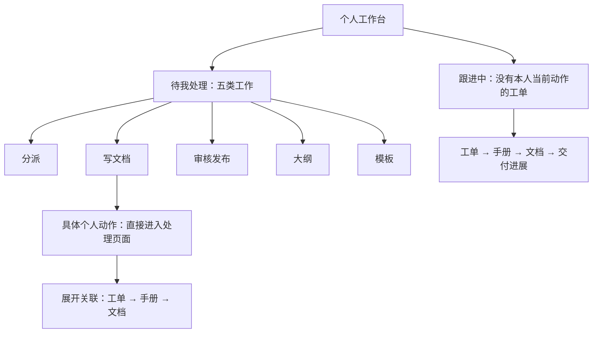

# 工作台统一待办与负责人视图概要设计

日期：2026-11-04
状态：新版效果稿已确认，进入正式实现与验收。

## 本轮实施契约（2026-11-04）

### 工作台展示纠偏（2026-11-04）

- 个人待办铺满主工作区可用宽度，保留适度页边距；桌面列表以单层白色容器、浅边线和 8px 圆角呈现，不使用装饰阴影。任务少时允许页面下方留白，不增加无业务依据的卡片。
- “待处理”保留为状态，工作类别和任务标题已说明处理类型。未接入个人动作事实的模板维护、大纲结构维护和发布事项不显示为已核准的 0 项；总数明确为“已接入待办”，并提供简短统计范围说明。
- 读取中展示加载态，不能先显示零项空状态。403 若来自当前身份无权访问的模块，按授权范围不计；当前身份有模块访问权却返回 403 时作为不可用来源显示“部分数据”。
- 任务行区分工单来源版本和手册目标分支，文件扩展名不充当任务主标题。列表提供直接进入处理页的主操作，详情保留为辅助入口。工作台导航说明与个人待办一致。
- 本轮不凭可编辑资产生成待办，不改变责任人、审核、发布或完成规则。来源缺少个人动作事实时明确保留待接入状态，不将前端外观修订认定为五类业务完成。

- 工作台使用“待我处理”主标题、轻量总数、五类筛选、搜索、业务版本和状态筛选、逐项详情及来源入口。按钮动作分别为重新读取、切换类型、筛选、清除筛选、打开/关闭详情、进入来源页面。
- 工单来源新增只读 `/knowledge-center/api/document-tasks/mine`，在可信会话内按工单、手册、文档当前责任人与确认状态投影个人行动项。只返回当前用户事项，不接受其他人员 ID；不触发写入。
- 审核来源使用服务端现有 `/review/bootstrap?view=mine` 的 `workbench.mine`；大纲领域分派沿用 `/outline/build-tasks` 的责任人事实。模板当前只有创建者/最后编辑者，没有指派或“待处理”实例，因此模板类保持空列表，不能把可编辑模板计作待办。大纲结构维护同样没有个人动作实例，暂不造待办。
- 各来源并行读取、独立失败；403 且当前身份没有该模块访问权时，该来源不计入授权范围；有模块访问权却返回 403 时显示“部分数据”并列出来源。其他读取失败同样显示“部分数据”。前端仅聚合已有已授权投影；来源模块仍在打开时二次校验权限。
- 一项采用 `来源类型:稳定来源对象:当前动作` 作为去重键。工单负责人确认、手册范围确认、文档编写和审核分别是不同动作。只有当前有明确下一步的人计入；审核中等待他人不计为本人写作待办。
- 本轮交互预算：已经获取数据后，类型切换、搜索、筛选、详情开启及关闭 P95 不超过 100ms；完整重新读取 P95 建议不超过 1500ms。必须以浏览器实测标明是否达到。百万工单/500 在线/50 同时操作仍需独立服务端索引及压测，本轮实际数据量测试不可替代容量验收。

### 实际落地边界

当前采用 `/document-tasks/mine` 服务端个人过滤，加上审核服务已有 `workbench.mine`、大纲领域任务和模板摘要的并行只读组合。工作台以已有模块授权读取，工单来源不会因管理员身份返回他人个人事项。组合与筛选在浏览器进行，尚未实现第 6 节建议的统一服务端分页聚合端点；工单存储仍整单读取。该路径适用于当前数据量，不能声称满足百万工单目标。进入容量建设时应以统一读模型和索引替换此投影，不能继续扩大浏览器全量组合。

当前模板数据只有创建者和最后修改者，没有明确“待某人处理”的任务；大纲结构维护也没有个人动作实例。这两类在页签中显示“待接入”，不把所有可编辑资产当待办。若后续新增可靠的任务分派和待处理字段，再接入对应分类。审核仅纳入现有 `assignedToMe` 的待审核记录；发布阶段没有个人负责人事实时不生成发布待办，并在统计范围说明中注明。

## 1. 需求复述

**手册负责人**：任务拆分后，手册负责人从统一工作台看到分派给自己的手册任务总量，并能按目标版本分类查看，识别每项手册任务的来源工单、状态、待办和进度。

**文档负责人**：任务拆分后，文档负责人从统一工作台看到分派给自己的文档编写任务。每篇文档须能追溯所属手册任务和来源工单，可从工作台进入既有文档编写流程，也能返回工单上下文。

**入口约束**：五类个人工作待办从“工作台”发现和进入。业务模块仍负责实际处理；任务管理保留工单导入、拆分、指派和配置等管理能力。

**当前个人工作范围**：工作台待办按分派任务、文档编写、文档审核与发布、大纲创建/更新/维护、模板创建/更新/维护五类展开。分派任务同时包含工单引起的手册/文档责任分派和大纲管理中的责任分派。资料清洗等不属于五类的事项不进入此个人工作台待办清单；其处理入口仍在所属业务模块。该口径是本轮用户对先前“全部模块统一接入”的范围修订。

## 2. 价值与合理性

两项需求价值较高且合理：版本分组有助于手册负责人安排版本工作；工单→手册→文档关系让文档负责人理解修改原因并准确回溯。工作台统一入口进一步消除用户先判断“去哪个模块找任务”的负担，并可形成真实的个人待办盘点。

工作台当前有 `pending/review/publishable/failed` 等概要计数和部分领域建设任务卡，但没有跨模块逐项个人待办清单、统一去重键或统一动作深链。因此这不只是新增两张视图，还需要先盘点各业务域的待办事实及合同。不能仅在前端拼接各模块页面或将概览计数解释成待办明细。

## 3. 方案比较

### 方案 A：工作台统一“我的待办”（推荐）

工作台首屏提供个人待办清单，并按“全部、分派任务、文档编写、文档审核与发布、大纲创建/更新/维护、模板创建/更新/维护”筛选。手册责任分派按所属手册目标版本分组；文档任务每条展示工单→手册→文档关系。点待办后携带稳定对象ID和返回状态，跳至所属业务模块处理；完成或产生下一步后回工作台更新。任务管理仍处理工单导入、拆分和责任分派。

优点：统一入口、可盘点完整个人待办、任务不重复建模、保留原业务操作边界。成本：需要跨模块待办投影、服务端权限过滤、状态映射和来源去重。当前接口资料不完整，需先完成盘点。

### 方案 B：工作台分类计数，点击后进入各模块列表

在工作台展示五类工作数量，点击后跳转各业务模块并应用筛选。

优点：改动较小，可复用各模块现有列表。缺点：工作台无法逐项展示五类工作的待办，用户仍须跨模块查找，也无法准确盘点这五类个人行动项；不满足统一入口目标。

### 建议

采用方案 A。工作台负责五类个人工作的发现、聚合、排序、筛选和恢复上下文；任务管理、文档生产、审核与发布、大纲管理、模板管理仍是业务事实的权威操作页面。工作台提供这五类工作的统一待办入口；只读投影引用原业务对象，不复制任务状态。

## 4. 重新设计后的工作台效果

### 五类工作与工单跟进效果稿（2026-11-04，待确认）

用户主要从工作台处理五类个人工作：分派任务、文档编写、文档审核与发布、大纲创建/维护、模板创建/维护。一个工单可能跨手册和文档，责任人还需持续看到整单进度；但等待他人合并和回读时，没有本人当前动作，不能挤占个人待办数。



[新交互效果稿](./知识中心-工作台-五类工作与工单跟进-效果稿.html)保留原先“全部、分派、写文档、审核发布、大纲、模板”主筛选，列表主行优先写本人下一步动作；工单、手册和文档通过展开层级追溯。跟进中独立列出等待他人处理的工单，不纳入“待我处理”计数。当前大纲结构维护与模板个人任务尚缺可靠来源，在效果稿中标“待接入”，不能显示为核实的零项。示例 E2E-WB-20261104-HE-YANG 仅演示交付跟进，不表示正式服务已返回该投影。目标设计达到高完成度的依据是：五类工作完整可发现、当前动作直达、工单进度持续可见、计数口径诚实、桌面与窄屏均可操作；正式评分仍须真实 API、权限、深链和性能验收。

#### 实施契约与接口增量

- `GET /knowledge-center/api/document-tasks/mine` 保留 `items/total` 本人行动项，新增 `following`：仅包含当前会话人员参与、未完成且此刻没有本人行动项的工单。服务端基于可信身份和现有资产可见范围过滤，不采信查询参数中的人员 ID。
- 行动项增加可选的 `lineage`，包含工单编号、手册 ID/名称、文档 ID/名称；前端展开时按结构字段展示，不解析中文 `context`。跟进摘要返回工单状态、本人相关手册及文档的现有完成标签、目标分支和来源链接；完成标签直接取现有交付投影，不从文案推导完成。
- 工作台仍并行读取四个来源；工单来源成功时才显示其 `following`。读取中不显示零项空态；来源失败列入“部分数据”。`following` 独立于五类行动项计数、搜索和类别切换，避免工单状态与个人动作互相覆盖。
- 展开只改变可见关联信息；主操作使用既有来源深链。来源事项更新后重新读取投影，展开状态按稳定 ID 保存。移动端保持单列，所有新增文本和状态采用平台 `--appearance-*` 外观令牌及服务端业务字段。

伪代码：`for task of visibleTasksForCurrentUser: actions = personalActions(task); if actions.length > 0: items += actions; else if task.status != completed: following += summarizeExistingCompletion(task)`。这里“无本人动作”是工单跟进的筛选条件；审批、合并和正文图片回读规则仍在来源服务，不在工作台重复判断。

2026-11-04 工单常驻与分层展开方案见[交互效果稿](./知识中心-工作台-工单常驻与分层展开-效果稿.html)。同一工单在清单中保留一条主行，展开后按手册、文档和交付记录展示关联进度；工单完成前，即使当前没有本人可执行动作，也可在“全部”及“跟进中”查看。“待我处理”只计本人当前可执行事项，不将等待人工合并与回读计为待办。效果稿使用示例数据，尚未接入正式工作台或业务接口。

2026-11-04 用户视角的术语与视觉复核见[工作台个人待办术语与竞品界面参考](../11-参考资料/知识中心-工作台-个人待办术语与竞品界面参考-20261104.md)，新版[视觉优化效果稿](./知识中心-工作台-个人待办术语与视觉优化-效果稿.html)。它使用“待我处理”作为页面主标题、五个短页签和按动作命名的任务行；编号、来源、关联手册/文档与业务版本降为次要信息。原统一待办效果稿保留为前一版设计对照。新版是静态交互示意，不表示术语已进入正式平台或来源已接入。

2026-11-04 真实首访慢样本纠偏：来源并行读取时，任一来源先返回即可显示该来源已确认属于本人的事项，并保留“读取中”提示；全部来源结束后才显示完整总数。失败来源单独列为“部分数据”，未返回来源不能算零项。首个可操作事项与全部来源完成分别计时；刷新期间仅用本次请求结果，不沿用可能过期的旧事项。晚到的旧请求不得覆盖新一次刷新。

渐进更新期间，已打开的详情保持打开，关闭后使用最新投影；正在输入的搜索框保留焦点和光标位置。源码与共享平台静态资源版本不同的验证只能记为源码覆盖测试，不能作为运行发布验收。

### 顶部待办信息的五种呈现方式（待选择）

现有效果稿把总量和四类数量排成五格统计卡，下方筛选标签又显示同一组数字，造成重复、占用首屏空间且视觉重点落在计数上。五种局部替代方案见[顶部待办信息方案对比效果稿](./知识中心-工作台-顶部待办信息-五种方案效果稿.html)；均沿用当前工作台导航和下方待办列表，演示数值不是生产数据。

| 方案 | 顶部形式 | 适用与取舍 |
|---|---|---|
| A 标题内轻量总数 | “工作台”标题旁用小号“N项待办”；分类数只留在下方筛选标签 | 最少改动、信息不重复；推荐用于当前高密度工作台 |
| B 一句概览 | 标题下用一句完整文字表示总数与当前处理范围 | 阅读自然，但比 A 多占一行；窄屏可折行 |
| C 筛选即概览 | 取消独立统计区域，把分类计数直接放进可切换的标签 | 入口与统计合一；需让“全部”标签足够显眼 |
| D 状态提示条 | 仅用窄条说明待处理/处理中/受阻，不再重复业务分类 | 适合以处理节奏为主要诉求；要先确认跨模块状态口径 |
| E 按需展开概览 | 默认只显示“N项待办”，点击展开分类统计 | 保留盘点能力且默认简洁；比 A 多一次操作 |

当前主效果稿采用 A 的轻量标题总数：分类数由下方筛选标签承担。五种方案对比稿保留其提出时的旧分类演示数据，仅用于比较顶部形态；当前分类及数量以主效果稿为准。来源不可用时标题改为“已读取N项 · 部分数据”，并在原有故障提示中列出来源。方案 D 的状态分布必须待各模块状态映射明确后才可落地。数字和标签不能各自作为独立实时播报区域，也不能把部分结果当作完整总数。

可交互效果稿：[工作台统一待办与负责人视图](./知识中心-工作台-统一待办与负责人视图-效果稿.html)。它展示工作台为活动入口、统一待办列表、手册版本分组、文档关联链，以及进入来源模块的详情抽屉。演示数据不代表真实API数据或生产能力。

桌面与窄屏截图及验证记录见 [`runtime/design/task-owner-views-20261104/`](../../../runtime/design/task-owner-views-20261104/README.md)。

### 工作台主结构

1. 当前用户、标题旁的个人待办总数，以及五类工作筛选标签；不再使用五格统计卡重复展示分类数量。
2. 一个统一任务清单；类型筛选仅改变同一清单的投影，不创建多个个人入口。
3. 分派任务中，手册责任分派按 `targetVersion` 分组，提供版本/状态筛选及工单、手册、进度信息；大纲管理中的责任分派也归入此类，行内标明来源模块。
4. 文档类型逐项列出文档，并明确展示来源工单、所属手册和文档自身稳定标识；主操作进入已有编写或状态详情。
5. 五类工作均只展示当前用户有明确下一步动作的事项，审核/发布、大纲、模板待办沿用各自服务端事实并保留来源模块深链；全量资产、未产生个人动作的维护事项不为凑数生成待办。
6. 详情侧栏提供当前事项上下文与“打开来源模块”操作；返回工作台恢复原筛选、页码和滚动位置。

### 五类工作与来源动作

| 工作分类 | 进入清单的事项 | 来源模块及打开位置 | 边界 |
|---|---|---|---|
| 分派任务 | 本人需判断工单/手册范围、指派手册或文档责任人，或完成大纲管理中的责任分派 | 任务管理、大纲管理的具体任务 | 以当前动作分类；大纲结构编辑归“大纲创建、更新和维护”，同一动作只记一条 |
| 文档编写 | 本人负责的新增/修改文档、审核退回后的修订等 | 文档生产的文档任务 | 保留工单→手册→文档稳定关联；未确认的提案不计入可执行待办 |
| 文档审核与发布 | 本人需审核候选、处理发布或交付失败等 | 审核与发布的审核任务或交付事项 | 审核、人工合并和回读沿用来源模块规则；仅创建MR不算完成 |
| 大纲创建、更新和维护 | 本人需创建大纲、确认结构变更或维护既有大纲 | 大纲管理的具体大纲/结构版本 | 仅存在明确个人处理事项时投影，不能把全部有维护权限的大纲计为待办 |
| 模板创建、更新和维护 | 本人需创建模板版本、修改或维护已指派模板 | 模板管理的具体模板/版本 | 仅存在明确个人处理事项时投影，不能把全部可编辑模板计为待办 |

同一来源对象可以在不同阶段产生不同人的动作，但工作台按“来源对象ID＋动作类型＋当前责任人”识别个人事项。来源模块仍负责状态和权限；聚合时同一动作不能因同时出现在任务管理与大纲管理而重复计数。示例中的大纲/模板个人待办用于展示目标交互，现有服务是否提供稳定指派与动作实例仍须盘点，不能将全部资产直接投影为待办。

### 手册负责人待办

- 只显示当前登录人已被指派、范围已确认且本人有权查看的手册任务。
- 版本分组使用所属手册任务 `targetVersion`；空值显示“未指定版本”。
- 显示来源工单编号/链接、摘要、手册、状态、子文档完成进度、下一步和最近更新时间。
- 待处理优先；每个分组汇总条数必须等于当前清单内实际行数，不将全量手册资产计作任务。

### 文档负责人待办

- 只显示已确认手册范围内，正式创建/关联且已指派给当前登录人的文档任务；未确认草稿和未发布新增文档提案不进入可执行待办。
- 每行展示稳定的工单编号、手册ID/名称、文档任务ID/文档ID，不能依赖同名标题或编号模糊匹配。
- 目标版本沿用所属手册任务版本；审核与交付状态来自原服务端投影。
- 主操作跳至现有文档生产页；无权时由源模块拒绝。工作台不另造正文、审核或完成状态。

### 非五类事项

资料清洗等非五类事项不进入此个人工作台待办清单，也不计入顶部总数或类型分布；仍可从原业务导航进入。无当前责任人的系统风险/失败同样不计入个人待办。该范围修订不改变这些模块原有功能、权限或处理规则。

## 5. 已确认口径与权限

### 本地测试责任人预览（2026-11-05）

已确认的[效果稿](./知识中心-工作台-当前责任人切换-效果稿.html)在工作台标题右侧提供“当前责任人”下拉框，默认登录用户。仅本地测试部署显式设置 `KNOWLEDGE_CENTER_LOCAL_OWNER_PREVIEW=1` 且登录人具备 `platform:manage` 时，服务端提供人员目录和只读预览；普通部署及普通用户不显示切换能力。切换不改变 Cookie、会话、权限或业务写接口身份；预览行与详情仅显示状态，隐藏可执行深链。切回本人立即恢复原“我的工作”请求。

接口伪代码：`GET /knowledge-center/api/workbench/responsibles` 校验开关与管理员，从有效用户目录返回 `id/displayName`；`GET /knowledge-center/api/workbench/preview?responsibleId=...` 再校验目标有效、本人可见手册交集，从任务聚合及审核快照生成最小 `items/following`，不返回正文、资源或可写能力。各来源独立失败时返回 `unavailable` 与 `completeness=partial`，界面不可把已读数量当成完整数量。大纲来源若无法安全按目标人员投影，应明确标记为不可用；不得伪造零项。请求参数只能影响这两个只读端点，原 `/mine`、审核与大纲操作接口仍只认登录会话。预览切换采用请求序号拒绝旧响应覆盖，刷新延用当前选择，重新加载页面恢复登录人。

- 管理员也只看到分派给本人、本人需行动的任务；不增加切换负责人或代看他人任务能力。
- 文档目标版本沿用所属手册任务版本。
- 大纲管理中的责任分派与工单手册/文档责任分派统一归“分派任务”；大纲结构维护仍归“大纲创建、更新和维护”。
- 资料清洗等非五类事项不进入个人工作台待办；五类之外的模块原页面仍可使用。
- 服务端以可信会话用户ID筛选，忽略/拒绝请求参数指定其他ownerId。
- 仍遵守原资产可见范围和模块动作权限；工作台出现待办不等于获得写作、审核或发布权限。
- 统计、排序与完成状态均由来源服务端事实投影。MR创建不算完成；现有人工合并及正文/图片回读门禁不变。
- 当任一待办来源不可用时，工作台明确标注“部分数据”、列出不可用来源；可用来源计数只能标为“已读取项”，不能展示为完整总数。

## 6. 数据与接口方向

建议提供工作台专用只读聚合投影，而非浏览器按模块抓取完整数据：

```http
GET /knowledge-center/api/workbench/my-tasks?page=1&pageSize=20&type=document&version=23.4&status=in_progress&q=YDBRD
```

响应至少包含 `items`、`total`、五类工作/版本/状态 `facets`、分页、投影时间、`completeness`（完整/部分数据）及不可用来源列表。`type` 仅允许 `assign`、`document`、`review`、`outline`、`template`；`all` 表示这五类合计。部分数据时`total`只表示已读取项数量，UI不得显示为完整待办总数。每项包含唯一 `taskRef`、工作分类、来源模块/稳定对象ID、当前用户可执行的动作、状态、下一步、源模块深链和返回状态。服务端从可信会话确定当前用户；根据各域真实权限投影；列表、筛选与分页在服务端完成。聚合读取不能复制写模型、提升源任务revision或写入业务状态。非五类来源不参与该聚合或故障完整性判断。

实现前须核对每个来源的稳定待办ID、责任人字段、状态和动作；为跨模块同一动作制定去重键。若存储仍为整单聚合，不能在百万条目标下全量装载后临时过滤，需先设计和验证查询投影/读模型及索引。百万工单、500人在线、50人同时操作是设计目标，不是已验证容量。

## 7. 验收标准

- 工作台是这五类个人工作的统一待办发现入口；每条都有可用源模块深链、回工作台路径和稳定来源ID。
- 角色过滤基于可信当前用户；管理员不能经查询参数看到他人个人待办。
- 工作台总数、五类分布和清单条目数一致；大纲责任分派计入“分派任务”，大纲结构维护计入“大纲创建、更新和维护”，同一动作只计一次。
- 对五类工作的来源逐一核对；任一纳入范围的来源不可用时显示“部分数据”和来源名称，计数明确为已读取项，恢复后自动重新对账；非五类来源故障不影响本工作台完整性标记。
- 资料清洗等非五类事项不出现在待办列表或总数中；原业务模块入口仍可使用。
- 手册任务按目标版本分组，版本组计数与清单匹配；未指定版本单列。
- 文档每行显示工单、所属手册和文档稳定关联；同名文档不混淆，版本继承手册版本。
- 草稿及未发布新增文档不计为可执行待办；审核退回、MR关闭和读回失败按源模块真实下一步显示。
- 打开原模块、执行动作、返回工作台后，筛选、分页和滚动位置恢复，待办按来源事实刷新。
- 390px无页面级横向溢出，工单关系和主操作可达；键盘导航完整。
- 在既定大规模目标下验证服务端分页、去重、权限、读取耗时和新鲜度；不得以效果稿数据代替。

## 8. 当前缺失资料与待确认问题

这些是开始开发前需从现状或业务负责人补齐的内容：

1. **五类任务来源台账**：逐一列出任务管理、文档生产、审核与发布、大纲管理、模板管理的待办API、稳定实例ID、负责人ID、动作、详情URL、刷新事件。尤其要确认大纲/模板是否已有可识别的个人动作实例。资料清洗不进入本清单。当前工作台概览只有几类汇总计数，并非完整任务明细。
2. **现有计数口径**：`pending/review/publishable/failed`各自统计谁、覆盖哪些模块、是否互斥，和逐条清单如何对账；缺口时如何标识降级。
3. **统一状态与下一步映射**：待处理、进行中、等待他人、阻塞和完成的来源字段；审核退回、MR关闭、回读失败分别由谁继续处理；失败但无人行动是否进入个人清单。
4. **跨域去重规则**：文档负责人和审核人是两个不同动作还是同一事项；重复深链/父子任务如何避免重复计数；全局`taskRef`由何种业务键组成。
5. **待办优先级、期限及SLA**：现有工单有来源时间和计划起止时间，但是否有截止日期/优先级/SLA及逾期定义尚不明确。未确认前不显示逾期标签，也不按截止日期承诺排序。
6. **已完成历史与清理策略**：本方案默认统一待办只显示仍需当前用户行动的项目。是否需要完成历史入口、保留期，以及它与工单按时间清理、审计留存如何协调，需明确。
7. **来源服务故障明细**：口径已确认显示“部分数据”及不可用来源；仍需盘点每个来源能否返回独立健康/错误、部分结果是否可复用以及恢复时何时重新对账。
8. **数据新鲜度与响应目标**：工作台待办多久更新、主动刷新/事件推送/轮询策略及首屏和筛选耗时目标尚缺；要按100万工单、500在线/50同时操作设计并真实压测。

其中1—4为接口和数据契约的开发阻塞项；5—8涉及优先级、历史、健康和刷新目标，可在需求评审确认默认口径后分阶段建设，但五类工作完整接入、容量测试和故障总数诚实展示不能省略。用户先前确认过“全部模块统一接入”，本轮进一步明确个人工作台只覆盖五类工作，资料清洗等非五类不展示；以本轮较新的明确范围为准。
# 2026-11-05 九字段工作台契约

待我处理与跟进中统一展示：编号、子任务编号、描述、状态、任务类型、开始时间、结束时间、详情、操作。六类任务为任务管理、文档生产、大纲管理、模板管理、文档审核、文档发布。导航仍保留“审核与发布”；其中发布包含创建 MR、等待人工合并与交付回读。大纲、模板个人事项来源待设计，筛选入口显示“待设计”，不计虚拟待办。

工单关联事项使用 PingCode 编号；每篇文档在手册范围确认时分配从 1 开始的持久子任务序号。序号跨编写、退回、审核、发布复用，删除范围或重排不回收。工单级和手册级事项没有子任务序号。开始、结束时间取工单计划时间，缺失时显示“—”。历史审核先按明确 reviewTaskId 与 revisionOf 链核对关联；无法唯一关联时登记待核对，不按标题推测。无关联历史事项使用持久 HIST 编号，且仅出现在工作台。

桌面九列表格与 390px 单列九字段卡片使用同一投影；详情保留来源、手册、文档、审核与 MR 链接。服务端按本人或管理员代办目标过滤，再输出结构化编号与时间。旧数据回填需先预检、备份、冲突检查，隔离重复执行验证；真实数据写入按审批边界单独执行。
