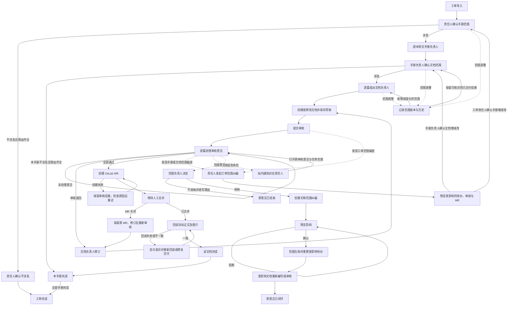

# 文档任务异常回流与重新流转概要设计

状态：部分实施，隔离 HTTP 验证于 2026-11-10 完成；共享平台部署、真实登录跨页体验及真实 MR 联验未完成。本文是本主题的业务基线，详细设计、接口和验收不得与本文冲突。范围仅覆盖工单、手册、文档生产、审核、GitLab MR 与交付回读；独立大纲和模板任务另行设计。实现证据见[实现与验证报告](../05-测试设计&报告/02-测试报告/知识中心-文档任务-异常回流与重新流转-实现与验证报告-20261110.md)。

本轮已实施或已有隔离证据：生产/审核阶段的范围纠偏请求、影响预览、确认/取消、审核与 MR 操作阻断、已合并撤出后的发布内容核对门禁；审核提及目标查询与负责人服务端解析。需求 25 本次只实现站内通知，不实现企业微信/企业邮箱。站内通知、三类提及、意见与纠偏闭环及真实浏览器体验仍以本设计的验收结果为准，不能把隔离 HTTP 证据当作生产完成。

## 目标与事实边界

工单状态继续由下级真实结果计算为待处理、处理中、已完成；异常原因、处理人和下一步动作作为独立投影。任何失败均不直接改写已冻结的审核、MR 或交付证据。用户修改范围时记录范围版本与审计，已完成的旧交付仍保留为历史事实；新范围只认与当前手册、文档、目标分支和范围版本匹配的交付。

## 全链路状态图

图中的“该文档完成 → 本手册完成 → 工单完成”仅在全部必要子项满足条件后成立。范围意见也必须走到“已结束”或“已闭环”，不能用“已读”或“已处理”代替。

## 状态转换契约

工单和手册的状态是当前有效子项的汇总值，不接受客户端直接设置。文档的审核任务、MR 和交付观察分别保留自身状态；页面将它们组合为当前阶段和异常提示，不新建一个可人工改写的“回退状态”。

| 当前阶段 | 触发与守卫 | 转到 | 必须保留的事实 | 恢复操作 |
|---|---|---|---|---|
| 待确认范围 | 责任人确认涉及的手册，或填写不涉及理由 | 手册确认 / 待确认完成 | 原范围版本、操作者和原因 | 调整范围时重新计算待办 |
| 待确认文档 | 手册负责人确认文档、目标分支和逐篇负责人，或填写不涉及理由 | 文档生产 / 待确认完成 | 原手册范围与分派记录 | 变化的文档重新生产 |
| 审核中 | 当前候选存在未处理意见 | 审核中 | 意见、回复及处理记录 | 处理全部意见后继续逐篇审核 |
| 审核中 | 审核人退回 | 待修订 | 原候选与审核决定 | 文档负责人保存新修订并关联旧审核任务送审 |
| 审核通过 | 创建 MR 失败；审核候选仍与当前范围相符 | 审核通过 | 失败原因、审核结论和候选摘要 | 有发布权限者核对后以幂等键重试创建 |
| 等待合并 | GitLab 确认 MR 已关闭 | 待修订 | 旧 MR、关闭观察和审核链 | 文档负责人实质修订、重新审核后创建新 MR |
| 已合并待回读 | 正文或图片回读失败，或依赖不可用 | 已合并待回读 | 目标提交、最后成功观察、错误码和时间 | 重试回读；内容不一致时修复交付 |
| 文档已完成 | 当前文档范围或目标分支实质变化 | 文档生产 | 旧审核、旧 MR、旧交付及旧范围版本 | 新范围重新送审和交付；未变化文档继续沿用有效证据 |
| 文档生产或审核中 | 发现工单对应的手册或文档范围错误 | 待范围纠偏；受影响子项暂停完成判定 | 当前草稿、审核意见、冻结候选和关联 | 按权限分层确认新范围，再重建受影响待办 |

旧审核结论只在冻结正文、目标分支、仓库提交、审核人与当前候选一致，且没有未处理意见时继承。MR 关闭后的新修订必须存在正文变更；已关闭 MR 的状态刷新不能将其重新作为交付证据。一次手册审核可覆盖多篇文档，逐篇关联工单时必须校验当前手册、文档和目标分支；关联中途失败保留已创建审核任务，并明确提示补充关联，不假装整单送审完成。

## 回流与责任

| 触发 | 保留的事实 | 下一步及处理人 | 完成门禁 |
|---|---|---|---|
| 审核退回 | 旧候选、审核决定及意见 | 文档负责人修订并送审；管理员可代办并记录实际操作者 | 新候选逐篇审核通过 |
| 未处理意见 | 原意见与锚点 | 审核人与作者处理意见 | 当前候选全部意见处理完才可通过和创建 MR |
| MR 创建失败 | 已通过审核及候选 | 有发布权限者核对原因并以幂等键重试 | MR 创建不算完成 |
| MR 关闭 | 关闭的 MR、审核历史 | 文档负责人修订并重新送审，新审核通过后创建新 MR | 关闭的 MR 永不作为交付完成证据 |
| 回读失败或来源不可用 | 最近一次合并观察及错误 | 有发布权限者重新回读；内容不一致时修复交付 | 正文和仓库相对图片均一致 |
| 范围或分支变化 | 旧范围、审核及交付历史 | 当前层责任人重新确认；变化的文档重新生产 | 当前范围逐项重新汇总，旧关联不得越范围复用 |
| 审核中提及责任角色 | 审核意见、提及目标与站内通知结果 | 对应手册负责人、文档首次责任人或知识中心负责人从站内通知进入原审核或任务详情 | 提及本身不代表审核通过、退回或范围已变更 |

工单责任人处理手册范围，手册负责人处理本手册文档范围，文档负责人处理写作，审核人处理审核，有发布权限者创建 MR 和同步交付。管理员可按已确认权限代作业务决定，审计保留实际操作者与责任人。无权限用户可查看自己可见范围内的进度和等待对象，不能看到伪造的恢复操作。

## 场景一：流程中纠正任务范围

**场景复述。** 工单已拆为手册和文档任务，文档负责人正在编写，或审核人正在审阅时，发现漏选、错选、重复选择或目标手册、文档、版本、负责人有偏差。需要在原工单下增、撤、调整相应子任务，并让受影响工作回到正确阶段，而不是重导工单或直接改写审核结论。

**建议流程。** 在工单详情或审核页发起“调整任务范围”，填写原因并查看影响预览；预览列出新增、撤出、保留、变更的手册与文档、当前负责人、草稿、审核任务、MR 和交付证据。工单责任人确认手册层变更，手册负责人分别确认本手册文档层变更；管理员代办时记录实际操作者。确认采用预期版本和幂等键，冲突则重新读取并重新预览。仅经有权人员确认的范围版本成为当前有效范围，工作台按新范围重算。

预览与确认都由服务端只读查询 GitLab 中受影响的 MR；查询失败或状态不确定时阻止确认。逐篇影响项展示草稿、审核结果、候选摘要、MR 状态、正文/图片回读结果及处理人。确认时重新查询并比较摘要；观察时间供用户判断数据新鲜度，不作为摘要内容，以免同一远端事实只因读取时间不同造成假冲突。系统不自动关闭或合并 MR。

| 调整 | 当前有效任务与待办 | 旧工作及交付证据 |
|---|---|---|
| 新增手册或文档 | 新增手册待确认或文档生产待办；文档沿用工单编号，分配不可回收的新子任务序号 | 原有未变化子项继续流转 |
| 改负责人 | 将未完成待办转给新负责人；范围版本不变 | 草稿、审核和已交付证据保留；记改派审计 |
| 改文档定义、所属手册、目标分支或版本 | 受影响子项回到范围确认或文档生产；新范围须重新送审 | 旧候选、审核、MR、交付证据只读留档，不能跨范围复用 |
| 撤出手册或文档 | 从当前文档交付门禁和原个人待办中移出；显示“已撤出”及原因。已合并内容须完成独立核对待办，工单才能完成 | 已产生的审核、MR、交付事实及原子任务编号保留，不物理删除或回收 |
| 撤出后再次纳入同一对象 | 显示原历史并重新判断当前版本与证据是否匹配 | 原编号可沿用该稳定对象；旧审核与交付只有通过当前范围门禁才能复用 |

审核中发现偏差但尚未明确文档时，只记录提醒并交责任人核实，不阻断审核或交付；明确受影响文档后才对这些文档设置阻断，保留审核意见。未受影响文档的逐篇结论可按原冻结内容、分支、提交、审核人及意见门禁继续有效。受影响文档存在打开的 MR 时，必须由有发布权限者先人工关闭旧 MR，服务端确认远端已关闭后才能确认相关范围变更；状态未知、读取失败或观察过期均不得放行，系统不自动关闭。旧 MR 已合并时保留真实交付事实，生成“核对已发布内容”待办，该待办完成后工单才可完成；不把“撤出任务”解释为撤销已发布内容。工单当前完成状态随有效范围和核对待办重算，历史完成时间与证据仍可查询。

**现状差距与落地顺序。** 当前服务端对已转交手册和已分派文档返回 `SCOPE_WITHDRAWAL_REQUIRED`，因此“撤出当前范围”尚不可用；已有范围历史和版本字段，但缺完整影响预览、撤出标记、审核中暂停门禁以及 MR 后续处置。先补范围变更命令与服务端守卫，再补审核页入口、工作台投影及历史查看；在这些能力验收前，页面不得暗示可任意删除已分派任务。

## 场景二：审核时提及责任角色

**场景复述。** 审核人发现需要责任人确认的范围、归属或跨文档问题，在审核意见中选择提及角色，希望准确通知对应人员，并使其能直接打开相关审核意见和工单上下文。

**建议交互。** 提及选择器按“手册负责人、文档首次责任人、知识中心负责人”分组，只显示当前审核任务和有效范围内的对象；同名手册同时展示业务版本或稳定编号。选中项以稳定 ID 和角色写入意见，服务端在提交时重新解析收件人。自由输入姓名不触发通知。人员管理中标记为“停用”的人员即为**失效人员**：不能被新意见选择或通知；历史意见保留原收件人快照并显示“人员已失效”。

审核意见和站内通知在同一审核存储事务中写入；同一意见对同一人员只入箱一次。通知包含审核任务 ID、意见 ID、手册 ID、文档 ID、发起人及安全深链；接收人从工作台或站内通知打开原意见，并可回复或进入有权限的范围调整入口。提及后改派不改写历史通知快照；新责任人只有在新意见或具名重发操作后才收到通知。意见或通知写入失败时整体失败并保留表单输入，不能显示“意见已保存”。

提及只负责沟通，不自动产生审核通过、退回、已处理意见或范围变更。负责人无审核权限时只可查看授权范围内的评论与任务信息，不能代审核人作决定；管理员代办遵循现有授权并同时记录操作者和责任人。

## 场景三：采纳范围意见后的闭环

范围负责人点击“采纳”只代表同意继续核查，**不代表范围已经改变**。系统必须按以下顺序闭环：

1. 将原意见记为“已采纳，待调整”；服务端随即在任务聚合幂等创建唯一范围纠偏记录并保存 `sourceOpinion`。审核页从服务端读模型取得关联的 `scopeChangeId`，不要求跨聚合物理双写。第二步失败时显示“已采纳，待创建”和“重试”，同一意见重试只补建单。
2. 范围负责人在原意见深链进入范围调整页，查看当前范围、拟议范围和逐项影响；未完成预览前不能确认。
3. 预览通过后点击“确认”。服务端重新校验责任人、版本、MR 和影响摘要；失败则停在“待重新预览”。
4. 确认成功后新范围生效，重算受影响文档的任务和待办；未受影响文档保持原有有效证据。
5. 受影响文档进入“待重新编写”或“待重新审核”，由文档负责人继续处理。平台不自动生成正文。
6. 所有受影响文档重新达到当前范围门禁后，原意见显示“已闭环”，并可查看范围版本、纠偏记录和新审核结果。

如果纠偏记录被取消，原意见显示“已采纳但未生效”，不会伪装成已闭环；需要继续调整时，负责人提交一条新的范围意见并关联旧意见。原意见不直接重开，避免一条意见对应多个相互冲突的决定。

关联和闭环状态的权威依据是任务聚合中的 `sourceOpinion`、范围确认版本及受影响文档的当前交付事实。审核页展示的纠偏 ID 和“待确认/待重新编写/已闭环”是服务端读取时合成的投影；查询暂不可用时显示“数据未更新”，不得凭按钮点击推断成功。重复创建按原意见 ID 定位已有纠偏，不能生成第二条活跃记录。

## 投影与接口原则

任务详情和工作台从同一服务端投影读取 `phase`、`issue`、`responsibleId`、`nextAction` 及 `observedAt`。失败或依赖不可用不把旧事实置空；明确显示“数据未更新”。恢复命令沿用现有审核、写作、MR 和范围接口，携带幂等键、预期版本或冻结候选摘要；409 提示重新读取，不自动重放外部写入。范围版本只有实质范围或目标分支变化才递增；单纯改派、草稿保存和重试不使已交付文档失效。

验收使用隔离存储与真实 HTTP，覆盖退回重审、MR 关闭后再次送审、回读失败、部分交付后范围调整、并发与越权，并检查工作台入口、详情、桌面和 390px。新增场景须覆盖审核中增删改手册与文档、未受影响子项继承、撤出后重纳入、MR 已打开或已合并时的处置、同名手册提及、改派前后接收人、通知重试去重与投递失败。企业 MR 不自动合并，未取得真实合并回读证据时不得宣布真实企业交付完成。
