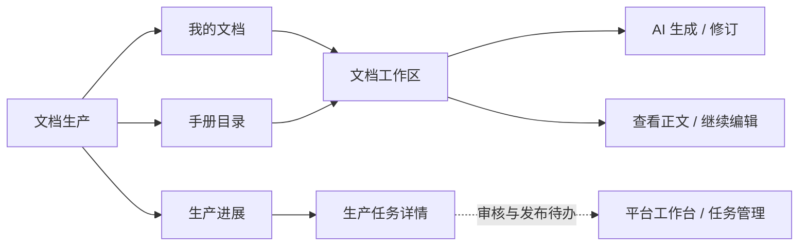

# 知识中心-文档生产-我的文档与生产进展-设计建议

> 状态：文档生产信息架构建议；生产进展视图已在工作树实现并完成定向验证，真实部署待验收；“我的文档”仍待数据契约设计。
> 范围：文档生产中心的信息架构、“我的文档”字段和分层策略、生产进展图表。

## 目标

文档生产的首要任务是让作者使用 AI 生产或修订文档，并快速找到、阅读和继续编辑自己负责的内容。全局页应首先围绕“文档”组织，而不是围绕底层运行记录或泛化流程组织。

## 现状与问题

当前全局页有手册视图、数据库版本、任务视图和我的生成四个并列标签，顶部提供“创建增量任务”。其中：

- “数据库版本”实现按任务 `businessVersion` 分组，并非权威数据库版本治理；名称与实际数据含义不一致，也不是作者找文档的主要入口。
- “我的生成”读取本人发起或参与的 Agent 运行记录。它不等于“我负责的文档”，普通手工编辑文档也不会因此出现在此处。
- “任务视图”将增量任务清单与五阶段处理详情同时呈现，难以快速按作者关心的文档和当前动作分类。
- “创建增量任务”要求选择已发布基线，适用于版本差异构建，不是 AI 文档生产的通用起点。

## 建议的信息架构

- 默认页改为“我的文档”，直接回答“我负责或参与的文档有哪些、最近在做什么、如何继续”。
- “手册目录”用于按资产浏览并进入统一文档工作区。
- “生产进展”用于观察批次或任务在生成、审核、发布阶段的分布；它不再兼任个人文档列表。
- 数据库版本不保留为独立页签。确认 `businessVersion` 的业务语义后，可作为列表筛选条件；需要版本治理时另行设计有权威数据源的版本视图。
- 版本差异构建保留在“任务视图”内作为次级操作，明确说明需要选择已发布基线；不作为文档生产全局页的首要操作。

## “我的文档”分层和字段

### 最近工作

按当前用户最近打开或修改时间排序，默认显示少量最近项。强调快速回到正文，主操作为“继续编辑”或“查看正文”。

| 字段 | 用途 |
|---|---|
| 文档标题 | 识别内容，是主要点击目标 |
| 手册 / 章节 | 定位文档在资产中的位置 |
| 最近工作时间 | 解释为何出现在“最近工作” |
| 当前状态 | 草稿、生成中、待审核、退回修订、待发布、已完成等真实状态 |
| 主操作 | 根据权限和阶段进入现有文档工作区 |

### 进行中

优先顺序为需要本人处理、本人生成运行中、失败待恢复、等待他人。突出下一步动作和异常，而不是重复展示流程全部历史。

| 字段 | 用途 |
|---|---|
| 文档标题；手册 / 章节 | 确认对象 |
| 当前阶段 / 状态 | 判断进度 |
| 下一步动作 / 等待对象 | 说明由谁采取什么行动；仅展示服务端事实 |
| 最近更新时间 | 判断记录是否新鲜 |
| 提示或失败原因 | 异常时出现，正常状态不占位 |
| 主操作 | 继续生成、修订、查看审核意见或打开交付详情 |

### 已完成

默认折叠并显示数量，按完成时间倒序，强调可回看和复用。

| 字段 | 用途 |
|---|---|
| 文档标题；手册 / 章节 | 找回交付内容 |
| 完成时间 | 确认最近交付 |
| 交付版本 / MR 状态 | 展示真实交付证据；没有证据则明确标记待核对 |
| 主操作 | 查看正文或交付记录 |

### 历史

默认折叠并按更新时间倒序；支持标题、手册、任务编号搜索。保留失败、取消、已替代版本的历史事实，不与当前有效文档混为一列。

## 生产进展图表调研与取舍

| 参考 | 官方能力 / 模式 | 借鉴点 | 不直接照搬的原因 |
|---|---|---|---|
| GitHub Projects | 表格、看板、路线图等视图；保存视图和筛选 | 同一任务数据按“查找、看阶段、看时间”切换 | 本平台需要按文档和权限聚合，不能把 GitHub 项目模型照搬为业务事实 |
| GitLab Issue Boards | 任务卡按列表/状态组织，可视化阶段流转 | 阶段列、卡片下钻、快速识别阻塞 | 阶段列过多或卡片塞入太多字段会重现“大杂烩” |
| Linear Custom Views / Insights | 可保存过滤视图，并提供任务分析和进度摘要 | 固定视图与过滤组合、概览和明细互相下钻 | 统计图表不能代替逐篇文档处理入口 |

官方来源：

- GitHub Projects 自定义视图：[Customizing views in your project](https://docs.github.com/en/issues/planning-and-tracking-with-projects/customizing-views-in-your-project)
- GitLab：[Issue boards](https://docs.gitlab.com/user/project/issue_board/)
- Linear：[Custom views](https://linear.app/docs/custom-views)
- Linear：[Insights](https://linear.app/docs/insights)

以上官方页面在 2026-11-13 访问并核对标题/HTTP 状态。生产进展采用知识资产“全部手册、待创建”式的可点击阶段计数格，点击后筛选下方任务列表。阶段包括待生成、生成中、待审核、退回修订、待发布、已完成和状态待确认；未知状态不得猜测归入待生成。阶段数量与当前搜索、状态、手册、版本和日期条件同步，避免统计数与明细不一致。异常、退回和等待外部动作需用文字标签，不单靠颜色表达。

时间视图采用按日期选择的日历和当日任务清单。日历格直接展示当天最多两条任务标题及剩余数量，选中日期后展示完整清单；筛选、阶段和日历格使用同一任务集合。日期依次采用可信活动时间 `activityAt` / `lastActivityAt`、`updatedAt`、`createdAt`、`startedAt`，并兼容既有时间字段别名；都缺失的任务不得丢弃或伪造日期，须在日历下方“未记录活动日期”分组中呈现。该日期代表可用的最近活动时间，不代表完整操作历史或计划时间。日期格使用平台白底，日期性质用小色标和文字说明，不用整格彩色底；日历翻页采用平台 `ui-system` 的 Lucide `chevron-left/right`，图形 14px、点击区 44px；这两个方向图标对应“上一月/下一月”导航，状态/任务无需再加装饰图标，以保留标题和任务内容空间。桑基图不建议作为常驻主图：任务可能回退、分叉或增加文档，简单流量图容易暗示不存在的单向守恒关系。

## 三种效果方向

可交互 HTML 效果稿：[`知识中心-文档生产-我的文档与生产进展-效果稿.html`](./知识中心-文档生产-我的文档与生产进展-效果稿.html)

- A「我的文档列表」：最近工作、进行中、已完成、历史分区，优先验证找文档和继续写作。
- B「生产阶段看板」：阶段分布图和可下钻泳道，优先验证任务流转的可读性。
- C「时间活动流」：按最近活动组织文档和生产事件，优先验证近期变化追踪。

三种方向使用同一组明确标注的示例数据，不调用业务 API。近期生成和阶段变化默认折叠，用户主动展开后才显示；阶段计数、搜索、状态、手册、版本和日期均可筛选。效果稿减少解释性小字，只保留标题、字段名、状态和必要的数据来源说明。

## 数据契约和待确认实施条件

效果稿中的本人文档、最近活动、最近打开时间和负责人关系需要来自后端可信会话投影。当前“我的生成”运行投影不足以支撑“我的文档”视图。正式实施前需核对并补齐：

1. 用户与文档的归属口径：作者、当前负责人、协作者是否分别展示；由谁有权“我的文档”列表。
2. 文档状态来源：草稿、生成、退回、审核、发布、完成的关联 ID 与权威状态源。
3. 最近工作的事实来源：是否已有可信的打开/编辑事件；若没有，首期用最近编辑时间并明确命名，不能伪称最近打开。
4. 大纲、模板和手动编辑产生的文档如何进入同一列表；未具备关联数据时需标为部分数据。
5. 分页、复合筛选、权限、刷新和 100ms 页面打开预算；列表需避免首屏同步加载所有历史内容。

后端字段、授权和索引设计完成并通过真实 API 验收前，本文及效果稿均为提案，不代表功能已实现。

## 已实施边界（2026-11-13）

- 已从生产页移除“数据库版本”页签和对应按 `businessVersion` 聚合的展示代码；访问旧 `?view=versions` 时显示手册视图。
- 旧增量任务 API、任务详情和其它视图不变。“创建增量任务”已从全局头部移入“任务视图”的增量任务列表工具区；创建对话框只在该视图渲染，明确其属于基线增量构建。
- 正式生产页新增“生产进展”：使用已读取的增量任务投影，不新增 API；阶段格支持点击筛选，查询支持标题/编号、状态、手册、版本、最近活动日期范围，筛选参数保存在 URL。列表、日历格和选日清单共享筛选结果；格内最多显示两条真实任务标题，其余以 `+N` 收拢。
- 日历按服务端实际活动/任务时间放置任务；同时展示格内标题、选日清单和无日期任务分组，避免字段缺失导致任务不可见。筛选条件在格子和清单中保持一致。
- 未知任务状态显示为“状态待确认”，不计入“待生成”。阶段计数跟随当前非阶段过滤条件。
- 效果稿中的“近期生成”和“阶段变化”均默认折叠；生产进展在正式页作为独立视图入口，不在默认手册页展开。
- “我的文档”列表仍未接入：当前没有可信的文档负责人/参与关系及完整最近活动 API。不得用 Agent 运行记录代替文档归属或活动历史。
- 本次为工作树源码及隔离浏览器验证；13510 共享平台部署尚未执行，效果稿示例数据不代表真实业务记录。
