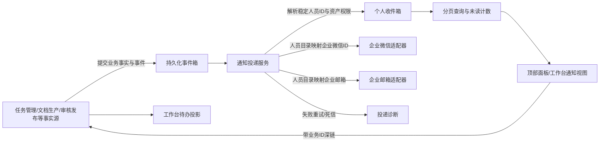
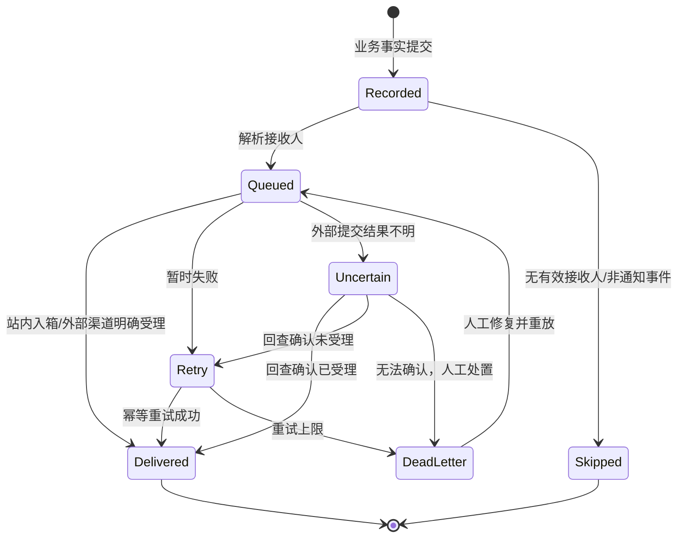
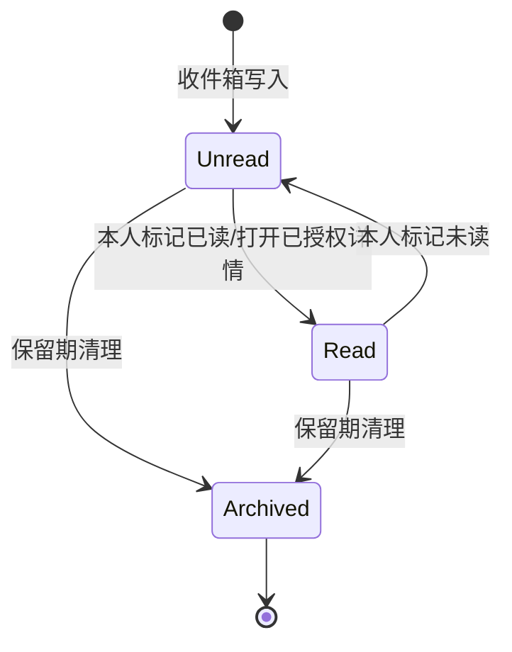

# 通知中心：业务事件与个人通知概要设计

状态：方案待评审，未实施（2026-11-10）。本设计针对知识中心管理平台；示例数据仅用于效果稿，不代表真实任务。

## 1. 问题、价值与边界

工作台回答“当前由我处理什么”，通知回答“哪项事实刚发生变化、为什么与我有关、从哪里进入”。现有工作台已有待我处理和等待他人投影，审核意见已有保存与回复；尚无持久化个人收件箱、结构化 `@手册` 接收人解析或可靠投递。跨角色流转、异常回流和异步完成时，用户可能不知道任务已转交或需要恢复。

建设目标：重要交接和异常可被准确送达且可追溯；用户从通知直达原对象；待办与通知使用同一业务事实，不维护两套任务状态。首期已确认同时接入**站内、企业微信、企业邮箱**，工作台标题栏提供站内通知面板，不增加一级导航。外部收件身份从企业人员目录中取得。只通知需要某人知晓或行动的关键事实；普通进度变化不逐条通知，避免消息淹没真正的交接。

通知只承载事实快照、接收人、阅读状态和安全定位链接；工单范围、审核决定、MR 状态与文档完成判定仍由原业务模块所有。点击通知或标记已读不能修改原业务状态；完成业务动作也不自动替用户“读过”历史消息。对已失效事项，打开后显示当前事实并提供历史入口。

## 2. 用户与场景

| 事件 | 接收人 | 用户需要获得的结果 | 优先级 |
|---|---|---|---|
| 工单、手册、文档任务首次分派或改派 | 新责任人；原责任人收到改派告知 | 新人进入可处理对象，旧人明确责任已移出 | P0 |
| 审核退回或明确的未处理意见 | 文档负责人；若意见结构化提及手册则加当前手册负责人 | 定位候选、意见和应处理范围 | P0 |
| 生产/审核中调整任务范围 | 被新增、撤出、改派或审核证据失效的责任人和审核人 | 停止旧工作、确认新范围或重审 | P0 |
| MR 创建失败、关闭、合并回读失败 | 有发布或修订职责的具名人员 | 看到失败原因与恢复入口 | P0 |
| 人工合并及目标正文/图片回读完成 | 工单责任人、相关文档负责人 | 知道交付结果；无需再盯外部状态 | P1 |
| 明确的审核请求、需要对方答复的评论回复 | 被指派审核人或被提及人员 | 开始审核或回复讨论 | P1 |
| 异步文档生成、清洗、大纲/模板维护完成或失败 | 发起人、下一阶段责任人（存在真实交接时） | 获得完成或恢复入口 | P1，按各模块真实事件逐项接入 |

不发送：草稿自动保存、每次轮询或刷新、同一事实的重复 API 回读、无指定接收人的通用“状态变化”。待办创建与通知可同源，但一个任务仍只按工作台原规则计数一次。消息不跨越资产可见范围泄露手册名、文档名、评论正文或 GitLab 地址。

## 3. 交互方案

工作台和平台其他页面的顶部使用铃铛按钮，显示本人未读数量；打开右侧通知面板，默认“未读”，可切“全部”，按类型筛选、按时间分组、单条标记已读或批量标记当前已加载的可见通知。每条包含事件标题、业务编号、影响对象、发生时间、发起人/来源、下一步入口；高风险事件标明原因。面板底部可进入工作台的完整通知视图以搜索和分页。窄屏为整页单列，保留返回位置、筛选和操作，不在页面上重复展示工作台待办表。

审核意见输入 `@` 后展示当前候选可见手册，使用手册 ID 区分同名项；提交前展示实际接收人。通知跳转到原审核意见，再由服务端核查当前权限、目标范围和候选版本。无权或对象已撤出时展示可理解的失效状态，不落到错误文档。通知正文只保留必要摘要，敏感原文仍在受控业务页读取。

可交互[效果稿](./知识中心-通知中心-工作台与审核提及-效果稿.html)展示桌面、窄屏、未读/全部、已读、详情定位、审核提及和部分数据状态。效果稿不调用业务 API。

## 4. 架构与数据流

领域写入与事件登记使用同一事务或等价可对账顺序；任一渠道投递失败不回滚已经成功的业务操作，也不阻止其他渠道。投递服务按事件 ID、收件人 ID、渠道去重，逐渠道记录结果。站内“已入箱”与企业微信/邮箱“渠道已受理”分别表达，外部渠道受理不等于用户已阅读。企业人员目录缺少已验证映射时站内仍投递，外部渠道标为“收件身份缺失”，不可猜测地址。通知投影保存展示快照及原业务引用，不复制审核正文或任务全量对象。首页未读计数与列表使用同一已授权收件箱；数据暂不可用时显示“通知暂不可用”和上次成功读取时间，不显示伪造的 0。

## 5. 两个状态机

投递状态与阅读状态独立。通知的业务对象可在任意阅读状态变成 `active`、`resolved` 或 `stale`；该标记来自实时权限及原对象投影，不用已读状态推断。被撤销权限后不提供内容深链，必要审计由后台保留。

## 6. 权限、治理与非功能要求

- 收件箱只能按可信会话本人查询和更改阅读状态；管理员代办他人业务不等于可读他人通知。管理员仅可看去敏的投递诊断，不能替人标记已读。
- 事件生产方提供稳定业务 ID、版本、操作者和目标角色；通知服务在投递时解析有效负责人，并在查看时再次校验可见范围。改派前已投递通知保留原收件人快照，新责任人的当前待办由工作台事实投影产生；重发须显式、有审计。
- 未读计数、面板和深链打开按仓库页面 100ms 交互目标设计。百万工单、500 在线、50 同时操作为既有容量测算目标，通知读写须用按收件人和时间的索引及真实压测证明，不以当前聚合 JSON 扫描宣称达标。
- 保留期、最大重试次数、通知类型开关和三渠道策略由受控配置管理；清理按时间分批、可审计、可恢复备份，业务审计与通知正文分离。默认天数与具体渠道配额在实施前冻结，不写死于前端。
- 首期 P0 交接与失败恢复类关键消息同时进入站内、企业微信和企业邮箱；用户不能静默关闭。P1 结果告知是否接入外部渠道由受控事件策略逐类决定，用户可按类型设置非必达消息偏好。截止日期提醒、重复催办和消息摘要暂不进入首期，避免把工作台任务重复推送成通知。
- 外部渠道只发送业务编号、事件类型和受控深链，评论正文、冻结文档内容、MR 差异和内部错误详情留在有权限的站内页面。企业微信应用和企业邮箱连接由平台治理配置，凭据不进入通知事件或效果稿；目录映射失效、渠道限流、明确拒绝和结果不明分别留诊断。
- 站内实时性建议采用业务事件流或 SSE；断线后依据最后事件序号补读，页面进入和重新可见时拉取收件箱。没有可靠事件源时只承诺刷新回读，不伪装实时到达。

## 7. 分期与验收

第一阶段先接入任务分派/改派、审核退回与 `@手册`、范围纠偏、MR 异常四类高价值事实，同时建设站内收件箱、企业微信适配器、企业邮箱适配器及工作台入口。第二阶段接入合并回读结果和各模块真实异步任务事件，按实际频次评估摘要通知。各来源模块必须提供事件契约及深链权限测试后才能接入；不能只在前端触发消息。

验收包括：同一业务命令重放不重复站内通知；改派和手册同名解析准确；评论已保存但某渠道暂时失败可恢复；人员目录缺映射时其他渠道继续投递；企业微信/邮箱明确受理、拒绝、限流、超时和结果不明分别处理，不能把结果不明当作已送达或盲目重发；源对象越权、停用人员、范围撤出、候选过期不泄露内容；工作台计数不因通知重复增加；已读/未读及分页计数一致；断线补读、死信重放、时间清理可对账；桌面和 390px 的键盘、焦点、无横向溢出；实际 API 和 P50/P95 耗时。效果稿仅用于评审，不等于上线验收。

已确认：首期同时接入站内、企业微信和企业邮箱；只通知关键事件；外部收件身份复用企业人员目录。仍需实施前核对企业微信应用、企业邮箱发送服务的真实协议、凭据治理与目录字段映射，未获得这些连接信息时只完成隔离适配器验证，不宣称真实外部送达。
