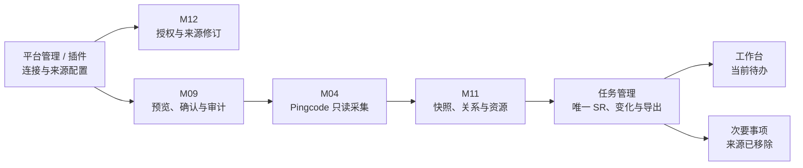
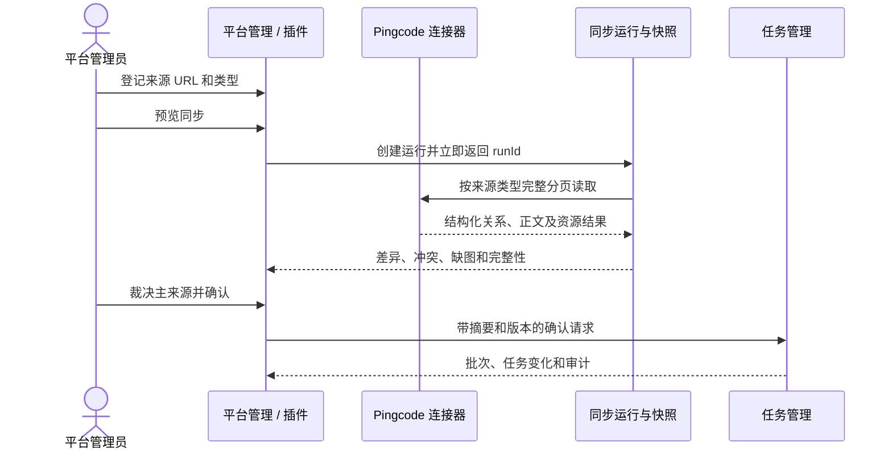
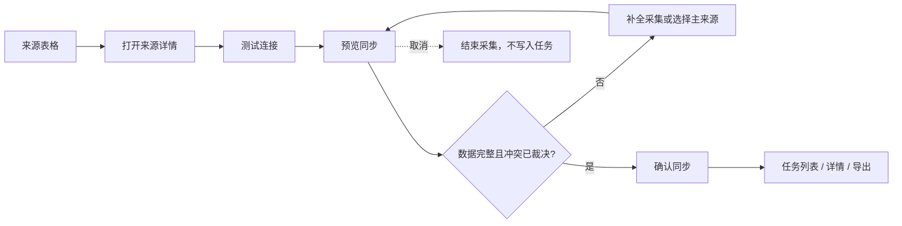

# 知识中心任务管理：Pingcode 来源同步详细设计

> 2026-11-11；依据[概要设计](../02-概要设计/知识中心-任务管理-Pingcode需求基线同步-概要设计文档.md)。本文为实施契约，实际验收结果须另行记录。

## 1. 模块与事实归属

任务详情的关系表投影可以不返回旧聚合中的 `assignmentHistory`。前端详情必须将缺省历史视为空列表，不能因可选审计字段缺失而阻断任务详情、来源变化和来源资料导出入口；有审计历史时仍按原顺序展示。

| 模块 | 输入 | 输出 | 禁止承担的职责 |
|---|---|---|---|
| 平台管理 / 插件 | 已授权连接、来源名称、HTTPS URL、人工类型 | 来源配置及同步操作入口 | 不直接修改任务状态 |
| Pingcode 连接器 | 已核验的基线或视图 ID、会话 | 完整分页的 IR、IR→SR 关系、SR 正文和资源读取结果 | 不猜测关联，不改派平台责任人 |
| 同步运行器 | 来源配置和连接器结果 | 运行进度、完整性结果、差异预览、缺图警告 | 未确认时不写任务 |
| 任务管理 | 已确认且未过期的预览 | 唯一 SR 任务、来源快照引用、变化历史、次要事项 | 不根据 Pingcode 状态判定平台完成 |
| 导出器 | 已确认快照及授权主体 | 固定列 CSV、Markdown 和图片包 | 不在导出时重新访问 Pingcode |





## 2. 来源标识与采集

需求 URL 仅接受 `https://pingcode.yasdb.com/ship/products/{product}/baselines/{baseline}/ideas?category={all|suiteShortId}`。先验证产品、基线及分类归属，随后读取完整分页。每条 IR 使用基线列表中的主体 `_id` 与 `version_id` 调用 `GET /api/ladon/relation/related-items`，参数固定为 `principal_name=idea&target_name=work_item`。仅接受 `whole_identifier` 为 `YDBRD-*`、`project_id` 与已核验 YDBRD 项目相符的工作项。记录 `_id`、`short_id` 和 IR 编号。关系数量与需求项的 `relation_data.work_item` 不符时本轮不可确认。

Agent + Skill 作为连接器的受控辅助能力：连接器先按来源授权读取页面与 API 结果；Agent 可在页面字段布局变化时，依据版本化 Skill 从已读取的页面快照中提出字段映射、正文规范化结果或诊断建议。输出必须是符合 JSON Schema 的候选，并为每个候选字段附上原始记录 ID 和证据片段位置。服务端继续核对记录总数、分页版本、IR→SR 关系数量、SR 编号及项目身份；校验失败时只显示 Agent 的诊断建议，不将候选写入任务或导出快照。Agent 不得补造编号、关联、负责人或日期，不得访问或输出 Cookie、令牌和模型凭据。当前同步链路尚未调用该辅助 Agent；实现前须补齐 Skill 契约、调用权限、运行记录及测试，且不得让模型获得真实 Pingcode 正文，除非对应模型数据流已获批准。

结构化读取失败返回稳定错误码。`PINGCODE_RELATION_INCOMPLETE` 可带 `sourceNumber`、`expectedCount` 与 `actualCount`，不包含需求正文；分页结构、来源身份和关联身份错误使用各自错误码。Pingcode API 的 `{success:false,error:{code,message}}` 由平台适配器统一解包并保留状态码、错误码和安全诊断字段；运行失败记录至少保留错误码并由插件详情页展示。模型辅助不得覆盖连接器错误或将失败改写为成功。

工单 URL 仅接受 `https://pingcode.yasdb.com/pjm/projects/YDBRD/defect/{viewShortId}`。先读取项目与 `visible/views/{viewShortId}` 验证视图归属和当前筛选条件，再用该视图的 `criteria`、`columns` 与 `addon_setting_id` 请求 `POST /api/agile/projects/{projectId}/defect/views/{viewId}/content`。`pi` 从 0 到 `page_count-1`，每页沿用同一视图筛选；比较所有分页的 `count`、视图版本和 SR ID，任何漂移或重复都使预览不可确认。只同步所选视图的结果。该示例视图当前约 47136 项，故采集必须是可取消的后台任务，前端不得等待全部分页。

详情用 `GET /api/agile/work-items/{shortId}` 核对稳定 `_id`、项目和编号，再提取标题、描述、来源负责人、日期与资源。正文用现有 HTML/Markdown 转换和来源图片托管模块；缺图保留失败记录。不得把 Pingcode Cookie、会话令牌或原始请求头写入快照。

## 3. API 契约

所有平台写请求要求认证、管理员权限和幂等键。列表与资源读取检查当前任务可见性。错误统一返回 `success:false,error:{code,message}`。

| 方法与路径 | 主要输入 | 主要输出 | 门槛 |
|---|---|---|---|
| `GET /api/platform/plugins/pingcode/sources` | 无 | 配置清单、连接状态、最近运行 | 管理员 |
| `POST /api/platform/plugins/pingcode/sources` | `name,type,url` | `sourceId,revision` | URL/类型/归属校验；不得传凭据 |
| `POST /api/platform/plugins/pingcode/sources/{id}/test` | 无 | 权限、视图/基线规模、能力 | 只读，不创建任务 |
| `POST /api/platform/plugins/pingcode/sources/{id}/runs` | 无 | `runId,status=collecting` | 后台运行；立即响应 |
| `GET /api/platform/plugins/pingcode/runs/{id}` | 无 | 进度、摘要、差异、警告、冲突 | 分页可读；失败保留前次快照 |
| `POST /api/platform/plugins/pingcode/runs/{id}/decisions` | `number,primarySourceId` | 新预览摘要 | 同号异来源冲突须逐项决定 |
| `POST /api/platform/plugins/pingcode/runs/{id}/confirm` | `digest,expectedRevision` | 批次与变化统计 | 完整、未过期、无未裁决冲突 |
| `POST /api/platform/plugins/pingcode/runs/{id}/cancel` | 无 | `status=cancelled` | 仅采集期可取消 |
| `GET /api/document-tasks?type=&ir=&attention=` | 分页与筛选 | 原有任务加类型/IR/关注级别 | 默认仅正常事项 |
| `GET /api/document-tasks/export.csv` | 同列表筛选 | 固定 12 列 CSV | 公式和换行安全转义 |
| `GET /api/document-tasks/{number}/source.md` | 无 | 快照 Markdown 或 ZIP | 含图片时使用相对 `assets/` 路径 |

## 4. 事务与伪代码

实施补充（2026-11-12）：平台统一入口仍使用现有登录会话和 `platform:manage` 权限；Pingcode 内部单页接口只由平台服务端调用。运行器在后台逐页核对来源身份、筛选条件、总数、版本和工作项 ID，任何关键字段漂移均使预览不可确认。预览摘要同时绑定来源配置修订、任务修订和采集结果；确认时复核，不能凭浏览器传回的条目直接写任务。来源快照和任务变更必须有同一确认批次 ID；中断或存储失败不能把半批次显示为已确认。图片失败作为独立警告，正文、关系或分页失败则停止确认。真实企业视图仅只读采样，隔离夹具负责写入验收。

```text
start(source):
  assert admin and source.enabled
  create run(status=collecting, sourceRevision)
  return runId immediately

collect(run):
  verify remote product/project and baseline/view identity
  fetch all pages; verify count, no duplicate identity, same filter/version
  for each IR: fetch structured work_item relations
  for each SR: fetch detail, convert body, stage image resources
  if critical fact missing: mark failed; keep previous confirmed snapshot
  else compare with current confirmed sources and tasks; mark awaiting_confirm

confirm(run, digest, revision):
  assert admin, complete, fresh digest/revision, resolved primary sources
  transaction:
    write immutable snapshot, changes and confirmation audit
    upsert each YDBRD by global number; preserve owner, scope, review and completion
    update source fields only from selected primary source
    compute attention only after every enabled related source has a complete round
  publish staged resources after transaction; retry missing images separately
```

`source_removed` 是关注级别，不是任务状态。已完成任务仍为完成；同步不能清空审核、MR 或人工计划时间。预览变化至少包括新增、更新、不变、IR 关系变化、缺图、身份冲突和移入/恢复次要事项。确认时若来源配置、任务修订或上游视图筛选发生变化，返回 `409 PREVIEW_STALE`。

## 5. 验收边界

API 测试须覆盖授权、完整分页、关系失配、视图筛选漂移、同号来源裁决、重复确认、缺图、来源移除与恢复、已完成不回退、CSV 注入防护和资源权限。浏览器验收使用隔离测试数据，验证插件页、预览、任务筛选、变化和导出；桌面与窄屏首屏在 100ms 内呈现已有骨架，长同步异步更新。真实 Pingcode 只读验证允许读取两条基线和选定视图；未经单独确认不得把真实 47136 条缺陷直接写入平台任务库。

插件页的用户操作路径如下。失败分支保留在同步批次中，不能跳过完整性检查直接确认。



来源登记只校验名称、类型和 URL 格式并保存配置，不访问 Pingcode 数据页；“测试连接”才执行只读远端校验并返回来源规模。保存按钮在请求期间显示“保存中…”，错误在表单内显示。这样避免把网络读取隐藏在“保存来源”中，尤其是需求基线首屏关联读取较慢时，用户可以立即知道动作正在执行或已结束。

### 2026-11-11 实测差异

当前连接器分页切片已经能用已授权会话读取基线第 2 页 9 条 IR 与缺陷视图第 1 页 50 条 SR。缺陷视图列表响应包含 `description`，连接器仅在正文缺失时逐条回读详情，避免对 47136 条数据额外发起同量详情请求。基线第 1 页的 `YASHAN-4403` 显示 `relation_data.work_item=2`，但用该 IR 的主体和基线版本查询结构化工作项返回 0；改用最新版 ID 仍返回 0。因此当前必须标记该页为关系不完整，不得确认需求来源同步。需要核对上游是否存在已删除、无权访问或版本关系口径差异；不能用正文编号替代关系。详见[阶段验收记录](../05-测试设计&报告/02-测试报告/知识中心-Pingcode任务来源同步-阶段验收-20261111.md)。

### 2026-11-12 容量与事务补充

当前任务保存在 `document_tasks/state` 单条聚合记录；YashanDB 存储服务默认单次请求体上限为 16 MiB。所选视图现有约 47136 条 SR，若把这些任务、正文和历史放进同一聚合，即使先通过一次确认，后续读写仍须反复传输整份任务集，无法满足列表首屏 100ms 约束。实现必须先解决按任务分页、按来源快照分片和批次原子性，不能提高请求体上限冒充容量方案。

| 方案 | 写入与查询 | 评价 |
|---|---|---|
| 扩大单条聚合上限 | 继续一次读取和重写全部任务 | 不满足 47136 条及 100ms；不采用 |
| 通用 KV 分片 | 按任务编号保存记录，另维护多个索引记录 | 单条容量可控，但跨分片确认、列表筛选与旧任务迁移需要补事务协议；可作为临时适配，不作为本次 9 分目标基线 |
| 在现有 YashanDB 内增加任务、来源和批次关系表 | 按 SR 编号唯一索引、按筛选条件分页；同一数据库事务确认快照和任务投影 | 推荐；需明确旧聚合任务兼容、迁移与回退，并按 Approval Boundary v1 §3.2 审批新 Schema |

推荐表组的职责：`KC_TASK` 以 `YDBRD` 编号唯一，保存平台任务事实与修订；`KC_PINGCODE_SOURCE` 保存来源 URL、类型、配置修订和启停；`KC_PINGCODE_RUN` 保存运行、预览摘要与确认批次；`KC_PINGCODE_SNAPSHOT` 按批次和 SR 编号保存来源字段及正文；`KC_PINGCODE_IR_RELATION` 保存多对多 IR；`KC_PINGCODE_RESOURCE` 保存资源元数据和修复版本。正文图片二进制仍放受控 `runtime` 资源仓，数据库保存哈希、状态和访问映射。列表和工作台通过任务表索引分页读取，不扫描正文。确认必须在一个数据库事务里校验来源修订、任务修订与摘要，写入新快照、变化、主来源及任务来源字段；旧任务的负责人、范围、审核、MR 和完成状态原样保留。旧聚合记录在迁移验证前保持只读可回退副本；迁移按编号去重、逐项对账，不在本轮自动触碰真实任务数据。

容量验收须覆盖 47136 条等量隔离夹具的分页采集、任务列表 P50/P95、单次确认失败回滚、重复确认、旧任务兼容和备份回退。真实视图继续只读，除非另获真实数据写入授权。关系计数不一致仍阻断真实需求来源确认。

### 2026-11-12 关系表实施门槛

用户已批准新增关系表并要求备份后迁移旧任务。迁移顺序固定为：确认目标是隔离个人开发库、从已提交版本构建迁移产物、结构快照、旧聚合只读备份、逐编号迁移、数量与正文哈希对账、验证列表与详情、保留回退副本。共享库迁移仍由项目负责人按 Storage 约束执行；真实 Pingcode 来源保持只读。

迁移兼容性：已提交的历史 SQL 不修改摘要。YashanDB 若对 `CREATE INDEX` 返回 `YAS-02043`，迁移执行器只在 `USER_IND_COLUMNS` 证明同一表已有**列及列顺序完全一致**的索引时跳过该冗余语句；其他 DDL 错误仍停止。个人开发库执行失败后从已验证的数据与结构导出恢复或清空重试，不能把部分执行的版本标记为完成。

`017` 编号与容量修订（2026-11-12）：生产库尚未执行 `017`；个人库 `regress` 已执行旧摘要并由负责人允许备份后重建。新 DDL 中 `KC_DOCUMENT_TASK` 及任务关联表以 `TASK_PREFIX VARCHAR(16)`、`TASK_NUMBER BIGINT` 组成任务身份，API 仍收发 `前缀-十进制编号`。Pingcode SR/IR 表分别固定为 `YDBRD` / `YASHAN` 类型，因此仅存 `SR_NUMBER BIGINT` / `IR_NUMBER BIGINT`；连接、运行、上游、人员、手册和幂等 ID 是不透明外部或内部标识，保持字符列。解析只接受规范的十进制后缀与 64 位有符号整数范围，拒绝前导零、溢出和无法拆分的旧任务编号；切换前须对旧聚合编号做预检。配置幂等记录使用 `WRITE_KIND=CONFIG` 且任务身份为空，不再把 `__config__` 放入编号列。

持续追加的运行、SR/IR 快照与关系、变化、资源、幂等记录按 `CREATED_AT` 月度间隔分区；当前任务、来源登记及当前来源映射保持普通表。归档时必须先确认运行及其子表全部越过保留边界、导出并核验对应分区，再按依赖顺序清理；本次 DDL 不自动删除任何分区，也不设未经批准的保留期限。伪代码：`parse(externalNumber) -> (prefix, bigint)`；`persist/query by numeric identity`；`format(prefix, bigint) -> externalNumber`；历史写入使用数据库默认创建时间；归档作业依据批准的保留策略选择同月分区并对账运行数、快照数及资源引用后执行。

任务业务事实只能有一个可写权威记录。切换前，旧聚合是权威，关系表中的 Pingcode 任务不能作为可操作任务展示；切换后，关系表是权威，范围确认、分派、审核关联和完成状态必须按单任务事务更新，不能继续改写旧聚合。任务配置单独存入 `KC_DOCUMENT_TASK_CONFIG`，以配置修订做 CAS；切换后的请求不得为读取配置下载旧聚合。过渡期间的列表需要显式区分“已同步来源快照”和“可处理任务”，不能把来源快照误当成已完成迁移的任务。

确认同步先校验完整性、摘要、来源版本、任务行版本和逐编号主来源裁决；在一个事务中按游标处理来源快照、IR 关系、来源存在性与任务投影。任务已有 `PAYLOAD` 时仅更新来源事实列，保留业务状态与人工分派；未选出主来源时事务回滚。确认成功后才更新 `LAST_CONFIRMED_RUN` 与运行状态。列表与导出均使用数据库分页，正文按编号读取，禁止把所有任务或正文加载到单个进程数组。

关系表切换的执行契约：`KC_DOCUMENT_TASK.PAYLOAD` 是单篇任务的业务事实，`ROW_VERSION` 是并发版本；列表只查询分页索引列及当前页正文，不扫描全表 CLOB。任务负责人、手册负责人和文档负责人在 `KC_DOCUMENT_TASK_ACTOR` 按编号和人员 ID 建索引，工作台只读取当前人员关联的任务。任务编号详情、范围确认、分派、审核关联和完成操作均只读写该任务行；审核任务 ID 另建索引定位任务。配置读取和更新使用 `KC_DOCUMENT_TASK_CONFIG`；切换后旧聚合仅作回退副本，不再读写。任务审计及幂等结果按任务存储，与任务行在同一事务写入。

任务索引状态必须与现有业务投影一致：未确认范围为 `PENDING_SCOPE`，已确认但未完成为 `IN_PROGRESS`，完成为 `COMPLETED`。逐任务写入使用业务层已经计算的 `status`；旧聚合迁移时若缺失该字段，只能依据已保存的范围确认事实推断前两者，不能仅因字段缺失把已确认任务归入待确认。无法从旧聚合独立证明的完成状态须在对账报告中列出，不能凭来源状态补判完成。

逐任务写入的幂等记录同时保存首次返回的业务响应和首次提交后的任务快照。同一幂等键及请求摘要重试时返回该快照，不查询后来更新过的任务；`GET /writes/{key}` 继续返回首次业务响应。相同键但请求摘要或任务编号不同必须拒绝。旧格式幂等记录按原格式回读，避免影响迁移前的记录。

### 快照资料的读取与导出接口（2026-11-12）

已确认批次的正文、IR 关系及字段变化从关系表按任务编号读取，不从前端提交的内容重新拼装，也不在导出时访问 Pingcode。Storage 内部提供 `GET /v1/pingcode-task-sync/tasks/{number}/source` 和 `/changes?page=&pageSize=`；前者只选当前主来源的 `LAST_CONFIRMED_RUN`，返回 Markdown、正文哈希、来源 URL、资源版本和资源清单；后者按确认时间倒序分页返回来源、字段、前后值及批次。平台外部接口为 `GET /api/document-tasks/{number}/source-export`、`GET /api/document-tasks/{number}/sync-changes` 和 `GET /api/document-tasks/export.csv`，先按现有任务可见性校验，再调用内部接口。没有已确认来源时明确返回 404。

CSV 使用任务列表同一筛选及可见性投影，逐页读取，固定 12 列、UTF-8 BOM、CRLF。单次导出最多 10000 行和 20 MiB，超限明确拒绝并提示缩小筛选；更大范围的异步导出列为后续容量工作，不允许静默截断。Markdown 按概要设计第 8 节的固定结构生成；若无图片直接输出 `.md`，有图片则输出 ZIP，图片路径只用内容哈希和可信扩展名。下载及预览不能绕过现有 `knowledge:read` 和手册可见性。

采集正文中的 Pingcode 图片时，只允许当前 Pingcode 主机的 `/atlas/files/public/` 路径。内部连接器使用当前授权会话取原图并按字节签名校验类型，平台同步服务把原图以 SHA-256 为文件名写入受控 `runtime/pingcode/task-resources`，数据库 `KC_PINGCODE_RESOURCE` 只保存哈希、相对路径、类型、字节数、状态和错误码。无效、超限或下载失败的图片保留失败元数据及正文占位；确认批次状态为 `CONFIRMED_MISSING_IMAGES`，不影响正文与关系完整性的确认。重试只修复失败资源，增加资源版本，不修改不可变正文、任务来源字段或历史结论。运行文件写入失败不得标为图片已保存。

任务列表的“导出 CSV”沿用当前筛选和正常/次要事项视图；任务详情的“同步变化”按确认批次分页读取字段前后值，“导出来源资料”只取当前主来源已确认快照。插件页对缺图批次展示失败数量、明细和“重试缺图”，重试进度由运行资源接口轮询。变化总数和列表都只包含已确认批次；同一 SR 被多个 IR 引用时只保留一份正文与资源快照，IR 关系独立累积。导出图片必须与数据库记录的哈希和字节数一致，否则拒绝下载。

同一连接、类型和 URL 只能登记一次来源。重复登记返回来源冲突，页面可引导打开已有配置；数据库唯一约束仍作为并发兜底，不能把正常的重复输入误报为服务不可用。

确认同步新建的 SR 任务使用任务配置中的 `defaultOwnerId` 作为平台第一层责任人，同时写入任务行的 `OWNER_ID` 和 `KC_DOCUMENT_TASK_ACTOR` 的 `OWNER` 关系，使其立即出现在该人的待办；若没有有效默认责任人，则整个确认事务失败。已存在任务的人工责任人不得被 Pingcode 来源覆盖。

Storage 内部提供 `GET /v1/document-tasks`（页码、每页至多 100、筛选、正常/次要事项）、`GET /v1/document-tasks/{number}`、`PUT /v1/document-tasks/{number}`（预期行版本、完整任务、幂等结果）与按人员/审核 ID 的索引查询。平台网关继续负责认证和可见性校验，Storage 接口不接受浏览器直接访问。迁移先建立结构，再备份旧聚合、逐条复制并校验哈希；激活前再次校验旧聚合修订、哈希及关系表每条任务，确认期间停止旧写入。激活后禁止旧聚合任务写入；任一校验失败不得改为 `ACTIVE`。

读取端点细化：`GET /v1/document-tasks` 返回 `{items,total,page,pageSize}`，支持 `q,ownerId,product,version,type,status,ir,attention`；`GET /v1/document-tasks/mine?principalId=` 和 `GET /v1/document-tasks/by-review/{reviewTaskId}` 走对应索引；`GET /v1/document-tasks/{number}` 只读取指定任务。所有读取仅在迁移记录为 `ACTIVE` 时可用，未激活返回冲突，绝不退回到尚未对账的关系表快照。平台层仍负责授权和任务可见性校验。

### 提交前数据正确性复核（2026-11-12）

个人工作投影必须遍历关系表查询的全部分页，不能用第一页 100 条冒充完整待办及跟进总数；分页期间若数量变化造成缺项或重复，应返回可重试错误而非静默漏项。任务列表的产品、版本筛选候选由 Storage 在当前可见手册和正常/次要事项范围内独立聚合，不能从当前页 `items` 推导。候选不受当前搜索与其他筛选项限制，口径与旧聚合一致。该修复先保证正确性；大规模个人工作投影的索引化分页及 100ms 性能仍属独立容量验收。

采集图片失败时，正文写为“图片未能读取”占位，原始规范化 URL 仅保留在失败资源元数据中供重试使用。确认快照和 AI 引用都不能继续呈现失效的远程图片引用。

### 插件来源页布局实施约束（2026-11-12）

平台管理的 Pingcode 插件页采用方案 D：来源列表以全宽表格展示；行内可见来源名称、人工选择的类型、启用状态、来源 URL 和详情入口。工具栏提供名称/URL 搜索、类型筛选、启用状态筛选及添加来源。点击来源行、键盘 Enter/Space 或“详情”打开该来源的原生对话框；详情集中展示来源配置、最近运行、运行历史、同步预览、冲突主来源选择、确认和缺图重试。弹窗 Escape 与关闭按钮均可关闭；打开首屏不自动选择首条来源。

首屏只请求来源列表，不为每条来源逐一请求运行记录，不虚构接口未返回的“最近同步时间”和“任务数”。用户打开某来源时，才请求该来源的运行记录、最新运行预览和资源状态。列表 API 失败显示带错误原因和重试入口的故障态；成功返回空列表显示添加来源空态；筛选无匹配显示独立的无结果状态。故障不得伪装成空列表。

添加来源是独立表单提交：点击“保存来源”不得由外围按钮事件重绘移除表单；提交期间显示“正在登记来源…”，接口成功且来源列表回读、详情首轮加载完成后关闭表单、打开新来源详情并显示“来源已添加”。幂等键优先使用 `crypto.randomUUID()`；HTTP 非安全上下文不可用时，使用 Web Crypto `getRandomValues()` 生成 UUID，不得在请求发送前静默失败。登记操作只保存平台来源配置，不自动读取 Pingcode；后续连接检查和预览分别由用户触发。浏览器验收必须断言实际创建 POST、列表回读包含新来源及详情成功状态，不得只以对话框关闭作为成功证据，并覆盖 `randomUUID` 不可用的 HTTP 环境。

窄屏将每一行重排为来源卡片，URL 可换行，页面不横向滚动；同步预览表可在弹窗内容区独立横向滚动。弹窗标题区和操作区固定，正文区单独滚动；键盘焦点可见，所有图标操作提供可访问名称。视觉仍使用知识中心现有颜色和按钮 token，不新增后端状态、接口或来源统计字段。浏览器验收覆盖桌面搜索/筛选、行键盘操作、弹窗关闭、原同步流程、空态/故障态区分和 390px 无页面溢出；首屏性能需以只调用来源列表 API 的请求记录核验。
