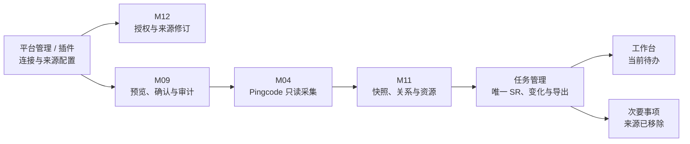
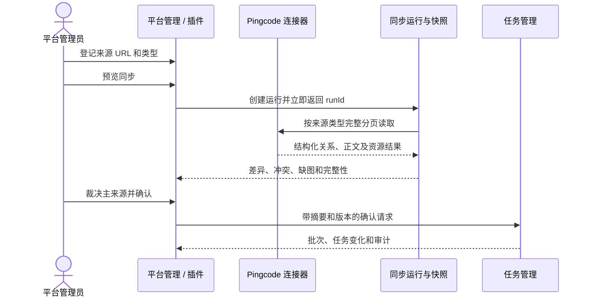
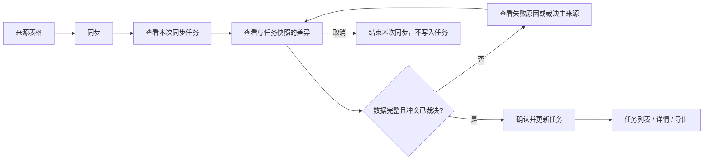
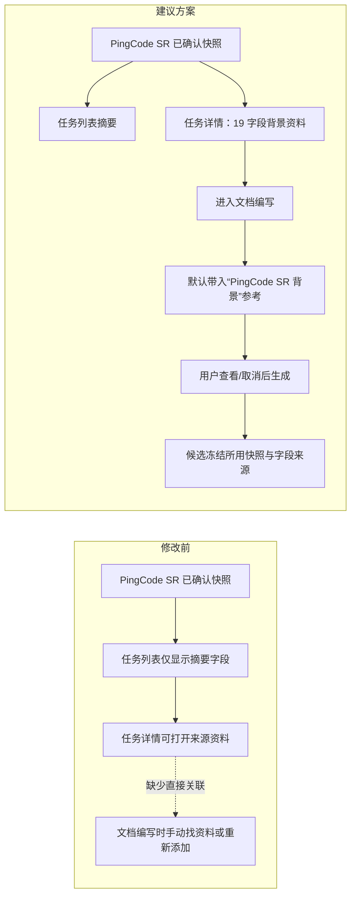
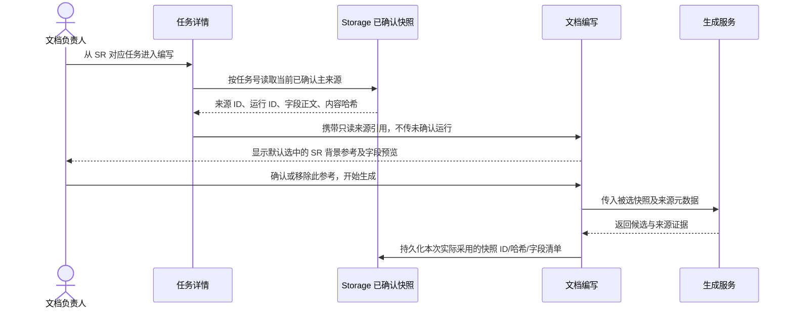

# 知识中心任务管理：Pingcode 来源同步详细设计

> 2026-11-11；依据[概要设计](../02-概要设计/知识中心-任务管理-Pingcode需求基线同步-概要设计文档.md)。本文为实施契约，实际验收结果须另行记录。

## 1. 模块与事实归属

平台管理的 PingCode 配置、新增和删除确认弹窗统一以 `--kc-viewport-height` 计算高度与上限。来源详情弹窗已移除；同步内容通过独立工作区查看。数据库连接首屏加载契约以当前可见的状态骨架及 JDBC 骨架为准，不再依赖已废弃的状态卡骨架类名。

任务详情的关系表投影可以不返回旧聚合中的 `assignmentHistory`。前端详情必须将缺省历史视为空列表，不能因可选审计字段缺失而阻断任务详情、来源变化和来源资料导出入口；有审计历史时仍按原顺序展示。

| 模块 | 输入 | 输出 | 禁止承担的职责 |
|---|---|---|---|
| 平台管理 / 插件 | 已授权连接、来源名称、HTTPS URL、人工类型 | 来源配置及同步操作入口 | 不直接修改任务状态 |
| Pingcode 连接器 | 已核验的基线或视图 ID、会话 | 完整分页的 IR、IR→SR 关系、SR 正文和资源读取结果 | 不猜测关联，不改派平台责任人 |
| 同步运行器 | 来源配置和连接器结果 | 运行进度、完整性结果、差异预览、缺图警告 | 未确认时不写任务 |
| 任务管理 | 已确认且未过期的预览 | 唯一 SR 任务、来源快照引用、变化历史、次要事项 | 不根据 Pingcode 状态判定平台完成 |
| 导出器 | 已确认快照及授权主体 | 固定列 CSV、Markdown 和图片包 | 不在导出时重新访问 Pingcode |





## 2. 来源标识与采集

需求 URL 仅接受 `https://pingcode.yasdb.com/ship/products/{product}/baselines/{baseline}/ideas?category={all|suiteShortId}`。先验证产品、基线及分类归属，随后读取完整分页。每条 IR 使用基线列表中的主体 `_id` 与 `version_id` 调用 `GET /api/ladon/relation/related-items`，参数固定为 `principal_name=idea&target_name=work_item`。仅接受 `whole_identifier` 为 `YDBRD-*`、`project_id` 与已核验 YDBRD 项目相符的工作项。记录 `_id`、`short_id` 和 IR 编号。IR 先于 SR 创建、PingCode 关系 API 明确返回空列表时，视为暂未关联：IR 保留为分页完整性和审计输入，`workItems` 为空，不生成 SR 或 IR→SR 关系；累计 `unlinkedIrCount` 并记录安全告警。非空返回数量与 `relation_data.work_item` 不符、关系响应结构异常或身份冲突仍阻断本页和本次预览。不能把部分关系缺失降级为未关联。

Agent + Skill 作为连接器的受控辅助能力：连接器先按来源授权读取页面与 API 结果；Agent 可在页面字段布局变化时，依据版本化 Skill 从已读取的页面快照中提出字段映射、正文规范化结果或诊断建议。输出必须是符合 JSON Schema 的候选，并为每个候选字段附上原始记录 ID 和证据片段位置。服务端继续核对记录总数、分页版本、IR→SR 关系数量、SR 编号及项目身份；校验失败时只显示 Agent 的诊断建议，不将候选写入任务或导出快照。Agent 不得补造编号、关联、负责人或日期，不得访问或输出 Cookie、令牌和模型凭据。当前同步链路尚未调用该辅助 Agent；实现前须补齐 Skill 契约、调用权限、运行记录及测试，且不得让模型获得真实 Pingcode 正文，除非对应模型数据流已获批准。

结构化读取失败返回稳定错误码。`PINGCODE_RELATION_INCOMPLETE` 可带 `sourceNumber`、`expectedCount` 与 `actualCount`，不包含需求正文；分页结构、来源身份和关联身份错误使用各自错误码。Pingcode API 的 `{success:false,error:{code,message}}` 由平台适配器统一解包并保留状态码、错误码和安全诊断字段；运行失败记录至少保留错误码并由插件详情页展示。模型辅助不得覆盖连接器错误或将失败改写为成功。

工单 URL 仅接受 `https://pingcode.yasdb.com/pjm/projects/YDBRD/defect/{viewShortId}`。先读取项目与 `visible/views/{viewShortId}` 验证视图归属和当前筛选条件，再用该视图的 `criteria`、`columns` 与 `addon_setting_id` 请求 `POST /api/agile/projects/{projectId}/defect/views/{viewId}/content`。`pi` 从 0 到 `page_count-1`，每页沿用同一视图筛选；比较所有分页的 `count`、视图版本和 SR ID，任何漂移或重复都使预览不可确认。只同步所选视图的结果。该示例视图当前约 47136 项，故采集必须是可取消的后台任务，前端不得等待全部分页。

详情用 `GET /api/agile/work-items/{shortId}` 核对稳定 `_id`、项目和编号，再提取标题、描述、来源负责人、日期与资源。需求关联列表只提供简要工作项，不含自定义属性；缺陷视图列配置也不能保证返回完整属性。故连接器对当前分页中的工作项详情按最多 50 条分批读取、每批最多 10 个并发请求，严格核对详情数量及每条记录的 `_id`、`short_id`、编号和项目后才接受。需求和工单正文统一从详情 `properties` 提取“测试建议”（`ceshijianyi`）、“概要设计方案”（`gaiyaoshejifangan`）、“开发设计方案”（`kaifashejifangan`）及“会议纪要”（`kaifashejifanganpingshenhuiyijiyao`）；空字段明确显示“PingCode 未填写”，不猜测或从其他字段补值。正文用现有 HTML/Markdown 转换和来源图片托管模块；缺图保留失败记录。不得把 PingCode Cookie、会话令牌或原始请求头写入快照。

## 3. API 契约

所有平台写请求要求认证、管理员权限和幂等键。列表与资源读取检查当前任务可见性。错误统一返回 `success:false,error:{code,message}`。

| 方法与路径 | 主要输入 | 主要输出 | 门槛 |
|---|---|---|---|
| `GET /api/platform/plugins/pingcode/sources` | 无 | 配置清单、连接状态、最近运行 | 管理员 |
| `POST /api/platform/plugins/pingcode/sources` | `name,type,url` | `sourceId,revision` | URL/类型/归属校验；不得传凭据 |
| `POST /api/platform/plugins/pingcode/sources/{id}/runs` | 无 | `runId,status=collecting` | 后台运行；立即响应 |
| `GET /api/platform/plugins/pingcode/runs/{id}` | 无 | 进度、摘要、差异、警告、冲突 | 分页可读；失败保留前次快照 |
| `GET /api/platform/plugins/pingcode/runs/{id}/preview?page=&pageSize=&view=` | `view=current/created/updated/removed/conflicts` | 对应分类的分页差异 | 插件、Node 服务和 Storage 使用同一分类枚举；未知值拒绝 |
| `POST /api/platform/plugins/pingcode/runs/{id}/decisions` | `number,primarySourceId` | 新预览摘要 | 同号异来源冲突须逐项决定 |
| `POST /api/platform/plugins/pingcode/runs/{id}/confirm` | `digest,expectedRevision` | 批次与变化统计 | 完整、未过期、无未裁决冲突 |
| `POST /api/platform/plugins/pingcode/runs/{id}/cancel` | 无 | `status=cancelled` | 仅采集期可取消 |
| `GET /api/document-tasks?type=&ir=&attention=` | 分页与筛选 | 原有任务加类型/IR/关注级别 | 默认仅正常事项 |
| `GET /api/document-tasks/export.csv` | 同列表筛选 | 固定 12 列 CSV | 公式和换行安全转义 |
| `GET /api/document-tasks/{number}/source.md` | 无 | 快照 Markdown 或 ZIP | 含图片时使用相对 `assets/` 路径 |

## 4. 事务与伪代码

实施补充（2026-11-12）：平台统一入口仍使用现有登录会话和 `platform:manage` 权限；Pingcode 内部单页接口只由平台服务端调用。运行器在后台逐页核对来源身份、筛选条件、总数、版本和工作项 ID，任何关键字段漂移均使预览不可确认。预览摘要同时绑定来源配置修订、任务修订和采集结果；确认时复核，不能凭浏览器传回的条目直接写任务。来源快照和任务变更必须有同一确认批次 ID；中断或存储失败不能把半批次显示为已确认。图片失败作为独立警告，正文、关系或分页失败则停止确认。真实企业视图仅只读采样，隔离夹具负责写入验收。

```text
start(source):
  assert admin and source.enabled
  create run(status=collecting, sourceRevision)
  return runId immediately

collect(run):
  verify remote product/project and baseline/view identity
  fetch all pages; verify count, no duplicate identity, same filter/version
  for each IR: fetch structured work_item relations
  for each SR: fetch detail, convert body, stage image resources
  if critical fact missing: mark failed; keep previous confirmed snapshot
  else compare with current confirmed sources and tasks; mark awaiting_confirm

confirm(run, digest, revision):
  assert admin, complete, fresh digest/revision, resolved primary sources
  transaction:
    write immutable snapshot, changes and confirmation audit
    upsert each YDBRD by global number; preserve owner, scope, review and completion
    update source fields only from selected primary source
    compute attention only after every enabled related source has a complete round
  publish staged resources after transaction; retry missing images separately
```

`source_removed` 是关注级别，不是任务状态。已完成任务仍为完成；同步不能清空审核、MR 或人工计划时间。预览变化至少包括新增、更新、不变、IR 关系变化、缺图、身份冲突和移入/恢复次要事项。确认时若来源配置、任务修订或上游视图筛选发生变化，返回 `409 PREVIEW_STALE`。

## 5. 验收边界

API 测试须覆盖授权、完整分页、关系失配、视图筛选漂移、同号来源裁决、重复确认、缺图、来源移除与恢复、已完成不回退、CSV 注入防护和资源权限。浏览器验收使用隔离测试数据，验证插件页、预览、任务筛选、变化和导出；桌面与窄屏首屏在 100ms 内呈现已有骨架，长同步异步更新。真实 Pingcode 只读验证允许读取两条基线和选定视图；未经单独确认不得把真实 47136 条缺陷直接写入平台任务库。

插件页的用户操作路径如下。失败分支保留在同步批次中，不能跳过完整性检查直接确认。



来源登记只校验名称、类型和 URL 格式并保存配置，不访问 PingCode 数据页；插件工作区移除单独的“测试连接”，只有用户明确点击“同步”才读取当前上游快照。用户要求需求基线全量拉取、校验、差异计算并到达 `AWAITING_CONFIRM` 的端到端耗时不超过 3 秒，这是硬门槛，启动回执不能替代。当前实现通过一个已认证会话批量并发读取基线分页、IR 关系和 SR 详情，再逐页向 Storage 暂存；真实完整来源仍远超门槛，不通过跳过完整性校验或把旧快照冒充本次结果来达标。全量完成时间独立测量，直到真实完整来源证明 P95 不超过 3 秒前，性能验收保持失败。同步结束或失败后持久化终态，只有用户再次点击同步才会产生新一轮读取，不配置定时轮询采集。

服务重启可能中断后台执行但留下 `COLLECTING` 运行。新同步启动前读取运行记录，将没有存活执行器的遗留运行标记为取消后再建新运行；同一进程已有活动运行时拒绝重复启动。用户停用来源时先中断该来源活动执行器并将所有 `COLLECTING` 运行写为 `CANCELLED`，再更新来源状态；因此遗留运行不能永久阻止停用或后续同步。取消与来源 revision 更新仍通过既有 Storage HTTP 接口执行，Storage 版本冲突时不覆盖并发修改。

运行完成后，Storage 从已暂存的 IR 快照及关系表汇总 `unlinkedIrCount`。插件工作区显示“X 条需求暂未关联工单，已跳过，不影响本次同步。”警告；从警告首次渲染起 3 秒后自动隐藏，并允许用户提前关闭。延迟期间的差异/正文读取不能提前消耗提示时长。该提示不改变运行状态、差异、确认权限或审计记录。运行失败错误不受该计时影响，持续展示并提供显式关闭入口。若来源分页中只有未关联 IR，来源行数仍按 PingCode 返回总数核对，SR 数为零；完整性不以过滤整行的方式伪造。

性能诊断日志使用 `pingcode.task_source_page.*` 记录每页关系请求数、分页读取、关系读取、详情读取和失败耗时；Node `pingcode.sync.*` 记录接受启动、分页暂存和全量采集终态。日志只含来源/运行标识、计数、阶段、耗时与错误码，不记录 URL、正文或凭据。完整全量 P95 未实测达标前，3 秒硬门槛状态为失败。

PingCode Python 适配器通过 Playwright 同步客户端复用一个已认证浏览器页；`PingCodeService._submit` 把浏览器操作提交至单 worker 执行器，避免多个 Python 线程同时操作同一个 Playwright page/browser 对象。允许的并发放在浏览器页内：需求关系按页批量调用 `get_idea_work_items_batch`，用同一会话中的异步 `fetch` worker 并发，默认 50 路；关系完整性校验完成后，先按 SR 短编号去重，再对整页唯一 SR 详情默认 50 路并发读取（单页最多 500 个唯一 SR），最后映射回每条 IR；同一 SR 被多条 IR 引用时只读取一次，短编号映射到冲突身份则拒绝。两个并发值分别由 `KNOWLEDGE_CENTER_PINGCODE_RELATION_CONCURRENCY` 和 `KNOWLEDGE_CENTER_PINGCODE_DETAIL_CONCURRENCY` 配置，合法范围为 1–50。超过单页安全上限、单个关系请求失败、分页/快照版本变化或关联计数不一致仍使整页失败，不放宽完整性门禁。真实来源对照未见 429，但将并发从 10 提到 50 仅带来小幅耗时变化，3 秒端到端目标仍远未达到；该配置不是达标保证，不能从批内并发推导达标。

每页日志分别记录产品、基线、项目、关系、详情、分页读取及总耗时，便于区分固定元数据往返、逐 IR 关系查询和 SR 详情查询成本。校验失败额外记录失败类型和脱敏后的短原因，用于区分来源身份、基线、分页和关联详情问题。日志不得记录来源 URL、需求/工单正文、认证信息或上游完整响应。该阶段计时为诊断数据，不取代端到端同步计时。

### 2026-11-11 实测差异

当前连接器分页切片已经能用已授权会话读取基线第 2 页 9 条 IR 与缺陷视图第 1 页 50 条 SR。缺陷视图列表响应包含 `description`，连接器仅在正文缺失时逐条回读详情，避免对 47136 条数据额外发起同量详情请求。2026-11-11 的历史实测中，基线第 1 页 `YASHAN-4403` 声明 2 条关联而关系 API 返回 0；当时设计按计数不一致阻断。后续业务规则已澄清：对明确空关系列表按未关联 IR 处理并警告；该历史记录仅说明当时失败原因，不代表修订后的门禁。非空但数量不符仍阻断，不能用正文编号补造关系。

### 2026-11-12 容量与事务补充

当前任务保存在 `document_tasks/state` 单条聚合记录；YashanDB 存储服务默认单次请求体上限为 16 MiB。所选视图现有约 47136 条 SR，若把这些任务、正文和历史放进同一聚合，即使先通过一次确认，后续读写仍须反复传输整份任务集，无法满足列表首屏 100ms 约束。实现必须先解决按任务分页、按来源快照分片和批次原子性，不能提高请求体上限冒充容量方案。

| 方案 | 写入与查询 | 评价 |
|---|---|---|
| 扩大单条聚合上限 | 继续一次读取和重写全部任务 | 不满足 47136 条及 100ms；不采用 |
| 通用 KV 分片 | 按任务编号保存记录，另维护多个索引记录 | 单条容量可控，但跨分片确认、列表筛选与旧任务迁移需要补事务协议；可作为临时适配，不作为本次 9 分目标基线 |
| 在现有 YashanDB 内增加任务、来源和批次关系表 | 按 SR 编号唯一索引、按筛选条件分页；同一数据库事务确认快照和任务投影 | 推荐；需明确旧聚合任务兼容、迁移与回退，并按 Approval Boundary v1 §3.2 审批新 Schema |

推荐表组的职责：`KC_TASK` 以 `YDBRD` 编号唯一，保存平台任务事实与修订；`KC_PINGCODE_SOURCE` 保存来源 URL、类型、配置修订和启停；`KC_PINGCODE_RUN` 保存运行、预览摘要与确认批次；`KC_PINGCODE_SNAPSHOT` 按批次和 SR 编号保存来源字段及正文；`KC_PINGCODE_IR_RELATION` 保存多对多 IR；`KC_PINGCODE_RESOURCE` 保存资源元数据和修复版本。正文图片二进制仍放受控 `runtime` 资源仓，数据库保存哈希、状态和访问映射。列表和工作台通过任务表索引分页读取，不扫描正文。确认必须在一个数据库事务里校验来源修订、任务修订与摘要，写入新快照、变化、主来源及任务来源字段；旧任务的负责人、范围、审核、MR 和完成状态原样保留。旧聚合记录在迁移验证前保持只读可回退副本；迁移按编号去重、逐项对账，不在本轮自动触碰真实任务数据。

容量验收须覆盖 47136 条等量隔离夹具的分页采集、任务列表 P50/P95、单次确认失败回滚、重复确认、旧任务兼容和备份回退。真实视图继续只读，除非另获真实数据写入授权。关系计数不一致仍阻断真实需求来源确认。

### 2026-11-13 全量同步性能与基线验收

实测对象为测试来源“27.7.1 需求基线”，PingCode 基线 `Yq_yJCzT`，返回 255 条、6 页。单页先按 IR 并发请求结构化 SR 关系，再按唯一 SR 并发读取详情。新增页面级去重后，50 条 IR 对应超过 50 个唯一 SR 会触发旧批次上限；现改为单页最多 500 个唯一 SR，详情仍最多 50 路并发。关系和详情并发可分别用 `KNOWLEDGE_CENTER_PINGCODE_RELATION_CONCURRENCY`、`KNOWLEDGE_CENTER_PINGCODE_DETAIL_CONCURRENCY` 调节，范围 1–50；本轮实测后默认调整为 50。

早期 1 秒目标阶段曾将并发临时调至 50 做只读对照，第 0 页 50 条耗时 10.15 秒；并发 10 同页耗时 9.97 秒，因此当时保持默认 10。该历史样本不代表后续全量批次并发对照；当前 3 秒目标与新对照见本节后续记录。早期默认样本阶段日志：产品 211ms、基线 41ms、项目 181ms、分页 679ms、50 条关系查询 6020ms、唯一 SR 详情查询 2805ms，总计 9945ms。

全量顺序读取第 0–3 页成功，共 200 条；第 0–3 页分别耗时 10.41、10.36、8.11、8.44 秒。第 4 页在 5.69 秒时因 `YASHAN-4241` 声明 1 条 SR 关系但结构化关系接口返回 0，返回 `PINGCODE_RELATION_INCOMPLETE`；到失败累计 43.02 秒，没有读取第 5 页、生成完整预览、确认或写入任务。这个完整性错误不得通过人工补造或忽略关系解决。

13510 当前来源 API 返回 401 `AUTH_REQUIRED`，没有管理员登录会话，故当时尚未验收真实浏览器同步；随后登录真实测试实例并完成本节末尾记录的真实全量同步。该历史结果不能代表当前最终状态。

### 2026-11-12 关系表实施门槛

用户已批准新增关系表并要求备份后迁移旧任务。迁移顺序固定为：确认目标是隔离个人开发库、从已提交版本构建迁移产物、结构快照、旧聚合只读备份、逐编号迁移、数量与正文哈希对账、验证列表与详情、保留回退副本。共享库迁移仍由项目负责人按 Storage 约束执行；真实 Pingcode 来源保持只读。

迁移兼容性：已提交的历史 SQL 不修改摘要。YashanDB 若对 `CREATE INDEX` 返回 `YAS-02043`，迁移执行器只在 `USER_IND_COLUMNS` 证明同一表已有**列及列顺序完全一致**的索引时跳过该冗余语句；其他 DDL 错误仍停止。个人开发库执行失败后从已验证的数据与结构导出恢复或清空重试，不能把部分执行的版本标记为完成。

`017` 编号与容量修订（2026-11-12）：生产库尚未执行 `017`；个人库 `regress` 已执行旧摘要并由负责人允许备份后重建。新 DDL 中 `KC_DOCUMENT_TASK` 及任务关联表以 `TASK_PREFIX VARCHAR(16)`、`TASK_NUMBER BIGINT` 组成任务身份，API 仍收发 `前缀-十进制编号`。Pingcode SR/IR 表分别固定为 `YDBRD` / `YASHAN` 类型，因此仅存 `SR_NUMBER BIGINT` / `IR_NUMBER BIGINT`；连接、运行、上游、人员、手册和幂等 ID 是不透明外部或内部标识，保持字符列。解析只接受规范的十进制后缀与 64 位有符号整数范围，拒绝前导零、溢出和无法拆分的旧任务编号；切换前须对旧聚合编号做预检。配置幂等记录使用 `WRITE_KIND=CONFIG` 且任务身份为空，不再把 `__config__` 放入编号列。

持续追加的运行、SR/IR 快照与关系、变化、资源、幂等记录按 `CREATED_AT` 月度间隔分区；当前任务、来源登记及当前来源映射保持普通表。归档时必须先确认运行及其子表全部越过保留边界、导出并核验对应分区，再按依赖顺序清理；本次 DDL 不自动删除任何分区，也不设未经批准的保留期限。伪代码：`parse(externalNumber) -> (prefix, bigint)`；`persist/query by numeric identity`；`format(prefix, bigint) -> externalNumber`；历史写入使用数据库默认创建时间；归档作业依据批准的保留策略选择同月分区并对账运行数、快照数及资源引用后执行。

任务业务事实只能有一个可写权威记录。切换前，旧聚合是权威，关系表中的 Pingcode 任务不能作为可操作任务展示；切换后，关系表是权威，范围确认、分派、审核关联和完成状态必须按单任务事务更新，不能继续改写旧聚合。任务配置单独存入 `KC_DOCUMENT_TASK_CONFIG`，以配置修订做 CAS；切换后的请求不得为读取配置下载旧聚合。过渡期间的列表需要显式区分“已同步来源快照”和“可处理任务”，不能把来源快照误当成已完成迁移的任务。

确认同步先校验完整性、摘要、来源版本、任务行版本和逐编号主来源裁决；在一个事务中按游标处理来源快照、IR 关系、来源存在性与任务投影。任务已有 `PAYLOAD` 时仅更新来源事实列，保留业务状态与人工分派；未选出主来源时事务回滚。确认成功后才更新 `LAST_CONFIRMED_RUN` 与运行状态。列表与导出均使用数据库分页，正文按编号读取，禁止把所有任务或正文加载到单个进程数组。

关系表切换的执行契约：`KC_DOCUMENT_TASK.PAYLOAD` 是单篇任务的业务事实，`ROW_VERSION` 是并发版本；列表只查询分页索引列及当前页正文，不扫描全表 CLOB。任务负责人、手册负责人和文档负责人在 `KC_DOCUMENT_TASK_ACTOR` 按编号和人员 ID 建索引，工作台只读取当前人员关联的任务。任务编号详情、范围确认、分派、审核关联和完成操作均只读写该任务行；审核任务 ID 另建索引定位任务。配置读取和更新使用 `KC_DOCUMENT_TASK_CONFIG`；切换后旧聚合仅作回退副本，不再读写。任务审计及幂等结果按任务存储，与任务行在同一事务写入。

任务索引状态必须与现有业务投影一致：未确认范围为 `PENDING_SCOPE`，已确认但未完成为 `IN_PROGRESS`，完成为 `COMPLETED`。逐任务写入使用业务层已经计算的 `status`；旧聚合迁移时若缺失该字段，只能依据已保存的范围确认事实推断前两者，不能仅因字段缺失把已确认任务归入待确认。无法从旧聚合独立证明的完成状态须在对账报告中列出，不能凭来源状态补判完成。

逐任务写入的幂等记录同时保存首次返回的业务响应和首次提交后的任务快照。同一幂等键及请求摘要重试时返回该快照，不查询后来更新过的任务；`GET /writes/{key}` 继续返回首次业务响应。相同键但请求摘要或任务编号不同必须拒绝。旧格式幂等记录按原格式回读，避免影响迁移前的记录。

### 快照资料的读取与导出接口（2026-11-12）

已确认批次的正文、IR 关系及字段变化从关系表按任务编号读取，不从前端提交的内容重新拼装，也不在导出时访问 Pingcode。Storage 内部提供 `GET /v1/pingcode-task-sync/tasks/{number}/source` 和 `/changes?page=&pageSize=`；前者只选当前主来源的 `LAST_CONFIRMED_RUN`，返回 Markdown、正文哈希、来源 URL、资源版本和资源清单；后者按确认时间倒序分页返回来源、字段、前后值及批次。平台外部接口为 `GET /api/document-tasks/{number}/source-export`、`GET /api/document-tasks/{number}/sync-changes` 和 `GET /api/document-tasks/export.csv`，先按现有任务可见性校验，再调用内部接口。没有已确认来源时明确返回 404。

CSV 使用任务列表同一筛选及可见性投影，逐页读取，固定 12 列、UTF-8 BOM、CRLF。单次导出最多 10000 行和 20 MiB，超限明确拒绝并提示缩小筛选；更大范围的异步导出列为后续容量工作，不允许静默截断。Markdown 按概要设计第 8 节的固定结构生成；若无图片直接输出 `.md`，有图片则输出 ZIP，图片路径只用内容哈希和可信扩展名。下载及预览不能绕过现有 `knowledge:read` 和手册可见性。

采集正文中的 Pingcode 图片时，只允许当前 Pingcode 主机的 `/atlas/files/public/` 路径。内部连接器使用当前授权会话取原图并按字节签名校验类型，平台同步服务把原图以 SHA-256 为文件名写入受控 `runtime/pingcode/task-resources`，数据库 `KC_PINGCODE_RESOURCE` 只保存哈希、相对路径、类型、字节数、状态和错误码。无效、超限或下载失败的图片保留失败元数据及正文占位；确认批次状态为 `CONFIRMED_MISSING_IMAGES`，不影响正文与关系完整性的确认。重试只修复失败资源，增加资源版本，不修改不可变正文、任务来源字段或历史结论。运行文件写入失败不得标为图片已保存。

任务列表的“导出 CSV”沿用当前筛选和正常/次要事项视图；任务详情的“同步变化”按确认批次分页读取字段前后值，“导出来源资料”只取当前主来源已确认快照。插件页对缺图批次展示失败数量、明细和“重试缺图”，重试进度由运行资源接口轮询。变化总数和列表都只包含已确认批次；同一 SR 被多个 IR 引用时只保留一份正文与资源快照，IR 关系独立累积。导出图片必须与数据库记录的哈希和字节数一致，否则拒绝下载。

同一连接、类型和 URL 只能登记一次来源。重复登记返回来源冲突，页面可引导打开已有配置；数据库唯一约束仍作为并发兜底，不能把正常的重复输入误报为服务不可用。

确认同步新建的 SR 任务使用任务配置中的 `defaultOwnerId` 作为平台第一层责任人，同时写入任务行的 `OWNER_ID` 和 `KC_DOCUMENT_TASK_ACTOR` 的 `OWNER` 关系，使其立即出现在该人的待办；若没有有效默认责任人，则整个确认事务失败。已存在任务的人工责任人不得被 Pingcode 来源覆盖。

Storage 内部提供 `GET /v1/document-tasks`（页码、每页至多 100、筛选、正常/次要事项）、`GET /v1/document-tasks/{number}`、`PUT /v1/document-tasks/{number}`（预期行版本、完整任务、幂等结果）与按人员/审核 ID 的索引查询。平台网关继续负责认证和可见性校验，Storage 接口不接受浏览器直接访问。迁移先建立结构，再备份旧聚合、逐条复制并校验哈希；激活前再次校验旧聚合修订、哈希及关系表每条任务，确认期间停止旧写入。激活后禁止旧聚合任务写入；任一校验失败不得改为 `ACTIVE`。

读取端点细化：`GET /v1/document-tasks` 返回 `{items,total,page,pageSize}`，支持 `q,ownerId,product,version,type,status,ir,attention`；`GET /v1/document-tasks/mine?principalId=` 和 `GET /v1/document-tasks/by-review/{reviewTaskId}` 走对应索引；`GET /v1/document-tasks/{number}` 只读取指定任务。所有读取仅在迁移记录为 `ACTIVE` 时可用，未激活返回冲突，绝不退回到尚未对账的关系表快照。平台层仍负责授权和任务可见性校验。

### 提交前数据正确性复核（2026-11-12）

个人工作投影必须遍历关系表查询的全部分页，不能用第一页 100 条冒充完整待办及跟进总数；分页期间若数量变化造成缺项或重复，应返回可重试错误而非静默漏项。任务列表的产品、版本筛选候选由 Storage 在当前可见手册和正常/次要事项范围内独立聚合，不能从当前页 `items` 推导。候选不受当前搜索与其他筛选项限制，口径与旧聚合一致。该修复先保证正确性；大规模个人工作投影的索引化分页及 100ms 性能仍属独立容量验收。

采集图片失败时，正文写为“图片未能读取”占位，原始规范化 URL 仅保留在失败资源元数据中供重试使用。确认快照和 AI 引用都不能继续呈现失效的远程图片引用。

### 插件来源页布局实施约束（2026-11-12，已由 2026-11-13 方案替代）

本节记录的详情弹窗与其表单/验收路径已不再是现行契约。实施及验收以紧邻下方的“Pingcode 来源配置与同步工作区”为准；历史页面截图或测试记录仅作为当时版本证据。

### Pingcode 来源配置与同步工作区（2026-11-13）

#### 用户目标与边界

插件页提供来源新增、编辑、停用、恢复和受保护的物理删除。新增、编辑只维护平台侧来源配置，不触发 PingCode 采集；不提供独立“测试连接”按钮，只有用户显式点击“同步”才读取上游快照。所有修改只允许平台管理员执行。列表、同步内容页与预览均使用后端回读，不用前端本地状态作为成功依据。移除旧“详情”弹窗及其入口，避免 CRUD 弹窗同时承载采集、历史、内容预览和任务确认。

来源属性区分“类型”（需求基线/工单视图）与“产品类型”（`DB`、`YCM`、`YMP`、`YDC`）。产品类型是管理员选择的独立枚举，不从 URL 推导；编辑表单名称固定为“Pingcode 配置”。现有来源按用户确认回填为 `DB`。新增来源必须选择产品类型；已有运行的来源仍锁定来源类型和 URL，产品类型沿用配置修订并在再次运行时生效。来源配置产品类型不绕过同步确认更新任务。

列表“已同步数量”统计该来源当前 `PRESENT='Y'` 且最后引用批次已确认的唯一 `YDBRD-*` 任务数；同一任务只计一次。失败批次不改变该数量，成功确认后撤出关系的任务不再计入。计数随来源列表一次聚合读取，不按来源逐条请求。

| 操作 | 规则 | 成功后的可见结果 |
|---|---|---|
| 新增 | 沿用名称、类型、产品类型、URL 校验及同连接/类型/URL 唯一约束 | 表单关闭，来源行出现在列表并提示“来源已添加”；不自动打开详情或触发采集 |
| 编辑（Pingcode 配置） | 提交当前 `revision`；冲突返回 409 并要求刷新。无任何运行时可改名称、类型、URL、产品类型；已有运行后仅名称和产品类型可改，来源类型和 URL 锁定以保留来源含义 | 回读列表及配置字段和新 `revision` |
| 停用/恢复 | 使用 `revision` 条件更新 `ACTIVE`/`DISABLED`；停用先中断本进程活动采集并取消数据库中遗留的 `COLLECTING` 运行，再更新来源状态。恢复后可继续手动同步 | 列表状态以服务端回读为准；并发 revision 冲突保留最新服务端状态并提示刷新 |
| 删除 | 物理删除仅对无任何运行记录、无任务来源关系的来源开放；数据库再次检查并在并发冲突时拒绝。已有任一历史引用时不提供删除，只能停用归档 | 删除成功后列表移除；拒绝时保留来源并说明应停用 |

来源 `SOURCE_ID` 是运行、任务来源关系和快照的稳定外键，因此有历史来源不得级联删除。`ROW_VERSION` 已存在，作为更新的乐观锁；不增加 Schema。来源 URL 或类型一旦被某次运行引用便不可修改，避免当前配置覆盖历史所代表的来源。名称为显示属性，不影响采集身份，可继续维护。来源重复由现有唯一键和存储冲突错误兜底，编辑时改成已存在配置同样返回冲突。

#### HTTP 契约

所有接口受现有平台管理员会话保护；平台路由负责认证，Storage 只接受内部服务调用。

| 方法与路径 | 请求 | 结果与拒绝条件 |
|---|---|---|
| `POST /sources` | `{name,type,productType,url}` | 201 返回完整来源；产品类型只接受四个固定值 |
| `PATCH /sources/{id}` | `{name,type,productType,url,revision}` | 200 返回更新后来源；404 不存在，409 版本冲突、重复配置或已有运行时改类型/URL，422 字段校验失败 |
| `PATCH /sources/{id}/state` | `{state,revision}` | 200 返回更新后来源；只接受 `ACTIVE`/`DISABLED`，进行中运行返回 409 |
| `DELETE /sources/{id}` | `If-Match: revision` | 无运行/任务引用则 200 `{deleted:true}`；版本冲突、存在引用或运行中返回 409 |
| `GET /sources/{id}/items?page&pageSize` | 分页参数 | 最近确认批次中当前仍关联的 SR 列表；含编号、标题、IR、变化时间和唯一总数 |
| `GET /runs/{id}/snapshots/{number}` | 来源运行和 YDBRD 编号 | 已持久化采集快照的 Markdown、资源状态及 IR 关系；不写入任务 |
| `GET /runs/{id}/items?page&pageSize` | 分页参数 | 本次运行已落库采集项；包括失败运行的部分采集项，只读且不可确认 |
| `GET /runs/{id}/items/{number}` | 运行和 YDBRD 编号 | 本次运行指定快照正文、资源状态及 IR 关系；不要求运行已确认 |
| `GET /sources` | 无 | 每条来源附 `productType`、`syncedTaskCount` 和 `deletable`；计数在同一 Storage 查询中投影 |

Storage 使用带 `ROW_VERSION` 条件的更新并核对更新行数，删除前在事务内查询运行和任务来源表；数据库外键作为最后保护。所有校验错误映射为稳定的公开中文提示，不回传 SQL 文本。新增成功后前端用创建响应更新列表，避免第二次列表读取失败造成误报；编辑和状态变更回读列表。失败保留表单输入并展示错误，409 同时提供刷新入口。删除通过明确显示来源名的二次确认执行。

#### 页面与验收

来源列表列为“来源名称、类型、产品类型、已同步数量、状态、来源 URL、已同步内容、配置操作”。“已同步内容”是独立图标列，点击进入插件内独立工作区，表格分页显示当前仍关联的已确认任务。状态列同时显示“已启用/已停用”和开关；开关使用按钮 `role=switch`，`aria-checked` 必须等于当前服务端状态，中文可访问名称说明点击后将执行的相反动作。点击后使用来源当前 `revision` 调用既有状态接口；请求中禁用开关并显示“正在停用/正在恢复”，成功以服务端响应更新，失败或版本冲突按服务端状态恢复开关并显示不超过 5 秒的错误提示。开关支持 Enter/Space 和可见焦点。

配置操作保留可见的“编辑”文字入口；删除收在“更多”菜单中，且仅在服务端 `deletable=true` 时出现。删除二次确认框明确来源名和不可撤销结果。不得使用电源图标替代状态开关，也不得只以颜色表达启停状态。不再显示“详情”按钮。每行可打开该任务的已确认来源正文；列表为空时显示尚未确认同步的空态。窄屏卡片为字段显示中文标签。

同步内容工作区提供“返回来源”和“同步”。同步运行中不增加“本次采集 / 采集中”面板，完成后在当前工作区展示本次同步任务、详情和差异。差异标题明确为“与当前任务快照的差异”，汇总显示新增、更新、移除数量；分类列表分别读取新增、更新、移除和来源冲突，分页由服务端过滤，不能在单页数据中客户端过滤。点击差异编号在本工作区读取对应任务快照详情。移除列表仅展示编号和移除变化，不提供本次运行已不存在的正文入口。

已确认任务表保留编号、标题、IR 和确认时间；本次同步任务表只保留编号、标题和 IR，移除含义不清的“运行状态”。编号采用任务管理现有蓝色文字链接式控件。详情正文以安全 Markdown 阅读视图呈现，保留正文中的标题、表格、列表和章节层级；外部 HTML 不执行，链接限制为安全协议，图片以说明占位呈现。完整详情字段须由 PingCode 结构化响应实际提供并在连接器映射中保留；未读取到的字段明确显示缺省，不得编造。特别检查“测试建议、概要设计方案、开发设计方案、会议纪要”等章节是否出现在来源详情与落库快照中。

```text
Pingcode 来源                                              [刷新] [添加来源]
[搜索名称或 URL____] [类型 v] [产品类型 v] [状态 v]       共 N 个来源
┌────────────┬──────┬──────┬────────┬──────┬────────────────┬──────┬────────┐
│ 来源名称   │ 类型 │ 产品 │ 已同步 │ 状态 │ 来源 URL       │ 查看 │ 配置   │
├────────────┼──────┼──────┼────────┼──────┼────────────────┼──────┼────────┤
│ YASHAN需求 │ 需求 │ DB   │ 12     │ 启用 │ https://...    │ 图标 │ 编辑…  │
└────────────┴──────┴──────┴────────┴──────┴────────────────┴──────┴────────┘

Pingcode 来源 / YASHAN 需求                              [返回来源]
产品 DB · 需求基线 · 当前已关联 12 项               [同步]
┌──────────┬──────────┬──────────┬───────────────────────────────┐
│ 编号     │ 标题     │ IR       │ 最近确认                      │
├──────────┼──────────┼──────────┼───────────────────────────────┤
│ YDBRD-1  │ 需求标题 │ YASHAN-1 │ 2026-11-13 10:00              │
└──────────┴──────────┴──────────┴───────────────────────────────┘

本次同步任务                                  [确认并更新任务]
编号                 标题                 IR
YDBRD-1              需求标题             YASHAN-1
详情：安全 Markdown 正文，完整呈现上游提供的章节与字段

与当前任务快照的差异    新增 2 项 · 更新 1 项 · 移除 0 项
[新增 2] [更新 1] [移除 0] [来源冲突]
当前分类的任务变化表格
```

完整性未通过时保留明确错误和已经落库的只读内容，不渲染不完整差异或确认操作。不能把部分采集结果当作完整总数或任务差异。成功完成后才显示分类差异和确认操作。确认成功须显示本批次新建/更新数量，并提供进入任务管理的链接。

添加与编辑使用同一“Pingcode 配置”表单：

```text
Pingcode 配置
来源名称 [________________________]
类型     [需求基线 v]
产品类型 [DB v]   选项：DB / YCM / YMP / YDC
来源 URL [________________________]
[取消]                                  [保存配置]
```

来源状态开关与“已启用/已停用”同列展示，只有开关本身可交互；请求期间禁用，成功后显示服务端回读状态，冲突/失败回到服务端原状态。配置入口提供可见文字；更多菜单提供键盘可操作的删除命令。其它纯图标按钮提供中文可访问名称；来源表格桌面全宽呈现，窄屏将来源行重排为字段卡片。采集内容和任务变化数据区独立分页，正文有自己的滚动区。所有操作遵守 44px 点击目标、键盘焦点可见、页面不横向溢出。

提示只有一个页面级区域，连接测试成功或失败及其它短时操作结果最多显示 5 秒；刷新/切换来源不重复恢复已过期提示。同步请求开始后，同步按钮立即变为“同步中…”并禁用，工作区以简短 `aria-live` 状态说明正在读取和比较快照，不恢复独立的采集进度面板。轮询到可预览状态后展示差异；轮询到失败/取消或无法读取终态时，在工作区保留可读错误及重试提示，不能只依赖会自动消失的短时 Toast。持续运行状态和完整性失败不是提示消息，保留在当前运行记录中。并发请求使用单调递增请求序号和 source/run ID 双校验；来源切换、页面退回或组件卸载后，迟到响应不能修改当前 DOM 或状态。来源清单刷新只接受最新一笔请求结果。来源列表编辑直达配置表单，状态开关使用当前来源 revision 更新，删除由“更多”菜单进入二次确认，不经过已移除的详情弹窗；来源整行和查看图标统一进入同步内容工作区。

后台对插件路由记录 `pingcode.source.request.started/completed/failed` 结构化事件，含请求/关联 ID、操作、来源/运行 ID、阶段、HTTP 状态、稳定错误码和耗时；授权拒绝也记录失败事件。不得记录完整 URL、请求正文、Pingcode 正文或认证凭据。响应返回的 `X-Request-ID` 与 `X-Correlation-ID` 可用于日志检索。

存储扩展：`KC_PINGCODE_SOURCE.PRODUCT_TYPE` 保存产品枚举，兼容迁移将已有来源回填为用户确认的 `DB`；新增/更新接口校验四个枚举值。来源列表在 Storage 单次查询中联接当前有效关系，返回 `syncedTaskCount`，不得逐来源 N+1。`GET /sources/{id}/items` 分页读取当前确认关联，`GET /sources/{id}/items/{number}` 读取已确认正文；`GET /runs/{id}/items` 与 `GET /runs/{id}/items/{number}` 读取本次运行快照，允许失败运行只读查看已经落库的部分。现有差异预览和确认接口保持向后兼容。针对失败运行，差异预览总数必须由实际已采集快照计算，并标记为部分数据，前端不显示可确认状态。

验收走公开 HTTP 与浏览器接口：产品类型四值及非法值、现有来源回填、当前任务关系数量、来源移除后计数减少、确认批次列表和正文读取、失败采集只读可查看但不可确认；标签/来源快速切换时故意延迟旧详情、刷新请求乱序、页面卸载期间迟到响应、成功/失败提示持续可见、显式关闭及新提示替换。新增/编辑、历史来源字段锁定、版本冲突、停用/恢复、受保护删除等既有 CRUD 契约继续回归。不得删除共享实例已有来源；仅隔离测试来源可执行删除。页面首帧按 100ms 口径单独核验。

## 2026-11-13 未关联 IR 说明、详情阅读区与全量性能目标

同步完成后，Storage 通过 `GET /runs/{id}/unlinked-irs?page=&pageSize=` 从本次运行的 IR 快照分页读取未关联编号；页面说明“采集时 PingCode 关系接口返回空列表，因此该 IR 暂无 SR 可同步”，并展示编号清单。运行摘要只展示未关联数量和入口，具体编号可展开查看。未关联事实不随短期提示消失。

同步内容桌面视图采用列表与详情双滚动区域：列表有独立分页/滚动，详情栏在视口内固定可读并只随选中编号切换；窄屏以“SR 列表 / SR 详情”分段控件切换，详情页提供返回列表。正文有独立滚动，不能由列表高度把详情推到视口之外。

需求基线全量采集、关系核验、SR 详情读取和差异计算的端到端目标为 3 秒。采集器通过单个已认证浏览器会话批量并发拉取基线分页、IR 关系和去重 SR 详情；Python 对稳定来源 ID/版本、分页总量、关系数量和 SR 身份做完整校验，Node 继续按原顺序向 Storage 分页暂存并由 Storage 完成差异与确认门禁。分页并发仅用于读取，不改变快照语义、审计、失败取消和人工确认规则。超时或不完整仍失败，不返回可确认的部分结果。性能验收须记录从点击同步到运行变为 `AWAITING_CONFIRM` 的 P50/P95、分阶段耗时、IR/SR 数量和来源版本；3 秒门槛仅在真实全量运行达到时记为通过。

2026-11-13 真实实例实测：目标来源 `27.7.1 需求基线`、revision 10，运行 `9832def6-5196-4b6a-ada7-7710fcbb2c80` 到 `AWAITING_CONFIRM` 共 62.7 秒，255/255 IR、6 页、319 个唯一 SR、6 条未关联 IR；未确认，不写入任务管理。连接器阶段日志为 56.6 秒，其中元数据 0.43 秒、分页 2.86 秒、255 条关系请求 39.86 秒、319 条详情请求 13.43 秒；Storage 逐页暂存及收尾约 6.2 秒。关系/详情并发 10 的只读连接器样本为 68.2 秒，50 并发样本为 64.2 秒，真实完整运行 50 并发样本为 62.7 秒；没有 429，但样本量不足以报告 P95。并发上调后仍是 3 秒目标约 21 倍，验收失败。服务端逐关系查询及逐详情查询占绝大多数时间；在未确认 PingCode 批量关系/详情 API 或更快增量变更接口前，继续提高本地线程数不能合理保证 3 秒。完整证据见[本轮实测记录](../../../runtime/test-results/pingcode-baseline-3s-benchmark-20261113.md)。

随后真实浏览器在插件页再次点击“同步”，运行 `2e7f9c9f-178d-413b-90b5-ed5d12aa5f35`，页面显示新增 319 项并可打开 SR 详情；点击至差异可见 66.780 秒，未关联 IR 仍为 6，浏览器 `pageerror=0`，状态 `AWAITING_CONFIRM` 且未确认。该页面级结果覆盖插件交互、状态轮询和差异渲染，仍约为 3 秒目标的 22 倍。
# 2026-11-13 操作结果通知生命周期

成功、错误和关系警告统一持续展示，直到用户关闭或新的操作结果替换；不使用 3/5 秒自动隐藏。编辑页、工作区和运行详情中的反馈均提供关闭入口。运行进度与轮询状态独立展示，不作为可关闭的操作结果提示。浏览器验收需覆盖提示持续可见、关闭、重绘保留和后续提示替换。

## 2026-11-16 SR 详情字段与任务列表确认契约

以真实 `GET /api/agile/work-items/R8zzm6Ue` 响应中的 `title`、`description` 和 `properties` 键为字段来源。插件中的本次运行详情和已确认详情都读取 Storage 保存的同一份 `BODY_MARKDOWN`；任务管理确认后的来源资料也读取该快照。字段只读，空值显示“PingCode 未填写”，不得猜测上游未返回的值。SR 标题单独显示为“描述”；需求描述取顶层 `description`，只生成一次同名章节。总计 19 个展示字段（描述 + 需求描述 + 17 个属性），字段顺序固定，便于跨页面核对：

| 显示字段 | PingCode 详情键 |
|---|---|
| 描述 | `title` |
| 需求描述 | `description` |
| 测试建议 | `properties.ceshijianyi` |
| Git 提交记录 | `properties.Gittijiaojilu` |
| 概要设计方案 | `properties.gaiyaoshejifangan` |
| 开发设计方案 | `properties.kaifashejifangan` |
| 开发设计方案评审会议纪要 | `properties.kaifashejifanganpingshenhuiyijiyao` |
| 测试设计方案 | `properties.ceshishejifangan` |
| 测试设计方案评审 | `properties.ceshishejifanganpingshen` |
| 用例 MR 链接 | `properties.yongliMRlianjie` |
| 覆盖率报告 | `properties.fugaishuaibaogao` |
| 设计变更 | `properties.shejibiangeng_1` |
| 上车运行次数 | `properties.shangcheyunhangcishu` |
| 转测质量评级（A~D） | `properties.zhuancezhiliangpingjiAD_1_2` |
| 测试用例数 | `properties.ceshiyonglishu` |
| 转测质量评价描述 | `properties.zhuancezhiliangpingjiamiaoshu_1_2` |
| TSE 评估 | `properties.TSEpinggu_1_2` |
| 代码行数 | `properties.daimahangshu` |
| 开发用例数（开发填写） | `properties.kaifayonglishukaifatianxie` |

页面流程为“同步 → 查看本次 SR 与差异 → 同步任务列表”。“同步”创建新运行并获取本次快照，不写入任务管理；“同步任务列表”仅在 `AWAITING_CONFIRM`、完整性通过且冲突已裁决时可用，提交服务端摘要和来源修订。Storage 在同一事务中将确认快照投影至 `KC_DOCUMENT_TASK`、维护来源关系，并推进来源最后确认批次；确认后任务管理列表通过既有任务查询 API 回读新增/更新任务。移除关联按次要事项规则投影。失败时保留当前差异及原因。任务列表沿用现有的编号、IR、描述、责任人、产品、版本、状态、时间、输出件、类型和来源字段，不为 PingCode 扩展字段新增另一套列表列；详情中的来源资料读取同一快照。重复确认按批次幂等，不能覆盖平台责任人、范围、审核和完成状态。

同步内容工作区和任务变化是两个独立页面状态。同步完成后，工作区只保留本次 SR 列表/详情及“查看任务变化”入口；点击后进入独立的“同步任务变化”页面，展示来源、完成时间、运行编号、分类标签与分页差异表。分类标签直接显示新增、更新、移除和来源冲突数量；不再另放一组重复汇总卡片。页面支持按编号/标题/IR 搜索、按 IR 筛选，冲突分类保留主来源选择。仅 `AWAITING_CONFIRM` 显示“同步任务列表”，确认成功后保留差异页并移除确认按钮；“返回同步工作区”返回本次 SR 内容。点击差异编号可打开对应 SR 详情，并可返回变化页。确认仍调用既有 `POST /runs/{id}/confirm`，该页面拆分不改变后端接口、幂等和人工确认边界。

任务管理提供受现有任务可见性约束的 `GET /api/document-tasks/{number}/source`，返回已确认主来源快照的编号、标题、Markdown、IR、来源和确认时间；不存在已确认来源返回 404。详情中的“查看来源详情”按需读取该端点，在任务详情内展示安全 Markdown，不在任务列表加载时逐项读取正文。现有 `source-export` 下载契约保持不变。

验收按真实示例 SR 核对上述 19 个展示字段（SR `title`、`description` 和 17 个属性键）的有值/空值映射，按隔离真实 HTTP 验证未确认不写任务、确认后任务列表可回读且字段与现有列表一致，并在桌面与窄屏核对 SR 详情独立滚动、编号切换不串内容。上游属性键变化必须先更新本表及映射测试；不能用未经验证的拼音别名静默兜底。历史 3 秒全量采集目标仍独立验收。

## 2026-11-16 方案待确认：SR 背景资料进入文档编写

### 要解决的问题

任务列表是高频扫描区，展示编号、负责人、状态和下一步即可；PingCode SR 的 19 个字段是文档写作背景，不能因此删掉，也不适合拆成 19 个任务列表列。当前平台已保存和展示完整 SR Markdown，任务详情可查看来源；本设计要补齐从“已确认任务来源”到“文档编写参考资料”的明确通路。当前未确认的同步运行不能成为任务或生成背景。

### 修改前后



| 修改前 | 建议效果 | 用户得到的变化 |
|---|---|---|
| 任务表只显示编号、IR、描述等列表字段 | 任务表保留现有列，完整 SR 资料进入任务详情的“SR 背景资料” | 列表仍可快速扫描，详情仍可查全量背景 |
| 用户可以打开来源详情，但写作入口没有清楚说明这份资料会否进入生成 | 从该任务进入文档编写时，显示“PingCode SR 背景”参考及来源版本；默认带入，生成前可查看或移除 | 不必重新搜索 SR；用户能确认模型将读取什么 |
| 来源变化后，已生成内容与新来源版本容易混淆 | 每次生成记录来源 ID、确认运行、内容摘要哈希及实际采用字段 | 后续同步不会悄悄改写历史生成依据 |
| 未确认采集数据与已确认任务容易混看 | 只有“同步任务列表”确认后的快照能成为任务和写作背景 | 未确认差异不进入写作 |

### 页面示意

#### 修改前

```text
任务管理 / 任务列表
┌──────────┬────────────┬──────┬────────┬──────┬────────┬────────────┐
│ 编号     │ 描述       │ IR   │ 责任人 │ 状态 │ 类型   │ 来源       │
├──────────┼────────────┼──────┼────────┼──────┼────────┼────────────┤
│YDBRD-4904│Param调整   │1392  │张三    │待处理│需求    │PingCode ↗  │
└──────────┴────────────┴──────┴────────┴──────┴────────┴────────────┘
  点编号 → 任务详情 → 查看来源详情
  进入文档编写时：没有“本 SR 背景已作为生成参考”的可见状态
```

#### 建议修改后

```text
任务管理 / YDBRD-4904
┌──────────────────────── 任务详情 ─────────────────────────┐
│ 描述：Param调整       状态：待处理       责任人：张三      │
│ IR：YASHAN-1392       类型：需求         来源：27.7.1基线  │
│                                                        │
│ PingCode SR 背景资料   已确认 · 19 个字段 · 快照版本 v12 │
│ 描述             Param调整                              │
│ 需求描述         ……                                      │
│ 方案与评审       概要设计 / 开发设计 / 评审纪要 …          │
│ 测试与质量       测试建议 / 用例 / 覆盖率 / TSE …          │
│ 交付记录         Git提交 / 设计变更 / 上车运行次数 …        │
│ [查看完整资料]                    [进入文档编写]          │
└──────────────────────────────────────────────────────────┘

文档生产 / 确认输入
┌────────────────── 本次写作参考 ──────────────────────────┐
│ ☑ PingCode SR 背景 · YDBRD-4904 · 已确认快照 v12         │
│   含需求描述、设计方案、测试建议、评审和交付质量字段      │
│   [查看 19 个字段]       本次生成前可以取消此参考          │
└──────────────────────────────────────────────────────────┘
  生成记录：参考快照版本与实际传入字段随候选一起留痕
```

图中“方案与评审、测试与质量、交付记录”是页面分组示意，不替代既有 19 字段名或数据键。字段详情使用单列标签/值布局和独立滚动；长正文可折叠，空值显示“PingCode 未填写”，不删字段、不用样例补值。窄屏时标签在上、内容在下，不做横向 19 列表格。

### 数据如何进入生成



不为任务复制第二份 SR 正文：当前已确认 Storage 快照仍是事实源。任务详情仅按需读取；列表不读取 19 字段。写作进入时以任务号解析当前已确认主来源，并把本次冻结的内容作为现有 `sourceSnapshots` 参考资料传入。候选生成后冻结来源运行 ID、内容哈希、采用字段清单和生成任务 ID，后续 PingCode 同步产生新版本时不回写历史候选。来源失效或不可读时显示错误并阻止静默降级为旧版本；用户可明确移除来源后继续。

SR 正文是外部数据，作为待核验的背景资料处理，不得被解释为系统指令。后端按现有任务可见性检查来源权限；前端不能仅凭 URL 参数授权。模型收到的内容和本轮实际来源要进入既有生成审计与来源证据链。

### 建议实施边界与验收

1. 先补“任务号 → 已确认 SR 快照 → 写作参考”的接口和状态契约，复用现有确认快照、来源 Markdown 与生成 `sourceSnapshots`，不改 PingCode 确认事务。
2. 任务详情加一处来源资料入口及 19 字段阅读视图；不增加任务列表列。文档生产确认输入区显示默认选中的来源，并提供查看和移除操作。
3. 生成服务冻结实际使用的快照 ID、哈希和字段清单；以后来源更新只影响下一次生成，不改旧生成证据。
4. 隔离 HTTP 验收已确认来源完整读取、未确认来源拒绝、无来源兼容、用户移除参考、来源更新后新旧生成证据分离、权限拒绝及正文转义；浏览器验收任务详情入口、19 字段折叠、窄屏阅读和生成前查看/取消。
5. 任务列表与来源摘要首屏仍以分页摘要读取，目标 P95 ≤100ms；按需详情与写作参考不纳入任务列表首屏耗时。

**方案状态：待用户确认；不代表任务详情或文档生成已完成改造。**
