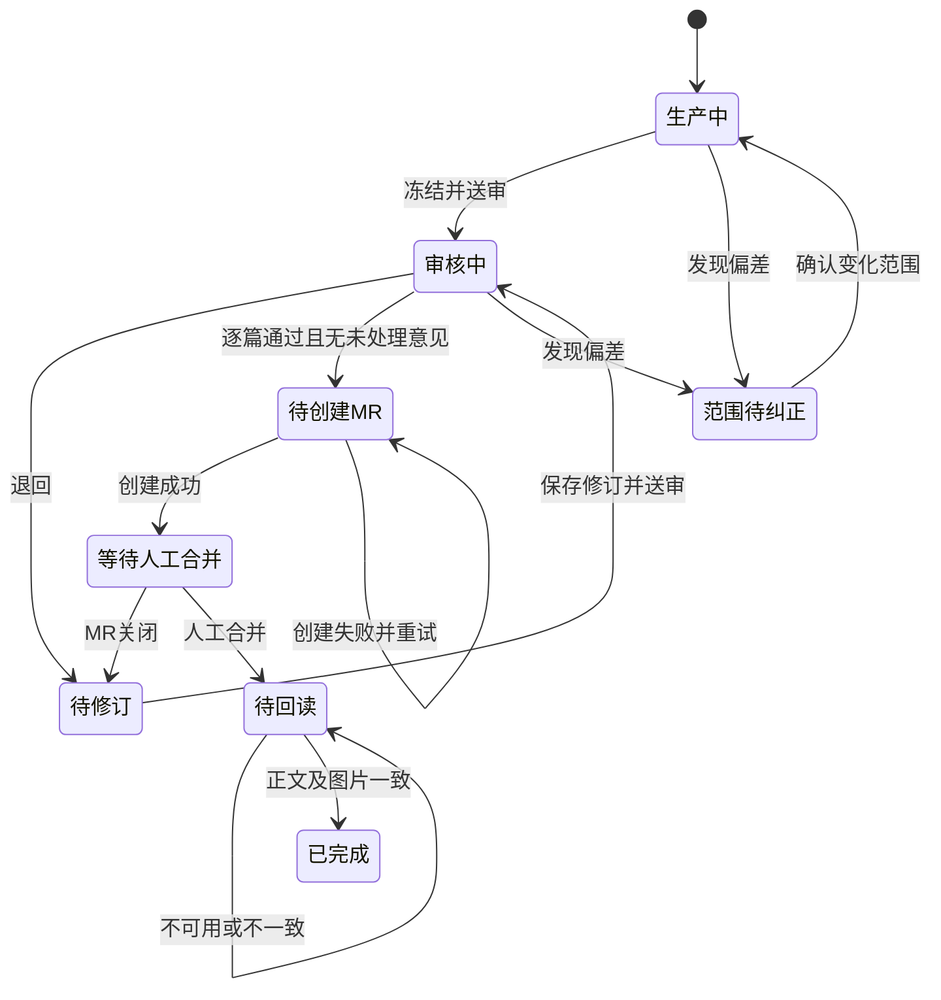
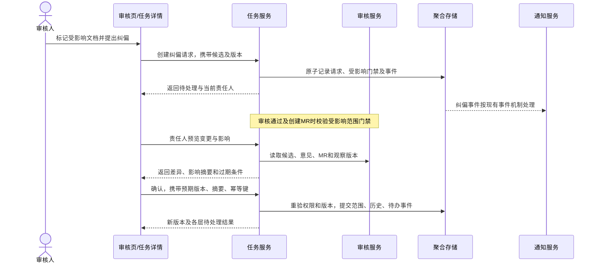
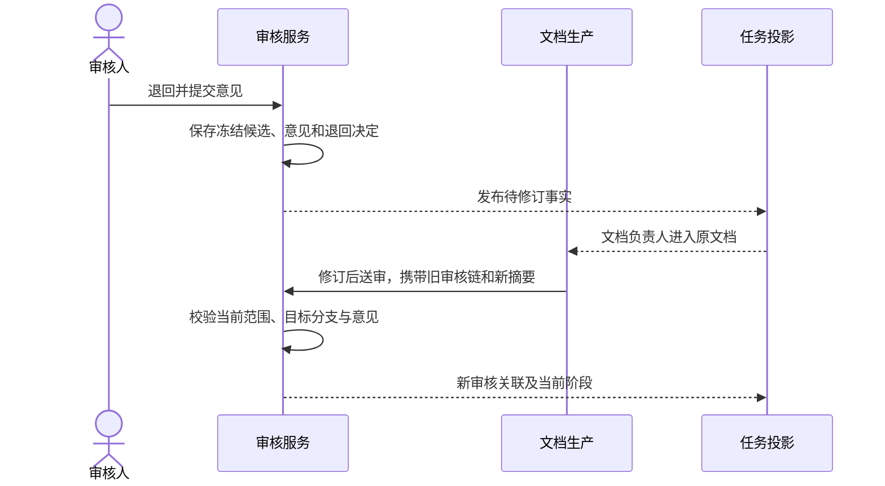
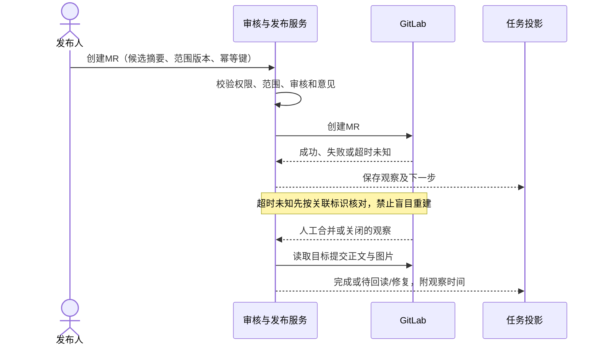
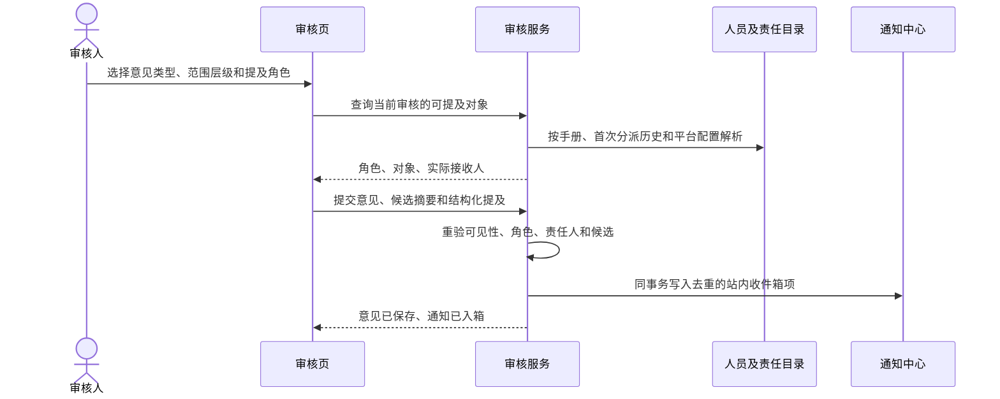
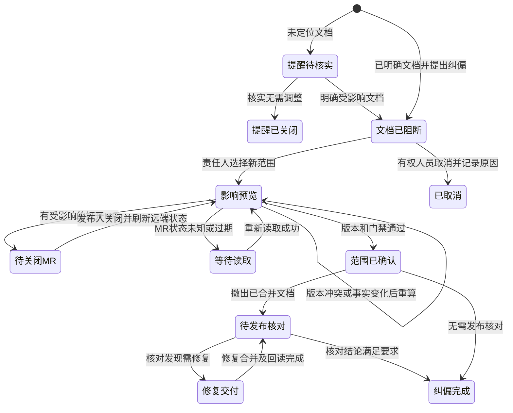
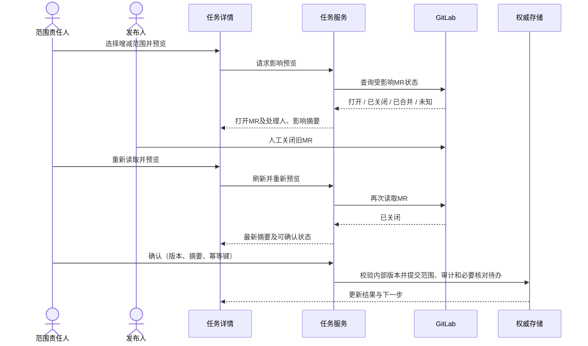
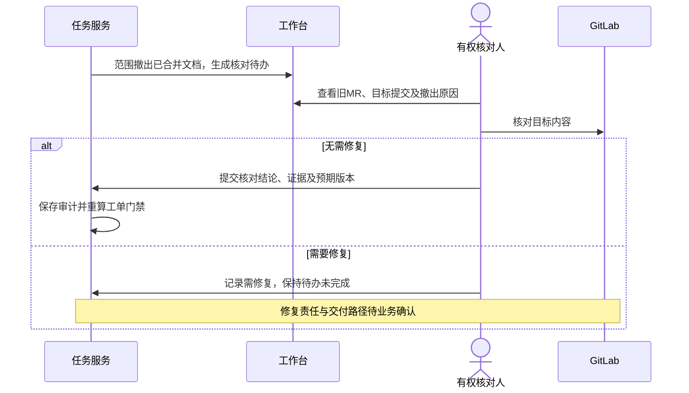

# 文档任务异常回流与重新流转详细设计

状态：部分实施（2026-11-12）。本详细设计以[概要设计](../02-概要设计/知识中心-文档任务-异常回流与重新流转-概要设计文档.md)为唯一业务口径；两文档冲突时以概要设计为准。已有范围纠偏预览/确认/取消、范围阻断、已合并撤出后的核对门禁；需求 25 的结构化意见、三类提及、站内收件箱和采纳后闭环仍待完整验收。人员管理中“停用”即失效人员，不能作为新的提及或通知对象。真实登录的完整跨页体验、历史首次责任人回填及意见与纠偏双向关联仍待验收或实现。企业微信和邮箱不属于需求 25。关联：[需求 25](../01-需求/知识中心-审核意见提及责任人与范围处理-需求文档.md)、[概要设计](../02-概要设计/知识中心-文档任务-异常回流与重新流转-概要设计文档.md)、[第二版交互效果稿](../02-概要设计/知识中心-文档任务-异常回流与重新流转-效果稿-v2.html)、[通知中心详细设计](./知识中心-通知中心-详细设计文档.md)及[实现与验证报告](../05-测试设计&报告/02-测试报告/知识中心-文档任务-异常回流与重新流转-实现与验证报告-20261110.md)。

## 1. 目标与事实

同一工单在生产、审核、MR 或回读阶段发生异常或范围偏差时，责任人能找到受影响对象、处理人、下一步及历史；当前范围的每项均满足完成门禁后才汇总完成。工单、手册、文档、审核、MR 和回读是不同对象，不通过手工改状态代替实际处理。独立大纲、模板任务不在本设计范围。

代码核对截至 2026-11-12：`document-tasks/view.js` 已有任务抽屉、两级范围和查看审核/MR；`routes/document-tasks.js` 依据审核与交付投影状态并通过 revision 校验范围写入，对已转交手册和已分派文档移除返回 `SCOPE_WITHDRAWAL_REQUIRED`。审核 `review-publishing/view.js` 已展示退回和 MR 关闭提示，意见表单也已有类型、层级和基本提及选择，但这些字段与动作尚未按场景收敛；代码检查不足以证明运行实例已更新或跨页体验已贯通。

## 2. 从场景判断问题是否值得解决

本节区分三种证据：**代码事实**表示当前仓库确实这样渲染或校验；**业务约束**来自需求 25 已确认的角色和权限；**待观察**表示尚无真实用户操作录像、任务完成率或线上耗时。代码事实能证明入口和信息缺口，不能证明每个用户都会遇到问题，也不能替代真实登录走查。

### 2.1 用户在什么地方卡住

| 场景与用户目标 | 当前可观察事实 | 可能造成的实际后果 | 解决价值与验证方式 |
|---|---|---|---|
| **审核人发现文档放错手册**，想让有权人判断并继续审核 | 审核表单已有“内容意见/范围意见”和“范围层级”，但无论选择哪类，层级字段始终占位；提及框是多选列表，选项只有手册、角色、姓名。意见列表又同时显示“标记已处理”和范围决定动作，见 `review-publishing/view.js` 的评论表单及意见操作区。 | 审核人需要自己分辨“处理评论”“决定范围”“通过文档”三件事；选错层级或误把已处理当作范围已调整，会产生看似结束、任务仍阻断的状态。 | 这是业务正确性问题：需求规定范围决定由对应层级负责人作出。用新手走查观察是否能独立完成“提出范围意见”，并核对提交后意见类型、层级和实际接收人。 |
| **被提及人收到通知**，想判断是不是自己要处理 | 工作台通知需要手动展开，单条目前只显示任务名、意见文字、已读状态和“标记已读”，见 `dashboard/my-tasks.js`；深链能到意见，但列表不显示工单、手册、文档和本人角色。 | 同名任务或短意见难以判断责任范围；“已读”容易被误认为“已处理”，用户还要进入详情才知道自己是讨论人还是决定人。 | 这是任务可发现性问题。用两条同名任务、不同角色通知测试：列表应能区分对象和本人身份，点击后进入正确意见；已读不改变范围决定或待办。 |
| **范围负责人采纳意见后调整范围**，想知道原范围和新范围影响 | 审核意见先记录采纳结果，随后进入范围页面查看影响；任务弹窗里的影响预览目前把多篇文档串成一段文字，按 `<br>` 分隔，仅给“文档 ID / MR 状态 / 能否确认”，见 `document-tasks/view.js` 的 `saveScopeWithPreview`。 | 文档多时难以逐篇比较“保留、增加、撤出”的结果，也看不出哪些草稿、审核结论和 MR 会失效；可能只看见确认按钮便提交。 | 这是不可逆交付风险：需求要求确认前看清影响，打开 MR 还需人工处理。用至少 8 篇文档、混合 MR 状态验收预览，要求用户准确指出受影响篇目和下一步。 |
| **平台管理员配置知识中心负责人**，想确定三类提及对象可用 | 负责人字段当前位于“任务管理 → 任务配置”表单，而平台管理的“人员管理”页没有该配置入口；任务配置还和默认工单责任人、不涉及理由并列，见 `document-tasks/view.js` 与 `platform-admin/view.js`。 | 管理员按“人员管理”查找时找不到配置；审核人选不到该角色时也无法判断是无权、未配置还是人员失效。 | 这是配置可发现性和诊断问题。走查管理员从平台管理进入配置的路径；未配置、停用、权限不足要显示不同状态，不能只给空列表。 |
| **文档负责人等待范围确认后继续编写**，想知道是否已可以动笔 | 范围意见的 `accepted_pending_scope` 只说明负责人采纳；任务范围仍由独立的预览/确认接口生效，且原意见必须等纠偏确认后才进入闭环。 | “已采纳”可能被当作“新范围生效”；文档负责人过早编写或沿用旧审核证据。 | 这是状态语义问题。服务端投影必须分别报告“意见已采纳”“纠偏已创建”“范围已确认”“待重新编写”“意见已闭环”，并以实际范围版本决定下一步。 |

以上场景不是凭空假设：每行均有已确认业务规则和当前代码中的具体入口或字段。它们的**发生频率与改进收益尚未量化**，因此设计验收必须补真实登录下的四类角色走查、误操作记录和完成时间；不能仅凭简图宣布体验达标。

| 要证明的改进 | 改造前基线如何取得 | 改造后的验收判断 |
|---|---|---|
| 审核人能准确提出范围意见 | 用同一篇文档分别观察首次用户选择意见类型、范围层级和接收人的过程，记录误选与求助次数 | 不经口头提示完成提交；服务端记录的类型、层级、接收人均正确 |
| 被提及人能判断自己该做什么 | 给同名任务的讨论者与范围负责人各一条通知，记录其首次点击去向和判断 | 两人均进入对应意见；只有有权负责人看到决定动作，标记已读不改变业务状态 |
| 范围负责人能安全确认影响 | 准备至少 8 篇文档，混合未送审、已通过、MR 打开与已合并状态，记录其能否指出受影响篇目 | 确认前能逐项指出被阻断对象和处理人；MR 打开或观察过期时服务端拒绝确认 |
| 管理员能找到并维护负责人 | 从平台管理首页开始记录寻找入口、配置和失效诊断所需操作 | 不依赖说明文字找到配置；未配置、人员停用、无权和版本冲突分别给出明确结果 |

如果基线走查显示某项已可独立完成，则只保留其服务端正确性补强，不为“优化”再增加页面层级。真实发生频率、完成时间与误操作数据写入验收记录后再评价体验收益。

### 2.2 从场景抽出的共同问题

五个场景共享同一条断裂的上下文：**对象是谁（工单/手册/文档） → 我以什么身份参与 → 当前事实到哪一步 → 我能做什么 → 操作后哪里发生变化**。现在这些事实分散在审核页、通知、任务详情和配置页，且“意见已读、意见已决定、范围已生效”容易被合并理解。

因此采用一套跨页的“业务上下文与下一步”投影，而不是新增流程状态机。每个入口只展示当前角色可执行的主动作；深链仅携带对象定位信息，目标页重新读取服务端当前身份、阶段和可执行能力，不能信任链接中的角色或按钮状态。审核意见、通知、范围变更仍归各自服务保存，前端不根据按钮点击推测成功。第 12.5 节给出具体页面、字段和接口联动。

## 3. 领域对象与约束

| 对象 | 关键字段 | 规则 |
|---|---|---|
| 工单聚合 | number、revision、currentScopeVersion | 汇总只使用当前有效范围；工单编号沿用 PingCode |
| 范围变更 | changeId、baseRevision、baseScopeVersion、reason、initiator、status、impactDigest | 持久状态为 `reported → confirmed/cancelled`；预览只读，事实改变须重新预览 |
| 范围成员 | handbookId、documentId、subtaskNo、membership、scopeVersion | active / withdrawn；编号不回收，同稳定对象重新纳入时沿用并重新校验证据 |
| 审核关联 | reviewTaskId、candidateDigest、documentId、branch、scopeVersion | 冻结关系；无完整可信关联时标待核对，不按标题猜测 |
| 外部交付观察 | MR ID、目标提交、状态、观察时间、正文及图片结果 | 保留历史；未知或过期不能判完成；外部观察不等于本地提交成功 |
| 审计 / 事件 | commandId、操作者、被代办责任人、前后版本、原因、时间 | 与本地业务变更同事务保存；需求 25 的站内收件箱项随意见同事务写入，其他异步事件遵循各自契约 |

仅改责任人不增加范围版本，记录改派并重新投影待办；变更文档、手册、目标版本或分支则使受影响对象的当前证据失效。全局范围版本变化不应使未受影响文档自动失效：每项用独立 scopeVersion 与冻结内容、目标仓库/分支、审核及未处理意见共同判定。撤出是从当前文档交付门禁移除，非删除文档或撤销已发布内容；已合并的撤出项另有核对待办，在完成前阻断工单完成。重纳入只有证据与新目标、正文、意见及有效范围均匹配才可复用；无法证明即重新流转。

## 4. 状态与门禁

| 当前事实 | 触发 | 守卫与动作 | 输出 |
|---|---|---|---|
| 生产 / 审核中 | 提出范围偏差 | 可见用户创建纠偏请求；被标记文档在服务端阻断通过和创建 MR | 待责任人处理，其他文档照常 |
| 生产 / 审核中 | 偏差尚未定位具体文档 | 保存提醒及责任人，不设置文档或手册阻断；明确对象后再记录阻断 | 责任人核实范围，既有审核与交付照常 |
| 待纠偏 | 确认范围 | 工单责任人处理手册层，手册负责人处理本手册文档层；管理员可代办 | 本层新范围生效，未确认层保持待办 |
| 待纠偏 | 受影响文档存在打开的 MR | 发布人手动关闭；服务端重新读取并确认关闭后才允许范围确认，状态未知或过期则禁止确认 | 原 MR 保留，新范围继续流转 |
| 已合并后撤出 | 确认范围 | 创建“核对已发布内容”待办并保留原提交；有权人员完成核对并记录结论及操作者 | 待办未完成时工单不能完成 |
| 审核中 | 退回 | 审核权限、冻结候选一致；保留意见与旧候选 | 负责人修订，关联重审链 |
| 已通过 | 创建 MR 失败 | 原审核仍有效、无未处理意见；同命令去重 | 保留通过，显示失败及重试 |
| MR 已关闭 | 同步观察到关闭 | 确认远端状态；旧 MR 不可复用 | 修订正文并重新审核，之后新建 MR |
| MR 已合并 | 回读失败 | 记录目标提交、错误和观察时间 | 可重试回读；内容不同须修复后重新交付 |
| 当前范围全部达标 | 汇总 | 每篇当前范围的 MR 已人工合并、目标正文及图片回读一致；或两级不涉及理由齐全且工单责任人确认 | 计算完成，留存证据 |



图为单篇当前流程投影；已完成后范围实质变化可重新产生生产任务，原完成证据保留。MR 已打开及已合并时的范围调整同样走影响预览，不能自动改变远端事实。

## 5. 端到端时序

### 5.1 审核中发现范围偏差



为避免预览后审核或 MR 状态变化造成错误确认，预览与确认均通过现有 GitLab 连接器只读查询受影响的 MR，确认时重新比较内部版本和外部事实摘要；读取失败、MR 打开或远端状态无法可靠确认时拒绝确认并提示发布人处理或重试。摘要覆盖 MR 身份与状态、候选和回读结论，但不包含每次请求变化的观察时间。已合并后撤出的核对待办与范围确认及审计须原子写入；待办完成需记录核对人、时间和结论，目标内容需修复时保留未完成并进入实际修复交付，不能用确认按钮绕过修复。跨聚合无法同事务时，先持久化阻断标记并以幂等任务完成投影；通过与 MR 创建入口必须同步验证权威门禁。幂等失败和人工恢复需要有持久任务与运维告警，不能仅靠页面控制。

### 5.2 退回及重审



未变化文档结论仅在概要设计列出的冻结内容、分支、提交、审核人和意见门禁均满足时继承；改变文档不继承。MR 关闭要求实质修订，不能仅重提同一摘要。

### 5.3 MR 与回读



### 5.4 审核意见提及



负责人变化时重新提示并要求确认接收人；无负责人则提示处理责任关系，普通意见仍可在移除该提及后提交。本需求只用站内收件箱；已入箱、已读、意见已决定和范围已确认是四个不同状态。

## 6. 交互与权限

| 界面 | 内容与行为 | 权限 |
|---|---|---|
| 工作台 | 当前阶段、异常、处理人、下一步；跳到原对象并保留返回位置 | 仅本人及授权可见对象；管理员代办遵循资源权限 |
| 任务详情 | 现有抽屉内显示手册及文档行、状态、历史和纠偏入口 | 工单责任人确认手册；手册负责人确认其文档；管理员可代办，审计被代办人 |
| 范围影响预览 | 新增/撤出/变更/保留，逐项显示负责人、草稿、审核、MR 与回读影响；必填原因 | 只确认本层，跨层分开提交；修改后必须重新预览 |
| 审核工作区 | 对受影响文档展示阻断；评论按三类角色提及，范围意见由对应层级负责人决定 | 审核决定仍由审核人执行；查看遵守资产范围 |
| 发布 | MR 关闭、合并与回读结果显示时间和明确下一步 | 发布权限；系统不自动合并或关闭 MR |

取消预览不产生范围变更；加载/保存有反馈，失效、越权、网络失败保持输入并给出动作；409 显示差异并重新读取，禁止静默覆盖。键盘可访问弹窗及恢复焦点；390px 下单列展示关键信息，不横向溢出。回流入口须回到用户上一次位置。

## 7. 拟议接口与数据契约

现有前缀 `/knowledge-center/api/document-tasks` 不变。下表是异常回流总体契约，含已接入的范围纠偏能力与待补能力；不能因列在表中就视为全部已实现。需求 25 已接入的接口与待补字段见第 12.2 节，开发前须与现有网关路径逐项核对。身份取可信会话，禁止使用请求体冒充操作者；内部服务验证调用身份。

| 方法和路径 | 输入 | 输出/守卫 |
|---|---|---|
| POST `/:number/scope-changes` | affectedIds（可为空）、reason、expectedRevision、idempotencyKey | 空列表仅记录提醒；明确文档后为所选文档创建阻断，返回 changeId；不能替责任人确认 |
| POST `/:number/scope-changes/:id/preview` | 层级及拟议范围 | 分项 diff、草稿/审核/候选/回读证据、最新 MR 观察、impactDigest；只读，不改变范围；GitLab 不可读时阻断 |
| POST `/:number/scope-changes/:id/confirm` | expectedRevision、impactDigest、idempotencyKey | 确认前再次读取相关 MR 并比较摘要；事务内校验角色和版本，并为已合并撤出项创建核对待办，返回当前范围及审计 ID |
| POST `/:number/publication-checks/:id/complete` | conclusion、expectedRevision、idempotencyKey | 有权责任人记录核对结论；需要修复时不可直接完成，工单汇总包含该待办 |
| POST `/:number/scope-changes/:id/cancel` | expectedRevision、idempotencyKey | 仅创建人或有权责任人取消；释放该请求独占的阻断，其他阻断保留 |
| GET `/:number/recovery` | 无 | 逐篇阶段、原因、处理人、动作、观察时间和来源完整性 |
| 审核意见接口扩展 | comment、commentType、scopeLevel、anchor、candidateDigest、mentions[{role,handbookId,documentId?}] | 服务端解析责任人；意见与站内通知项同事务提交，响应同时报告保存与入箱结果 |

统一错误：`403 FORBIDDEN`、`409 REVISION_CONFLICT`、`409 IMPACT_STALE`、`409 SCOPE_BLOCKED`、`422 RECIPIENT_MISSING`、`503 DEPENDENCY_UNAVAILABLE`；返回安全提示和 requestId。幂等键与操作者、命令类型及请求摘要绑定，同键不同内容拒绝；需求 25 中意见或站内入箱任一步失败时整体回滚并报告失败，其他异步事件按各自结果报告，不重复执行 GitLab 外部写入。范围确认与有效门禁须在权威存储原子更新；外部调用不放在数据库事务中。

## 8. 迁移、兼容、回退

先只读预检旧范围、审核链、目标分支、MR 和子任务号；备份并生成可重复迁移计划。缺失或歧义标记待核对，不猜测、不直接认定已完成。此前用户明确不批准真实历史编号回填，沿用该边界。先部署兼容读取与观测，再灰度写入口；旧客户端写入需执行相同服务端门禁。关闭新入口后保留变更记录和安全阻断，未完成操作提供管理员核对与恢复；已发通知、远端 MR 与已交付内容不可通过数据库回滚抹除。生产迁移和外部写入按现有授权边界单独审查。

## 9. 验证和实施顺序

1. 确认待决项与页面效果；核对真实前端、后端 API 和权限后冻结契约。
2. 隔离数据覆盖新增、撤出、重纳入、版本/分支变化、改派、跨层权限和当前范围汇总；验证历史记录和子任务号不丢失。
3. 真实 HTTP 覆盖预览不写入、重复提交、竞态（范围确认与审核通过/MR 创建）、越权、依赖失败和冲突恢复；不能仅验证前端。
4. 覆盖退回重审、部分文档继承、创建超时核对、MR 关闭、合并后正文及图片不一致/不可用、重试及人工修复。
5. 验证三类结构化提及、同名手册、负责人改派竞态、站内收件箱权限和同人去重；不把外部渠道计入需求 25。
6. 真实登录桌面及 390px 验证所有入口、取消、焦点、返回位置、权限、数据未更新；测量页面与按钮响应，按平台 100ms 要求报告实测分位数及条件，后端或外部网络无法达标需如实列出。
7. 真实企业 MR 未取得人工合并及回读证据前，标记该项未验收；禁止自动合并。

## 10. 决策与待评审事项

1. **打开的 MR**：必须人工关闭旧 MR 并经服务端确认后，才能确认受影响范围。
2. **已合并后撤出**：必须完成“核对已发布内容”待办，工单才能完成。
3. **纠偏对象未明确**：只记录提醒；明确具体文档后才阻断该文档。
4. **内容修复责任，待评审**：回读确认内容真实不一致时建议由原文档负责人修订、重新审核并创建新 MR；具体责任及外部人为改动的处理需确认。

待评审事项在确认前不应固化为生产规则。设计、示例页面及静态核对不等于功能已实施或验收。

## 11. 完整纠偏状态与时序



纠偏完成仅代表纠偏事项完成，工单还须满足当前有效范围的全部交付门禁。未定位文档的提醒不阻断现有审核或 MR，但不能被误显示为“已阻断”。



## 12. 需求 25：审核意见提及与范围决定实现契约（2026-11-12）

本节是需求 25 的实现基线，覆盖现有审核意见、任务范围与通知中心，不新增另一套任务状态机。通知只要求站内；范围确认仍使用本设计已有预览、版本校验和确认门禁。

### 12.1 人员解析与首次责任人

提及目标按角色解析为稳定 `principalId`：

| 角色 | 可信来源 | 提及范围 |
|---|---|---|
| 手册负责人 | 当前已确认任务手册的 `ownerId` | 当前审核任务关联手册 |
| 文档首次责任人 | 文档第一次正式确认分派时记录的 `firstAssignedOwnerId/At` | 当前审核任务关联文档 |
| 知识中心负责人 | 平台管理配置 `knowledgeCenterOwnerId` | 所有有权可读的审核意见 |

任务范围首次正式确认时固化首次分派人；之后的改派只改当前 `ownerId` 与改派审计。当前存量记录不自动回填，缺少首次责任人的旧记录不提供该提及选项；根据可信 `assignmentHistory` 补录仍是后续迁移任务。人员管理中状态为“停用”的人员即失效人员：新意见不得选择、服务端不得发送通知；历史意见保留收件人快照并展示“人员已失效”。配置更新使用 revision/CAS 和幂等键。

### 12.2 意见、通知和范围决定

审核评论可选择 `commentType=scope_opinion`，并提供 `scopeLevel=ticket|handbook`。评论记录本身不改变范围。提及事件解析完成后，在审核聚合内同事务生成站内收件箱项；唯一键为 `(commentId, recipientId)`，同一人因多个角色命中只入箱一次。收件箱仅能由收件人读取或标记已读，包含服务端生成的审核深链；打开时再校验当前会话、资产权限和候选摘要。

范围意见持久字段为 `scopeOpinion={level,status,responsibleId,ticketNumber,handbookId,decisionBy,decisionAt,decisionReason,relatedOpinionId?}`；读取投影补充 `scopeChangeId`、闭环状态与时间，不把它们误当审核聚合的事务写入字段。`relatedOpinionId` 只用于取消纠偏后新建的范围意见：服务端核验原意见属于同一审核、已采纳且其纠偏已取消。新意见具有独立 ID，旧意见保持原终态。决定权限从当前任务范围实时解析：`ticket` 层对应工单责任人，`handbook` 层对应该手册负责人。拒绝必须填写原因，状态变为 `rejected`，只结束本条意见，不改范围。采纳必须携带幂等键，状态变为 `accepted_pending_scope`，范围负责人直达现有范围纠偏编辑。

采纳后的用户可见阶段按以下顺序投影；只持久化各聚合自身的业务事实，不新增独立状态机。采纳决定成功而关联纠偏创建失败时，保持“已采纳，待创建”并允许幂等重试：

```text
open
  -> accepted_pending_scope       负责人点击“采纳”
  -> correction_created           任务聚合创建唯一纠偏，读模型返回 scopeChangeId
  -> awaiting_confirmation       已生成影响预览入口，尚未确认
  -> scope_confirmed              预览通过且范围负责人确认
  -> reanalysis_pending           服务端重算受影响任务和待办
  -> rework_pending               受影响文档待重新编写或审核
  -> closed                       所有受影响文档达到当前范围门禁

open -> rejected                  负责人点击“不采纳”并填写理由
accepted_pending_scope -> accepted_not_applied 纠偏被取消
accepted_pending_scope -> 待创建     任务聚合暂不可写；同一意见重试补建单
待创建 -> correction_created       重试成功，仍只保留一条纠偏
```

创建纠偏事项时服务端复核来源意见已采纳及当前任务/手册/层级匹配，并在任务聚合记录 `sourceOpinion={taskId,reviewId,commentId}`；审核侧通过只读投影取得关联的 `scopeChangeId`。任务聚合与审核聚合不共享事务，不能宣称已物理回写或原子双写。范围纠偏的 `reported → confirmed/cancelled` 与审核意见投影联动：确认后展示 `scope_confirmed`，取消后展示 `accepted_not_applied`；预览本身是只读结果，不持久化 `previewed` 状态。确认后沿用既有范围重算和待办投影，由文档负责人重新编写，不自动生成正文。所有受影响文档重新达到门禁后，投影才显示 `closed`。若取消后仍需处理，创建一条新的范围意见并关联旧意见，不能把旧意见直接改回 `open`。投影查询失败时保留已知事实并显示“数据未更新”，不得凭前端按钮点击推断成功。

接口扩展约定：

| 方法与路径 | 行为与守卫 |
|---|---|
| `GET /knowledge-center/api/incremental-tasks/notifications?state=unread&limit=20` | 当前会话收件箱，最多 100 条，返回本人未读数、审核意见深链、`recipientActive` 和按当前责任人及审核权限计算的 `actions`；工作台按需展开后读取，按钮只依据 `actions` 显示 |
| `PUT /knowledge-center/api/incremental-tasks/notifications/:id/read` | 收件人本人标记已读，幂等；不接受客户端传入 recipientId |
| `GET /knowledge-center/api/document-tasks/review/:reviewTaskId/mention-targets` | 返回当前审核关联手册的三类可信对象；无首次分派记录时不返回该角色 |
| `POST /knowledge-center/api/incremental-tasks/:taskId/reviews/:reviewId/comments` | 创建普通意见或范围意见；取消纠偏后新建范围意见可提交 `relatedOpinionId` 并校验原意见与纠偏状态；评论和站内通知在同一事务，按 comment ID 与收件人去重 |
| `GET /knowledge-center/api/incremental-tasks/:taskId/reviews/:reviewId/comments` | 返回历史提及的原收件人姓名快照和 `mentions[].disabled`；人员停用不抹去历史意见 |
| `POST /knowledge-center/api/incremental-tasks/:taskId/reviews/:reviewId/comments/:commentId/scope-decision` | 当前范围负责人提交 `accept|reject` 和幂等键；拒绝必填原因；采纳后幂等创建或定位唯一纠偏，返回 `correctionStatus=ready`、`scopeChangeId` 和范围页深链。创建失败返回 `correctionStatus=pending`、错误与 `retryUrl`；同一 `accept` 重试只补建单 |
| `POST /knowledge-center/api/document-tasks/:number/scope-changes` | 可携带 `sourceOpinion`；服务端复核已采纳的来源、层级与任务，并阻止同一意见重复创建活跃纠偏 |
| `GET /knowledge-center/api/document-tasks/review/:reviewTaskId/scope-opinions` | 按审核任务读取关联纠偏、范围版本和受影响文档事实；已采纳但未建单时也返回“待创建”投影，已建单返回 `scopeChangeId` 与闭环阶段；只读且重新校验会话权限，撤出后仍能定位历史来源意见 |
| `GET/PUT /knowledge-center/api/document-tasks/config` | 管理员读取或配置一名 `knowledgeCenterOwnerId`；PUT 使用 expectedRevision 与幂等键 |

若现有网关路由已有相同能力，应扩展原路径而非并行创建重复契约。错误返回 `403`、`409`（版本冲突/已决定）、`422`（角色或理由无效）与 `404`（不可见对象统一隐藏）；任何失败不能创建半条通知或半个范围变更。

### 12.3 执行伪代码

```text
submitComment(session, request):
  require reviewer permission and readable frozen candidate
  recipients = resolveMentionRolesFromTaskHistoryAndPlatformConfig(request.roles)
  reject missing, ambiguous or stale recipients
  transaction:
    comment = appendReviewComment(request, recipients)
    for recipient in unique(recipients by principalId):
      insertInboxOnce(comment.id, recipient.id, safeReviewDeepLink(comment))
    audit comment and recipients
  return comment + inbox state

decideScopeOpinion(session, commentId, decision, reason, idempotencyKey):
  load opinion, linked task and current scope owner
  require current layer owner
  reject existing terminal decision or reused key with different body
  if decision == rejected: require reason
  reviewTransaction: record decision and actor
  if accepted:
    change = createOrGetLinkedScopeChange(comment)
    return change.id
  review read model resolves comment.scopeChangeId from task sourceOpinion
    return deep link to scope editor
createScopeChange(session, sourceOpinion):
  validate accepted opinion, ticket, handbook and layer again
  taskTransaction: create one active linked correction request
  owner previews and confirms; task service recomputes affected tasks and todos
```

### 12.4 必测行为

以服务端真实 HTTP 接口为主边界，覆盖三种提及角色、停用人员不可提及且历史快照可见、重复角色同人只入箱一次、首次责任人经改派仍保持首次值、缺历史不猜测、平台负责人配置权限/CAS、非本人读通知拒绝、已读幂等、范围决定越权/理由/重复提交、采纳后 `scopeChangeId` 经读模型双向回读、预览/确认/取消与原意见投影联动、确认后仅重算受影响待办且不自动生成正文、受影响文档全部达标后原意见才闭环。浏览器补测中文角色选项、实际收件人预览、意见深链和负责人操作入口。页面打开不等待收件箱；用户展开通知后才请求本人列表。

### 12.5 页面信息设计（目标，非现状截图）

**共同规则**：沿用平台当前顶部导航、工作台表格、审核阅读区和任务范围弹窗。桌面页只把当前任务、正文和当前动作放在主视线；历史、解释和配置按需展开。390px 窄屏保持同一字段顺序，右侧栏移到正文后且不另造第二套操作。以下简图是信息结构设计，不能当作已实现效果或真实环境截图。

#### A. 审核人：在原文旁提出范围意见

```text
审核工作区  /  工单 P-1  /  SQL 参考手册  /  备份恢复.md
┌───────────────────────────────────────────┬──────────────────────┐
│ 文档阅读区（原有，约 70%）                 │ 审核意见（约 30%）   │
│ 当前候选摘要 · 文档版本 · 已选原文位置     │ [内容意见|范围意见]  │
│                                           │ 范围层级 [手册内文档▼]│
│ 正文……                                   │ 意见内容 [________] │
│ 选中的原始文字高亮                       │ 提及人员 [选择…]    │
│                                           │ 接收人：姓名·角色   │
│                                           │ [提交范围意见]      │
└───────────────────────────────────────────┴──────────────────────┘
下方同一意见线程：待决定 / 已采纳待调整 / 待确认范围 / 待重新编写 / 已闭环 / 不采纳
```

- 选择“内容意见”时隐藏范围层级，主按钮为“提交内容意见”；选“范围意见”时必须选择层级，主按钮为“提交范围意见”。原文锚点与候选摘要保留；全文意见明确显示“整篇文档”。
- “提及人员”按**手册负责人、文档首次责任人、知识中心负责人**分组，选项显示姓名、角色、关联手册/文档；选中后表单下方显示实际收件人和入箱人数。同一人命中多个角色只显示一次投递人数。目标缺失显示不可选原因，不用空白下拉代替。
- 提交成功后，线程分别显示“意见已保存”和“站内通知已入箱”两个事实；若同事务入箱失败，表单保留原输入并提示重试或移除无效提及，不能显示“意见已保存”。线程中的“标记已处理”仅处理普通讨论，不能代替范围决定。当前代码已支持基本类型、层级和提及，但**隐藏无关字段、收件人预览和状态区分仍待界面实施**。

#### B. 被提及人：从工作台找到原意见

```text
我的工作                                      [站内通知 2] [刷新]
─────────────────────────────────────────────────────────────
站内通知（展开后读取本人数据）                       [关闭]
未读  范围意见 · P-1 / SQL 参考手册 / 备份恢复.md
      你被提及为：手册负责人 · 审核人：李某 · 10:32
      “该文档应归入另一手册……”       [处理] [标记已读]
已读  内容意见 · P-2 / 安装手册 / 参数.md           [查看]
─────────────────────────────────────────────────────────────
原有“待我处理 / 等待他人”表格继续在下方，不把通知算成待办。
```

- 通知入口由用户主动展开后请求；首屏表格不等待收件箱。默认仅取最近 20 条，长列表在通知区独立滚动并分页/继续加载，未读数取服务端。通知行必须有工单、手册、文档、意见类型、提及角色、发起人、时间及明确动作；长意见截断，详情页看全文。
- “处理”打开原审核任务的意见页并定位该意见；若当前人只是被提及的讨论者，动作改为“回复”，不显示范围决定；无处理或回复权限时显示“查看”。已读只更新通知状态，不能改变审核结论、范围或工作台待办。通知行展示对象、本人角色和服务端返回的可用动作。

#### C. 范围负责人：采纳后预览并确认

```text
审核意见线程：范围意见 · 手册内文档范围
原意见、关联文档、提及与讨论              [采纳] [不采纳]
不采纳时：原因（必填）                    [确认不采纳]

任务管理 / P-1 / SQL 参考手册 / 调整文档范围
原意见：该文档应归入另一手册……           [返回原意见]
范围调整原因 [________________________________________]
当前范围（左）                 拟调整范围（右）
备份恢复.md  张某  23.4       [ ] 备份恢复.md  张某  23.4
恢复验证.md  王某  23.4       [x] 恢复验证.md  王某  23.4
                                             [预览影响]
变更影响（预览结果；固定列，不以换行文字串联）
文档          操作   当前审核/MR    影响与处理人         结果
备份恢复.md   撤出   MR !73 打开    发布人先关闭 MR     阻断
恢复验证.md   保留   审核已通过     证据不变            可保留
                                             [取消] [确认]
```

- 进入范围页先显示来源意见及当前范围；负责人修改后点击“预览影响”，**只有最新预览**可启用“确认”。影响表逐项列操作、原负责人、草稿/审核/MR/回读状态、失效证据、需要谁处理及下一步；打开 MR、外部状态未知或版本变化时禁用确认并给对应动作。超过一屏时只滚动影响明细，表头和底部确认区保持可见。
- 采纳只是决定，不意味着范围生效；创建纠偏记录后显示“已采纳，待确认范围”，预览合格显示“待确认”，确认后显示“范围已确认，受影响文档待重新编写”，全部受影响文档重新达到门禁后显示“已闭环”。不采纳显示理由并结束该意见。取消纠偏显示“已采纳但未生效”，不能伪装成闭环。当前任务页已有范围选择和预览接口，但**影响表、来源意见展示、意见与纠偏双向关联及确认后的返回入口仍待实施**。

#### D. 平台管理员：配置协调责任人

```text
平台管理 > 人员管理
知识中心责任配置
知识中心负责人 [搜索人员并选择一名 ▼]  当前：何阳 · 有效
最近修改：管理员 / 时间                     [保存负责人]
```

- 这是**目标入口**。当前字段实际在“任务管理 → 任务配置”，与管理员寻找人员的习惯不一致；迁移展示入口时复用现有 `/document-tasks/config` 契约，保留 `expectedRevision` 与管理员校验，不建立第二份配置事实。人员停用或未配置时，审核提及选项明确显示不可用原因。保存后正在编辑的意见应重新读取收件人，避免静默转投新负责人。

#### 字段、按钮和服务端事实对照

| 前端可见内容或动作 | 权威数据/API | 成功后应变成什么 | 失败时保留什么 |
|---|---|---|---|
| 意见类型、层级、原文位置、候选摘要 | 评论表单；`POST .../reviews/:id/comments` | 新增意见线程；范围意见为 `open` | 输入内容、原文位置；展示字段错误 |
| 三类提及对象与实际收件人 | `GET /document-tasks/review/:id/mention-targets`；提交时网关再次解析 | 站内收件箱按人去重入箱 | 已选角色，提示人员变化并要求重新选择 |
| 通知未读数、查看、标记已读 | `GET/PUT .../incremental-tasks/notifications` | 仅该人的通知 `readAt` 更新 | 列表与未读数不作乐观假更新 |
| 采纳/不采纳 | `POST .../comments/:id/scope-decision`；服务端实时核对层级负责人 | `accepted_pending_scope` 或 `rejected`；任务聚合关联唯一纠偏，读模型返回 `scopeChangeId` | 输入和原意见保留；409 时刷新责任和意见状态 |
| 预览影响、确认范围 | `POST /document-tasks/:number/scope-changes`、`/:id/preview`、`/:id/confirm` | 任务范围版本与受影响待办重算；确认后负责人继续编写 | 拟议范围与原因；MR/版本阻断时不清空表单 |
| 知识中心负责人 | `GET/PUT /document-tasks/config` | 唯一有效负责人及配置版本更新 | 原配置；无权或冲突时明确提示 |

桌面主区与侧区按现有审核布局自适应，最小宽度约束以实际容器为准；窄屏顺序为“任务与版本 → 正文 → 意见表单/线程”，通知和范围预览改为单列，不出现页面级横向滚动。按钮文字直接说明动作，不用小字替代；禁用状态给具体原因。视觉与交互按现有平台按钮、输入框、边框和图标规范，不新增独立配色。设计依据还包括本仓库所加载的 `/home/hey/.codex/skills/ui-ux-pro-max/SKILL.md` 的表单反馈、可见标签、深链、键盘可达与窄屏无横向滚动要求；这些是设计检查项，仍须用真实页面验证。

### 12.6 页面术语统一

终态页面沿用平台现有短术语，按钮不重复描述业务对象或操作结果：

| 不使用 | 统一使用 | 使用位置 |
|---|---|---|
| 查看影响预览 / 影响预览（按钮） | 查看 | 终态页面按钮 |
| 前往处理 MR | MR链接 | MR 入口按钮 |
| 取消本次纠偏 | 取消 | 纠偏记录按钮 |
| 决定人 | 处理人 | 处理结果字段 |
| 决定时间 | 时间 | 处理结果字段 |
| 查看范围变更 | 查看 | 详情入口 |
| 查看新审核结果 | 查看审核 | 审核入口 |
| 查看处理记录 | 查看历史 | 历史入口 |
| 提出新的范围意见 / 选择有效责任人重新提出意见 | 提交意见 | 新意见入口 |
| 进入文档编写 | 进入编写 | 文档待办入口 |

“影响预览”“范围纠偏”等词只在状态、接口和设计说明中使用；界面按钮采用上表短术语。字段和按钮必须与平台已有中文术语一致，不为同一动作新增同义词。

### 12.7 终态效果验收图（目标页面）

以下不是装饰性流程图，而是验收时页面必须呈现的最终信息。每张图都要求用户能从按钮和状态直接判断“发生了什么、是否完成、下一步是否可做”。

#### 终态 A：范围意见已闭环

```text
审核工作区 / 备份恢复.md                         [返回任务]
┌──────────────────────────────────────────────────────────────┐
│ 范围意见  已闭环                                             │
│ 原意见：该文档应归入另一手册                                  │
│ 提及：何阳（手册负责人）  处理：采纳  2026-11-12 10:32       │
│ 纠偏记录：SC-102  ·  范围版本：v8 → v9                       │
│                                                              │
│ 处理结果                                                     │
│ ✓ 范围已确认   ✓ 受影响任务已重算   ✓ 文档已重新编写           │
│ ✓ 新审核已通过   ✓ 当前范围门禁已满足                         │
│                                                              │
│ [查看] [查看审核] [查看历史]                                   │
└──────────────────────────────────────────────────────────────┘
```

验收：原意见不可再次显示“采纳/不采纳”；所有勾选项均来自服务端事实；点击“查看”可看到旧/新范围及影响明细。

#### 终态 B：采纳但尚未生效

```text
审核工作区 / 备份恢复.md                         [返回任务]
┌──────────────────────────────────────────────────────────────┐
│ 范围意见  已采纳，待确认范围                                 │
│ 纠偏记录：SC-102  · 当前范围仍为 v8                           │
│                                                              │
│ 影响预览：未完成。打开的 MR !73 需要发布人先关闭。              │
│                                                              │
│ [查看] [MR链接] [取消]                                         │
│                                                              │
│ “确认”  不可用：存在打开的 MR                                  │
└──────────────────────────────────────────────────────────────┘
```

验收：范围版本不变；不能出现“范围已生效”或“文档待重写”；阻断原因必须在按钮附近显示。

#### 终态 C：不采纳

```text
审核工作区 / 备份恢复.md                         [返回任务]
┌──────────────────────────────────────────────────────────────┐
│ 范围意见  不采纳                                               │
│ 处理人：何阳  · 时间：2026-11-12 11:05                         │
│ 理由：当前文档属于本手册，目录映射已核对。                      │
│                                                              │
│ 范围未改变 · 原审核结论未改变 · 本意见已结束                    │
│                                                              │
│ [查看历史] [提交意见]                                          │
└──────────────────────────────────────────────────────────────┘
```

验收：不能显示“已处理”替代“不采纳”；范围、审核结论和待办均不被改变。

#### 终态 D：人员已失效

```text
审核意见详情
提及：何阳（文档首次责任人）  人员已失效
      该人员已在人员管理中停用，历史通知仍保留，不能重新发送。

[查看] [提交意见]
```

验收：新建意见的提及选择器不出现该人员；历史意见仍可回读原收件人快照；不能把失效人员静默替换成当前负责人。

#### 终态 E：范围确认后待重新编写

```text
我的工作
工单 P-1 / SQL 参考手册
范围版本 v9  · 受影响文档 2 篇
┌──────────────────────────────────────────────────────────────┐
│ 备份恢复.md   待重新编写   原因：范围已调整       [进入编写]     │
│ 恢复验证.md   待重新审核   原因：范围已调整       [进入审核]     │
└──────────────────────────────────────────────────────────────┘
```

验收：只出现受影响文档的重新流转入口，未受影响文档继续显示原阶段；平台不自动生成正文。

外部状态读取与本地提交之间仍可能发生 GitLab 状态变化。实施必须明确并验证：能否通过受控集成防止已关闭 MR 被重新打开；如不能，范围确认后仍需持续对账，发现重开立即产生阻断和告警，并禁止以旧观察作为交付证据。不得宣称数据库事务能锁住 GitLab。



## 13. 契约补充

以下契约作为本次实现边界。所有 ID 为稳定标识；`revision` 为聚合并发版本，`scopeVersion` 为范围版本，不可互换。

```json
{
  "expectedRevision": 17,
  "reason": "本次工单不涉及主备切换文档",
  "affectedDocuments": [{"handbookId": "book-1", "documentId": "doc-1"}],
  "idempotencyKey": "scope-request-unique-key"
}
```

创建纠偏请求的 `affectedDocuments` 空数组表示仅提醒；非空时每项必须属于用户可见的当前范围。成功返回 `changeId`、`revision`、`status` 和每项 `blocked`；明确对象须提供独立后续命令并重验版本，不能因补充对象覆盖其他用户变更。提醒关闭须记录处理人、结论、时间和版本。

```json
{
  "changeId": "change-1",
  "baseRevision": 17,
  "impactDigest": "sha256:example",
  "observedAt": "2026-11-10T08:00:00Z",
  "items": [{"documentId": "doc-1", "operation": "withdraw", "mrState": "opened", "canConfirm": false, "nextAction": "close_mr"}],
  "canConfirm": false
}
```

`impactDigest` 服务端生成并覆盖操作、对象、范围版本、审核摘要、MR 身份与观察状态及回读结论；不包含每次请求变化的 `observedAt`，也不由前端决定。确认以 `expectedRevision`、`impactDigest`、`idempotencyKey` 请求，成功返回新 revision、范围版本、待办及审计 ID；`409 IMPACT_STALE` 返回重新预览入口，`409 MR_OPEN` 返回安全的 MR 标识和处理角色，`503 DEPENDENCY_UNAVAILABLE` 不返回可确认状态。`observedAt` 作为单独显示的读取时间由服务端控制，不能由客户端延长。

核对待办字段至少包括 `id`、工单/手册/文档 ID、原 MR 与目标提交、撤出原因、状态、处理角色、核对结论、证据引用、操作者、时间和 revision。状态为 `pending → needs_fix → pending → completed`；`needs_fix` 不得完成。仅具备 `publish:manage` 或平台管理员权限的具名操作人可提交核对；“无需修复”必须给出目标提交及正文/图片检查结论，“需要修复”只能记录为 `needs_fix`，不能关闭待办。修复后须引用同手册、同文档且交付回读完整一致的新审核/MR 记录，服务端验证后才可完成。该门禁避免仅凭自由文本关闭待办。

审核提及在评论事务中保存角色、手册/文档和服务端解析的收件人快照；按评论 ID 与收件人去重创建站内通知。通知包含审核与评论定位符及安全深链；收件人只能操作自己的通知。企业微信和邮箱属于通知中心后续能力，本需求不设计或验收其投递。

## 14. 逐项验收矩阵

| 编号 | 前置与动作 | 预期及证据 |
|---|---|---|
| A01 | 无明确文档提出提醒 | 不阻断任何文档；工作台出现核实事项；HTTP 与页面回读 |
| A02 | 选择文档 A 提出纠偏，同时审核 B | A 通过和创建 MR 拒绝，B 按原门禁处理；并发请求证据 |
| A03 | 撤出文档且其 MR 打开 | 范围确认拒绝，展示 MR 和发布人；关闭后刷新并重新预览方可确认 |
| A04 | MR 查询超时/状态过期 | 禁止确认并显示上次观察时间；恢复读取后重算影响 |
| A05 | 已合并文档撤出 | 创建核对待办，工单保持未完成；核对及必要修复后重新汇总 |
| A06 | 预览后他人改范围 | 409，保留用户输入，要求重读和重新预览；无静默覆盖 |
| A07 | 同键重试及同键不同内容 | 前者只执行一次，后者拒绝；无重复待办与远端写入 |
| A08 | 变更手册/文档、重纳入与改派 | 未变化项仍有效；旧审计和交付可查，编号不回收；新范围按证据重算 |
| A09 | 审核退回、MR关闭、回读失败 | 展示各自处理人、原因和可执行下一步；旧审核、MR、提交可回读 |
| A10 | 同名手册提及、改派、站内通知失败 | ID 区分、显示接收人；意见保存与通知状态明确，重试不重复 |
| A11 | 非责任人和管理员分别操作 | 越权请求被后端拒绝；管理员代办记录本人及原责任人 |
| A12 | 桌面与390px打开原型及生产页面 | 所有操作可达、焦点返回、无页面级横向溢出；记录截图及按钮耗时 |
| A13 | 人工合并测试 MR 后回读 | 正文和图片一致才完成；无真实企业合并证据则该项未验收 |
| A14 | 范围意见采纳，纠偏预览、确认、重算和受影响文档重新流转 | 原意见依次显示“已采纳待调整 → 待确认范围 → 待重新编写/审核 → 已闭环”；`scopeChangeId` 经只读投影双向回读，未受影响文档不变 |
| A14a | 采纳决定已保存，但任务聚合创建纠偏失败 | 返回“已采纳，待创建”和重试入口；刷新仍可回读；同一意见重试只补建单，不重复决定或通知 |
| A15 | 采纳后取消纠偏并再次提出意见 | 原意见显示“已采纳但未生效”；范围不变；新意见有独立 ID 并关联旧意见，旧意见不回到 `open` |
| A16 | 范围负责人不采纳 | 显示处理人、时间和必填理由；范围、审核结论和待办均不改变 |
| A17 | 新意见选择人员管理中已停用的人员 | 选择器不展示该人员，服务端拒绝伪造 ID；历史意见显示“人员已失效”并保留快照 |
| A18 | 终态页面截图核验 | 闭环、未生效、不采纳、人员失效、待重新编写五种终态的字段、按钮、禁用原因和深链与第 12.7 节一致 |
