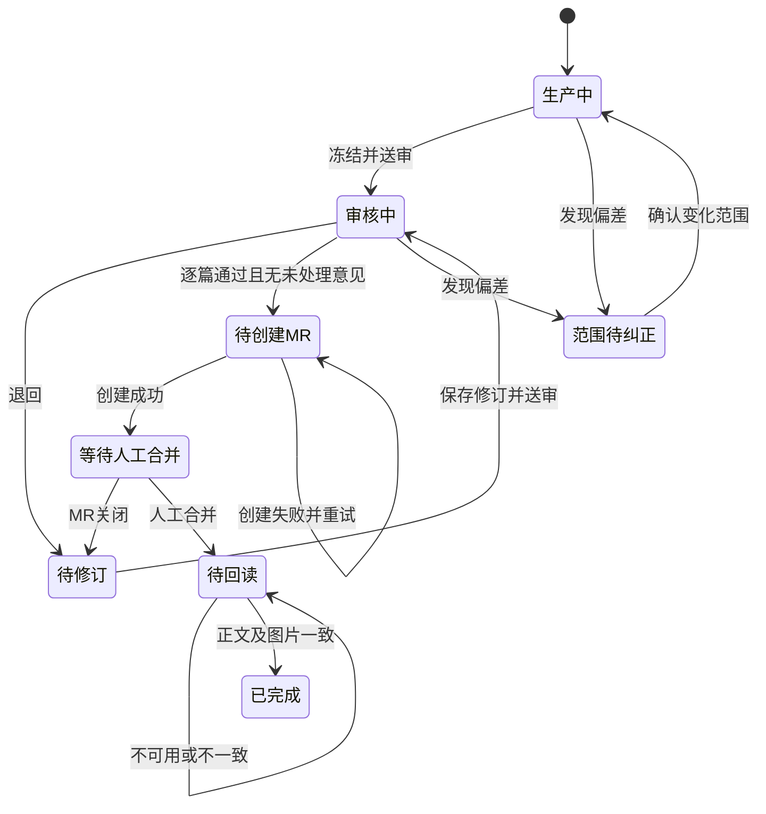
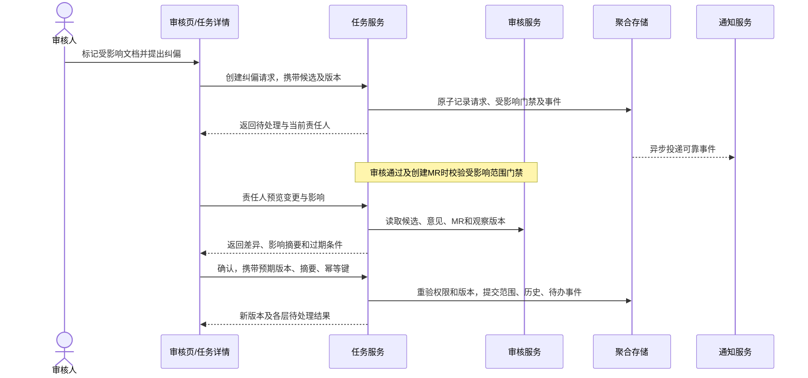
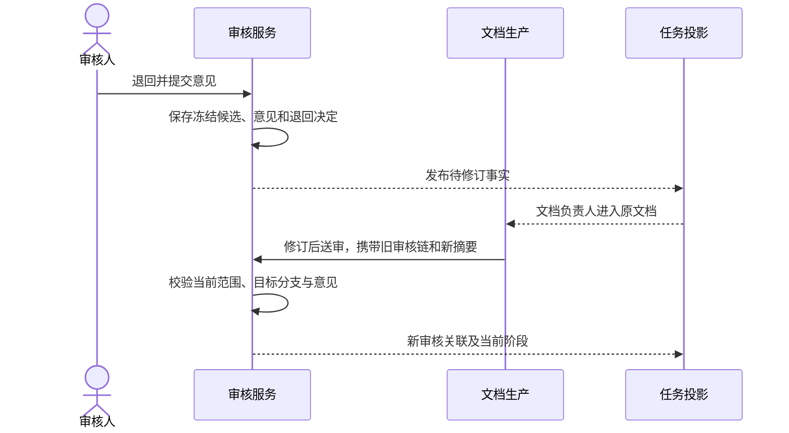
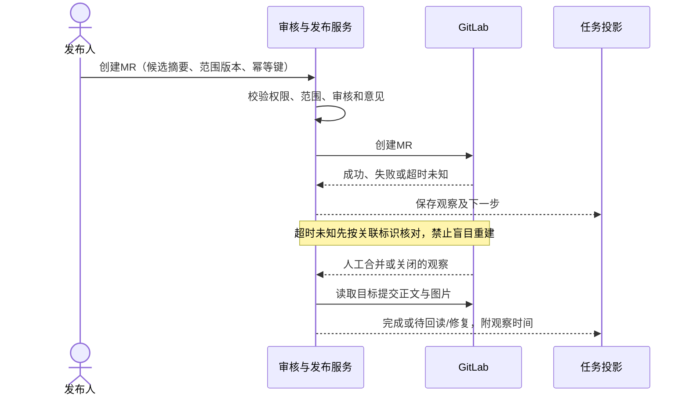
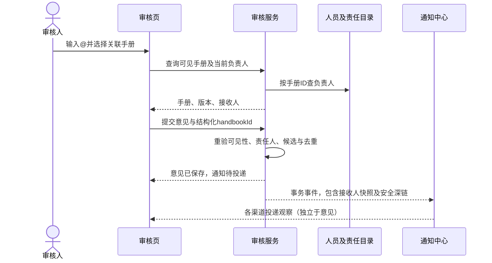
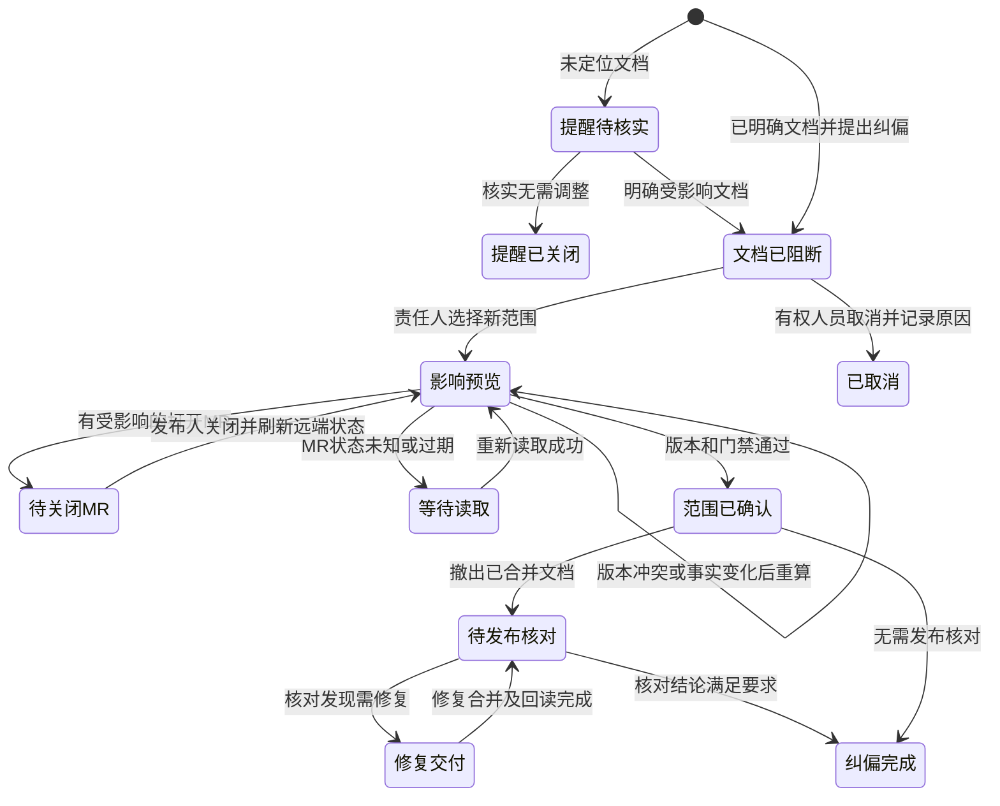
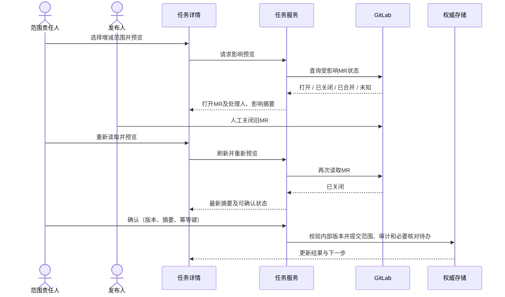
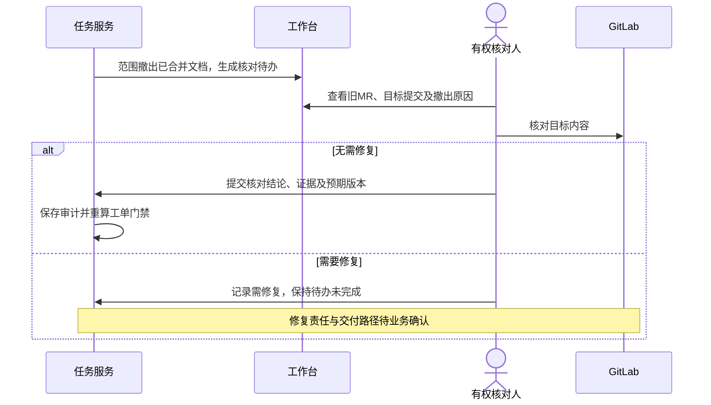

# 文档任务异常回流与重新流转详细设计

状态：部分实施，隔离服务端 HTTP 回归通过（2026-11-10）。已实现范围纠偏预览/确认/取消、范围阻断、已合并撤出后的核对门禁，以及审核关联手册与当前负责人的安全解析；审核意见可存结构化提及和 `pending_configuration` 渠道事件。站内收件箱、企业微信/企业邮箱投递适配器和真实企业渠道验收仍未实现，不能将待配置事件视为已通知。管理员按现有权限代办并留审计。关联：[概要设计](../02-概要设计/知识中心-文档任务-异常回流与重新流转-概要设计文档.md)、[第二版交互效果稿](../02-概要设计/知识中心-文档任务-异常回流与重新流转-效果稿-v2.html)、[通知中心详细设计](./知识中心-通知中心-详细设计文档.md)及[实现与验证报告](../05-测试设计&报告/02-测试报告/知识中心-文档任务-异常回流与重新流转-实现与验证报告-20261110.md)。

## 1. 目标与事实

同一工单在生产、审核、MR 或回读阶段发生异常或范围偏差时，责任人能找到受影响对象、处理人、下一步及历史；当前范围的每项均满足完成门禁后才汇总完成。工单、手册、文档、审核、MR 和回读是不同对象，不通过手工改状态代替实际处理。独立大纲、模板任务不在本设计范围。

代码核对截至 2026-11-10：`document-tasks/view.js` 已有任务抽屉、两级范围和查看审核/MR；`routes/document-tasks.js` 依据审核与交付投影状态并通过 revision 校验范围写入，对已转交手册和已分派文档移除返回 `SCOPE_WITHDRAWAL_REQUIRED`。审核 `review-publishing/view.js` 已展示退回和 MR 关闭提示，意见表单为普通文本；代码检查不足以证明运行实例已更新或所有异常恢复已贯通。

## 2. 现有页面问题与修改意见

| 位置 | 已核对问题 | 修改建议 |
|---|---|---|
| 任务详情抽屉 | 可进入调整范围，但已转交对象不能撤出；缺影响预览 | 入口保留，增加变更草案、逐项影响和确认，撤出为逻辑退出，旧证据只读 |
| 文档行 | 有完成标签和部分恢复提示；跨审核、MR 的影响不集中 | 增加当前阶段、原因、处理人和唯一可执行下一步；依赖不可用显示观察时间 |
| 审核页 | 普通意见输入框没有结构化手册提及；审核人发现范围偏差需切换上下文 | 增加“提出范围纠偏”，定位工单；意见内选择 `@手册` 并显示接收人 |
| 范围与审核并发 | 范围和审核分别写入，单纯前端禁用不能防止竞争 | 服务端提交时校验同一冻结范围版本；使用原子提交或明确持久化阻断与恢复机制 |
| MR 已打开或已合并 | 撤出范围不会撤销远端内容；自动关闭或回滚会越权 | 打开的旧 MR 人工关闭并经服务端确认后才允许确认范围；已合并生成阻断工单完成的核对待办 |
| 交付回读 | 失败与正文不一致的处理需要区分 | 暂时不可用可重试；真实内容不一致进入修复交付，禁止无限重试掩盖差异 |

以上是源码和既有设计的静态核对，实际页面和后端状态仍需实施前登录环境核验。效果稿为示例，不代表真实记录。

## 3. 领域对象与约束

| 对象 | 关键字段 | 规则 |
|---|---|---|
| 工单聚合 | number、revision、currentScopeVersion | 汇总只使用当前有效范围；工单编号沿用 PingCode |
| 范围变更 | changeId、baseRevision、baseScopeVersion、reason、initiator、status、impactDigest | `draft → previewed → confirmed/cancelled/expired`；预览过期或事实改变须重新预览 |
| 范围成员 | handbookId、documentId、subtaskNo、membership、scopeVersion | active / withdrawn；编号不回收，同稳定对象重新纳入时沿用并重新校验证据 |
| 审核关联 | reviewTaskId、candidateDigest、documentId、branch、scopeVersion | 冻结关系；无完整可信关联时标待核对，不按标题猜测 |
| 外部交付观察 | MR ID、目标提交、状态、观察时间、正文及图片结果 | 保留历史；未知或过期不能判完成；外部观察不等于本地提交成功 |
| 审计 / 事件 | commandId、操作者、被代办责任人、前后版本、原因、时间 | 与本地业务变更同事务保存；通知由可靠事件异步投递 |

仅改责任人不增加范围版本，记录改派并重新投影待办；变更文档、手册、目标版本或分支则使受影响对象的当前证据失效。全局范围版本变化不应使未受影响文档自动失效：每项用独立 scopeVersion 与冻结内容、目标仓库/分支、审核及未处理意见共同判定。撤出是从当前文档交付门禁移除，非删除文档或撤销已发布内容；已合并的撤出项另有核对待办，在完成前阻断工单完成。重纳入只有证据与新目标、正文、意见及有效范围均匹配才可复用；无法证明即重新流转。

## 4. 状态与门禁

| 当前事实 | 触发 | 守卫与动作 | 输出 |
|---|---|---|---|
| 生产 / 审核中 | 提出范围偏差 | 可见用户创建纠偏请求；被标记文档在服务端阻断通过和创建 MR | 待责任人处理，其他文档照常 |
| 生产 / 审核中 | 偏差尚未定位具体文档 | 保存提醒及责任人，不设置文档或手册阻断；明确对象后再记录阻断 | 责任人核实范围，既有审核与交付照常 |
| 待纠偏 | 确认范围 | 工单责任人处理手册层，手册负责人处理本手册文档层；管理员可代办 | 本层新范围生效，未确认层保持待办 |
| 待纠偏 | 受影响文档存在打开的 MR | 发布人手动关闭；服务端重新读取并确认关闭后才允许范围确认，状态未知或过期则禁止确认 | 原 MR 保留，新范围继续流转 |
| 已合并后撤出 | 确认范围 | 创建“核对已发布内容”待办并保留原提交；有权人员完成核对并记录结论及操作者 | 待办未完成时工单不能完成 |
| 审核中 | 退回 | 审核权限、冻结候选一致；保留意见与旧候选 | 负责人修订，关联重审链 |
| 已通过 | 创建 MR 失败 | 原审核仍有效、无未处理意见；同命令去重 | 保留通过，显示失败及重试 |
| MR 已关闭 | 同步观察到关闭 | 确认远端状态；旧 MR 不可复用 | 修订正文并重新审核，之后新建 MR |
| MR 已合并 | 回读失败 | 记录目标提交、错误和观察时间 | 可重试回读；内容不同须修复后重新交付 |
| 当前范围全部达标 | 汇总 | 每篇当前范围的 MR 已人工合并、目标正文及图片回读一致；或两级不涉及理由齐全且工单责任人确认 | 计算完成，留存证据 |



图为单篇当前流程投影；已完成后范围实质变化可重新产生生产任务，原完成证据保留。MR 已打开及已合并时的范围调整同样走影响预览，不能自动改变远端事实。

## 5. 端到端时序

### 5.1 审核中发现范围偏差



为避免预览后审核或 MR 状态变化造成错误确认，确认时重验所有影响摘要中的内部版本和外部观察时效；受影响文档存在打开 MR 或远端状态无法可靠确认时拒绝确认并提示发布人处理或重新读取。已合并后撤出的核对待办与范围确认及审计须原子写入；待办完成需记录核对人、时间和结论，目标内容需修复时保留未完成并进入实际修复交付，不能用确认按钮绕过修复。跨聚合无法同事务时，先持久化阻断标记并以幂等任务完成投影；通过与 MR 创建入口必须同步验证权威门禁。幂等失败和人工恢复需要有持久任务与运维告警，不能仅靠页面控制。

### 5.2 退回及重审



未变化文档结论仅在概要设计列出的冻结内容、分支、提交、审核人和意见门禁均满足时继承；改变文档不继承。MR 关闭要求实质修订，不能仅重提同一摘要。

### 5.3 MR 与回读



### 5.4 审核意见提及



负责人变化时重新提示并要求确认接收人；无负责人则提示处理责任关系，普通意见仍可在移除该提及后提交。站内、企业微信及企业邮箱依赖通知中心设计与企业人员映射；投递失败不回滚已保存意见，不表示已读或业务完成。

## 6. 交互与权限

| 界面 | 内容与行为 | 权限 |
|---|---|---|
| 工作台 | 当前阶段、异常、处理人、下一步；跳到原对象并保留返回位置 | 仅本人及授权可见对象；管理员代办遵循资源权限 |
| 任务详情 | 现有抽屉内显示手册及文档行、状态、历史和纠偏入口 | 工单责任人确认手册；手册负责人确认其文档；管理员可代办，审计被代办人 |
| 范围影响预览 | 新增/撤出/变更/保留，逐项显示负责人、草稿、审核、MR 与回读影响；必填原因 | 只确认本层，跨层分开提交；修改后必须重新预览 |
| 审核工作区 | 对受影响文档展示阻断与联系责任人；评论可选 `@手册` | 审核决定由审核人或获授权管理员完成；查看遵守资产范围 |
| 发布 | MR 关闭、合并与回读结果显示时间和明确下一步 | 发布权限；系统不自动合并或关闭 MR |

取消预览不产生范围变更；加载/保存有反馈，失效、越权、网络失败保持输入并给出动作；409 显示差异并重新读取，禁止静默覆盖。键盘可访问弹窗及恢复焦点；390px 下单列展示关键信息，不横向溢出。回流入口须回到用户上一次位置。

## 7. 拟议接口与数据契约

现有前缀 `/knowledge-center/api/document-tasks` 不变，下列均为拟新增或扩展，实际路径需在开发前与现有网关契约核对。身份取可信会话，禁止使用请求体冒充操作者；内部服务验证调用身份。

| 方法和路径 | 输入 | 输出/守卫 |
|---|---|---|
| POST `/:number/scope-changes` | affectedIds（可为空）、reason、expectedRevision、idempotencyKey | 空列表仅记录提醒；明确文档后为所选文档创建阻断，返回 changeId；不能替责任人确认 |
| POST `/:number/scope-changes/:id/preview` | 层级及拟议范围 | 分项 diff、依赖事实、impactDigest、失效时间；只读，不改变范围 |
| POST `/:number/scope-changes/:id/confirm` | expectedRevision、impactDigest、idempotencyKey | 确认前校验相关 MR 已关闭或已合并及观察时效；事务内校验角色和版本，并为已合并撤出项创建核对待办，返回当前范围及审计 ID |
| POST `/:number/publication-checks/:id/complete` | conclusion、expectedRevision、idempotencyKey | 有权责任人记录核对结论；需要修复时不可直接完成，工单汇总包含该待办 |
| POST `/:number/scope-changes/:id/cancel` | expectedRevision、idempotencyKey | 仅创建人或有权责任人取消；释放该请求独占的阻断，其他阻断保留 |
| GET `/:number/recovery` | 无 | 逐篇阶段、原因、处理人、动作、观察时间和来源完整性 |
| 审核意见接口扩展 | comment、anchor、candidateDigest、mentions[{handbookId}] | 服务端解析责任人；存意见与通知事件，响应两者不同状态 |

统一错误：`403 FORBIDDEN`、`409 REVISION_CONFLICT`、`409 IMPACT_STALE`、`409 SCOPE_BLOCKED`、`422 RECIPIENT_MISSING`、`503 DEPENDENCY_UNAVAILABLE`；返回安全提示和 requestId。幂等键与操作者、命令类型及请求摘要绑定，同键不同内容拒绝；存储、审核、通知失败分别报告，不重复执行 GitLab 外部写入。范围确认与有效门禁须在权威存储原子更新；外部调用不放在数据库事务中。

## 8. 迁移、兼容、回退

先只读预检旧范围、审核链、目标分支、MR 和子任务号；备份并生成可重复迁移计划。缺失或歧义标记待核对，不猜测、不直接认定已完成。此前用户明确不批准真实历史编号回填，沿用该边界。先部署兼容读取与观测，再灰度写入口；旧客户端写入需执行相同服务端门禁。关闭新入口后保留变更记录和安全阻断，未完成操作提供管理员核对与恢复；已发通知、远端 MR 与已交付内容不可通过数据库回滚抹除。生产迁移和外部写入按现有授权边界单独审查。

## 9. 验证和实施顺序

1. 确认待决项与页面效果；核对真实前端、后端 API 和权限后冻结契约。
2. 隔离数据覆盖新增、撤出、重纳入、版本/分支变化、改派、跨层权限和当前范围汇总；验证历史记录和子任务号不丢失。
3. 真实 HTTP 覆盖预览不写入、重复提交、竞态（范围确认与审核通过/MR 创建）、越权、依赖失败和冲突恢复；不能仅验证前端。
4. 覆盖退回重审、部分文档继承、创建超时核对、MR 关闭、合并后正文及图片不一致/不可用、重试及人工修复。
5. 验证结构化提及、同名手册、负责人改派竞态、通知各渠道失败及重试去重；测试账号与外部渠道须隔离。
6. 真实登录桌面及 390px 验证所有入口、取消、焦点、返回位置、权限、数据未更新；测量页面与按钮响应，按平台 100ms 要求报告实测分位数及条件，后端或外部网络无法达标需如实列出。
7. 真实企业 MR 未取得人工合并及回读证据前，标记该项未验收；禁止自动合并。

## 10. 决策与待评审事项

1. **打开的 MR**：必须人工关闭旧 MR 并经服务端确认后，才能确认受影响范围。
2. **已合并后撤出**：必须完成“核对已发布内容”待办，工单才能完成。
3. **纠偏对象未明确**：只记录提醒；明确具体文档后才阻断该文档。
4. **内容修复责任，待评审**：回读确认内容真实不一致时建议由原文档负责人修订、重新审核并创建新 MR；具体责任及外部人为改动的处理需确认。

待评审事项在确认前不应固化为生产规则。设计、示例页面及静态核对不等于功能已实施或验收。

## 11. 完整纠偏状态与时序



纠偏完成仅代表纠偏事项完成，工单还须满足当前有效范围的全部交付门禁。未定位文档的提醒不阻断现有审核或 MR，但不能被误显示为“已阻断”。



外部状态读取与本地提交之间仍可能发生 GitLab 状态变化。实施必须明确并验证：能否通过受控集成防止已关闭 MR 被重新打开；如不能，范围确认后仍需持续对账，发现重开立即产生阻断和告警，并禁止以旧观察作为交付证据。不得宣称数据库事务能锁住 GitLab。



## 12. 契约补充

以下契约作为本次实现边界。所有 ID 为稳定标识；`revision` 为聚合并发版本，`scopeVersion` 为范围版本，不可互换。

```json
{
  "expectedRevision": 17,
  "reason": "本次工单不涉及主备切换文档",
  "affectedDocuments": [{"handbookId": "book-1", "documentId": "doc-1"}],
  "idempotencyKey": "scope-request-unique-key"
}
```

创建纠偏请求的 `affectedDocuments` 空数组表示仅提醒；非空时每项必须属于用户可见的当前范围。成功返回 `changeId`、`revision`、`status` 和每项 `blocked`；明确对象须提供独立后续命令并重验版本，不能因补充对象覆盖其他用户变更。提醒关闭须记录处理人、结论、时间和版本。

```json
{
  "changeId": "change-1",
  "baseRevision": 17,
  "impactDigest": "sha256:example",
  "observedAt": "2026-11-10T08:00:00Z",
  "items": [{"documentId": "doc-1", "operation": "withdraw", "mrState": "opened", "canConfirm": false, "nextAction": "close_mr"}],
  "canConfirm": false
}
```

`impactDigest` 服务端生成并覆盖操作、对象、范围版本、审核摘要、MR 身份与观察状态；不由前端决定。确认以 `expectedRevision`、`impactDigest`、`idempotencyKey` 请求，成功返回新 revision、范围版本、待办及审计 ID；`409 IMPACT_STALE` 返回重新预览入口，`409 MR_OPEN` 返回安全的 MR 标识和处理角色，`503 DEPENDENCY_UNAVAILABLE` 不返回可确认状态。`observedAt` 及过期策略由服务端控制并配置，不能由客户端延长。

核对待办字段至少包括 `id`、工单/手册/文档 ID、原 MR 与目标提交、撤出原因、状态、处理角色、核对结论、证据引用、操作者、时间和 revision。状态为 `pending → needs_fix → pending → completed`；`needs_fix` 不得完成。仅具备 `publish:manage` 或平台管理员权限的具名操作人可提交核对；“无需修复”必须给出目标提交及正文/图片检查结论，“需要修复”只能记录为 `needs_fix`，不能关闭待办。修复后须引用同手册、同文档且交付回读完整一致的新审核/MR 记录，服务端验证后才可完成。该门禁避免仅凭自由文本关闭待办。

审核提及在评论事务中保存 `{handbookId, handbookName, recipientId}` 快照和唯一通知事件 ID。通知事件包含审核/评论/工单/文档 ID 与安全站内深链，重试按事件 ID 去重；意见保存与通知投递独立。外部渠道适配器读取通知中心配置和企业人员目录的已验证映射；缺少租户应用或邮箱映射时保留站内事件并报告外部渠道未送达，不接受客户端提供收件人身份。

## 13. 逐项验收矩阵

| 编号 | 前置与动作 | 预期及证据 |
|---|---|---|
| A01 | 无明确文档提出提醒 | 不阻断任何文档；工作台出现核实事项；HTTP 与页面回读 |
| A02 | 选择文档 A 提出纠偏，同时审核 B | A 通过和创建 MR 拒绝，B 按原门禁处理；并发请求证据 |
| A03 | 撤出文档且其 MR 打开 | 范围确认拒绝，展示 MR 和发布人；关闭后刷新并重新预览方可确认 |
| A04 | MR 查询超时/状态过期 | 禁止确认并显示上次观察时间；恢复读取后重算影响 |
| A05 | 已合并文档撤出 | 创建核对待办，工单保持未完成；核对及必要修复后重新汇总 |
| A06 | 预览后他人改范围 | 409，保留用户输入，要求重读和重新预览；无静默覆盖 |
| A07 | 同键重试及同键不同内容 | 前者只执行一次，后者拒绝；无重复待办与远端写入 |
| A08 | 变更手册/文档、重纳入与改派 | 未变化项仍有效；旧审计和交付可查，编号不回收；新范围按证据重算 |
| A09 | 审核退回、MR关闭、回读失败 | 展示各自处理人、原因和可执行下一步；旧审核、MR、提交可回读 |
| A10 | 同名手册提及、改派、渠道失败 | ID 区分、显示接收人；意见保存与通知结果独立，重试不重复 |
| A11 | 非责任人和管理员分别操作 | 越权请求被后端拒绝；管理员代办记录本人及原责任人 |
| A12 | 桌面与390px打开原型及生产页面 | 所有操作可达、焦点返回、无页面级横向溢出；记录截图及按钮耗时 |
| A13 | 人工合并测试 MR 后回读 | 正文和图片一致才完成；无真实企业合并证据则该项未验收 |
