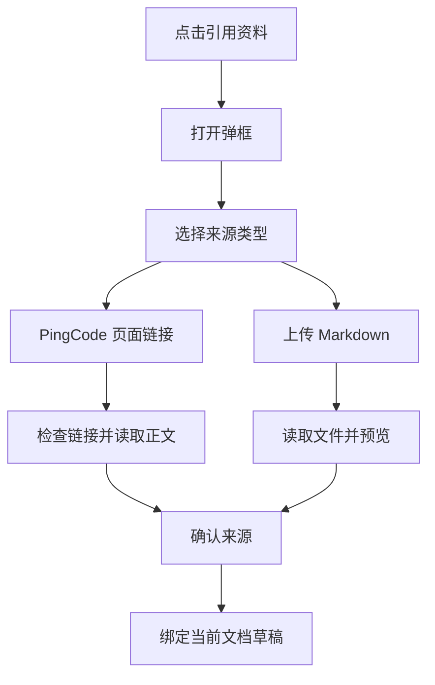
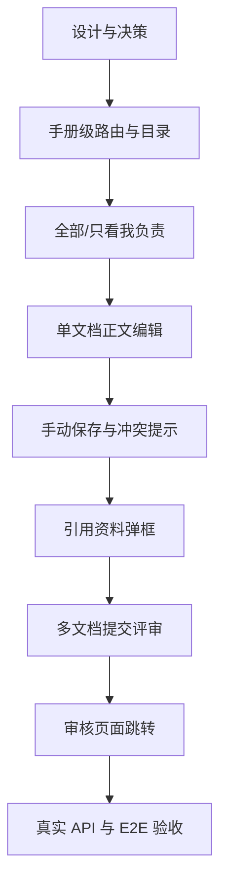
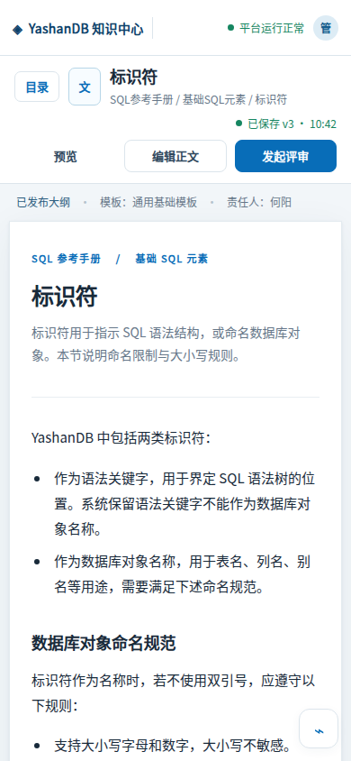
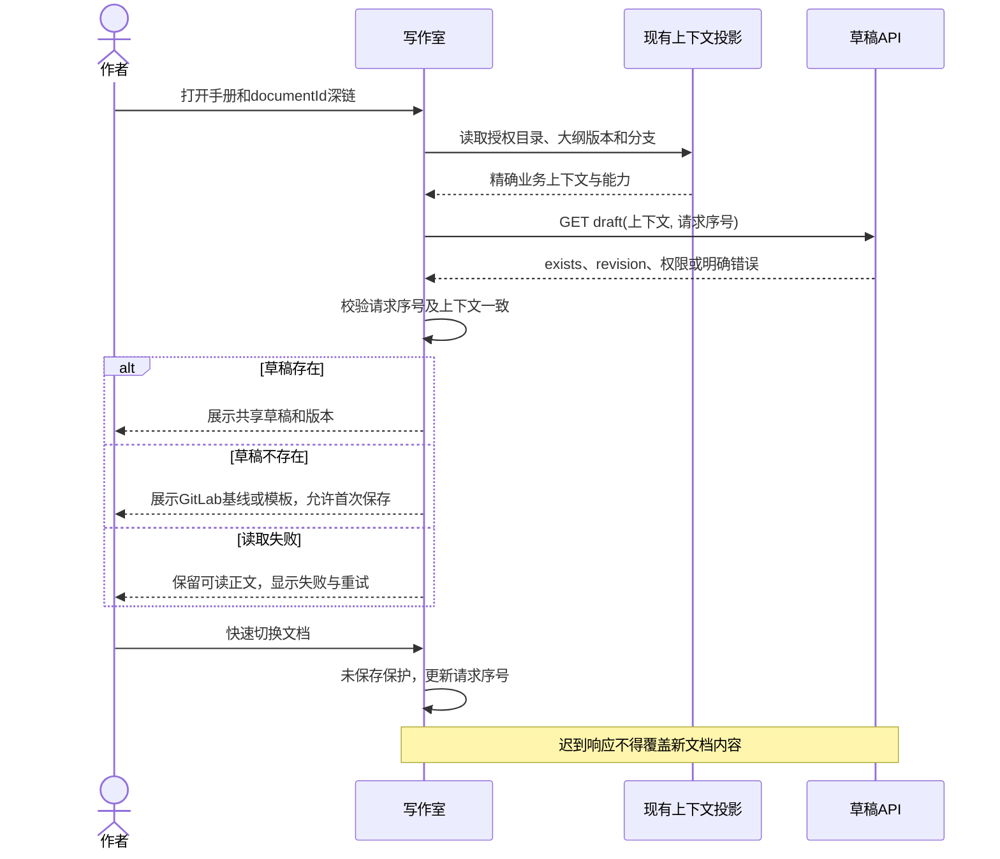
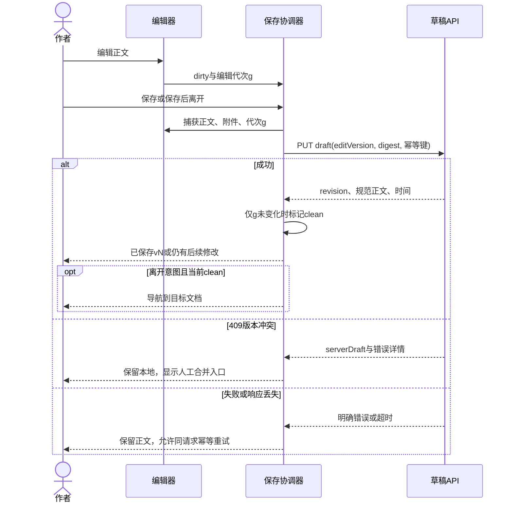
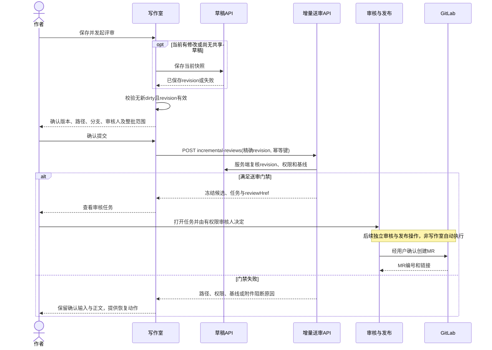

# 知识中心-文档生产-手册级文档生成页面-前端详细设计文档

> 文档类型：前端页面专项详细设计（受控例外）
> 设计编号：KC-FE-DOC-PRODUCTION-HANDBOOK-001
> 状态：现行三栏页面已实现；沉浸式写作室为待实施目标设计，业务能力以第20、21节的已验证事实为准
> 版本：0.9.0（沉浸式写作室设计修订）
> 更新日期：2026-10-16
> 上游需求：`../01-需求/增量文档构建MVP需求.md`
> 上游概要设计：`../02-概要设计/知识中心-文档生产-增量构建垂直业务-概要设计文档.md`
> 业务详细设计：`./知识中心-文档生产-详细设计文档.md`
> 关联开发任务：`../04-开发任务/知识中心-文档生产-增量文档构建MVP-开发任务文档.md`

## 1. 设计边界

**阅读优先级**：第2–16节描述业务流程及原有三栏实现基线；第22节是待实施的沉浸式写作室目标规格，覆盖与其冲突的常驻三栏、目录宽度、辅助栏和滚动布局。第16节的历史验收记录仅证明当时版本。第20、21节的共享草稿、冻结送审和MR业务边界保持有效。

本文件只描述“每本手册一个独立文档生成页面”的页面结构、交互、前端状态、路由、可访问性和页面验收。该页面同时是全局文档生产中心和“知识资产 → 手册详情”的统一下钻工作台，两类入口不另建编辑器。

本文件不重新定义：

- 增量任务、草稿、候选、审核实例和发布批次的业务事实；
- 来源快照、版本、审核和发布的后端数据模型；
- Agent Workflow、模型、Prompt 或生成规则；
- 正式版本发布事务。

页面只消费业务模块返回的事实和能力声明。前端不得根据页面文案自行推断责任人、审核结果、版本状态或发布成功。

手册映射中的默认分支和启用分支属于平台配置事实，但不是文档作者在本页需要决策的业务版本。GitLab OAuth 缺失、远端正文暂不可读或没有匹配正文时，页面不展示技术性错误文案，而是使用当前文档选中模板的正文骨架继续编写；底层不得伪造仓库正文或把模板内容标记为 GitLab 内容。

## 2. 页面目标与用户结果

每本手册对应一个独立的文档生成页面。进入路由时手册已经确定，页面唯一核心任务是在沉浸式工作区定位文档、编写正文、保存共享草稿并发起评审；目录、模板、资料和属性按需展开，不再要求重复选择产品或确认全局生成上下文。

用户主流程固定为：


只有存在多个已发布大纲版本时才显示“大纲版本”入口；只有存在真实业务版本事实时才显示目标版本。GitLab 分支不得作为业务版本展示。

作者进入手册后，可以：

1. 按需打开当前手册目录；
2. 切换“全部文档”和“只看我负责”；
3. 选择一个文档并在居中画布编辑正文；
4. 手动保存文档草稿；
5. 通过弹框为当前文档引用 PingCode 页面或 Markdown 资料；
6. 选择多个已修改文档，形成一个提交评审批次；
7. 提交后进入审核与发布页面查看冻结候选，并按现有候选粒度与权限进行审核。


## 3. 页面信息架构

本节给出沉浸式写作室**目标结构**。2026-10-16当前部署仍为三栏页面；效果图和状态细节见第22.3–22.6节，不能据此宣称已实现。

| 层级 | 默认展示 | 按需入口 |
|---|---|---|
| 全局上下文 | 手册与当前文档路径、受控返回 | 收起的平台导航轨 |
| 当前文档命令 | 文档名、保存状态、预览/编辑和当前可执行主操作 | 模板、历史、附件、取消修改 |
| 正文 | 单篇文档的居中阅读/编辑画布 | 格式工具栏仅在编辑态展示 |
| 导航 | 当前文档的上下文 | 左侧目录抽屉：层级树、搜索、全部/只看我负责 |
| 辅助 | 不常驻占宽 | 右侧互斥抽屉：引用资料、属性、历史及实际可用的AI |
| 送审 | 当前篇保存后的送审/任务入口 | 多篇已保存草稿的批量送审清单与确认窗 |

桌面默认状态为“窄轨＋宽正文画布”，目录与辅助工具覆盖打开，不挤窄正文。移动端使用可见的“目录”文字按钮，文档编辑仍为主视图；切换文档前必须处理未保存修改。批量送审和审核决定继续遵守第20、21节的业务事实。

## 4. 路由与 URL 状态

推荐路由：

```text
/knowledge-center/production/handbook/{handbookId}?taskId={taskId}&documentId={documentId}&view=mine&from=production
```

兼容现有入口：

```text
/knowledge-center/production?handbookId={handbookId}&documentId={documentId}
```

URL 状态含义：

| 参数 | 含义 | 规则 |
|---|---|---|
| `handbookId` | 当前手册 | 必填，服务端校验可见性 |
| `taskId` | 当前生产任务 | 可选；存在时必须属于当前手册，用于恢复任务范围和草稿上下文 |
| `documentId` | 当前选中文档 | 可选，缺失时显示目录并选择首个可见文档 |
| `view` | 目录过滤模式 | `all` 或 `mine`，默认 `all` |
| `from` | 受控入口来源 | `assets`、`production` 或 `todo`；只影响面包屑和返回目标，不改变权限 |

刷新、浏览器后退和深链必须恢复手册、当前任务、当前文档和目录模式。不接受任意外部 `returnTo` URL；返回目标使用受控来源枚举和同源导航状态，防止开放跳转。

## 5. 手册目录与按需导航

目录事实源是知识中心当前发布的大纲，不以 GitLab 文件树反向生成目录。GitLab 仅作为已配置映射手册的正文来源。

### 5.1 目录模式

目录提供两个互斥模式：

```text
全部文档
只看我负责
```

目录节点展示：

- 文档标题；
- 层级路径；
- 当前责任人；
- 正式版本或草稿状态；
- 是否存在未保存修改；
- 是否已选入提交批次。

示例：

```text
参数说明       张三       草稿
连接配置       李四       已发布
安全配置       未分配     只读
```

### 5.2 责任人过滤

- 当前用户身份来自服务端会话；
- `mine` 只使用服务端返回的责任映射；
- 无责任文档显示“未分配”，不能默认归属当前用户；
- 服务端必须同时执行资源权限校验，前端过滤不能替代授权；
- 无匹配文档时显示“当前没有由你负责的文档”。

## 6. 沉浸式文档工作区

### 6.1 按需目录抽屉

目录抽屉继续以当前手册已发布大纲为事实源。进入手册页面后解析目录与当前文档，但默认关闭抽屉；单一发布大纲不显示选择控件，多个版本切换前处理未保存草稿。

目录文档项与审核与发布阅读树采用紧凑密度：文档按钮最小高度 40px，标题和草稿状态保持两行但减小行间距；保留层级缩进、选中态、键盘焦点和待评审标记。目录框架和开关方式不变。

MVP 的“新增章节”只提供入口和待接入说明；在大纲变更契约未明确前，不允许绕过发布大纲直接创建正式章节。

### 6.2 居中正文编辑器

已存在的可读正文优先展示。没有可读正文时，正文区域展示当前文档选中模板的内容骨架；只有没有可用模板时才展示“请选择当前文档的模板”。页面不展示“GitLab 未匹配正文”“GitLab 中未找到对应正文”或“来源分支”等不具备当前业务决策价值的技术信息。

目标命令栏持续显示当前文档、预览/编辑、保存状态及按状态派生的保存或送审动作；模板、历史、附件和取消修改转入按需次级入口。编辑态 Vditor 格式栏仍在其下方固定，遵守公共滚动避让。以下条目保留编辑器行为约束：

- 预览态使用共享 Markdown 渲染器，完整展示标题、表格、代码、图片和相对附件链接；
- 当前未保存草稿、已保存草稿、仓库正文和模板骨架的预览均以 Markdown 为事实源，统一调用 `renderDatabaseMarkdown`。编辑器生成的 `htmlSnapshot` 仅供草稿存储与恢复，不直接作为预览 HTML 插入。正文使用与审核与发布阅读区一致的 `.repository-markdown` 排版规则：900px 最大阅读宽度、1.75 行高、标题间距、表格边框、代码块底色、图片自适应及链接颜色；审核页的意见和状态提示不进入写作预览。
- 编辑态使用接近 Obsidian Live Preview 的渲染内容编辑区，不展示纯 Markdown 源码；
- 编辑结果只形成当前页面草稿，不修改 GitLab 正文；
- 空文档选择模板后，以模板正文形成可预览、可编辑的骨架；
- 已有正文或页面草稿时切换模板不得静默覆盖正文，只更新模板约束；
- 全局预览使用独立图标按钮，具备可访问名称和 `aria-pressed`；进入后隐藏平台全局导航、目录、右侧面板和评审区，退出后恢复当前文档、预览模式和辅助页签；
- sticky 操作栏不得遮挡正文或键盘焦点；长文档滚动后仍可直接保存或取消；
- 操作栏根据正文容器宽度自适应：空间充足时上下文与操作同排，正文容器不足 760px 时自动分为两行；按钮文案不得按单个汉字断行；
- 已有 GitLab 图片和附件保持可展示；草稿附件上传及扫描门禁以第20.3节现行契约为准，不能伪造成功。

一次只编辑一个文档。

MVP 编辑器使用可阅读的渲染内容区，不在正文上方重复显示“Markdown / 富文本”标题：

```text
当前文档正文
[模板或已有正文的阅读/编辑区]

状态：未保存 / 保存中 / 已保存 / 保存失败
[预览] [编辑] [取消] [保存] [全局预览图标]
```

本轮不实现多文档同时编辑、自动保存、多人实时协作或 Agent 自动覆盖正文。

共享草稿和增量送审的当前实现与验证边界以第20、21节为准；Agent生成及正式来源快照尚未接入。上述写作室视觉布局仍是待实施目标。

### 6.3 已发布大纲选择

当前只有一个已发布大纲时，页面解析目录并定位当前文档，不显示大纲名称、版本或选择控件。当后端提供多个已发布大纲事实时，才在页面提供“大纲版本”选择入口；切换前必须处理未保存草稿。GitLab 分支不得代替业务大纲版本。

## 7. 按需辅助抽屉

右侧抽屉按需打开，不常驻占据正文宽度；使用页签承载：

- `AI助手`：生成本节、润色、检查；
- `文档属性`：路径、责任人、草稿状态；
- `引用资料`：复用现有 PingCode 页面和 Markdown 上传能力；
- `关联知识`：本轮只展示入口和空状态，不伪造知识关联结果。

桌面和窄屏均使用可关闭抽屉，按实际可用能力呈现入口；AI尚未接入时只显示明确待接入状态，不默认占据正文空间。抽屉触发按钮具有可访问名称，关闭后焦点返回触发点，支持Esc关闭；目录与辅助抽屉互斥。

AI 操作规则：

- AI 输出只能形成当前页面草稿，不得覆盖正式正文；
- 用户必须能看到操作对象是“当前章节/当前文档”；
- 后端生成契约未接入时按钮返回“AI 能力待接入”，不得生成静态示例冒充结果；
- 每次 AI 结果进入编辑器前必须保留用户可撤销边界；
- 人工编辑始终可用，不依赖 AI。

## 8. 引用资料弹框

引用资料关联当前文档草稿，不关联整个手册。



弹框字段：

- 来源类型；
- PingCode 页面链接或 Markdown 文件；
- 资料名称；
- 内容预览；
- 读取状态；
- 内容摘要或版本标识；
- 取消和确认引用。

规则：

- MVP 上传格式仅支持 Markdown；
- PingCode 保持只读；
- 连接器未接入时显示“正文读取待接入”，不得声称读取成功；
- 读取失败不得生成空引用；
- 引用资料不能直接覆盖当前正文；
- 后端接入后形成不可变来源快照；
- 前端不保存 PingCode 凭证，Agent 不直接接触凭证。

## 9. 滚动与全局预览原则

- 桌面端只由 `.main-shell` 承担纵向滚动，`html/body` 不生成可见纵向滚动条；窄屏下 `.main-shell` 改为普通文档流，由浏览器根页面滚动；任一断点只能存在一个主纵向滚动容器；
- 默认正文保持单主纵向滚动；目录和辅助抽屉打开后允许在受控浮层内滚动，并按公共滚动协议锁定背景，不能让正文与浮层同时响应同一滚轮；
- 左侧默认只展开当前文档所在目录路径，避免大纲一次性全部展开；
- 全局预览为当前页面内的沉浸状态，不打开新窗口、不改变业务路由；
- 全局预览通过图标的 tooltip/可访问名称表达“全局预览 / 退出全局预览”，并支持 `Esc` 退出。

### 9.1 长文写作控制面

编辑态将文档上下文、格式命令和保存/送审动作组成视觉连续的双层固定控制栏。以下是旧三栏的命令布局，沉浸式目标以第22.4节及原型图为准：

```text
第一层  文档名称 / 简短路径    预览·编辑  保存状态  历史  附件  取消  保存
第二层  标题  加粗  斜体  列表  表格  代码  链接  图片  撤销  重做
───────────────────────────────────────
                    连续滚动的正文画布
```

- `.main-shell` 为桌面端唯一滚动容器，第一层业务控制栏以 `top: 0` 固定；
- Vditor 格式栏固定在第一层下方，偏移量由第一层的稳定高度决定，不得与业务控制栏争用 `top: 0`；
- 两层使用同一白色背景、单一外轮廓和轻微阴影，不表现为两张独立卡片；
- 加粗、斜体、撤销等熟悉命令使用图标，保留中文 tooltip 和可访问名称；
- 同一时刻只有一个视觉主动作：有修改时保存或保存并发起评审，已保存且可送审时发起评审；保存状态与操作靠近，并以文字表达；
- 文档模板等低频上下文保留在非固定的次级信息条，不占用长文写作的持续视野；
- 正文画布宽度为 `min(100%, 860px)`，常规正文保持约 65–75 个字符的行长，表格、图片和长链接不得撑破页面；
- 固定栏高度必须通过 `scroll-padding-top` 和正文 `scroll-margin-top` 补偿，键盘焦点、搜索命中和标题锚点不得被遮挡；
- 窄屏下格式命令可水平滚动，保存状态和保存动作仍保持可见。

## 10. 草稿保存与离开保护

保存方式为“手动保存 + 离开提示”：

1. 用户编辑正文后标记为“未保存”；
2. 点击保存发送当前草稿和版本指纹；
3. 保存成功返回新草稿版本、摘要和时间；
4. 保存失败保留编辑内容并提供重试；
5. 版本冲突提示服务端已有新版本，禁止静默覆盖；
6. 切换文档、切换手册或离开页面时，如果存在未保存修改，弹出确认。

## 11. 提交评审区

现行页面底部展示当前手册中存在修改的文档；沉浸式目标将多篇送审清单放在按需入口，当前篇保存后的送审/任务入口持续可见：

```text
待提交评审

□ 参数说明       已保存草稿       引用资料 2 项
□ 连接配置       已保存草稿       引用资料 1 项
□ 安全配置       未保存修改       不可提交
```

提交规则：

- 用户可选择多个文档；
- 多个文档形成一个提交批次；
- 多篇选择形成既有一个冻结候选，逐篇保留来源revision、路径和审核人信息；
- 审核决定遵守现有候选粒度，不在写作室中改为逐篇独立决定；
- 提交成功后跳转审核与发布页面；
- 跳转保留手册 ID、批次 ID 和文档上下文。

提交前门禁：

- 至少选择一个文档；
- 每个所选文档存在已保存草稿；
- 所选文档不能有未保存修改；
- 所选文档存在有效正式基线；
- 引用资料读取失败的文档不能提交；
- 服务端重新校验权限、版本和草稿指纹。

## 12. 页面状态矩阵

| 状态 | 页面表现 | 可执行动作 |
|---|---|---|
| 加载中 | 目录和正文显示加载状态 | 等待 |
| 可编辑 | 编辑区可输入 | 保存、接入资料 |
| 只读 | 显示只读原因 | 返回、查看 |
| 未保存 | 显示未保存标记 | 保存、放弃 |
| 保存中 | 保存按钮处理中 | 等待 |
| 保存失败 | 就近显示错误 | 重试，保留输入 |
| 版本冲突 | 显示服务端版本变化 | 重新读取、人工处理 |
| 引用资料读取中 | 弹框显示处理中 | 等待、取消 |
| 引用资料失败 | 显示失败原因 | 重试、取消 |
| 提交中 | 提交按钮处理中 | 等待 |
| 提交成功 | 显示批次号 | 进入审核 |
| 提交失败 | 保留勾选和草稿 | 重试 |
| 无权访问 | 显示权限说明 | 返回 |
| 无责任文档 | 显示只读状态 | 查看正文 |

状态不能只通过颜色表达，必须同时显示文字和可访问名称。

## 13. 前端组件职责

下列树为现行三栏组件基线；沉浸式目标组件拆分见第22.8节。布局组件调整不得复制正文状态或重建服务端业务事实。

```text
HandbookDocumentProductionPage
├── HandbookHeader
├── DirectoryModeToggle
├── HandbookDocumentTree
├── DocumentTreeItem
├── DocumentEditorWorkspace
├── DocumentMetadata
├── MarkdownEditor
├── ReferenceDocumentDialog
├── ReferenceDocumentList
├── ReviewBatchSelector
├── UnsavedChangesGuard
└── PageStatusBanner
```

- 目录组件只负责目录展示、过滤和文档选择；
- 编辑器负责正文编辑和草稿状态；
- 引用资料弹框负责来源输入、预览和关联；
- 提交区负责文档选择和批次提交；
- 审核操作复用审核与发布页面，不在此页面复制；
- 页面不自行推断业务状态。

## 14. 接口依赖

以下为早期建议接口清单，不代表全部已实现或本次新增契约。沉浸式方案复用第20.6、21节现行接口，具体调用以前端API适配层及后端契约为准：

```text
GET  /knowledge-center/api/production/handbooks/{handbookId}/workspace
GET  /knowledge-center/api/production/handbooks/{handbookId}/documents/{documentId}
PUT  /knowledge-center/api/production/handbooks/{handbookId}/documents/{documentId}/draft
POST /knowledge-center/api/production/handbooks/{handbookId}/documents/{documentId}/references
POST /knowledge-center/api/production/handbooks/{handbookId}/review-batches
```

接口必须返回能力声明、版本指纹、责任人事实、错误码和可恢复建议。接口不存在时，前端只能显示待接入状态，不可用本地状态冒充正式成功。

## 15. 响应式与可访问性

- `>=1200px`：窄轨与居中正文画布，目录和辅助工具为覆盖式抽屉；
- `768px–1199px`：命令栏重排，正文不被常驻三栏挤窄，按需打开抽屉；
- `<768px`：提供明确的“目录”文字入口，正文全宽，抽屉可全屏呈现；
- 目录、弹框、编辑器和提交按钮均支持键盘操作；
- 弹框打开后焦点进入弹框，关闭后返回触发按钮；
- 未保存、冲突和失败提示使用 `role="status"` 或 `role="alert"`；
- 页面不得产生横向滚动；
- 状态不能只依赖颜色、图标或位置表达。

## 16. 页面验收

### 16.1 用户视角整改基线

- 目录必须以大纲层级呈现，不能将文档平铺成文件列表；
- 文档主标题使用大纲名称，不展示 `.md` 扩展名和内部排序前缀；
- 进入手册后直接解析当前发布大纲；目录按需打开，不再选择产品或执行“生成文档结构”；
- 正文不可读时必须展示当前文档模板骨架，不展示 GitLab 匹配技术错误；
- 页面突出当前文档、阅读/编辑、保存事实及下一步送审；模板和其他次级工具按需展开；
- 多篇草稿评审清单按需打开，不遮挡正文；当前篇只在具备送审条件时突出送审动作；
- 页面草稿可以恢复为原文，恢复前必须确认且不修改正式内容；
- 目录展开/收起状态在当前手册页面内保持，刷新后以当前选择文档所在路径为最低恢复范围；
- “只看我负责”模式显示实际文档数量，无匹配时提供返回“全部文档”的入口；
- 默认正文单主滚动；目录和辅助抽屉打开时允许受控浮层滚动并锁定背景；全屏预览支持显式退出和Esc退出。

1. 进入指定手册后只加载该手册目录，默认聚焦当前文档，目录可按需打开；
2. 可以切换“全部文档”和“只看我负责”；
3. 切换文档后正文、文档模板、责任人和路径正确变化；
4. 可以手动修改正文并保存页面草稿；
5. 未保存切换文档时显示确认提示；
6. 保存冲突不会覆盖服务端较新版本；
7. 弹框支持 PingCode 链接和 Markdown 文件；
8. 引用资料关联到当前文档而非整个手册；
9. 多篇文档可组成一个评审批次；
10. 审核页面按现有候选粒度展示所选文档及冻结内容；
11. 提交失败不丢失选择和草稿；
12. 无权限、无责任人和空目录有明确状态；
13. 桌面、平板和移动端无横向滚动；
14. 键盘可以完成主要操作；
15. 正式保存、来源读取和评审批次创建均由服务端事实确认。

**历史验收，不代表沉浸式目标已上线。** 本轮真实验收结果（2026-09-24）：

- 使用真实管理员会话、真实大纲 API、真实模板 API和数据库 GitLab 映射完成页面装配；
- 进入指定手册后直接展示发布大纲目录、文档级模板、正文编辑器与 AI助手/属性/引用资料三栏；
- GitLab OAuth 缺失且远端正文不可读时，正文区展示真实模板 API 返回的模板骨架，不展示技术错误；
- Markdown 引用文件可以在弹框内读取和预览，但不冒充正式上传或来源快照；
- 人工编辑、页面草稿保存和恢复链路通过，恢复未产生后端写请求；
- 390px 视口页面宽度与客户端宽度均为 390px，无横向溢出；
- 目录与右侧面板计算样式均无 `auto/scroll` 纵向滚动，页面仅使用浏览器主滚动条；
- 页面内全屏预览可隐藏目录、助手和评审区，退出后状态恢复；
- 浏览器端到端用例 3 项全部通过。

**历史验收，不代表沉浸式目标已上线。** 长文写作控制面验收（2026-09-28）：

- 1440px 视口长文滚动后，业务控制栏固定于 `0–68px`，Vditor 格式栏紧接于 `68–114px`，加粗命令未被遮挡；
- 保存按钮始终位于固定栏首屏，历史、附件、取消和全局预览在可滚离的次级条；
- 1440/1024/768/390px 未观察到页面级水平溢出，390px 保留预览/编辑、保存状态、保存和辅助工具；
- 新增 E2E 在 Chromium 和 Firefox 通过；全量隔离 E2E 仍存在与本设计无关的人员名单硬编码失败，不得声明全仓测试全绿。

## 17. 与全局生产中心的联动

本页是手册生产的唯一下钻工作台。全局生产中心的手册视图、任务视图、我的生成，以及知识资产中的手册详情，打开同一本手册时都必须进入本页，不得复制另一套目录、编辑器或草稿状态。


联动规则：

1. 同一 `handbookId + taskId + documentId` 不论从哪个入口打开，草稿、模板、引用资料、任务状态和权限投影必须一致。
2. 从全局手册视图进入时，面包屑为“文档生产总览 / 手册名称”；从知识资产进入时，面包屑为“知识资产 / 手册名称 / 文档生产”。
3. 从任务或待办进入时，页面显示与当前编辑直接相关的任务状态和返回动作，但不把全部五阶段表单复制到编辑器。
4. 返回全局生产中心时恢复原视图、筛选、分页和滚动位置；返回知识资产时恢复原手册详情上下文。
5. 离开前如有未保存修改，仍执行第 10 节的离开保护；不因入口不同而改变草稿安全规则。

页面不存在“全局生产中心草稿”和“知识资产草稿”两种事实；入口只是导航上下文，业务事实始终属于同一手册、任务和文档。

## 18. 实施边界

原三栏前端流程骨架已实现并通过对应时点的真实浏览器验收；共享草稿与增量送审能力见第20、21节，Agent生成和来源快照仍未接入。沉浸式布局与交互已于2026-10-16实施，实际验收见第22.15节。以下仅保留原前端骨架的历史实施路径：


### 18.1 目录面板历史实现规格（2026-09-24）

以下260px可拖拽目录属于已实现三栏基线。沉浸式目标改为默认关闭的覆盖式目录抽屉，宽度与交互以第22.4节为准；保留搜索、责任过滤、键盘操作及URL恢复的业务语义，不把历史拖拽宽度当成新方案门槛。

手册级页面采用“文档导航树＋正文编辑区＋辅助工具”的三栏工作区。目录默认 260px，允许在 220–360px 内拖动；折叠后保留 48px 窄栏，正文和辅助工具保留自己的业务布局。目录搜索只过滤当前手册，搜索命中时展开祖先节点；“全部文档/只看我负责”仍是责任范围过滤，不改变正文事实。

目录分隔条支持鼠标、方向键、Shift 加方向键、双击恢复默认和 Escape 取消拖动。宽度及折叠状态按 `production-handbook` 保存，不按手册保存；当前 `handbookId/documentId/view` 继续由 URL 恢复。`768px` 以下不显示拖拽条，目录改为目录视图和正文视图切换，不能产生页面级横向滚动。

目录不负责模板冻结、GitLab 写入、正式草稿保存或审核决定。目录中的状态只用于定位当前文档，正文编辑结果仍然只形成页面草稿。

### 18.2 表单字段语义与组合框接入

- 当前文档模板选择器保留原生 select 语义，并使用 name="templateId"，由公共组合框渐进增强；因此键盘、表单值和 change 事件仍以原生控件为事实入口。
- 页面携带当前大纲版本的隐藏字段 name="outlineId"，仅用于保持上下文，不提供节点级模板配置，也不改变“模板版本由文档生产任务冻结”的规则。
- 组合框宽度由页面场景属性控制，不使用全局固定宽度覆盖手册目录、编辑工具栏和弹框。

## 19. 工作台与“我的生成”边界（2026-09-28）

### 19.1 设计目标

当前页面涉及三个不同层级，不能用一个“个人工作台”概念混合：

1. **平台工作台**：知识中心根路径的跨模块总览，回答“平台当前有哪些风险、生产进度和需要关注的事项”。
2. **文档生产中心**：文档生产模块内部的手册视图、任务视图和“我的生成”，回答“文档生产活动和生成记录处于什么状态”。
3. **手册级生产工作台**：单本手册的编辑、差异、审核和发布下钻页面，回答“如何处理当前文档”。

本设计不再新增与平台工作台并列的“个人工作台”。个人强相关事项进入平台工作台的“待我处理”区域；文档生产模块的“我的生成”保持独立，只展示当前用户发起或参与的生成记录，不承担跨模块待办聚合。

### 19.2 保留、删除和降级

| 处理 | 内容 | 原因 |
|---|---|---|
| 保留 | 手册目录树、文档级模板、预览/编辑、全局预览、单滚动、URL 恢复、引用资料入口 | 已验证且直接服务正文定位和编辑 |
| 保留 | 任务视图、按文档审核、任务级整体发布 | 多文档生产的业务主链路 |
| 保留 | 平台工作台中的“待我处理”摘要 | 以个人视角提示跨模块下一步动作，但不复制业务工作区 |
| 保留 | 文档生产中心中的“我的生成” | 展示当前用户发起或参与的生成运行、草稿和结果 |
| 删除 | 后端未接入时作为主操作展示的“生成本节、润色、检查、提交评审” | 避免可点击但不产生正式业务事实 |
| 降级 | AI、引用资料和审核能力未就绪时的入口 | 显示待接入或前置条件，不冒充成功 |
| 删除 | “前端暂存”作为成功结果的强提示 | 前端内存不等于正式草稿或来源快照 |

### 19.3 三层信息架构

~~~mermaid
flowchart TB
    U["当前登录用户"] --> P["平台工作台"]
    P --> PT["待我处理摘要"]
    P --> PR["跨模块风险与进度"]
    U --> D["文档生产中心"]
    D --> H["手册视图"]
    D --> T["任务视图"]
    D --> G["我的生成"]
    PT --> X["进入对应业务工作区"]
    G --> R["生成运行 / 草稿 / 结果详情"]
    X --> W["手册级生产工作台或审核工作区"]
~~~

### 19.4 平台工作台中的个人区域

~~~text
┌ 工作台                                      [刷新] [范围/统计时间] ┐
│ 平台总览：风险、生产进度，以及与你相关的下一步事项               │
├──────────────────────────────────────────────────────────────────┤
│ 待我处理（跨模块摘要）                                            │
│ ┌──────────────┬──────────────────────────────┬─────────────────┐ │
│ │ 优先级       │ 事项                         │ 下一步          │ │
│ │ 高           │ mysql模式参考手册·参数说明    │ 继续编辑        │ │
│ │ 高           │ 系统参数手册·审核意见 2 条    │ 处理意见        │ │
│ │ 中           │ 连接配置手册·待确认来源       │ 确认来源        │ │
│ │ 中           │ 发布批次 PB-024               │ 确认发布        │ │
│ └──────────────┴──────────────────────────────┴─────────────────┘ │
├──────────────────────────────┬───────────────────────────────────┤
│ 文档生产：3 项                 │ 其他模块：2 项                    │
│ [进入文档生产]                 │ [查看全部待处理]                   │
├──────────────────────────────┴───────────────────────────────────┤
│ 最近处理：手册、文档、动作、时间、结果；失败项提供重试或返回入口     │
└──────────────────────────────────────────────────────────────────┘
~~~

平台工作台只展示跨模块摘要，不复制文档生产的生成列表、编辑器、审核器或发布器。点击事项后进入对应模块的真实工作区。

文档生产中心中的“我的生成”使用独立页面或页签：

```text
┌ 文档生产                         [手册视图] [任务视图] [我的生成] ┐
│ 我的生成：当前用户发起或参与的生成运行                           │
├──────────────────────────────────────────────────────────────────┤
│ 运行状态 │ 手册 / 文档 │ 发起时间 │ 最近结果 │ 下一步               │
│ 已完成   │ mysql模式…  │ 09-28    │ 草稿     │ 查看草稿             │
│ 运行中   │ 系统参数…  │ 09-28    │ —        │ 查看运行             │
│ 失败     │ 连接配置…  │ 09-27    │ 错误     │ 重试 / 查看原因       │
└──────────────────────────────────────────────────────────────────┘
```

### 19.5 “我的生成”与个人待处理的边界

平台工作台的“待我处理”必须来自当前用户可见且需要当前用户动作的真实事实；“我的生成”则来自生成运行和草稿事实。二者都不能由前端根据角色名称推断，但二者不合并为同一个列表。

支持的业务类型：

| 类型 | 触发事实 | 下一动作 |
|---|---|---|
| document_edit | 当前用户负责文档且草稿未完成 | 继续编辑 |
| source_confirm | 来源已读取但等待当前用户确认快照 | 确认来源 |
| review_comment | 当前用户作为作者，存在未处理审核意见 | 处理意见 |
| review_decision | 当前用户具有有效审核权限且候选待审核 | 进入审核 |
| publication_confirm | 所有文档门禁满足且当前用户有发布权限 | 确认发布 |
| conflict_resolution | 基线或版本冲突，需要用户选择处理方式 | 查看冲突 |

| 组件 | 职责 | 输入 | 事件 | 不能负责 |
|---|---|---|---|---|
| DashboardPersonalSummary | 平台工作台中的个人摘要 | 跨模块待处理投影 | 打开模块 | 推断数量 |
| DashboardWorkItemCard | 展示跨模块事项摘要 | workItem | 打开业务工作区 | 处理业务状态 |
| MyGenerationPage | 展示我的生成记录 | generationRuns、drafts | 查看、重试、进入草稿 | 生成正式发布版本 |
| MyGenerationList | 展示生成运行列表 | generationRuns | 筛选、排序、打开 | 生成业务待办 |
| WorkItemActionGuard | 渲染服务端允许的动作 | capabilities、status | 允许或阻断 | 自行判断审核/发布资格 |
| WorkItemEmptyState | 展示空、失败、无权、过期 | 状态、恢复动作 | 重试、返回 | 用示例数据填充 |

### 19.6 接口、状态和入口

平台工作台使用既有工作台投影接口中的个人摘要字段；不新增 `personal-workspace` 作为独立页面接口。文档生产中心的“我的生成”使用文档生产域接口，例如：

`GET /knowledge-center/api/production/generations?scope=mine`

投影必须区分 loading、ready、empty、unavailable、forbidden、stale，不能用空数组同时表示“没有待办”和“接口失败”。工作项打开使用：

~~~text
/knowledge-center/production/handbook/{handbookId}
  ?taskId={taskId}&documentId={documentId}&from=dashboard&workItemId={workItemId}
~~~

workItemId 只用于返回上下文、幂等和审计，不改变权限。

### 19.7 未接入能力的显示原则

- 正式草稿接口未接入：显示“页面内编辑草稿”，不显示“已保存”作为服务端成功；
- 来源快照接口未接入：保留“引用资料”入口，但显示“能力待接入”；
- Agent 接口未接入：不显示可点击的生成、润色、检查主按钮；
- 审核接口未接入：不显示“提交评审”主按钮；
- 发布接口未接入：不显示“确认发布”动作。

### 19.8 验收标准

1. 当前用户进入平台工作台后可以看到跨模块的“待我处理”摘要；
2. 当前用户进入文档生产中心后，可以独立进入“我的生成”查看生成运行和草稿；
3. “我的生成”不混入审核、发布或其他模块待办；
4. 点击个人摘要事项能恢复 handbookId、taskId、documentId，返回平台工作台时恢复列表和位置；
5. 无待办、无权、失败和过期状态互相区分；
6. 平台工作台和“我的生成”不复制编辑器、审核器或发布器，所有下钻进入已有工作区；
7. 未接入能力不进入“已完成”或“待我处理”的业务投影；
8. 1440px、1024px、768px、390px 视口下可读、可键盘操作且无页面级横向滚动。

### 19.9 分工事实与“只看我负责”一致性

手册生产页的责任人过滤必须使用大纲治理接口返回的 `effectiveDocumentAssignments[].ownerships`。数据库模式下，技术领域归属来自责任映射，具体责任人来自同一大纲的领域建设任务项；服务端必须按 `documentId + techDomainId` 合并两类事实后再返回。

前端不得仅读取 `techDomainIds`、不得把 `pending_binding` 解释为当前用户负责，也不得根据文档标题或责任人姓名猜测归属。若治理投影与任务项不一致，页面应显示不可用或未分配状态，不能把文档错误纳入“只看我负责”。

身份匹配优先比较会话中的全部稳定标识（包括 `principalId`），不得因认证用户 `id` 存在而丢弃人员主数据标识；显示名仅作为兼容既有数据的后备匹配。

## 20. 共享草稿保存与评审前端基线（2026-09-28）

### 20.1 草稿上下文与加载优先级

共享草稿由 `handbookId + outlineVersionId + branch + documentId` 唯一确定，不按浏览器或用户隔离。进入文档时先读取该上下文的最新工作草稿；不存在草稿时使用当前 GitLab 分支的基线正文。切换文档、大纲版本或分支前，若当前编辑器有未保存内容，必须要求用户确认。

编辑器采用本地托管 Vditor 的 `wysiwyg` 模式，默认不展示 Markdown 源码。Markdown 是发布、差异和审核的正文事实，HTML 只作为经过服务端清洗和一致性校验的编辑/阅读快照。只有服务端保存成功后，页面才能显示“已保存 vN · 时间”。

### 20.2 编辑状态机

```text
loading -> clean -> dirty -> saving -> saved
                    |          |       |
                    |          +-----> failed
                    +----------------> conflict
```

- `未修改`：当前正文等于已加载的服务端草稿或 GitLab 基线；
- `有未保存修改`：编辑器内容已变化；
- `保存中`：禁用重复保存，但不清空编辑器；
- `已保存 vN · HH:mm`：仅由成功响应驱动；
- `保存失败`：保留正文、附件和重试入口；
- `版本冲突`：保留本地正文，并提供服务器版本、本地版本和合并入口。

“取消”恢复最近一次服务端草稿；没有草稿时恢复当前 GitLab 基线。“恢复原文”按钮删除，避免与删除共享草稿混淆。编辑器支持 `Ctrl/Cmd+S`，本阶段不自动保存。

### 20.3 编辑器与附件

工具栏提供标题、粗体、斜体、列表、表格、代码块、链接、图片、附件、撤销和重做。图片支持 PNG、JPEG、WebP、GIF，单个不超过 10MB；普通附件支持 Markdown、PDF、DOCX、XLSX，单个不超过 50MB；单草稿附件总量不超过 200MB。

上传先进入临时资源区，服务端返回 `attachmentId`、稳定引用、摘要和扫描状态。图片插入正文，普通附件插入文件链接；保存草稿时通过 `attachmentIds` 绑定。上传失败、扫描失败或仍在处理中时，禁止保存引用该资源的草稿。未绑定资源由服务端按 TTL 清理。

### 20.4 冲突与历史

保存请求携带 `editVersion`、`baselineDigest` 和幂等键。服务端版本变化时返回 `409 DRAFT_VERSION_CONFLICT`，前端不得静默覆盖。冲突界面允许重新载入服务器版本、复制本地内容或进入人工合并编辑器，不提供强制覆盖。

`baselineDigest` 统一使用 UTF-8 SHA-256。页面在 HTTPS 或 localhost 安全上下文中优先使用 Web Crypto；在局域网 HTTP 访问导致 `crypto.subtle` 不可用时，必须使用同算法的本地回退计算，不得因浏览器安全上下文差异中断保存，也不得以空摘要绕过版本指纹。

版本历史抽屉展示 revision 号、更新人、时间、摘要和来源 revision。恢复历史版本会创建新的 revision，并记录 `restoredFromRevisionId`；历史记录不可覆盖或删除。

### 20.5 评审提交

评审区只列出已由服务端保存且当前无未保存修改的文档。一个批次可以包含多篇文档，每篇文档引用确定的 `draftRevisionId`，配置批次默认审核人并允许逐篇覆盖。每篇文档至少需要一名有审核权限的审核人；当前阶段允许提交者本人担任审核人，不授予额外审核权限。

提交成功后，选定 revision 固化为增量审核候选，页面显示已提交版本与“查看审核任务”。继续编辑后保存才生成 vN+1，不自动克隆工作稿；审核内容始终不变。退回后通过“返回手册修改”编辑并保存新版本，再次发起评审。

### 20.6 API 契约

```text
GET  /knowledge-center/api/production/handbooks/{handbookId}/documents/{documentId}/draft?outlineVersionId=&branch=
PUT  /knowledge-center/api/production/handbooks/{handbookId}/documents/{documentId}/draft
POST /knowledge-center/api/production/handbooks/{handbookId}/documents/{documentId}/draft-attachments?outlineVersionId=&branch=
GET  /knowledge-center/api/production/handbooks/{handbookId}/documents/{documentId}/draft/revisions?outlineVersionId=&branch=
POST /knowledge-center/api/production/handbooks/{handbookId}/documents/{documentId}/draft/restore
GET  /knowledge-center/api/production/handbooks/{handbookId}/reviewers
POST /knowledge-center/api/production/handbooks/{handbookId}/review-batches
```

附件上传请求体为原始二进制，文件名通过 `X-File-Name` 传递，MIME 使用 `Content-Type`；不得将大附件 Base64 放入 JSON。保存请求包含 `outlineVersionId`、`branch`、`baselineDigest`、`editVersion`、`markdown`、`htmlSnapshot`、`templateVersionId` 和 `attachmentIds`。响应返回草稿、revision、版本、摘要、规范化 Markdown、已清洗 HTML、附件、更新人、更新时间和能力声明。

首次读取前，前端必须先固定服务端返回的发布大纲版本和当前 GitLab 分支，不得用临时的 `published` 字符串发起读取后再用具体版本 ID 保存。查询参数缺失或响应不符合 JSON 契约时，标记草稿服务不可用，不得误报为“没有草稿”或“保存失败”。

冲突响应使用 `error.details.serverDraft` 恢复服务器正文；错误响应丢失 `details` 视为契约失败。附件 ID 只能绑定创建它的同一手册、大纲版本、分支和文档草稿。

### 20.7 前端组件补充

```text
DocumentEditorWorkspace
├── VditorEditorAdapter
├── DraftSaveStatus
├── DraftConflictDialog
├── DraftHistoryDrawer
├── DraftAttachmentManager
└── ReviewBatchDialog
```

Vditor 资源必须随平台本地部署，并在进入编辑态后按需加载。任一 API 不可用时展示明确不可用状态，不得回退为本地成功。

### 20.8 空草稿与服务不可用状态

- 服务端成功返回 `exists: false` 表示当前文档没有历史草稿，是正常业务空状态；顶部显示“未修改”，不显示错误，也不渲染草稿历史入口。
- 只有 `exists: true` 时才展示草稿版本和历史入口。
- 网络失败、非 JSON 响应、权限失败或契约解析失败不等同于没有草稿；继续展示 GitLab 基线或模板正文，并允许用户进入编辑态查看和临时编辑。
- 草稿服务不可用时，在模板与次级操作区显示低干扰的可恢复说明，不占用正文主区域，不使用“草稿读取失败”作为文档状态。
- 草稿服务恢复前禁用保存、附件上传和历史操作；本地编辑内容保留在当前页面，快捷键保存也必须经过同一能力门禁。
- 服务端返回有效空草稿后，保存能力保持可用，首次保存使用 `editVersion=0` 创建 revision。
> 滚动兼容性（2026-10-12）：公共机制以《知识中心-前端-详细设计文档》为准。原有单主滚动、长文命令栏、编辑器工具栏和移动助手规则保留；所有视口尺寸引用 --kc-viewport-height，命令栏与编辑器工具栏注册避让，不在本页创建第二套 viewport runtime。

本轮浏览器回归确认：窄编辑区内文档选项行未换行，模板、状态及次级操作的最小宽度之和超过中栏，导致全局预览按钮进入助手栏并被遮挡。选项行与工具操作允许换行、模板选择器允许收缩；不通过提升层级覆盖助手解决。助手非空渲染与空态统一声明 drawer，编辑器挂载完成后注册格式栏为公共避让控件。

## 21. 保存后发起评审与 GitLab MR（2026-10-15）

2026-10-16 补充：审核与发布的仓库阅读区通过 `reviewPath` 深链进入本页。加载手册映射树后仅在仓库路径与一个已发布大纲文档唯一匹配时自动定位并读取其共享草稿；匹配失败显示无法打开文档，不回退到目录第一篇。编辑、保存和评审确认仍由本页既有控件完成；送审时服务端比较冻结草稿与 GitLab 基线，同文返回 `GITLAB_NO_CHANGES`，不产生审核任务。审核通过后在审核详情创建 MR，成功链接可回看，失败保留任务和重试入口。

本轮采用模块设计 22.1 的方案二，复用增量任务审核接口。现状为“保存 → 页面下方默认折叠评审区 → 勾选 → 创建孤立批次”；目标为“保存 → 当前文档发起评审 → 确认 → 真实审核任务 → GitLab MR”。

```text
手册 / 目标分支
┌文档目录─────┬当前文档────────────────────────┐
│安装说明     │模板 v2 · 已保存 v3 · 时间      │
│参数说明     │[预览] [编辑] [保存] [发起评审] │
│             │正文                           │
└─────────────┴───────────────────────────────┘
评审区（有草稿时默认展开）：选择文档 / 已保存版本 / 仓库路径
确认弹窗：冻结版本、目标分支、审核人（允许本人）、提交说明
成功反馈：[查看审核任务]；后续修改不改变已提交版本
审核页：通过 / 退回 → [发布：创建 GitLab MR] → MR 链接
```

单篇入口默认选择当前文档；多篇入口保留。未保存修改时禁用提交并显示“请先保存”；保存成功后主操作可见，错误不依赖瞬时 toast。提交期间禁用重复点击；提交失败保留选择与正文。无映射路径、无审核人、版本过期、GitLab 不可达分别显示原因，不报成功。任务链接保存到 revision 对应的工作草稿状态，刷新可恢复；已提交且未发生新保存时展示“查看审核任务”，避免重复提交。

`POST /production/handbooks/{id}/incremental-reviews` 接收 documents（documentId、outlineVersionId、branch、draftRevisionId、filePath、reviewerIds）与 defaultReviewerIds、note、幂等键。服务端读取共享草稿并转换，返回 tasks 与 reviewHref。旧 review-batches 保留兼容，不再作为页面主流程。审核页发布动作对该类任务调用既有 publish URL，返回真实 MR；状态为 mr_submitted，不推进正式基线。

验收需真实 HTTP 覆盖保存、同 revision 重放、过期版本、本人审核、无权限、审核页读取、候选冻结、MR 创建和重试；浏览器核对保存后入口、确认信息、提交反馈与 MR 链接。真实 GitLab 写操作只在明确指定的隔离仓库授权下执行，默认使用隔离 GitLab HTTP 服务验证协议。

确认窗口逐篇显示可确认的仓库路径；一批形成一个候选，由所选审核人之一作整体决定。含平台临时附件时显示阻断原因并保留正文；GitLab 连接必须支持读写且凭证有创建分支、提交与 MR 权限。MR 已创建后的状态是交付凭据，不作为实时合并状态。

### 21.1 送审入口状态与保存前置（2026-10-15 修复）

- GitLab 正文可见不等于共享草稿已保存；草稿身份由手册、文档、大纲版本与分支共同确定。尚无草稿时显示“当前正文尚未保存为共享草稿，请点击保存”，具备编辑权限且草稿服务就绪时，即使尚未触发编辑器 input 事件，也允许首次保存当前正文；已有草稿且无修改则不重复保存。不能让保存与送审同时灰色且无解释。无权限、读取失败、读取中、保存中分别展示原因。原因独立展示于工具栏下方，允许换行，不能被工具栏横向滚动裁切。
- 有未保存修改且服务可用、有编辑/送审权限时，入口显示“保存并发起评审”；先调用现有保存接口，成功且无后续未保存修改后打开送审确认窗。保存失败或版本冲突不得进入送审。已保存且无修改时保持“发起评审”。
- 操作区显示可读原因，使用 aria-describedby 关联按钮，不能仅依赖鼠标悬浮。保存过程中禁止重复操作。验证包含真实部署无草稿、编辑、保存后按钮、打开送审窗；真实 MR 写入继续使用隔离环境验证。

## 22. 沉浸式写作室详细方案（2026-10-16，已实施并完成定向验收）

> 状态：写作室前端布局与抽屉交互已实施，定向端到端验收通过；全量门禁结果见第22.15节。用户已授权按设计实施；本节为现有页面的布局与交互增量，不复制模块业务契约；与旧三栏视觉规格冲突时，仅在本方案实施后由本节覆盖布局部分。共享草稿、权限、审核候选和 MR 语义仍以第20、21节及文档生产模块详细设计为准。

### 22.1 摘要、问题与目标

当前入口为 `/knowledge-center/production/handbook/{handbookId}`。2026-10-16 浏览器只读查看 DB-004 的“标识符”：1280px 视口下，全局导航248px、目录260px、助手300px、正文容器约397px，正文及工具栏受到挤压。页面有501篇文档，必须同时解决大目录定位与长文写作。

目标：进入指定文档后，正文立即成为视觉中心；目录、资料、属性、历史和评审随时可达；用户始终知道当前对象、是否保存、下一步是什么。改善布局不自动改写用户正文，不通过隐藏失败、权限或送审风险制造简洁感。

成功结果：作者能在默认沉浸布局中定位文档、编辑、手动保存、处理冲突并提交确定 revision 到真实审核任务；审核和创建 GitLab MR 继续在审核与发布模块进行。

设计路线：默认沉浸布局 + 按需目录抽屉 + 单一辅助抽屉 + 持续可见的上下文命令栏。保留现有“全局预览”为进一步隐藏控制面的阅读模式。布局变化和业务编辑状态分别管理。

### 22.2 设计依据与取舍

| 依据 | 应用到本页的原则 | 不直接照搬的部分 |
|---|---|---|
| NN/g Progressive Disclosure：https://www.nngroup.com/articles/progressive-disclosure/ | 低频模板设置、属性、历史按需展开，常驻突出文档与主操作 | 不将错误恢复、保存状态和权限原因藏到“更多” |
| NN/g Visual Hierarchy：https://www.nngroup.com/articles/visual-hierarchy-ux-definition/ | 用分组、对比和尺度确定正文优先级，减少同权重卡片 | 不以大量留白取代专业信息密度 |
| W3C WCAG 2.2 Reflow：https://www.w3.org/WAI/WCAG22/Understanding/reflow.html | 窄屏和放大时内容重排；表格、代码可在局部滚动 | 桌面1280px截图不是WCAG完整合规证明 |
| 项目第20、21节及模块业务详细设计 | 手动保存、乐观锁、冻结候选、本人可担任有权限审核人、MR交付 | 不引入自动保存、逐篇独立决定等新业务规则 |

以上网页在本次调研中通过浏览器读取正文；它们提供原则，不是本项目实测收益证据。正文宽度、字级、断点为本方案候选视觉参数，需要实施后验证。

### 22.3 前端展示效果图与资源

效果图用真实手册名称和文档主题制作；正文节选经缩写，状态、版本、责任人均为示意。不得将示意数据或额外导语写入真实文档。

**桌面默认态：正文居中，保存与送审持续可见。**


**目录展开态：当前节点高亮，搜索和责任过滤保留，关闭后恢复正文焦点。**


**移动端：命令栏换行，正文占满可用宽度。**



[效果图源文件](./原型/沉浸式写作室/mockup.html)为静态评审材料，不连接后端，按钮不代表已实现能力。目录展开态可用 `?directory=open` 查看。原型桌面目录入口位于左侧窄轨，移动端使用“目录”文字按钮；右侧工具仅显示资料与属性。效果图中的占位字符图标在实施时替换为项目已有 Lucide 图标。

### 22.4 信息架构与布局规格

```text
现状
全局导航 | 文档目录 | 窄正文 + 两层工具区 | 常驻助手

沉浸式默认态
顶栏：知识中心 / 文档生产 / 手册（受控返回） / 当前文档
命令栏：文档名与路径 | 保存状态 | 预览/编辑 | 保存/送审
窄导航轨：目录、返回生产中心、审核入口（按实际能力展示）
正文画布：当前文档内容，单一主滚动
按需浮层：目录 / 引用资料、属性、历史 / 模板设置
```

- 顶栏约56–64px，命令栏约72–88px；正文画布最大860px，桌面左右内边距48–64px，正文有效宽度随容器收缩；1440px默认态正文有效宽度目标为约680–740px。
- 正文16px、行高1.75–1.9，命令文案13–14px，辅助信息12–13px；标题采用现有中文无衬线字体，代码采用等宽字体。不得为了字体加载引入新外部字体服务。
- 颜色复用平台token：浅灰蓝舞台、白色正文、深色正文文字、品牌蓝主操作、语义成功/警告/错误。图中hex仅是原型样式，实施从现有token映射，缺失项进入前端主题配置。
- 采用8px间距基准；页纸轻阴影，其余工具以细边界区分；不新增装饰渐变、醒目背景卡片或大面积彩色状态块。
- 默认仅一个实心主操作，按状态为“保存”“保存并发起评审”或“发起评审”；“保存并发起评审”沿用21.1，不自动提交。编辑态独立保存始终可达。
- 文档标题在命令栏识别当前对象；正文标题仅在Markdown原文包含时渲染，不能为效果图重复插入标题、导语或栏目标签。
- 仅进入手册写作页时将全平台导航临时收起为窄轨；离开写作页时恢复进入前的展开、隐藏和宽度状态，不覆盖其他模块的本地偏好。缺少documentId时先展示目录选择态，并沿用既有首个可见文档选择规则；URL指定不在已发布大纲的documentId时显示文档不存在或已移除；手册授权失败时显示无权访问，不静默选择另一篇。责任过滤未命中时提示切换“全部文档”，不将责任过滤冒充授权。
- 目录默认关闭；打开是覆盖式抽屉，不挤窄正文；桌面宽约320px，移动最大92vw。目录支持搜索、全部/只看我负责、层级展开、选中节点定位。501篇仅当前节点祖先默认展开；恢复当前会话目录展开与搜索状态。状态文字优先展示当前项、异常项和已变化项，普通未编辑项可以弱化，但无障碍名称保留。
- 资料、属性、历史共用右抽屉：桌面约360px、移动最大92vw。左右抽屉互斥；打开确认对话框前关闭非模态抽屉并记住返回位置。编辑内容与选区不因展开工具销毁。
- 桌面默认保持正文可编辑时的单主滚动；长目录在抽屉内独立滚动，遵循公共滚动协议。模态打开锁定背景滚动，禁止页面与弹层同时响应同一滚轮。

### 22.5 能力边界与约束

| 类别 | 本方案范围 | 约束 |
|---|---|---|
| 文档编写 | 复用Vditor所见即所得、预览、模板选择、附件、撤销重做 | 不切换编辑器，不新增依赖，不自动修改正文 |
| 草稿 | 手动保存、版本历史、恢复、乐观锁、失败重试 | 共享身份仍为手册+大纲版本+分支+文档；不改为个人草稿 |
| 送审 | 当前篇或多篇已保存revision送审；选择审核人、显示路径与分支 | 一批一个冻结候选，所选审核人之一整体决定；不宣称逐篇独立审核 |
| 审核与交付 | 查看已有任务、跳转审核工作区 | 本页不作审核决定、不创建MR、不推进正式分支；MR不是已合并 |
| AI/引用 | 真实能力可用时按服务端能力展示；否则明确待接入 | 首期不接入生成、润色、检查、来源快照；不因画图新增后端能力 |
| 自动化 | 前端展示与状态恢复 | 不自动保存、不自动送审、不自动发布、不新增本地正文持久化 |
| 权限 | 前端按能力显示，服务端逐请求复核 | 不新增角色或权限，不把责任过滤作为授权 |

强约束：保持Markdown为正文事实；HTML清洗、安全链接、附件扫描与大小限制沿用既有契约；不在URL或localStorage保存正文、token、审核人个人数据；未保存内容仅在内存保留，刷新/关闭使用浏览器原生离开警告，不能承诺崩溃恢复。附件占位未完成或扫描失败不可保存；含平台临时附件送审继续按现有服务端阻断。前端显示的“保存成功”“送审成功”只能来自对应真实API成功响应。

### 22.6 主要用户流程与状态

1. **进入与定位**：解析路由 → 校验手册/大纲/分支 → 按精确上下文读取草稿 → 草稿存在则优先显示，否则读取基线/模板 → 阅读态。编辑权限明确时用户点“编辑正文”进入编辑态，避免打开即改变业务状态。
2. **写作与保存**：输入变dirty → 点击保存或Ctrl/Cmd+S → 捕获快照和编辑代次 → API成功更新revision；请求期间又发生输入时，仅被提交快照为已保存，当前正文仍dirty。
3. **切换与退出**：打开目录不会触发离开；选择另一篇、切换大纲/分支、返回模块或浏览器内部后退走统一guard → 保存后离开 / 放弃修改 / 继续编辑。保存失败留在当前文档；保存中排队一个导航意图，不并发切换上下文。
4. **送审**：已保存且无新改动时打开确认窗；dirty时“保存并发起评审”先保存，随后重新检查编辑代次；确认页显示确切revision、路径、分支、审核人和整批影响 → 确认后请求真实API → 成功显示任务链接。取消确认不丢正文。
5. **批量送审**：从更多操作的“批量送审”打开清单，只选服务端可确认的已保存、无本地dirty文档；不把当前页面未保存内容当作已提交。没有可靠可提交清单时显示不可用原因，不能靠跨页缓存猜测。

| 编辑状态 | 保存状态文案 | 允许动作与主操作 |
|---|---|---|
| loading | 正在读取草稿 | 可读基线但不能保存；成功前不展示“无草稿” |
| noDraft + clean | 尚未保存为共享草稿 | 有权限时允许首次保存，送审需先保存 |
| saved + clean | 已保存vN · 时间 | 编辑、历史、发起评审；同revision已送审则查看任务 |
| dirty | 有未保存修改 | 保存；具备送审能力时保存并发起评审 |
| saving | 正在保存 | 禁止重复写请求，正文保留；后续编辑另计代次 |
| failed | 保存失败：原因 | 保留正文，重试、复制内容、继续编辑 |
| conflict | 版本冲突，本地内容已保留 | 查看两版本、复制本地、人工合并；禁止强制覆盖 |
| unavailable/forbidden | 服务不可用/无编辑权限 | 禁止相应写操作，展示准确恢复或联系路径 |

送审状态独立为idle/confirming/submitting/succeeded/failed，不与编辑状态揉成一个“已完成”。存在已送审v3又有dirty时同时显示“审核中v3 / 有未保存修改”；不能暗示最新正文已送审。

### 22.7 主要工作流执行时序图

**进入文档与快速切换竞态**



**保存、并发冲突与离开保护**



**保存并送审与下游边界**



### 22.8 接口复用、组件和伪代码

不新增公共API、数据库表或迁移。复用第20.6草稿、附件、历史、审核人接口和第21节`incremental-reviews`。上下文通过当前生产模块bootstrap投影获得；第14节的建议workspace接口不是本方案新增接口。实现前核对实际响应字段与能力，不将设计期建议接口当成可用事实。

前端拆分职责：`ImmersiveWorkspaceShell`管理布局；`DocumentCommandBar`派生可执行动作；`DirectoryDrawer`管理搜索和节点定位；`AuxiliaryDrawer`承载属性/资料/历史；`EditorAdapter`复用Vditor；`DraftCoordinator`管理保存代次与冲突；`UnsavedChangesGuard`统一导航；`ReviewConfirmation`复用整批送审。业务revision和服务端能力仅由现有状态层维护，抽屉不再复制一份正文。

```text
save(intent):
  assert exactContextResolved && serverCapabilities.canSave
  if saveInFlight: return existingSavePromise
  capture snapshot, generation, contextKey, idempotencyKey
  response = await saveDraft(snapshot, editVersion, baselineDigest)
  if contextKey != currentContextKey: reject stale response
  update savedRevision from response
  if generation == currentGeneration:
    apply normalized saved content without firing user-change; mark clean
  else:
    retain current editor content; mark dirty
  if intent == review and clean: open confirmation for savedRevision
  if intent == navigate and clean: perform queued navigation
  on error: retain editor content, show persistent reason; never navigate

navigate(target):
  if !dirty && !saving: navigateExactTarget(target)
  else: ask saveAndLeave | discardAndLeave | stay
```

`Idempotency-Key`重试沿用同一快照的键；正文变化生成新键。409之后先更新明确的服务端基线再人工合并保存，不重放过期版本覆盖。错误码及HTTP语义以现有契约为准，不前端硬造。

### 22.9 路由、恢复与配置

保持既有路径和`documentId/view/taskId/from`语义，不新增必须参数。沉浸布局是本路由的默认表现，不改变手册或草稿身份。抽屉开关、搜索和滚动位置只作同源会话导航状态；首次直达不打开历史或送审确认窗。刷新恢复相同文档与责任过滤，已送审任务由服务端恢复，不能仅靠toast或内存。返回来源沿受控枚举，缺失时返回生产中心。

视觉参数和布局策略集中在前端token及页面配置，能力判定来自服务端，不散落硬编码业务规则。实施时整理当前目录宽度、断点及状态文案的配置归属；确有临时常量需同步项目待办，标明位置和退出条件。

### 22.10 响应式、可访问性与动效

| 视口 | 布局与交互 |
|---|---|
| >=1200px | 窄轨+居中正文，目录/辅助覆盖抽屉；命令栏按可用宽度分组重排 |
| 768–1199px | 收紧纸面内边距，命令栏两行；不强塞三栏；一次仅打开一个抽屉 |
| <768px | 无窄轨，明确“目录”按钮；正文全宽，操作分行；抽屉/确认页可全屏 |

断点只是候选，最终以容器实际宽度检查；最长中文按钮完整显示。支持320CSS px重排与200%/400%缩放检查；表格与代码允许局部横向滚动，页面整体不横滚。正文不强制插入换行改变复制结果。

遵循WCAG2.2 AA目标：普通文字对比至少4.5:1、大字至少3:1，图标/焦点等关键非文本3:1；Tab顺序与视觉一致，图标有中文名称；模态焦点约束、Esc只关最上层、关闭回到触发点；目录选择后焦点移到文档标题或编辑器且不被sticky遮挡。快捷键保存不能触发浏览器下载页面；输入法组合期间不触发文档跳转。动画约150–200ms且尊重prefers-reduced-motion，状态不依赖动画或颜色。

### 22.11 安全、可观测性与性能验证口径

沿用会话认证和服务端资源校验；抽屉仅呈现授权数据，搜索不得暴露不可见文档。Markdown链接、HTML及上传继续复用现有安全处理；不新增远端字体、分析SDK或AI请求。

利用现有日志记录加载/保存/送审阶段、错误码、相关请求ID和耗时；禁止日志记录正文、cookie和密钥。新增埋点若需服务或敏感字段另行设计。本方案不改变对外性能承诺：以同环境、同文档、同缓存口径比较改版前后首次可读、编辑器就绪、输入响应和目录打开；报告中给出样本数、冷暖区分及P50/P95，不以动画隐藏等待当成加速。目录501篇搜索与连续切换不得丢输入；超长文档使用专项样本检查，不擅自截断正文。

### 22.12 自测用例与验收标准

以下是待执行的实施验收计划，不是已通过测试。写入类用例必须调用真实隔离后端HTTP；生产站点仅只读走查。GitLab协议使用隔离HTTP模拟服务，真实MR写入仅在明确授权隔离仓库验证。

| ID/优先级 | 前置与步骤 | 通过标准 | 验证方式 |
|---|---|---|---|
| IW-01/P1 | 1440×900、1280×800打开目标深链 | 默认正文主导；标题与全部主要按钮可见；1280px正文有效宽度>=600px，无页面横滚 | 浏览器截图+几何断言 |
| IW-02/P1 | 501篇目录打开、搜索、切换责任过滤、选择目标 | 结果仅授权范围；选中项祖先展开并可见；关闭不重建编辑器 | 真实投影+浏览器 |
| IW-03/P1 | URL指定不存在或无权文档 | 显示准确错误，不自动打开另一篇；不泄露正文 | HTTP+浏览器 |
| IW-04/P0 | 无共享草稿、加载有正文，不产生input直接保存 | 保存可用，PUT editVersion=0；返回revision后才显示已保存 | 真实API+浏览器 |
| IW-05/P0 | 编辑→Ctrl/Cmd+S→再次点击保存 | 同一快照无重复revision；正文不丢；响应失败不报成功 | HTTP计数+浏览器 |
| IW-06/P0 | 保存进行中继续输入 | 成功仅更新已保存快照；后续输入仍dirty且原样保留 | 延迟真实API+浏览器 |
| IW-07/P0 | 两会话读同一草稿，A保存后B保存 | B收到409、保留本地；服务器A内容不被覆盖；合并再保存为新revision | 双会话真实API |
| IW-08/P0 | 保存超时/500/非JSON，然后重试 | 保留正文与附件；明确失败；同快照幂等重试不重复revision | 隔离后端故障注入 |
| IW-09/P0 | dirty时选择另一篇/返回/浏览器后退 | 保存后离开、放弃、继续三分支正确；失败不离开；不能混入下一篇正文 | 浏览器+API |
| IW-10/P0 | A草稿请求延迟，立即选择B | A迟到响应不得覆盖B标题、正文、revision或保存状态 | 请求顺序控制 |
| IW-11/P0 | dirty点击保存并发起评审；保存失败或期间又输入 | 失败/新dirty均不打开确认；成功且clean显示确切revision | HTTP+浏览器 |
| IW-12/P0 | 填审核人并送审，重复点击/响应丢失重试 | 生成同一冻结候选和任务；审核人有权限且可为本人；确认显示整批影响 | 真实增量API |
| IW-13/P0 | 送审vN后编辑并保存vN+1，打开审核任务 | 审核仍为vN冻结正文；写作室同时准确显示当前新版本与历史任务 | API比对摘要+浏览器 |
| IW-14/P1 | 批量选多篇，含未保存/过期/无映射/临时附件 | 阻断有原因；成功为既有整批候选，不冒充逐篇独立审核 | 真实后端门禁 |
| IW-15/P1 | 草稿不可用、权限不足、目录读取失败 | 三种状态准确区分；禁止相应写入；输入保留；重试可恢复 | HTTP+浏览器 |
| IW-16/P1 | 375×812、390×844、768×1024、200%与400%缩放 | 无主页面横滚；按钮完整；抽屉可关；表格/代码局部滚动且复制无损 | 双浏览器截图 |
| IW-17/P1 | 仅键盘打开目录/资料/确认窗并Esc退出 | 焦点可见、顺序正确、模态不逃逸、关闭返回触发点，sticky不遮挡 | 键盘走查+自动化 |
| IW-18/P1 | 上传处理中/扫描失败/超限/成功再保存 | 沿用既有大小限制及扫描门禁；跨上下文附件绑定失败；上传错误可恢复 | HTTP+编辑器回归 |
| IW-19/P1 | AI未接入、引用快照未接入 | 不发生成请求、不展示伪结果；人工编辑可用；未接入原因可读 | 浏览器+网络断言 |
| IW-20/P1 | 刷新已保存/已送审文档，返回生产中心再进入 | 恢复精确文档/过滤与服务端revision和任务；未保存刷新只承诺原生警告 | 真实API+浏览器 |
| IW-21/P1 | 标题、列表、图片、表格、代码与历史恢复后保存 | Markdown往返结构一致；历史恢复生成新revision；正文不含效果图导语 | 摘要/语义差异检查 |
| IW-22/P1 | 有权限角色在审核页决定并创建MR | 写作室仅跳转；MR状态与正式合并区分；权限及下游流程不回退 | 隔离端到端HTTP |

视觉验收：实际页面与效果图比较主体比例、层级、间距和按钮完整性，字体差异单独记录；效果图只是静态参照，不能用截图相似度替代业务验收。正文默认字级16px，目录和辅助文本不低于12px；所有颜色按实际token测对比。

交付门槛：P0/P1用例全部通过；相关公共导航、草稿、审核及MR回归通过；未解除问题和跳过项逐项披露。若现有统一测试入口要求全量则执行统一入口，不以只跑新用例替代。性能仅作为同口径回归证据，未知或外部环境失败不得记成功。输出真实请求证据、测试报告、桌面/目录/编辑/冲突/送审/移动截图，标明模拟GitLab与真实环境的区别。

### 22.13 实施顺序、回退与待确认项

实施拆分：①提取页面外壳与布局配置、保持API不变；②目录和辅助抽屉、响应式与焦点管理；③保存状态协调器及导航保护、对接既有送审；④隔离API和浏览器验收、视觉走查；⑤按项目发布规则部署。每步可独立审查，禁止以静态原型替换生产页充当交付。

回退：只回退写作室页面外壳/布局配置与新增前端交互，不回退已保存revision、任务或MR；新布局不能改变持久化格式。正式切换遵循项目部署流程。上线发现输入丢失、错误文档保存、冻结候选变化立即停止写入路径并回退；后端已有数据按真实审计核对，不自动删除。

设计决定：默认沉浸、手动编辑入口、目录覆盖抽屉、一次一层工具、业务状态持续可见、复用现有保存送审。尚需实施前核对：实际bootstrap能力字段、批量草稿可提交清单的事实来源、既有公共滚动注册与路由guard是否完整覆盖后退。核对发现缺少后端能力时保留明确不可用边界，另提契约方案，不能在本次视觉改版中悄悄扩展API。

### 22.14 本轮实施决策与差异记录（2026-10-16）

- 用户已授权前端实施。页面专属 `directoryDrawerOpen` 控制覆盖目录，原 `directoryOpen` 保留树节点展开映射；打开目录时关闭辅助抽屉，打开辅助工具时关闭目录。目录与工具均默认隐藏，关闭与 Esc 返回各自入口。对话框优先处理 Esc。
- 命令栏保留“目录、当前文档、预览/编辑、保存状态、保存、送审、工具”入口；独立“保存”为次级按钮，当前可送审动作使用主按钮，避免误以为送审会自动保存或自动批准。已有送审状态机和真实 API 不变。
- 原目录宽度拖动与三栏布局退出本页主流程；目录宽度固定为不超过 360px、移动端不超过 92vw。目录原有搜索、层级、责任过滤仍保留。评审清单默认折叠，命令栏中的当前篇送审仍可见。
- 用户补充决定：只有进入手册写作页时临时收起全平台导航；进入前的宽度、展开与隐藏状态保留在本页会话内，退出到生产中心或其他模块时恢复，不写入原偏好。用户在写作页手动调整导航仅作用于本页会话。
- 缺少 `documentId` 时沿用首篇可见文档选择规则。指定 ID 未出现在该手册的已发布大纲时显示“不在已发布大纲中，可能已被移除”，不加载其他文档的草稿；手册授权投影返回 forbidden 时显示“无权访问当前手册”；`view=mine` 过滤未命中时提示切换“全部文档”。当前契约没有文档级 ACL，不能从目录缺失推断文档级无权。现有 API 只支持当前上下文的草稿投影，批量清单仍遵循已加载草稿范围。
- 抽屉开关与辅助标签只更新局部 DOM、状态和焦点，不能调用页面级 `render()`；Vditor 节点、未保存正文和选区保持原实例。完整页面重新载入、切换文档或编辑模式按既有保存保护处理。
- 本节效果图仍为视觉目标，实际完成情况与未通过项以验收记录为准；布局改动没有授权部署或真实 GitLab 写入。

### 22.15 实施与验收记录（2026-10-16）

- 实施范围：手册写作页的默认沉浸布局、目录/辅助覆盖抽屉、键盘关闭与焦点返回、正文最大860px、长文双层吸顶控制栏、评审清单默认折叠；没有修改草稿和送审公共API。
- 目录与辅助标签使用局部DOM状态切换，不触发页面级 `render()`；浏览器断言Vditor节点在抽屉和标签切换后保持同一实例。
- 仅在手册写作路由临时收起全局导航，离开恢复进入前的宽度、隐藏和折叠状态，不持久化临时状态。
- 指定 `documentId` 未在当前已发布大纲中时显示“可能已被移除”，且不请求另一篇的草稿；手册目录投影返回403时显示“无权访问当前手册”；`view=mine`未命中只解释责任过滤。当前系统不存在文档级ACL，因此不宣称已支持文档级无权细分。
- 隔离实例使用 `test_hy` Schema 和真实后端API。2026-10-16最终一轮 `python3 tests/run_tests.py e2e --jobs 2 --timeout 1800` 中，手册生产套件在 Chromium/Firefox 各12项全部通过，包含真实草稿PUT、刷新回读、长文控制栏、移动端与深链错误。写入型E2E组72/72经重试通过；全量另一组202项中大纲模板填写说明用例稳定失败，201/202通过，故统一E2E入口整体仍为FAIL。该大纲失败与本页无直接调用关系，未在本轮扩大修改。
- `npm run check:node`（320文件）、手册草稿状态单元测试（3/3）、隔离构建（6/6）和 `git diff --check` 已通过。未部署，未在真实GitLab执行写入，生产环境视觉与多人并发验收仍待发布流程。
