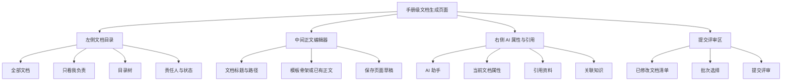
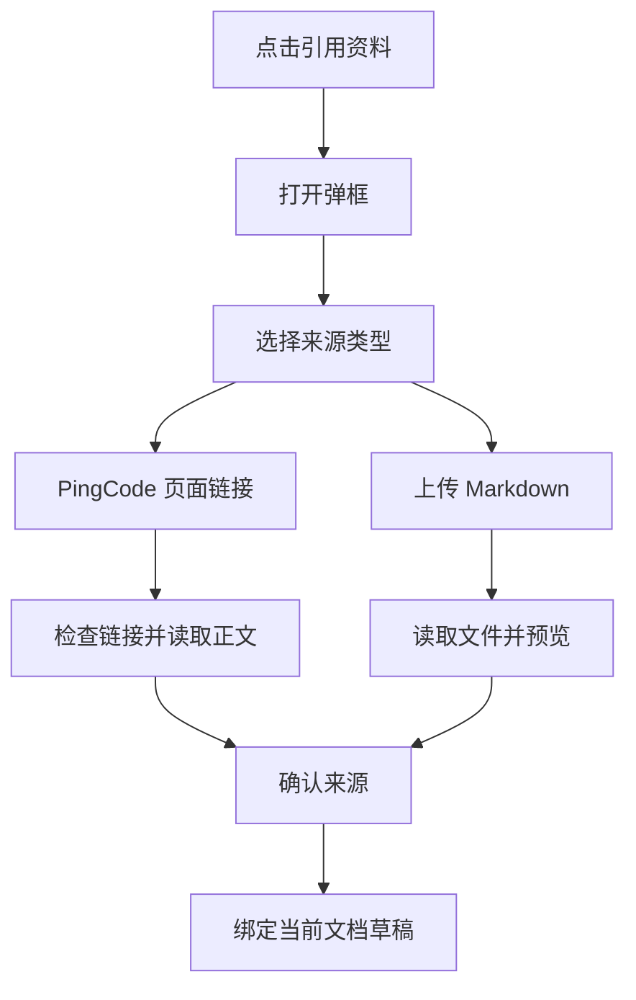
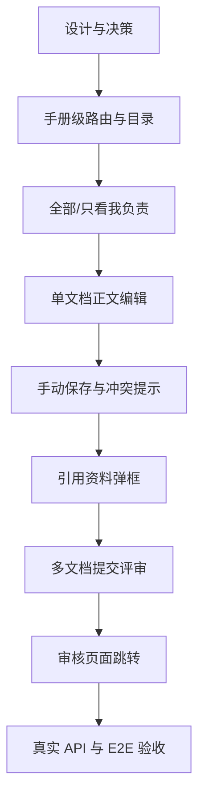

# 知识中心-文档生产-手册级文档生成页面-前端详细设计文档

> 文档类型：前端页面专项详细设计（受控例外）
> 设计编号：KC-FE-DOC-PRODUCTION-HANDBOOK-001
> 状态：前端流程骨架已实现；工作台与“我的生成”边界已明确，正式业务接口待实施
> 版本：0.8.0
> 更新日期：2026-09-28
> 上游需求：`../01-需求/增量文档构建MVP需求.md`
> 上游概要设计：`../02-概要设计/知识中心-文档生产-增量构建垂直业务-概要设计文档.md`
> 业务详细设计：`./知识中心-文档生产-详细设计文档.md`
> 关联开发任务：`../04-开发任务/知识中心-文档生产-增量文档构建MVP-开发任务文档.md`

## 1. 设计边界

本文件只描述“每本手册一个独立文档生成页面”的页面结构、交互、前端状态、路由、可访问性和页面验收。该页面同时是全局文档生产中心和“知识资产 → 手册详情”的统一下钻工作台，两类入口不另建编辑器。

本文件不重新定义：

- 增量任务、草稿、候选、审核实例和发布批次的业务事实；
- 来源快照、版本、审核和发布的后端数据模型；
- Agent Workflow、模型、Prompt 或生成规则；
- 正式版本发布事务。

页面只消费业务模块返回的事实和能力声明。前端不得根据页面文案自行推断责任人、审核结果、版本状态或发布成功。

手册映射中的默认分支和启用分支属于平台配置事实，但不是文档作者在本页需要决策的业务版本。GitLab OAuth 缺失、远端正文暂不可读或没有匹配正文时，页面不展示技术性错误文案，而是使用当前文档选中模板的正文骨架继续编写；底层不得伪造仓库正文或把模板内容标记为 GitLab 内容。

## 2. 页面目标与用户结果

每本手册对应一个独立的文档生成页面。进入路由时手册已经确定，页面唯一核心任务是在同一个工作区完成目录导航、按文档选择模板、正文编写和引用资料/AI 辅助，不再要求重复选择产品或确认全局生成上下文。

用户主流程固定为：


只有存在多个已发布大纲版本时才显示“大纲版本”入口；只有存在真实业务版本事实时才显示目标版本。GitLab 分支不得作为业务版本展示。

作者进入手册后，可以：

1. 在左侧查看当前手册目录；
2. 切换“全部文档”和“只看我负责”；
3. 选择一个文档并在右侧编辑正文；
4. 手动保存文档草稿；
5. 通过弹框为当前文档引用 PingCode 页面或 Markdown 资料；
6. 选择多个已修改文档，形成一个提交评审批次；
7. 提交后进入审核与发布页面，按文档处理审核。


## 3. 页面信息架构



桌面端布局：

```text
┌─────────────────────────────────────────────────────────────────────────────┐
├────────────────┬────────────────────────────────┬───────────────────────────┤
│ 文档目录       │ 当前文档                         │ AI助手 / 属性 / 引用资料    │
│                │                                │                           │
│ 1 概述         │ # 当前文档标题                  │ AI 助手                    │
│ 2 安装         │ 模板 [参数说明 v1 ▼]            │ [生成本节] [润色] [检查]  │
│  2.1 环境      │ ## 安装要求                     │                           │
│  2.2 安装      │                                │ 当前文档属性               │
│ 3 配置         │ 正文……                         │ 责任人 / 路径 / 草稿状态   │
│ 4 使用         │                                │                           │
│ 5 运维         │                                │ 引用资料 [添加]            │
│ [+章节]        │ [预览] [编辑] [取消] [保存] [全局预览图标] │ [引用资料]       │
├────────────────┴────────────────────────────────┴───────────────────────────┤
│ 页面草稿与保存状态                                             [提交评审]   │
└─────────────────────────────────────────────────────────────────────────────┘
```

移动端使用两级视图：`目录视图 → 文档编辑视图`。切换视图或返回前，存在未保存修改时必须确认。

## 4. 路由与 URL 状态

推荐路由：

```text
/knowledge-center/production/handbook/{handbookId}?taskId={taskId}&documentId={documentId}&view=mine&from=production
```

兼容现有入口：

```text
/knowledge-center/production?handbookId={handbookId}&documentId={documentId}
```

URL 状态含义：

| 参数 | 含义 | 规则 |
|---|---|---|
| `handbookId` | 当前手册 | 必填，服务端校验可见性 |
| `taskId` | 当前生产任务 | 可选；存在时必须属于当前手册，用于恢复任务范围和草稿上下文 |
| `documentId` | 当前选中文档 | 可选，缺失时显示目录并选择首个可见文档 |
| `view` | 目录过滤模式 | `all` 或 `mine`，默认 `all` |
| `from` | 受控入口来源 | `assets`、`production` 或 `todo`；只影响面包屑和返回目标，不改变权限 |

刷新、浏览器后退和深链必须恢复手册、当前任务、当前文档和目录模式。不接受任意外部 `returnTo` URL；返回目标使用受控来源枚举和同源导航状态，防止开放跳转。

## 5. 左侧手册目录

目录事实源是知识中心当前发布的大纲，不以 GitLab 文件树反向生成目录。GitLab 仅作为已配置映射手册的正文来源。

### 5.1 目录模式

目录提供两个互斥模式：

```text
全部文档
只看我负责
```

目录节点展示：

- 文档标题；
- 层级路径；
- 当前责任人；
- 正式版本或草稿状态；
- 是否存在未保存修改；
- 是否已选入提交批次。

示例：

```text
参数说明       张三       草稿
连接配置       李四       已发布
安全配置       未分配     只读
```

### 5.2 责任人过滤

- 当前用户身份来自服务端会话；
- `mine` 只使用服务端返回的责任映射；
- 无责任文档显示“未分配”，不能默认归属当前用户；
- 服务端必须同时执行资源权限校验，前端过滤不能替代授权；
- 无匹配文档时显示“当前没有由你负责的文档”。

## 6. 三栏文档工作区

### 6.1 左侧文档目录

左侧目录继续以当前手册已发布大纲为事实源。进入手册页面后直接投影目录，不再增加“生成文档结构”步骤。单一发布大纲不展示选择控件；存在多个已发布版本时才提供“大纲版本”入口，切换前必须处理未保存草稿。

MVP 的“新增章节”只提供入口和待接入说明；在大纲变更契约未明确前，不允许绕过发布大纲直接创建正式章节。

### 6.2 中间正文编辑器

已存在的可读正文优先展示。没有可读正文时，正文区域展示当前文档选中模板的内容骨架；只有没有可用模板时才展示“请选择当前文档的模板”。页面不展示“GitLab 未匹配正文”“GitLab 中未找到对应正文”或“来源分支”等不具备当前业务决策价值的技术信息。

当前文档头部提供文档级模板选择和 sticky 操作栏。操作栏统一承载“预览 / 编辑”模式、保存状态、“取消 / 保存”和全局预览图标：

- 预览态使用共享 Markdown 渲染器，完整展示标题、表格、代码、图片和相对附件链接；
- 编辑态使用接近 Obsidian Live Preview 的渲染内容编辑区，不展示纯 Markdown 源码；
- 编辑结果只形成当前页面草稿，不修改 GitLab 正文；
- 空文档选择模板后，以模板正文形成可预览、可编辑的骨架；
- 已有正文或页面草稿时切换模板不得静默覆盖正文，只更新模板约束；
- 全局预览使用独立图标按钮，具备可访问名称和 `aria-pressed`；进入后隐藏平台全局导航、目录、右侧面板和评审区，退出后恢复当前文档、预览模式和辅助页签；
- sticky 操作栏不得遮挡正文或键盘焦点；长文档滚动后仍可直接保存或取消；
- 操作栏根据正文容器宽度自适应：空间充足时上下文与操作同排，正文容器不足 760px 时自动分为两行；按钮文案不得按单个汉字断行；
- 已有 GitLab 图片和附件保持可展示；新增附件上传等待独立后端契约，不能伪造成功。

一次只编辑一个文档。

MVP 编辑器使用可阅读的渲染内容区，不在正文上方重复显示“Markdown / 富文本”标题：

```text
当前文档正文
[模板或已有正文的阅读/编辑区]

状态：未保存 / 保存中 / 已保存 / 保存失败
[预览] [编辑] [取消] [保存] [全局预览图标]
```

本轮不实现多文档同时编辑、自动保存、多人实时协作或 Agent 自动覆盖正文。

当前已实现的是可执行的前端流程骨架和页面草稿。正式草稿保存、Agent 生成、来源快照与评审批次仍以本文件定义的接口边界为后续工作，不属于本轮已验证能力。

### 6.3 已发布大纲选择

当前只有一个已发布大纲时，页面直接投影目录，不显示大纲名称、版本或选择控件。当后端提供多个已发布大纲事实时，才在页面提供“大纲版本”选择入口；切换前必须处理未保存草稿。GitLab 分支不得代替业务大纲版本。

## 7. 右侧 AI、属性和引用面板

右侧使用页签承载：

- `AI助手`：生成本节、润色、检查；
- `文档属性`：路径、责任人、草稿状态；
- `引用资料`：复用现有 PingCode 页面和 Markdown 上传能力；
- `关联知识`：本轮只展示入口和空状态，不伪造知识关联结果。

桌面端右侧面板相对平台主滚动容器使用 sticky 定位，滚动长文档时持续可见，但面板自身不建立第二条纵向滚动条。宽度不足时右侧面板转为可关闭抽屉，触发图标必须具备可访问名称，关闭后焦点返回触发按钮，并支持 `Esc` 关闭。

AI 操作规则：

- AI 输出只能形成当前页面草稿，不得覆盖正式正文；
- 用户必须能看到操作对象是“当前章节/当前文档”；
- 后端生成契约未接入时按钮返回“AI 能力待接入”，不得生成静态示例冒充结果；
- 每次 AI 结果进入编辑器前必须保留用户可撤销边界；
- 人工编辑始终可用，不依赖 AI。

## 8. 引用资料弹框

引用资料关联当前文档草稿，不关联整个手册。



弹框字段：

- 来源类型；
- PingCode 页面链接或 Markdown 文件；
- 资料名称；
- 内容预览；
- 读取状态；
- 内容摘要或版本标识；
- 取消和确认引用。

规则：

- MVP 上传格式仅支持 Markdown；
- PingCode 保持只读；
- 连接器未接入时显示“正文读取待接入”，不得声称读取成功；
- 读取失败不得生成空引用；
- 引用资料不能直接覆盖当前正文；
- 后端接入后形成不可变来源快照；
- 前端不保存 PingCode 凭证，Agent 不直接接触凭证。

## 9. 滚动与全局预览原则

- 桌面端只由 `.main-shell` 承担纵向滚动，`html/body` 不生成可见纵向滚动条；窄屏下 `.main-shell` 改为普通文档流，由浏览器根页面滚动；任一断点只能存在一个主纵向滚动容器；
- 文档目录和右侧辅助面板不得设置独立的纵向 `overflow` 滚动容器；
- 左侧默认只展开当前文档所在目录路径，避免大纲一次性全部展开；
- 全局预览为当前页面内的沉浸状态，不打开新窗口、不改变业务路由；
- 全局预览通过图标的 tooltip/可访问名称表达“全局预览 / 退出全局预览”，并支持 `Esc` 退出。

### 9.1 长文写作控制面

编辑态将文档上下文、格式命令和保存动作组成视觉连续的双层固定控制栏：

```text
第一层  文档名称 / 简短路径    预览·编辑  保存状态  历史  附件  取消  保存
第二层  标题  加粗  斜体  列表  表格  代码  链接  图片  撤销  重做
───────────────────────────────────────
                    连续滚动的正文画布
```

- `.main-shell` 为桌面端唯一滚动容器，第一层业务控制栏以 `top: 0` 固定；
- Vditor 格式栏固定在第一层下方，偏移量由第一层的稳定高度决定，不得与业务控制栏争用 `top: 0`；
- 两层使用同一白色背景、单一外轮廓和轻微阴影，不表现为两张独立卡片；
- 加粗、斜体、撤销等熟悉命令使用图标，保留中文 tooltip 和可访问名称；
- 保存是唯一视觉主动作；保存状态靠近保存按钮，并以文字表达；
- 文档模板等低频上下文保留在非固定的次级信息条，不占用长文写作的持续视野；
- 正文画布宽度为 `min(100%, 860px)`，常规正文保持约 65–75 个字符的行长，表格、图片和长链接不得撑破页面；
- 固定栏高度必须通过 `scroll-padding-top` 和正文 `scroll-margin-top` 补偿，键盘焦点、搜索命中和标题锚点不得被遮挡；
- 窄屏下格式命令可水平滚动，保存状态和保存动作仍保持可见。

## 10. 草稿保存与离开保护

保存方式为“手动保存 + 离开提示”：

1. 用户编辑正文后标记为“未保存”；
2. 点击保存发送当前草稿和版本指纹；
3. 保存成功返回新草稿版本、摘要和时间；
4. 保存失败保留编辑内容并提供重试；
5. 版本冲突提示服务端已有新版本，禁止静默覆盖；
6. 切换文档、切换手册或离开页面时，如果存在未保存修改，弹出确认。

## 11. 提交评审区

底部展示当前手册中存在修改的文档：

```text
待提交评审

□ 参数说明       已保存草稿       引用资料 2 项
□ 连接配置       已保存草稿       引用资料 1 项
□ 安全配置       未保存修改       不可提交
```

提交规则：

- 用户可选择多个文档；
- 多个文档形成一个提交批次；
- 批次包含多个文档级审核对象；
- 审核按文档独立进行；
- 提交成功后跳转审核与发布页面；
- 跳转保留手册 ID、批次 ID 和文档上下文。

提交前门禁：

- 至少选择一个文档；
- 每个所选文档存在已保存草稿；
- 所选文档不能有未保存修改；
- 所选文档存在有效正式基线；
- 引用资料读取失败的文档不能提交；
- 服务端重新校验权限、版本和草稿指纹。

## 12. 页面状态矩阵

| 状态 | 页面表现 | 可执行动作 |
|---|---|---|
| 加载中 | 目录和正文显示加载状态 | 等待 |
| 可编辑 | 编辑区可输入 | 保存、接入资料 |
| 只读 | 显示只读原因 | 返回、查看 |
| 未保存 | 显示未保存标记 | 保存、放弃 |
| 保存中 | 保存按钮处理中 | 等待 |
| 保存失败 | 就近显示错误 | 重试，保留输入 |
| 版本冲突 | 显示服务端版本变化 | 重新读取、人工处理 |
| 引用资料读取中 | 弹框显示处理中 | 等待、取消 |
| 引用资料失败 | 显示失败原因 | 重试、取消 |
| 提交中 | 提交按钮处理中 | 等待 |
| 提交成功 | 显示批次号 | 进入审核 |
| 提交失败 | 保留勾选和草稿 | 重试 |
| 无权访问 | 显示权限说明 | 返回 |
| 无责任文档 | 显示只读状态 | 查看正文 |

状态不能只通过颜色表达，必须同时显示文字和可访问名称。

## 13. 前端组件职责

```text
HandbookDocumentProductionPage
├── HandbookHeader
├── DirectoryModeToggle
├── HandbookDocumentTree
├── DocumentTreeItem
├── DocumentEditorWorkspace
├── DocumentMetadata
├── MarkdownEditor
├── ReferenceDocumentDialog
├── ReferenceDocumentList
├── ReviewBatchSelector
├── UnsavedChangesGuard
└── PageStatusBanner
```

- 目录组件只负责目录展示、过滤和文档选择；
- 编辑器负责正文编辑和草稿状态；
- 引用资料弹框负责来源输入、预览和关联；
- 提交区负责文档选择和批次提交；
- 审核操作复用审核与发布页面，不在此页面复制；
- 页面不自行推断业务状态。

## 14. 接口依赖

页面依赖现有业务契约，必要时由 BFF 提供页面聚合接口。建议能力包括：

```text
GET  /knowledge-center/api/production/handbooks/{handbookId}/workspace
GET  /knowledge-center/api/production/handbooks/{handbookId}/documents/{documentId}
PUT  /knowledge-center/api/production/handbooks/{handbookId}/documents/{documentId}/draft
POST /knowledge-center/api/production/handbooks/{handbookId}/documents/{documentId}/references
POST /knowledge-center/api/production/handbooks/{handbookId}/review-batches
```

接口必须返回能力声明、版本指纹、责任人事实、错误码和可恢复建议。接口不存在时，前端只能显示待接入状态，不可用本地状态冒充正式成功。

## 15. 响应式与可访问性

- `>=1200px`：目录、编辑区、提交区采用桌面布局；
- `768px–1199px`：目录和提交摘要可折叠为抽屉；
- `<768px`：目录视图和编辑视图分离；
- 目录、弹框、编辑器和提交按钮均支持键盘操作；
- 弹框打开后焦点进入弹框，关闭后返回触发按钮；
- 未保存、冲突和失败提示使用 `role="status"` 或 `role="alert"`；
- 页面不得产生横向滚动；
- 状态不能只依赖颜色、图标或位置表达。

## 16. 页面验收

### 16.1 用户视角整改基线

- 目录必须以大纲层级呈现，不能将文档平铺成文件列表；
- 文档主标题使用大纲名称，不展示 `.md` 扩展名和内部排序前缀；
- 进入手册后直接展示当前发布大纲目录，不再选择产品或执行“生成文档结构”；
- 正文不可读时必须展示当前文档模板骨架，不展示 GitLab 匹配技术错误；
- 页面只突出当前文档、文档级模板、阅读/编辑和页面草稿，不展示“前端工作区”或“来源分支”等实现性文案；
- 页面草稿评审区不得遮挡正文；没有草稿时弱化为引导状态，有草稿时才突出提交动作；
- 页面草稿可以恢复为原文，恢复前必须确认且不修改正式内容；
- 目录展开/收起状态在当前手册页面内保持，刷新后以当前选择文档所在路径为最低恢复范围；
- “只看我负责”模式显示实际文档数量，无匹配时提供返回“全部文档”的入口；
- 目录和右侧面板不得建立独立纵向滚动条；全屏预览必须支持显式退出和 Esc 退出。

1. 进入指定手册后只显示该手册目录；
2. 可以切换“全部文档”和“只看我负责”；
3. 切换文档后正文、文档模板、责任人和路径正确变化；
4. 可以手动修改正文并保存页面草稿；
5. 未保存切换文档时显示确认提示；
6. 保存冲突不会覆盖服务端较新版本；
7. 弹框支持 PingCode 链接和 Markdown 文件；
8. 引用资料关联到当前文档而非整个手册；
9. 多篇文档可组成一个评审批次；
10. 审核页面按文档分别展示；
11. 提交失败不丢失选择和草稿；
12. 无权限、无责任人和空目录有明确状态；
13. 桌面、平板和移动端无横向滚动；
14. 键盘可以完成主要操作；
15. 正式保存、来源读取和评审批次创建均由服务端事实确认。

本轮真实验收结果（2026-09-24）：

- 使用真实管理员会话、真实大纲 API、真实模板 API和数据库 GitLab 映射完成页面装配；
- 进入指定手册后直接展示发布大纲目录、文档级模板、正文编辑器与 AI助手/属性/引用资料三栏；
- GitLab OAuth 缺失且远端正文不可读时，正文区展示真实模板 API 返回的模板骨架，不展示技术错误；
- Markdown 引用文件可以在弹框内读取和预览，但不冒充正式上传或来源快照；
- 人工编辑、页面草稿保存和恢复链路通过，恢复未产生后端写请求；
- 390px 视口页面宽度与客户端宽度均为 390px，无横向溢出；
- 目录与右侧面板计算样式均无 `auto/scroll` 纵向滚动，页面仅使用浏览器主滚动条；
- 页面内全屏预览可隐藏目录、助手和评审区，退出后状态恢复；
- 浏览器端到端用例 3 项全部通过。

长文写作控制面验收（2026-09-28）：

- 1440px 视口长文滚动后，业务控制栏固定于 `0–68px`，Vditor 格式栏紧接于 `68–114px`，加粗命令未被遮挡；
- 保存按钮始终位于固定栏首屏，历史、附件、取消和全局预览在可滚离的次级条；
- 1440/1024/768/390px 未观察到页面级水平溢出，390px 保留预览/编辑、保存状态、保存和辅助工具；
- 新增 E2E 在 Chromium 和 Firefox 通过；全量隔离 E2E 仍存在与本设计无关的人员名单硬编码失败，不得声明全仓测试全绿。

## 17. 与全局生产中心的联动

本页是手册生产的唯一下钻工作台。全局生产中心的手册视图、任务视图、我的生成，以及知识资产中的手册详情，打开同一本手册时都必须进入本页，不得复制另一套目录、编辑器或草稿状态。


联动规则：

1. 同一 `handbookId + taskId + documentId` 不论从哪个入口打开，草稿、模板、引用资料、任务状态和权限投影必须一致。
2. 从全局手册视图进入时，面包屑为“文档生产总览 / 手册名称”；从知识资产进入时，面包屑为“知识资产 / 手册名称 / 文档生产”。
3. 从任务或待办进入时，页面显示与当前编辑直接相关的任务状态和返回动作，但不把全部五阶段表单复制到编辑器。
4. 返回全局生产中心时恢复原视图、筛选、分页和滚动位置；返回知识资产时恢复原手册详情上下文。
5. 离开前如有未保存修改，仍执行第 10 节的离开保护；不因入口不同而改变草稿安全规则。

页面不存在“全局生产中心草稿”和“知识资产草稿”两种事实；入口只是导航上下文，业务事实始终属于同一手册、任务和文档。

## 18. 实施边界

本设计对应的前端流程骨架已实现并通过真实浏览器验收。正式草稿保存、Agent 生成、来源快照与评审批次接口仍是后续实施边界。前端骨架实施路径为：


### 18.1 目录面板页面级规格（2026-09-24）

手册级页面采用“文档导航树＋正文编辑区＋辅助工具”的三栏工作区。目录默认 260px，允许在 220–360px 内拖动；折叠后保留 48px 窄栏，正文和辅助工具保留自己的业务布局。目录搜索只过滤当前手册，搜索命中时展开祖先节点；“全部文档/只看我负责”仍是责任范围过滤，不改变正文事实。

目录分隔条支持鼠标、方向键、Shift 加方向键、双击恢复默认和 Escape 取消拖动。宽度及折叠状态按 `production-handbook` 保存，不按手册保存；当前 `handbookId/documentId/view` 继续由 URL 恢复。`768px` 以下不显示拖拽条，目录改为目录视图和正文视图切换，不能产生页面级横向滚动。

目录不负责模板冻结、GitLab 写入、正式草稿保存或审核决定。目录中的状态只用于定位当前文档，正文编辑结果仍然只形成页面草稿。

### 18.2 表单字段语义与组合框接入

- 当前文档模板选择器保留原生 select 语义，并使用 name="templateId"，由公共组合框渐进增强；因此键盘、表单值和 change 事件仍以原生控件为事实入口。
- 页面携带当前大纲版本的隐藏字段 name="outlineId"，仅用于保持上下文，不提供节点级模板配置，也不改变“模板版本由文档生产任务冻结”的规则。
- 组合框宽度由页面场景属性控制，不使用全局固定宽度覆盖手册目录、编辑工具栏和弹框。

## 19. 工作台与“我的生成”边界（2026-09-28）

### 19.1 设计目标

当前页面涉及三个不同层级，不能用一个“个人工作台”概念混合：

1. **平台工作台**：知识中心根路径的跨模块总览，回答“平台当前有哪些风险、生产进度和需要关注的事项”。
2. **文档生产中心**：文档生产模块内部的手册视图、任务视图和“我的生成”，回答“文档生产活动和生成记录处于什么状态”。
3. **手册级生产工作台**：单本手册的编辑、差异、审核和发布下钻页面，回答“如何处理当前文档”。

本设计不再新增与平台工作台并列的“个人工作台”。个人强相关事项进入平台工作台的“待我处理”区域；文档生产模块的“我的生成”保持独立，只展示当前用户发起或参与的生成记录，不承担跨模块待办聚合。

### 19.2 保留、删除和降级

| 处理 | 内容 | 原因 |
|---|---|---|
| 保留 | 手册目录树、文档级模板、预览/编辑、全局预览、单滚动、URL 恢复、引用资料入口 | 已验证且直接服务正文定位和编辑 |
| 保留 | 任务视图、按文档审核、任务级整体发布 | 多文档生产的业务主链路 |
| 保留 | 平台工作台中的“待我处理”摘要 | 以个人视角提示跨模块下一步动作，但不复制业务工作区 |
| 保留 | 文档生产中心中的“我的生成” | 展示当前用户发起或参与的生成运行、草稿和结果 |
| 删除 | 后端未接入时作为主操作展示的“生成本节、润色、检查、提交评审” | 避免可点击但不产生正式业务事实 |
| 降级 | AI、引用资料和审核能力未就绪时的入口 | 显示待接入或前置条件，不冒充成功 |
| 删除 | “前端暂存”作为成功结果的强提示 | 前端内存不等于正式草稿或来源快照 |

### 19.3 三层信息架构

~~~mermaid
flowchart TB
    U["当前登录用户"] --> P["平台工作台"]
    P --> PT["待我处理摘要"]
    P --> PR["跨模块风险与进度"]
    U --> D["文档生产中心"]
    D --> H["手册视图"]
    D --> T["任务视图"]
    D --> G["我的生成"]
    PT --> X["进入对应业务工作区"]
    G --> R["生成运行 / 草稿 / 结果详情"]
    X --> W["手册级生产工作台或审核工作区"]
~~~

### 19.4 平台工作台中的个人区域

~~~text
┌ 工作台                                      [刷新] [范围/统计时间] ┐
│ 平台总览：风险、生产进度，以及与你相关的下一步事项               │
├──────────────────────────────────────────────────────────────────┤
│ 待我处理（跨模块摘要）                                            │
│ ┌──────────────┬──────────────────────────────┬─────────────────┐ │
│ │ 优先级       │ 事项                         │ 下一步          │ │
│ │ 高           │ mysql模式参考手册·参数说明    │ 继续编辑        │ │
│ │ 高           │ 系统参数手册·审核意见 2 条    │ 处理意见        │ │
│ │ 中           │ 连接配置手册·待确认来源       │ 确认来源        │ │
│ │ 中           │ 发布批次 PB-024               │ 确认发布        │ │
│ └──────────────┴──────────────────────────────┴─────────────────┘ │
├──────────────────────────────┬───────────────────────────────────┤
│ 文档生产：3 项                 │ 其他模块：2 项                    │
│ [进入文档生产]                 │ [查看全部待处理]                   │
├──────────────────────────────┴───────────────────────────────────┤
│ 最近处理：手册、文档、动作、时间、结果；失败项提供重试或返回入口     │
└──────────────────────────────────────────────────────────────────┘
~~~

平台工作台只展示跨模块摘要，不复制文档生产的生成列表、编辑器、审核器或发布器。点击事项后进入对应模块的真实工作区。

文档生产中心中的“我的生成”使用独立页面或页签：

```text
┌ 文档生产                         [手册视图] [任务视图] [我的生成] ┐
│ 我的生成：当前用户发起或参与的生成运行                           │
├──────────────────────────────────────────────────────────────────┤
│ 运行状态 │ 手册 / 文档 │ 发起时间 │ 最近结果 │ 下一步               │
│ 已完成   │ mysql模式…  │ 09-28    │ 草稿     │ 查看草稿             │
│ 运行中   │ 系统参数…  │ 09-28    │ —        │ 查看运行             │
│ 失败     │ 连接配置…  │ 09-27    │ 错误     │ 重试 / 查看原因       │
└──────────────────────────────────────────────────────────────────┘
```

### 19.5 “我的生成”与个人待处理的边界

平台工作台的“待我处理”必须来自当前用户可见且需要当前用户动作的真实事实；“我的生成”则来自生成运行和草稿事实。二者都不能由前端根据角色名称推断，但二者不合并为同一个列表。

支持的业务类型：

| 类型 | 触发事实 | 下一动作 |
|---|---|---|
| document_edit | 当前用户负责文档且草稿未完成 | 继续编辑 |
| source_confirm | 来源已读取但等待当前用户确认快照 | 确认来源 |
| review_comment | 当前用户作为作者，存在未处理审核意见 | 处理意见 |
| review_decision | 当前用户具有有效审核权限且候选待审核 | 进入审核 |
| publication_confirm | 所有文档门禁满足且当前用户有发布权限 | 确认发布 |
| conflict_resolution | 基线或版本冲突，需要用户选择处理方式 | 查看冲突 |

| 组件 | 职责 | 输入 | 事件 | 不能负责 |
|---|---|---|---|---|
| DashboardPersonalSummary | 平台工作台中的个人摘要 | 跨模块待处理投影 | 打开模块 | 推断数量 |
| DashboardWorkItemCard | 展示跨模块事项摘要 | workItem | 打开业务工作区 | 处理业务状态 |
| MyGenerationPage | 展示我的生成记录 | generationRuns、drafts | 查看、重试、进入草稿 | 生成正式发布版本 |
| MyGenerationList | 展示生成运行列表 | generationRuns | 筛选、排序、打开 | 生成业务待办 |
| WorkItemActionGuard | 渲染服务端允许的动作 | capabilities、status | 允许或阻断 | 自行判断审核/发布资格 |
| WorkItemEmptyState | 展示空、失败、无权、过期 | 状态、恢复动作 | 重试、返回 | 用示例数据填充 |

### 19.6 接口、状态和入口

平台工作台使用既有工作台投影接口中的个人摘要字段；不新增 `personal-workspace` 作为独立页面接口。文档生产中心的“我的生成”使用文档生产域接口，例如：

`GET /knowledge-center/api/production/generations?scope=mine`

投影必须区分 loading、ready、empty、unavailable、forbidden、stale，不能用空数组同时表示“没有待办”和“接口失败”。工作项打开使用：

~~~text
/knowledge-center/production/handbook/{handbookId}
  ?taskId={taskId}&documentId={documentId}&from=dashboard&workItemId={workItemId}
~~~

workItemId 只用于返回上下文、幂等和审计，不改变权限。

### 19.7 未接入能力的显示原则

- 正式草稿接口未接入：显示“页面内编辑草稿”，不显示“已保存”作为服务端成功；
- 来源快照接口未接入：保留“引用资料”入口，但显示“能力待接入”；
- Agent 接口未接入：不显示可点击的生成、润色、检查主按钮；
- 审核接口未接入：不显示“提交评审”主按钮；
- 发布接口未接入：不显示“确认发布”动作。

### 19.8 验收标准

1. 当前用户进入平台工作台后可以看到跨模块的“待我处理”摘要；
2. 当前用户进入文档生产中心后，可以独立进入“我的生成”查看生成运行和草稿；
3. “我的生成”不混入审核、发布或其他模块待办；
4. 点击个人摘要事项能恢复 handbookId、taskId、documentId，返回平台工作台时恢复列表和位置；
5. 无待办、无权、失败和过期状态互相区分；
6. 平台工作台和“我的生成”不复制编辑器、审核器或发布器，所有下钻进入已有工作区；
7. 未接入能力不进入“已完成”或“待我处理”的业务投影；
8. 1440px、1024px、768px、390px 视口下可读、可键盘操作且无页面级横向滚动。

### 19.9 分工事实与“只看我负责”一致性

手册生产页的责任人过滤必须使用大纲治理接口返回的 `effectiveDocumentAssignments[].ownerships`。数据库模式下，技术领域归属来自责任映射，具体责任人来自同一大纲的领域建设任务项；服务端必须按 `documentId + techDomainId` 合并两类事实后再返回。

前端不得仅读取 `techDomainIds`、不得把 `pending_binding` 解释为当前用户负责，也不得根据文档标题或责任人姓名猜测归属。若治理投影与任务项不一致，页面应显示不可用或未分配状态，不能把文档错误纳入“只看我负责”。

身份匹配优先比较会话中的全部稳定标识（包括 `principalId`），不得因认证用户 `id` 存在而丢弃人员主数据标识；显示名仅作为兼容既有数据的后备匹配。

## 20. 共享草稿保存与评审前端基线（2026-09-28）

### 20.1 草稿上下文与加载优先级

共享草稿由 `handbookId + outlineVersionId + branch + documentId` 唯一确定，不按浏览器或用户隔离。进入文档时先读取该上下文的最新工作草稿；不存在草稿时使用当前 GitLab 分支的基线正文。切换文档、大纲版本或分支前，若当前编辑器有未保存内容，必须要求用户确认。

编辑器采用本地托管 Vditor 的 `wysiwyg` 模式，默认不展示 Markdown 源码。Markdown 是发布、差异和审核的正文事实，HTML 只作为经过服务端清洗和一致性校验的编辑/阅读快照。只有服务端保存成功后，页面才能显示“已保存 vN · 时间”。

### 20.2 编辑状态机

```text
loading -> clean -> dirty -> saving -> saved
                    |          |       |
                    |          +-----> failed
                    +----------------> conflict
```

- `未修改`：当前正文等于已加载的服务端草稿或 GitLab 基线；
- `有未保存修改`：编辑器内容已变化；
- `保存中`：禁用重复保存，但不清空编辑器；
- `已保存 vN · HH:mm`：仅由成功响应驱动；
- `保存失败`：保留正文、附件和重试入口；
- `版本冲突`：保留本地正文，并提供服务器版本、本地版本和合并入口。

“取消”恢复最近一次服务端草稿；没有草稿时恢复当前 GitLab 基线。“恢复原文”按钮删除，避免与删除共享草稿混淆。编辑器支持 `Ctrl/Cmd+S`，本阶段不自动保存。

### 20.3 编辑器与附件

工具栏提供标题、粗体、斜体、列表、表格、代码块、链接、图片、附件、撤销和重做。图片支持 PNG、JPEG、WebP、GIF，单个不超过 10MB；普通附件支持 Markdown、PDF、DOCX、XLSX，单个不超过 50MB；单草稿附件总量不超过 200MB。

上传先进入临时资源区，服务端返回 `attachmentId`、稳定引用、摘要和扫描状态。图片插入正文，普通附件插入文件链接；保存草稿时通过 `attachmentIds` 绑定。上传失败、扫描失败或仍在处理中时，禁止保存引用该资源的草稿。未绑定资源由服务端按 TTL 清理。

### 20.4 冲突与历史

保存请求携带 `editVersion`、`baselineDigest` 和幂等键。服务端版本变化时返回 `409 DRAFT_VERSION_CONFLICT`，前端不得静默覆盖。冲突界面允许重新载入服务器版本、复制本地内容或进入人工合并编辑器，不提供强制覆盖。

`baselineDigest` 统一使用 UTF-8 SHA-256。页面在 HTTPS 或 localhost 安全上下文中优先使用 Web Crypto；在局域网 HTTP 访问导致 `crypto.subtle` 不可用时，必须使用同算法的本地回退计算，不得因浏览器安全上下文差异中断保存，也不得以空摘要绕过版本指纹。

版本历史抽屉展示 revision 号、更新人、时间、摘要和来源 revision。恢复历史版本会创建新的 revision，并记录 `restoredFromRevisionId`；历史记录不可覆盖或删除。

### 20.5 评审提交

评审区只列出已由服务端保存且当前无未保存修改的文档。一个批次可以包含多篇文档，每篇文档引用确定的 `draftRevisionId`，配置批次默认审核人并允许逐篇覆盖。每篇文档至少需要一名有审核权限且不是提交者的审核人。

提交成功后，评审 revision 永久冻结，服务端自动克隆下一工作草稿。页面同时显示“评审中 vN”和“工作草稿 vN+1”；之后的编辑不改变评审内容。退回时若已有更新工作稿，不覆盖该工作稿，只合并审核意见并展示其与退回 revision 的差异。

### 20.6 API 契约

```text
GET  /knowledge-center/api/production/handbooks/{handbookId}/documents/{documentId}/draft?outlineVersionId=&branch=
PUT  /knowledge-center/api/production/handbooks/{handbookId}/documents/{documentId}/draft
POST /knowledge-center/api/production/handbooks/{handbookId}/documents/{documentId}/draft-attachments?outlineVersionId=&branch=
GET  /knowledge-center/api/production/handbooks/{handbookId}/documents/{documentId}/draft/revisions?outlineVersionId=&branch=
POST /knowledge-center/api/production/handbooks/{handbookId}/documents/{documentId}/draft/restore
GET  /knowledge-center/api/production/handbooks/{handbookId}/reviewers
POST /knowledge-center/api/production/handbooks/{handbookId}/review-batches
```

附件上传请求体为原始二进制，文件名通过 `X-File-Name` 传递，MIME 使用 `Content-Type`；不得将大附件 Base64 放入 JSON。保存请求包含 `outlineVersionId`、`branch`、`baselineDigest`、`editVersion`、`markdown`、`htmlSnapshot`、`templateVersionId` 和 `attachmentIds`。响应返回草稿、revision、版本、摘要、规范化 Markdown、已清洗 HTML、附件、更新人、更新时间和能力声明。

首次读取前，前端必须先固定服务端返回的发布大纲版本和当前 GitLab 分支，不得用临时的 `published` 字符串发起读取后再用具体版本 ID 保存。查询参数缺失或响应不符合 JSON 契约时，标记草稿服务不可用，不得误报为“没有草稿”或“保存失败”。

冲突响应使用 `error.details.serverDraft` 恢复服务器正文；错误响应丢失 `details` 视为契约失败。附件 ID 只能绑定创建它的同一手册、大纲版本、分支和文档草稿。

### 20.7 前端组件补充

```text
DocumentEditorWorkspace
├── VditorEditorAdapter
├── DraftSaveStatus
├── DraftConflictDialog
├── DraftHistoryDrawer
├── DraftAttachmentManager
└── ReviewBatchDialog
```

Vditor 资源必须随平台本地部署，并在进入编辑态后按需加载。任一 API 不可用时展示明确不可用状态，不得回退为本地成功。

### 20.8 空草稿与服务不可用状态

- 服务端成功返回 `exists: false` 表示当前文档没有历史草稿，是正常业务空状态；顶部显示“未修改”，不显示错误，也不渲染草稿历史入口。
- 只有 `exists: true` 时才展示草稿版本和历史入口。
- 网络失败、非 JSON 响应、权限失败或契约解析失败不等同于没有草稿；继续展示 GitLab 基线或模板正文，并允许用户进入编辑态查看和临时编辑。
- 草稿服务不可用时，在模板与次级操作区显示低干扰的可恢复说明，不占用正文主区域，不使用“草稿读取失败”作为文档状态。
- 草稿服务恢复前禁用保存、附件上传和历史操作；本地编辑内容保留在当前页面，快捷键保存也必须经过同一能力门禁。
- 服务端返回有效空草稿后，保存能力保持可用，首次保存使用 `editVersion=0` 创建 revision。
