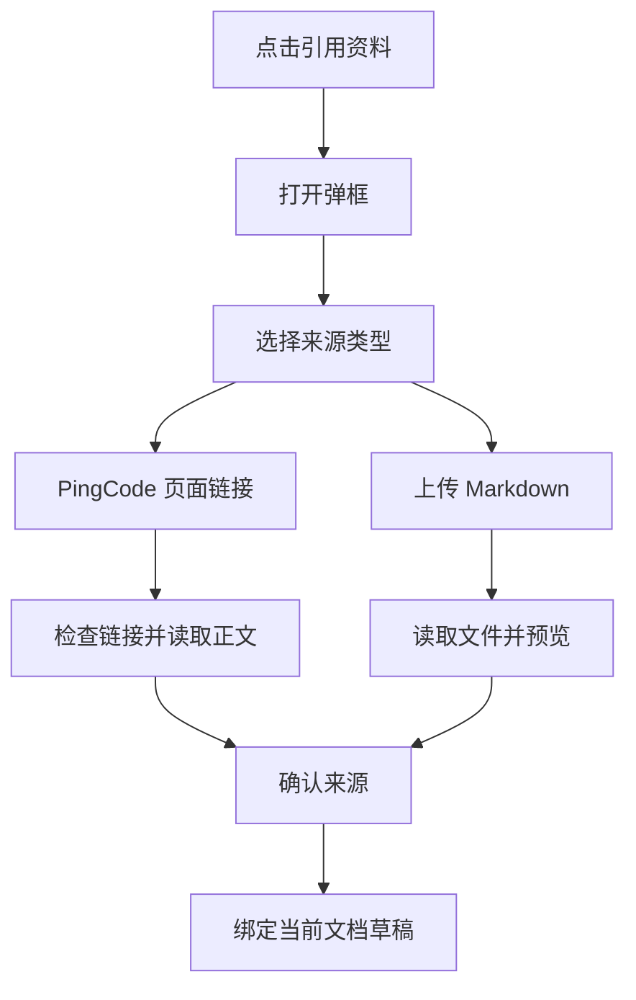
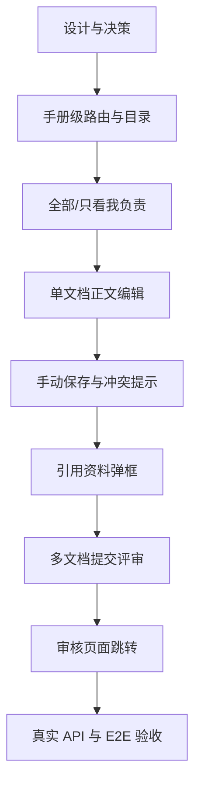
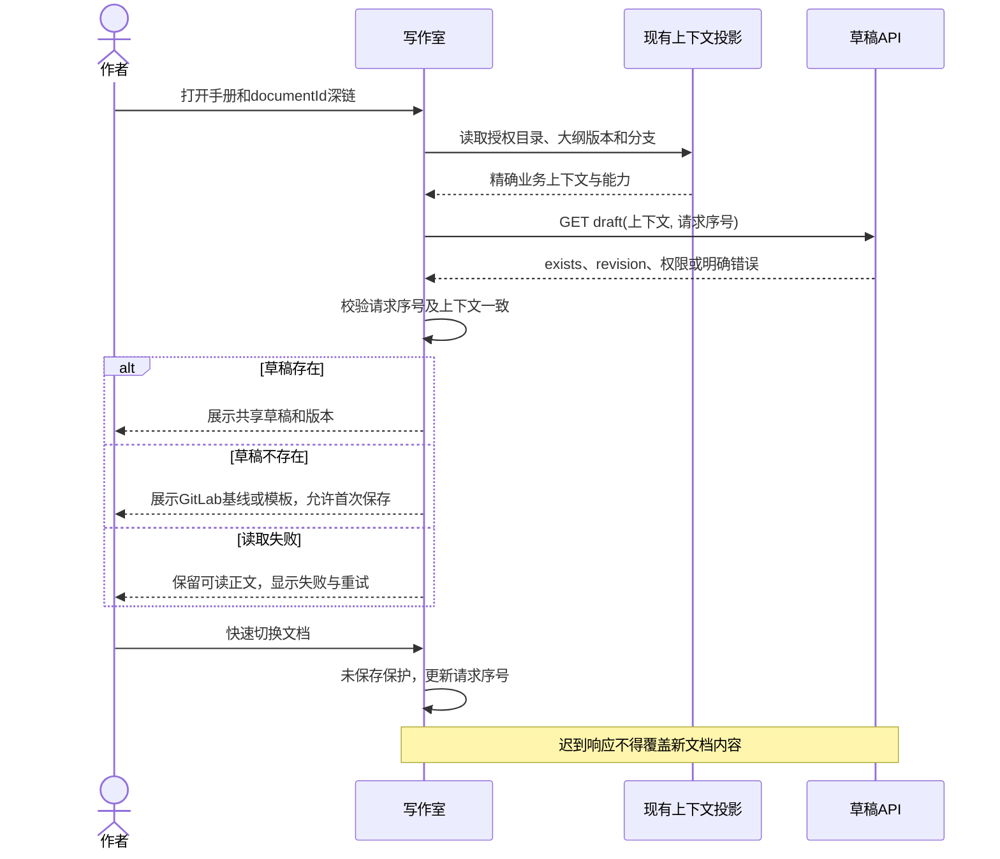
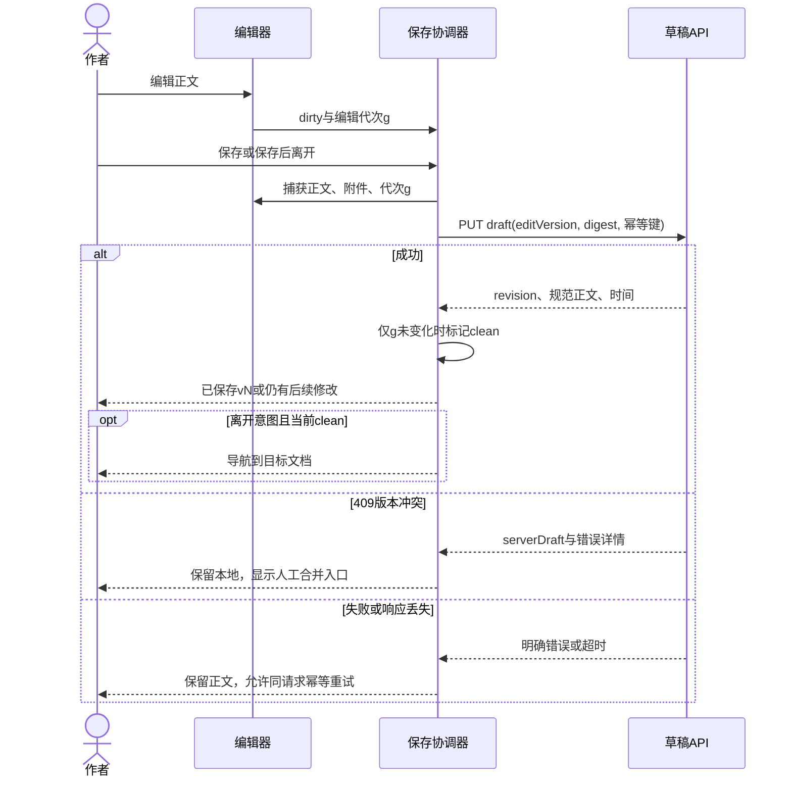
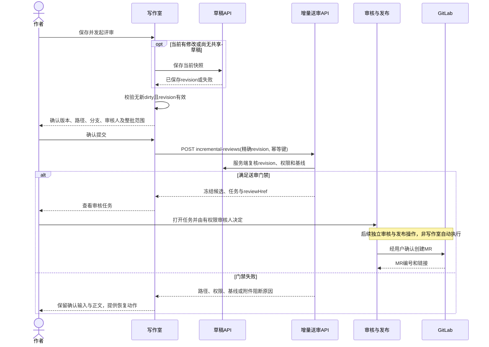
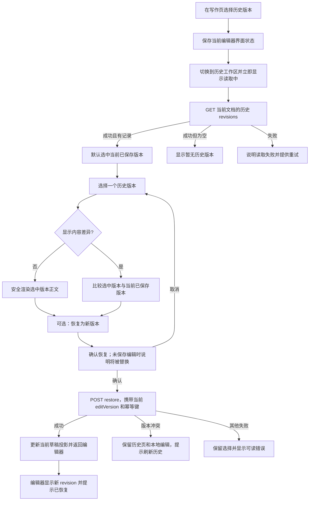

# 知识中心-文档生产-手册级文档生成页面-前端详细设计文档

> 文档类型：前端页面专项详细设计（受控例外）
> 设计编号：KC-FE-DOC-PRODUCTION-HANDBOOK-001
> 状态：现行三栏页面已实现；沉浸式写作室为待实施目标设计，业务能力以第20、21节的已验证事实为准
> 版本：0.9.0（沉浸式写作室设计修订）
> 更新日期：2026-10-16
> 上游需求：`../01-需求/增量文档构建MVP需求.md`
> 上游概要设计：`../02-概要设计/知识中心-文档生产-增量构建垂直业务-概要设计文档.md`
> 业务详细设计：`./知识中心-文档生产-详细设计文档.md`
> 关联开发任务：`../04-开发任务/知识中心-文档生产-增量文档构建MVP-开发任务文档.md`

## 1. 设计边界

**阅读优先级**：第2–16节描述业务流程及原有三栏实现基线；第22节是待实施的沉浸式写作室目标规格，覆盖与其冲突的常驻三栏、目录宽度、辅助栏和滚动布局。第16节的历史验收记录仅证明当时版本。第20、21节的共享草稿、冻结送审和MR业务边界保持有效。

本文件只描述“每本手册一个独立文档生成页面”的页面结构、交互、前端状态、路由、可访问性和页面验收。该页面同时是全局文档生产中心和“知识资产 → 手册详情”的统一下钻工作台，两类入口不另建编辑器。

本文件不重新定义：

- 增量任务、草稿、候选、审核实例和发布批次的业务事实；
- 来源快照、版本、审核和发布的后端数据模型；
- Agent Workflow、模型、Prompt 或生成规则；
- 正式版本发布事务。

页面只消费业务模块返回的事实和能力声明。前端不得根据页面文案自行推断责任人、审核结果、版本状态或发布成功。

手册映射中的默认分支和启用分支属于平台配置事实，但不是文档作者在本页需要决策的业务版本。GitLab OAuth 缺失、远端正文暂不可读或没有匹配正文时，页面不展示技术性错误文案，而是使用当前文档选中模板的正文骨架继续编写；底层不得伪造仓库正文或把模板内容标记为 GitLab 内容。

## 2. 页面目标与用户结果

每本手册对应一个独立的文档生成页面。进入路由时手册已经确定，页面唯一核心任务是在沉浸式工作区定位文档、编写正文、保存共享草稿并发起评审；目录、模板、资料和属性按需展开，不再要求重复选择产品或确认全局生成上下文。

用户主流程固定为：


只有存在多个已发布大纲版本时才显示“大纲版本”入口；只有存在真实业务版本事实时才显示目标版本。GitLab 分支不得作为业务版本展示。

作者进入手册后，可以：

1. 按需打开当前手册目录；
2. 切换“全部文档”和“只看我负责”；
3. 选择一个文档并在居中画布编辑正文；
4. 手动保存文档草稿；
5. 通过弹框为当前文档引用 PingCode 页面或 Markdown 资料；
6. 选择多个已修改文档，形成一个提交评审批次；
7. 提交后进入审核与发布页面查看冻结候选，并按现有候选粒度与权限进行审核。


## 3. 页面信息架构

本节给出沉浸式写作室**目标结构**。2026-10-16当前部署仍为三栏页面；效果图和状态细节见第22.3–22.6节，不能据此宣称已实现。

| 层级 | 默认展示 | 按需入口 |
|---|---|---|
| 全局上下文 | 手册与当前文档路径、受控返回 | 收起的平台导航轨 |
| 当前文档命令 | 文档名、保存状态、预览/编辑和当前可执行主操作 | 模板、历史、附件、取消修改 |
| 正文 | 单篇文档的居中阅读/编辑画布 | 格式工具栏仅在编辑态展示 |
| 导航 | 当前文档的上下文 | 左侧目录抽屉：层级树、搜索、全部/只看我负责 |
| 辅助 | 不常驻占宽 | 右侧互斥抽屉：引用资料、属性、历史及实际可用的AI |
| 送审 | 当前篇保存后的送审/任务入口 | 多篇已保存草稿的批量送审清单与确认窗 |

桌面默认状态为“窄轨＋宽正文画布”，目录与辅助工具覆盖打开，不挤窄正文。移动端使用可见的“目录”文字按钮，文档编辑仍为主视图；切换文档前必须处理未保存修改。批量送审和审核决定继续遵守第20、21节的业务事实。

## 4. 路由与 URL 状态

推荐路由：

```text
/knowledge-center/production/handbook/{handbookId}?taskId={taskId}&documentId={documentId}&view=mine&from=production
```

兼容现有入口：

```text
/knowledge-center/production?handbookId={handbookId}&documentId={documentId}
```

URL 状态含义：

| 参数 | 含义 | 规则 |
|---|---|---|
| `handbookId` | 当前手册 | 必填，服务端校验可见性 |
| `taskId` | 当前生产任务 | 可选；存在时必须属于当前手册，用于恢复任务范围和草稿上下文 |
| `documentId` | 当前选中文档 | 可选，缺失时显示目录并选择首个可见文档 |
| `view` | 目录过滤模式 | `all` 或 `mine`，默认 `all` |
| `from` | 受控入口来源 | `assets`、`production` 或 `todo`；只影响面包屑和返回目标，不改变权限 |

刷新、浏览器后退和深链必须恢复手册、当前任务、当前文档和目录模式。不接受任意外部 `returnTo` URL；返回目标使用受控来源枚举和同源导航状态，防止开放跳转。

## 5. 手册目录与按需导航

目录事实源是知识中心当前发布的大纲，不以 GitLab 文件树反向生成目录。GitLab 仅作为已配置映射手册的正文来源。

### 5.1 目录模式

目录提供两个互斥模式：

```text
全部文档
只看我负责
```

目录节点展示：

- 文档标题；
- 层级路径；
- 当前责任人；
- 正式版本或草稿状态；
- 是否存在未保存修改；
- 是否已选入提交批次。

示例：

```text
参数说明       张三       草稿
连接配置       李四       已发布
安全配置       未分配     只读
```

### 5.2 责任人过滤

- 当前用户身份来自服务端会话；
- `mine` 只使用服务端返回的责任映射；
- 无责任文档显示“未分配”，不能默认归属当前用户；
- 服务端必须同时执行资源权限校验，前端过滤不能替代授权；
- 无匹配文档时显示“当前没有由你负责的文档”。

## 6. 沉浸式文档工作区

### 6.1 按需目录抽屉

目录抽屉继续以当前手册已发布大纲为事实源。进入手册页面后解析目录与当前文档，但默认关闭抽屉；单一发布大纲不显示选择控件，多个版本切换前处理未保存草稿。

目录文档项与审核与发布阅读树采用紧凑密度：文档按钮最小高度 40px，标题和草稿状态保持两行但减小行间距；保留层级缩进、选中态、键盘焦点和待评审标记。目录框架和开关方式不变。

MVP 的“新增章节”只提供入口和待接入说明；在大纲变更契约未明确前，不允许绕过发布大纲直接创建正式章节。

### 6.2 居中正文编辑器

已存在的可读正文优先展示。没有可读正文时，正文区域展示当前文档选中模板的内容骨架；只有没有可用模板时才展示“请选择当前文档的模板”。页面不展示“GitLab 未匹配正文”“GitLab 中未找到对应正文”或“来源分支”等不具备当前业务决策价值的技术信息。

目标命令栏持续显示当前文档、预览/编辑、保存状态及按状态派生的保存或送审动作；模板、历史、附件和取消修改转入按需次级入口。编辑态 Vditor 格式栏仍在其下方固定，遵守公共滚动避让。以下条目保留编辑器行为约束：

- 预览态使用共享 Markdown 渲染器，完整展示标题、表格、代码、图片和相对附件链接；
- 当前未保存草稿、已保存草稿、仓库正文和模板骨架的预览均以 Markdown 为事实源，统一调用 `renderDatabaseMarkdown`。编辑器生成的 `htmlSnapshot` 仅供草稿存储与恢复，不直接作为预览 HTML 插入。正文使用与审核与发布阅读区一致的 `.repository-markdown` 排版规则：900px 最大阅读宽度、1.75 行高、标题间距、表格边框、代码块底色、图片自适应及链接颜色；审核页的意见和状态提示不进入写作预览。
- 编辑态使用接近 Obsidian Live Preview 的渲染内容编辑区，不展示纯 Markdown 源码；
- 编辑结果只形成当前页面草稿，不修改 GitLab 正文；
- 空文档选择模板后，以模板正文形成可预览、可编辑的骨架；
- 已有正文或页面草稿时切换模板不得静默覆盖正文，只更新模板约束；
- 全局预览使用独立图标按钮，具备可访问名称和 `aria-pressed`；进入后隐藏平台全局导航、目录、右侧面板和评审区，退出后恢复当前文档、预览模式和辅助页签；
- sticky 操作栏不得遮挡正文或键盘焦点；长文档滚动后仍可直接保存或取消；
- 操作栏根据正文容器宽度自适应：空间充足时上下文与操作同排，正文容器不足 760px 时自动分为两行；按钮文案不得按单个汉字断行；
- 已有 GitLab 图片和附件保持可展示；草稿附件上传及扫描门禁以第20.3节现行契约为准，不能伪造成功。

一次只编辑一个文档。

MVP 编辑器使用可阅读的渲染内容区，不在正文上方重复显示“Markdown / 富文本”标题：

```text
当前文档正文
[模板或已有正文的阅读/编辑区]

状态：未保存 / 保存中 / 已保存 / 保存失败
[预览] [编辑] [取消] [保存] [全局预览图标]
```

本轮不实现多文档同时编辑、自动保存、多人实时协作或 Agent 自动覆盖正文。

共享草稿和增量送审的当前实现与验证边界以第20、21节为准；Agent生成及正式来源快照尚未接入。上述写作室视觉布局仍是待实施目标。

### 6.3 已发布大纲选择

当前只有一个已发布大纲时，页面解析目录并定位当前文档，不显示大纲名称、版本或选择控件。当后端提供多个已发布大纲事实时，才在页面提供“大纲版本”选择入口；切换前必须处理未保存草稿。GitLab 分支不得代替业务大纲版本。

## 7. 按需辅助抽屉

右侧抽屉按需打开，不常驻占据正文宽度；使用页签承载：

- `AI助手`：生成本节、润色、检查；
- `文档属性`：路径、责任人、草稿状态；
- `引用资料`：复用现有 PingCode 页面和 Markdown 上传能力；
- `关联知识`：本轮只展示入口和空状态，不伪造知识关联结果。

桌面和窄屏均使用可关闭抽屉，按实际可用能力呈现入口；AI尚未接入时只显示明确待接入状态，不默认占据正文空间。抽屉触发按钮具有可访问名称，关闭后焦点返回触发点，支持Esc关闭；目录与辅助抽屉互斥。

AI 操作规则：

- AI 输出只能形成当前页面草稿，不得覆盖正式正文；
- 用户必须能看到操作对象是“当前章节/当前文档”；
- 后端生成契约未接入时按钮返回“AI 能力待接入”，不得生成静态示例冒充结果；
- 每次 AI 结果进入编辑器前必须保留用户可撤销边界；
- 人工编辑始终可用，不依赖 AI。

## 8. 引用资料弹框

引用资料关联当前文档草稿，不关联整个手册。



弹框字段：

- 来源类型；
- PingCode 页面链接或 Markdown 文件；
- 资料名称；
- 内容预览；
- 读取状态；
- 内容摘要或版本标识；
- 取消和确认引用。

规则：

- MVP 上传格式仅支持 Markdown；
- PingCode 保持只读；
- 连接器未接入时显示“正文读取待接入”，不得声称读取成功；
- 读取失败不得生成空引用；
- 引用资料不能直接覆盖当前正文；
- 后端接入后形成不可变来源快照；
- 前端不保存 PingCode 凭证，Agent 不直接接触凭证。

## 9. 滚动与全局预览原则

- 桌面端只由 `.main-shell` 承担纵向滚动，`html/body` 不生成可见纵向滚动条；窄屏下 `.main-shell` 改为普通文档流，由浏览器根页面滚动；任一断点只能存在一个主纵向滚动容器；
- 默认正文保持单主纵向滚动；目录和辅助抽屉打开后允许在受控浮层内滚动，并按公共滚动协议锁定背景，不能让正文与浮层同时响应同一滚轮；
- 左侧默认只展开当前文档所在目录路径，避免大纲一次性全部展开；
- 全局预览为当前页面内的沉浸状态，不打开新窗口、不改变业务路由；
- 全局预览通过图标的 tooltip/可访问名称表达“全局预览 / 退出全局预览”，并支持 `Esc` 退出。

### 9.1 长文写作控制面

编辑态将文档上下文、AI 辅助写作、格式命令和保存/送审动作组成视觉连续的双层固定控制栏。AI 辅助写作是高频入口，与保存共同构成首层主任务；保存状态紧邻保存动作。富文本格式工具栏位于正文上方并随编辑区保持可达，Markdown 模式显示对应的 Markdown 编辑控件。首层命令栏压缩手册标题区与正文间距，左侧表达当前文档和路径，右侧分组呈现 AI/模式、保存状态/保存及次级操作。沉浸式目标以第22.4节及原型图为准：

```text
第一层  文档名称 / 简短路径  AI 辅助写作  预览·编辑  保存状态  保存  次级操作
第二层  富文本格式命令（富文本编辑态，固定在正文上方）
───────────────────────────────────────
                    连续滚动的正文画布
```

- `.main-shell` 为桌面端唯一滚动容器，第一层业务控制栏以 `top: 0` 固定；
- Vditor 格式栏固定在第一层下方，偏移量由第一层的稳定高度决定，不得与业务控制栏争用 `top: 0`；
- 两层使用同一白色背景、单一外轮廓和轻微阴影，不表现为两张独立卡片；
- 加粗、斜体、撤销等熟悉命令使用图标，保留中文 tooltip 和可访问名称；
- AI 辅助写作是长期高频任务入口，稳定显示在首层；AI 与保存构成并列主任务，视觉强调协调，不遮盖当前文档上下文。保存状态紧邻保存动作并以文字表达；送审按草稿状态提供，不占用 AI 或保存的稳定位置；
- 富文本格式栏位于正文编辑区上方，长文滚动时按公共滚动避让规则保持可达，不移入“更多”或辅助抽屉；格式命令只在富文本编辑态出现；
- 文档模板等低频上下文保留在非固定的次级信息条，不占用长文写作的持续视野；
- 正文画布宽度为 `min(100%, 860px)`，常规正文保持约 65–75 个字符的行长，表格、图片和长链接不得撑破页面；
- 固定栏高度必须通过 `scroll-padding-top` 和正文 `scroll-margin-top` 补偿，键盘焦点、搜索命中和标题锚点不得被遮挡；
- 窄屏下格式命令可水平滚动，保存状态和保存动作仍保持可见。

## 10. 草稿保存与离开保护

保存方式为“手动保存 + 离开提示”：

1. 用户编辑正文后标记为“未保存”；
2. 点击保存发送当前草稿和版本指纹；
3. 保存成功返回新草稿版本、摘要和时间；
4. 保存失败保留编辑内容并提供重试；
5. 版本冲突提示服务端已有新版本，禁止静默覆盖；
6. 切换文档、切换手册或离开页面时，如果存在未保存修改，弹出确认。

## 11. 提交评审区

现行页面底部展示当前手册中存在修改的文档；沉浸式目标将多篇送审清单放在按需入口，当前篇保存后的送审/任务入口持续可见：

```text
待提交评审

□ 参数说明       已保存草稿       引用资料 2 项
□ 连接配置       已保存草稿       引用资料 1 项
□ 安全配置       未保存修改       不可提交
```

提交规则：

- 用户可选择多个文档；
- 多个文档形成一个提交批次；
- 多篇选择形成既有一个冻结候选，逐篇保留来源revision、路径和审核人信息；
- 审核决定遵守现有候选粒度，不在写作室中改为逐篇独立决定；
- 提交成功后跳转审核与发布页面；
- 跳转保留手册 ID、批次 ID 和文档上下文。

提交前门禁：

- 至少选择一个文档；
- 每个所选文档存在已保存草稿；
- 所选文档不能有未保存修改；
- 所选文档存在有效正式基线；
- 引用资料读取失败的文档不能提交；
- 服务端重新校验权限、版本和草稿指纹。

## 12. 页面状态矩阵

| 状态 | 页面表现 | 可执行动作 |
|---|---|---|
| 加载中 | 目录和正文显示加载状态 | 等待 |
| 可编辑 | 编辑区可输入 | 保存、接入资料 |
| 只读 | 显示只读原因 | 返回、查看 |
| 未保存 | 显示未保存标记 | 保存、放弃 |
| 保存中 | 保存按钮处理中 | 等待 |
| 保存失败 | 就近显示错误 | 重试，保留输入 |
| 版本冲突 | 显示服务端版本变化 | 重新读取、人工处理 |
| 引用资料读取中 | 弹框显示处理中 | 等待、取消 |
| 引用资料失败 | 显示失败原因 | 重试、取消 |
| 提交中 | 提交按钮处理中 | 等待 |
| 提交成功 | 显示批次号 | 进入审核 |
| 提交失败 | 保留勾选和草稿 | 重试 |
| 无权访问 | 显示权限说明 | 返回 |
| 无责任文档 | 显示只读状态 | 查看正文 |

状态不能只通过颜色表达，必须同时显示文字和可访问名称。

## 13. 前端组件职责

下列树为现行三栏组件基线；沉浸式目标组件拆分见第22.8节。布局组件调整不得复制正文状态或重建服务端业务事实。

```text
HandbookDocumentProductionPage
├── HandbookHeader
├── DirectoryModeToggle
├── HandbookDocumentTree
├── DocumentTreeItem
├── DocumentEditorWorkspace
├── DocumentMetadata
├── MarkdownEditor
├── ReferenceDocumentDialog
├── ReferenceDocumentList
├── ReviewBatchSelector
├── UnsavedChangesGuard
└── PageStatusBanner
```

- 目录组件只负责目录展示、过滤和文档选择；
- 编辑器负责正文编辑和草稿状态；
- 引用资料弹框负责来源输入、预览和关联；
- 提交区负责文档选择和批次提交；
- 审核操作复用审核与发布页面，不在此页面复制；
- 页面不自行推断业务状态。

## 14. 接口依赖

以下为早期建议接口清单，不代表全部已实现或本次新增契约。沉浸式方案复用第20.6、21节现行接口，具体调用以前端API适配层及后端契约为准：

```text
GET  /knowledge-center/api/production/handbooks/{handbookId}/workspace
GET  /knowledge-center/api/production/handbooks/{handbookId}/documents/{documentId}
PUT  /knowledge-center/api/production/handbooks/{handbookId}/documents/{documentId}/draft
POST /knowledge-center/api/production/handbooks/{handbookId}/documents/{documentId}/references
POST /knowledge-center/api/production/handbooks/{handbookId}/review-batches
```

接口必须返回能力声明、版本指纹、责任人事实、错误码和可恢复建议。接口不存在时，前端只能显示待接入状态，不可用本地状态冒充正式成功。

## 15. 响应式与可访问性

- `>=1200px`：窄轨与居中正文画布，目录和辅助工具为覆盖式抽屉；
- `768px–1199px`：命令栏重排，正文不被常驻三栏挤窄，按需打开抽屉；
- `<768px`：提供明确的“目录”文字入口，正文全宽，抽屉可全屏呈现；
- 目录、弹框、编辑器和提交按钮均支持键盘操作；
- 弹框打开后焦点进入弹框，关闭后返回触发按钮；
- 未保存、冲突和失败提示使用 `role="status"` 或 `role="alert"`；
- 页面不得产生横向滚动；
- 状态不能只依赖颜色、图标或位置表达。

## 16. 页面验收

### 16.1 用户视角整改基线

- 目录必须以大纲层级呈现，不能将文档平铺成文件列表；
- 文档主标题使用大纲名称，不展示 `.md` 扩展名和内部排序前缀；
- 进入手册后直接解析当前发布大纲；目录按需打开，不再选择产品或执行“生成文档结构”；
- 正文不可读时必须展示当前文档模板骨架，不展示 GitLab 匹配技术错误；
- 页面突出当前文档、阅读/编辑、保存事实及下一步送审；模板和其他次级工具按需展开；
- 多篇草稿评审清单按需打开，不遮挡正文；当前篇只在具备送审条件时突出送审动作；
- 页面草稿可以恢复为原文，恢复前必须确认且不修改正式内容；
- 目录展开/收起状态在当前手册页面内保持，刷新后以当前选择文档所在路径为最低恢复范围；
- “只看我负责”模式显示实际文档数量，无匹配时提供返回“全部文档”的入口；
- 默认正文单主滚动；目录和辅助抽屉打开时允许受控浮层滚动并锁定背景；全屏预览支持显式退出和Esc退出。

1. 进入指定手册后只加载该手册目录，默认聚焦当前文档，目录可按需打开；
2. 可以切换“全部文档”和“只看我负责”；
3. 切换文档后正文、文档模板、责任人和路径正确变化；
4. 可以手动修改正文并保存页面草稿；
5. 未保存切换文档时显示确认提示；
6. 保存冲突不会覆盖服务端较新版本；
7. 弹框支持 PingCode 链接和 Markdown 文件；
8. 引用资料关联到当前文档而非整个手册；
9. 多篇文档可组成一个评审批次；
10. 审核页面按现有候选粒度展示所选文档及冻结内容；
11. 提交失败不丢失选择和草稿；
12. 无权限、无责任人和空目录有明确状态；
13. 桌面、平板和移动端无横向滚动；
14. 键盘可以完成主要操作；
15. 正式保存、来源读取和评审批次创建均由服务端事实确认。

**历史验收，不代表沉浸式目标已上线。** 本轮真实验收结果（2026-09-24）：

- 使用真实管理员会话、真实大纲 API、真实模板 API和数据库 GitLab 映射完成页面装配；
- 进入指定手册后直接展示发布大纲目录、文档级模板、正文编辑器与 AI助手/属性/引用资料三栏；
- GitLab OAuth 缺失且远端正文不可读时，正文区展示真实模板 API 返回的模板骨架，不展示技术错误；
- Markdown 引用文件可以在弹框内读取和预览，但不冒充正式上传或来源快照；
- 人工编辑、页面草稿保存和恢复链路通过，恢复未产生后端写请求；
- 390px 视口页面宽度与客户端宽度均为 390px，无横向溢出；
- 目录与右侧面板计算样式均无 `auto/scroll` 纵向滚动，页面仅使用浏览器主滚动条；
- 页面内全屏预览可隐藏目录、助手和评审区，退出后状态恢复；
- 浏览器端到端用例 3 项全部通过。

**历史验收，不代表沉浸式目标已上线。** 长文写作控制面验收（2026-09-28）：

- 1440px 视口长文滚动后，业务控制栏固定于 `0–68px`，Vditor 格式栏紧接于 `68–114px`，加粗命令未被遮挡；
- 保存按钮始终位于固定栏首屏，历史、附件、取消和全局预览在可滚离的次级条；
- 1440/1024/768/390px 未观察到页面级水平溢出，390px 保留预览/编辑、保存状态、保存和辅助工具；
- 新增 E2E 在 Chromium 和 Firefox 通过；全量隔离 E2E 仍存在与本设计无关的人员名单硬编码失败，不得声明全仓测试全绿。

## 17. 与全局生产中心的联动

本页是手册生产的唯一下钻工作台。全局生产中心的手册视图、任务视图、我的生成，以及知识资产中的手册详情，打开同一本手册时都必须进入本页，不得复制另一套目录、编辑器或草稿状态。


联动规则：

1. 同一 `handbookId + taskId + documentId` 不论从哪个入口打开，草稿、模板、引用资料、任务状态和权限投影必须一致。
2. 从全局手册视图进入时，面包屑为“文档生产总览 / 手册名称”；从知识资产进入时，面包屑为“知识资产 / 手册名称 / 文档生产”。
3. 从任务或待办进入时，页面显示与当前编辑直接相关的任务状态和返回动作，但不把全部五阶段表单复制到编辑器。
4. 返回全局生产中心时恢复原视图、筛选、分页和滚动位置；返回知识资产时恢复原手册详情上下文。
5. 离开前如有未保存修改，仍执行第 10 节的离开保护；不因入口不同而改变草稿安全规则。

### 主流程入口约束（2026-11-13）

文档生产中心按手册、版本、任务和个人生成记录组织工作；从手册行进入本工作区，任务和审核入口通过同一 `handbookId + taskId + documentId` 深链回到当前草稿。主流程页面不再提供跳转到 `/document-generation-workbench.html` 的入口，避免用户离开统一平台后进入另一套导航与页面状态。旧 URL 保留给历史收藏和既有链接，不改旧页面能力；新功能和角色任务链以本设计的手册级工作区为准。回归同时验证主页面没有旧生成器链接、手册行进入本工作区，以及兼容 URL 仍可被服务端解析。

页面不存在“全局生产中心草稿”和“知识资产草稿”两种事实；入口只是导航上下文，业务事实始终属于同一手册、任务和文档。

## 18. 实施边界

原三栏前端流程骨架已实现并通过对应时点的真实浏览器验收；共享草稿与增量送审能力见第20、21节，Agent生成和来源快照仍未接入。沉浸式布局与交互已于2026-10-16实施，实际验收见第22.15节。以下仅保留原前端骨架的历史实施路径：


### 18.1 目录面板历史实现规格（2026-09-24）

以下260px可拖拽目录属于已实现三栏基线。沉浸式目标改为默认关闭的覆盖式目录抽屉，宽度与交互以第22.4节为准；保留搜索、责任过滤、键盘操作及URL恢复的业务语义，不把历史拖拽宽度当成新方案门槛。

手册级页面采用“文档导航树＋正文编辑区＋辅助工具”的三栏工作区。目录默认 260px，允许在 220–360px 内拖动；折叠后保留 48px 窄栏，正文和辅助工具保留自己的业务布局。目录搜索只过滤当前手册，搜索命中时展开祖先节点；“全部文档/只看我负责”仍是责任范围过滤，不改变正文事实。

目录分隔条支持鼠标、方向键、Shift 加方向键、双击恢复默认和 Escape 取消拖动。宽度及折叠状态按 `production-handbook` 保存，不按手册保存；当前 `handbookId/documentId/view` 继续由 URL 恢复。`768px` 以下不显示拖拽条，目录改为目录视图和正文视图切换，不能产生页面级横向滚动。

目录不负责模板冻结、GitLab 写入、正式草稿保存或审核决定。目录中的状态只用于定位当前文档，正文编辑结果仍然只形成页面草稿。

### 18.2 表单字段语义与组合框接入

- 当前文档模板选择器保留原生 select 语义，并使用 name="templateId"，由公共组合框渐进增强；因此键盘、表单值和 change 事件仍以原生控件为事实入口。
- 页面携带当前大纲版本的隐藏字段 name="outlineId"，仅用于保持上下文，不提供节点级模板配置，也不改变“模板版本由文档生产任务冻结”的规则。
- 组合框宽度由页面场景属性控制，不使用全局固定宽度覆盖手册目录、编辑工具栏和弹框。

## 19. 工作台与“我的生成”边界（2026-09-28）

### 19.1 设计目标

当前页面涉及三个不同层级，不能用一个“个人工作台”概念混合：

1. **平台工作台**：知识中心根路径的跨模块总览，回答“平台当前有哪些风险、生产进度和需要关注的事项”。
2. **文档生产中心**：文档生产模块内部的手册视图、任务视图和“我的生成”，回答“文档生产活动和生成记录处于什么状态”。
3. **手册级生产工作台**：单本手册的编辑、差异、审核和发布下钻页面，回答“如何处理当前文档”。

本设计不再新增与平台工作台并列的“个人工作台”。个人强相关事项进入平台工作台的“待我处理”区域；文档生产模块的“我的生成”保持独立，只展示当前用户发起或参与的生成记录，不承担跨模块待办聚合。

### 19.2 保留、删除和降级

| 处理 | 内容 | 原因 |
|---|---|---|
| 保留 | 手册目录树、文档级模板、预览/编辑、全局预览、单滚动、URL 恢复、引用资料入口 | 已验证且直接服务正文定位和编辑 |
| 保留 | 任务视图、按文档审核、任务级整体发布 | 多文档生产的业务主链路 |
| 保留 | 平台工作台中的“待我处理”摘要 | 以个人视角提示跨模块下一步动作，但不复制业务工作区 |
| 保留 | 文档生产中心中的“我的生成” | 展示当前用户发起或参与的生成运行、草稿和结果 |
| 删除 | 后端未接入时作为主操作展示的“生成本节、润色、检查、提交评审” | 避免可点击但不产生正式业务事实 |
| 降级 | AI、引用资料和审核能力未就绪时的入口 | 显示待接入或前置条件，不冒充成功 |
| 删除 | “前端暂存”作为成功结果的强提示 | 前端内存不等于正式草稿或来源快照 |

### 19.3 三层信息架构

~~~mermaid
flowchart TB
    U["当前登录用户"] --> P["平台工作台"]
    P --> PT["待我处理摘要"]
    P --> PR["跨模块风险与进度"]
    U --> D["文档生产中心"]
    D --> H["手册视图"]
    D --> T["任务视图"]
    D --> G["我的生成"]
    PT --> X["进入对应业务工作区"]
    G --> R["生成运行 / 草稿 / 结果详情"]
    X --> W["手册级生产工作台或审核工作区"]
~~~

### 19.4 平台工作台中的个人区域

~~~text
┌ 工作台                                      [刷新] [范围/统计时间] ┐
│ 平台总览：风险、生产进度，以及与你相关的下一步事项               │
├──────────────────────────────────────────────────────────────────┤
│ 待我处理（跨模块摘要）                                            │
│ ┌──────────────┬──────────────────────────────┬─────────────────┐ │
│ │ 优先级       │ 事项                         │ 下一步          │ │
│ │ 高           │ mysql模式参考手册·参数说明    │ 继续编辑        │ │
│ │ 高           │ 系统参数手册·审核意见 2 条    │ 处理意见        │ │
│ │ 中           │ 连接配置手册·待确认来源       │ 确认来源        │ │
│ │ 中           │ 发布批次 PB-024               │ 确认发布        │ │
│ └──────────────┴──────────────────────────────┴─────────────────┘ │
├──────────────────────────────┬───────────────────────────────────┤
│ 文档生产：3 项                 │ 其他模块：2 项                    │
│ [进入文档生产]                 │ [查看全部待处理]                   │
├──────────────────────────────┴───────────────────────────────────┤
│ 最近处理：手册、文档、动作、时间、结果；失败项提供重试或返回入口     │
└──────────────────────────────────────────────────────────────────┘
~~~

平台工作台只展示跨模块摘要，不复制文档生产的生成列表、编辑器、审核器或发布器。点击事项后进入对应模块的真实工作区。

文档生产中心中的“我的生成”使用独立页面或页签：

```text
┌ 文档生产                         [手册视图] [任务视图] [我的生成] ┐
│ 我的生成：当前用户发起或参与的生成运行                           │
├──────────────────────────────────────────────────────────────────┤
│ 运行状态 │ 手册 / 文档 │ 发起时间 │ 最近结果 │ 下一步               │
│ 已完成   │ mysql模式…  │ 09-28    │ 草稿     │ 查看草稿             │
│ 运行中   │ 系统参数…  │ 09-28    │ —        │ 查看运行             │
│ 失败     │ 连接配置…  │ 09-27    │ 错误     │ 重试 / 查看原因       │
└──────────────────────────────────────────────────────────────────┘
```

### 19.5 “我的生成”与个人待处理的边界

平台工作台的“待我处理”必须来自当前用户可见且需要当前用户动作的真实事实；“我的生成”则来自生成运行和草稿事实。二者都不能由前端根据角色名称推断，但二者不合并为同一个列表。

支持的业务类型：

| 类型 | 触发事实 | 下一动作 |
|---|---|---|
| document_edit | 当前用户负责文档且草稿未完成 | 继续编辑 |
| source_confirm | 来源已读取但等待当前用户确认快照 | 确认来源 |
| review_comment | 当前用户作为作者，存在未处理审核意见 | 处理意见 |
| review_decision | 当前用户具有有效审核权限且候选待审核 | 进入审核 |
| publication_confirm | 所有文档门禁满足且当前用户有发布权限 | 确认发布 |
| conflict_resolution | 基线或版本冲突，需要用户选择处理方式 | 查看冲突 |

| 组件 | 职责 | 输入 | 事件 | 不能负责 |
|---|---|---|---|---|
| DashboardPersonalSummary | 平台工作台中的个人摘要 | 跨模块待处理投影 | 打开模块 | 推断数量 |
| DashboardWorkItemCard | 展示跨模块事项摘要 | workItem | 打开业务工作区 | 处理业务状态 |
| MyGenerationPage | 展示我的生成记录 | generationRuns、drafts | 查看、重试、进入草稿 | 生成正式发布版本 |
| MyGenerationList | 展示生成运行列表 | generationRuns | 筛选、排序、打开 | 生成业务待办 |
| WorkItemActionGuard | 渲染服务端允许的动作 | capabilities、status | 允许或阻断 | 自行判断审核/发布资格 |
| WorkItemEmptyState | 展示空、失败、无权、过期 | 状态、恢复动作 | 重试、返回 | 用示例数据填充 |

### 19.6 接口、状态和入口

平台工作台使用既有工作台投影接口中的个人摘要字段；不新增 `personal-workspace` 作为独立页面接口。文档生产中心的“我的生成”使用文档生产域接口，例如：

`GET /knowledge-center/api/production/generations?scope=mine`

投影必须区分 loading、ready、empty、unavailable、forbidden、stale，不能用空数组同时表示“没有待办”和“接口失败”。工作项打开使用：

~~~text
/knowledge-center/production/handbook/{handbookId}
  ?taskId={taskId}&documentId={documentId}&from=dashboard&workItemId={workItemId}
~~~

workItemId 只用于返回上下文、幂等和审计，不改变权限。

### 19.7 未接入能力的显示原则

- 正式草稿接口未接入：显示“页面内编辑草稿”，不显示“已保存”作为服务端成功；
- 来源快照接口未接入：保留“引用资料”入口，但显示“能力待接入”；
- Agent 接口未接入：不显示可点击的生成、润色、检查主按钮；
- 审核接口未接入：不显示“提交评审”主按钮；
- 发布接口未接入：不显示“确认发布”动作。

### 19.8 验收标准

1. 当前用户进入平台工作台后可以看到跨模块的“待我处理”摘要；
2. 当前用户进入文档生产中心后，可以独立进入“我的生成”查看生成运行和草稿；
3. “我的生成”不混入审核、发布或其他模块待办；
4. 点击个人摘要事项能恢复 handbookId、taskId、documentId，返回平台工作台时恢复列表和位置；
5. 无待办、无权、失败和过期状态互相区分；
6. 平台工作台和“我的生成”不复制编辑器、审核器或发布器，所有下钻进入已有工作区；
7. 未接入能力不进入“已完成”或“待我处理”的业务投影；
8. 1440px、1024px、768px、390px 视口下可读、可键盘操作且无页面级横向滚动。

### 19.9 分工事实与“只看我负责”一致性

手册生产页的责任人过滤必须使用大纲治理接口返回的 `effectiveDocumentAssignments[].ownerships`。数据库模式下，技术领域归属来自责任映射，具体责任人来自同一大纲的领域建设任务项；服务端必须按 `documentId + techDomainId` 合并两类事实后再返回。

前端不得仅读取 `techDomainIds`、不得把 `pending_binding` 解释为当前用户负责，也不得根据文档标题或责任人姓名猜测归属。若治理投影与任务项不一致，页面应显示不可用或未分配状态，不能把文档错误纳入“只看我负责”。

身份匹配优先比较会话中的全部稳定标识（包括 `principalId`），不得因认证用户 `id` 存在而丢弃人员主数据标识；显示名仅作为兼容既有数据的后备匹配。

## 20. 共享草稿保存与评审前端基线（2026-09-28）

### 20.1 草稿上下文与加载优先级

共享草稿由 `handbookId + outlineVersionId + branch + documentId` 唯一确定，不按浏览器或用户隔离。进入文档时先读取该上下文的最新工作草稿；不存在草稿时使用当前 GitLab 分支的基线正文。切换文档、大纲版本或分支前，若当前编辑器有未保存内容，必须要求用户确认。

编辑器采用本地托管 Vditor 的 `wysiwyg` 模式，默认不展示 Markdown 源码。Markdown 是发布、差异和审核的正文事实，HTML 只作为经过服务端清洗和一致性校验的编辑/阅读快照。只有服务端保存成功后，页面才能显示“已保存 vN · 时间”。

编辑器按需异步初始化。用户在初始化完成前关闭写作页时，先释放页面宿主和事件监听，保留待完成的实例引用；待 Vditor `after` 回调确认内部节点就绪后再销毁实例，避免第三方销毁方法访问未建立的内部节点，同时完成异步资源回收。

### 20.2 编辑状态机

```text
loading -> clean -> dirty -> saving -> saved
                    |          |       |
                    |          +-----> failed
                    +----------------> conflict
```

- `未修改`：当前正文等于已加载的服务端草稿或 GitLab 基线；
- `有未保存修改`：编辑器内容已变化；
- `保存中`：禁用重复保存，但不清空编辑器；
- `已保存 vN · HH:mm`：仅由成功响应驱动；
- `保存失败`：保留正文、附件和重试入口；
- `版本冲突`：保留本地正文，并提供服务器版本、本地版本和合并入口。

“取消”恢复最近一次服务端草稿；没有草稿时恢复当前 GitLab 基线。“恢复原文”按钮删除，避免与删除共享草稿混淆。编辑器支持 `Ctrl/Cmd+S`，本阶段不自动保存。

### 20.3 编辑器与附件

工具栏提供标题、粗体、斜体、列表、表格、代码块、链接、图片、附件、撤销和重做。图片支持 PNG、JPEG、WebP、GIF，单个不超过 10MB；普通附件支持 Markdown、PDF、DOCX、XLSX，单个不超过 50MB；单草稿附件总量不超过 200MB。

上传先进入临时资源区，服务端返回 `attachmentId`、稳定引用、摘要和扫描状态。图片插入正文，普通附件插入文件链接；保存草稿时通过 `attachmentIds` 绑定。上传失败、扫描失败或仍在处理中时，禁止保存引用该资源的草稿。未绑定资源由服务端按 TTL 清理。

### 20.4 冲突与历史

保存请求携带 `editVersion`、`baselineDigest` 和幂等键。服务端版本变化时返回 `409 DRAFT_VERSION_CONFLICT`，前端不得静默覆盖。冲突界面允许重新载入服务器版本、复制本地内容或进入人工合并编辑器，不提供强制覆盖。

`baselineDigest` 统一使用 UTF-8 SHA-256。页面在 HTTPS 或 localhost 安全上下文中优先使用 Web Crypto；在局域网 HTTP 访问导致 `crypto.subtle` 不可用时，必须使用同算法的本地回退计算，不得因浏览器安全上下文差异中断保存，也不得以空摘要绕过版本指纹。

版本历史抽屉展示 revision 号、更新人、时间、摘要和来源 revision。恢复历史版本会创建新的 revision，并记录 `restoredFromRevisionId`；历史记录不可覆盖或删除。

### 20.5 评审提交

评审区只列出已由服务端保存且当前无未保存修改的文档。一个批次可以包含多篇文档，每篇文档引用确定的 `draftRevisionId`，配置批次默认审核人并允许逐篇覆盖。每篇文档至少需要一名有审核权限的审核人；当前阶段允许提交者本人担任审核人，不授予额外审核权限。

提交成功后，选定 revision 固化为增量审核候选，页面显示已提交版本与“查看审核任务”。继续编辑后保存才生成 vN+1，不自动克隆工作稿；审核内容始终不变。退回后通过“返回手册修改”编辑并保存新版本，再次发起评审。

### 20.6 API 契约

```text
GET  /knowledge-center/api/production/handbooks/{handbookId}/documents/{documentId}/draft?outlineVersionId=&branch=
PUT  /knowledge-center/api/production/handbooks/{handbookId}/documents/{documentId}/draft
POST /knowledge-center/api/production/handbooks/{handbookId}/documents/{documentId}/draft-attachments?outlineVersionId=&branch=
GET  /knowledge-center/api/production/handbooks/{handbookId}/documents/{documentId}/draft/revisions?outlineVersionId=&branch=
POST /knowledge-center/api/production/handbooks/{handbookId}/documents/{documentId}/draft/restore
GET  /knowledge-center/api/production/handbooks/{handbookId}/reviewers
POST /knowledge-center/api/production/handbooks/{handbookId}/review-batches
```

附件上传请求体为原始二进制，文件名通过 `X-File-Name` 传递，MIME 使用 `Content-Type`；不得将大附件 Base64 放入 JSON。保存请求包含 `outlineVersionId`、`branch`、`baselineDigest`、`editVersion`、`markdown`、`htmlSnapshot`、`templateVersionId` 和 `attachmentIds`。响应返回草稿、revision、版本、摘要、规范化 Markdown、已清洗 HTML、附件、更新人、更新时间和能力声明。

首次读取前，前端必须先固定服务端返回的发布大纲版本和当前 GitLab 分支，不得用临时的 `published` 字符串发起读取后再用具体版本 ID 保存。查询参数缺失或响应不符合 JSON 契约时，标记草稿服务不可用，不得误报为“没有草稿”或“保存失败”。

冲突响应使用 `error.details.serverDraft` 恢复服务器正文；错误响应丢失 `details` 视为契约失败。附件 ID 只能绑定创建它的同一手册、大纲版本、分支和文档草稿。

### 20.7 前端组件补充

```text
DocumentEditorWorkspace
├── VditorEditorAdapter
├── DraftSaveStatus
├── DraftConflictDialog
├── DraftHistoryDrawer
├── DraftAttachmentManager
└── ReviewBatchDialog
```

Vditor 资源必须随平台本地部署，并在进入编辑态后按需加载。任一 API 不可用时展示明确不可用状态，不得回退为本地成功。

### 20.8 空草稿与服务不可用状态

- 服务端成功返回 `exists: false` 表示当前文档没有历史草稿，是正常业务空状态；顶部显示“未修改”，不显示错误，也不渲染草稿历史入口。
- 只有 `exists: true` 时才展示草稿版本和历史入口。
- 网络失败、非 JSON 响应、权限失败或契约解析失败不等同于没有草稿；继续展示 GitLab 基线或模板正文，并允许用户进入编辑态查看和临时编辑。
- 草稿服务不可用时，在模板与次级操作区显示低干扰的可恢复说明，不占用正文主区域，不使用“草稿读取失败”作为文档状态。
- 草稿服务恢复前禁用保存、附件上传和历史操作；本地编辑内容保留在当前页面，快捷键保存也必须经过同一能力门禁。
- 服务端返回有效空草稿后，保存能力保持可用，首次保存使用 `editVersion=0` 创建 revision。
> 滚动兼容性（2026-10-12）：公共机制以《知识中心-前端-详细设计文档》为准。原有单主滚动、长文命令栏、编辑器工具栏和移动助手规则保留；所有视口尺寸引用 --kc-viewport-height，命令栏与编辑器工具栏注册避让，不在本页创建第二套 viewport runtime。

本轮浏览器回归确认：窄编辑区内文档选项行未换行，模板、状态及次级操作的最小宽度之和超过中栏，导致全局预览按钮进入助手栏并被遮挡。选项行与工具操作允许换行、模板选择器允许收缩；不通过提升层级覆盖助手解决。助手非空渲染与空态统一声明 drawer，编辑器挂载完成后注册格式栏为公共避让控件。

## 21. 保存后发起评审与 GitLab MR（2026-10-15）

2026-10-16 补充：审核与发布的仓库阅读区通过 `reviewPath` 深链进入本页。加载手册映射树后仅在仓库路径与一个已发布大纲文档唯一匹配时自动定位并读取其共享草稿；匹配失败显示无法打开文档，不回退到目录第一篇。编辑、保存和评审确认仍由本页既有控件完成；送审时服务端比较冻结草稿与 GitLab 基线，同文返回 `GITLAB_NO_CHANGES`，不产生审核任务。审核通过后在审核详情创建 MR，成功链接可回看，失败保留任务和重试入口。

本轮采用模块设计 22.1 的方案二，复用增量任务审核接口。现状为“保存 → 页面下方默认折叠评审区 → 勾选 → 创建孤立批次”；目标为“保存 → 当前文档发起评审 → 确认 → 真实审核任务 → GitLab MR”。

```text
手册 / 目标分支
┌文档目录─────┬当前文档────────────────────────┐
│安装说明     │模板 v2 · 已保存 v3 · 时间      │
│参数说明     │[预览] [编辑] [保存] [发起评审] │
│             │正文                           │
└─────────────┴───────────────────────────────┘
评审区（有草稿时默认展开）：选择文档 / 已保存版本 / 仓库路径
确认弹窗：冻结版本、目标分支、审核人（允许本人）、提交说明
成功反馈：[查看审核任务]；后续修改不改变已提交版本
审核页：通过 / 退回 → [发布：创建 GitLab MR] → MR 链接
```

单篇入口默认选择当前文档；多篇入口保留。未保存修改时禁用提交并显示“请先保存”；保存成功后主操作可见，错误不依赖瞬时 toast。提交期间禁用重复点击；提交失败保留选择与正文。无映射路径、无审核人、版本过期、GitLab 不可达分别显示原因，不报成功。任务链接保存到 revision 对应的工作草稿状态，刷新可恢复；已提交且未发生新保存时展示“查看审核任务”，避免重复提交。

`POST /production/handbooks/{id}/incremental-reviews` 接收 documents（documentId、outlineVersionId、branch、draftRevisionId、filePath、reviewerIds）与 defaultReviewerIds、note、幂等键。服务端读取共享草稿并转换，返回 tasks 与 reviewHref。旧 review-batches 保留兼容，不再作为页面主流程。审核页发布动作对该类任务调用既有 publish URL，返回真实 MR；状态为 mr_submitted，不推进正式基线。

验收需真实 HTTP 覆盖保存、同 revision 重放、过期版本、本人审核、无权限、审核页读取、候选冻结、MR 创建和重试；浏览器核对保存后入口、确认信息、提交反馈与 MR 链接。真实 GitLab 写操作只在明确指定的隔离仓库授权下执行，默认使用隔离 GitLab HTTP 服务验证协议。

确认窗口逐篇显示可确认的仓库路径；一批形成一个候选，由所选审核人之一作整体决定。含平台临时附件时显示阻断原因并保留正文；GitLab 连接必须支持读写且凭证有创建分支、提交与 MR 权限。MR 已创建后的状态是交付凭据，不作为实时合并状态。

### 21.1 送审入口状态与保存前置（2026-10-15 修复）

- GitLab 正文可见不等于共享草稿已保存；草稿身份由手册、文档、大纲版本与分支共同确定。尚无草稿时显示“当前正文尚未保存为共享草稿，请点击保存”，具备编辑权限且草稿服务就绪时，即使尚未触发编辑器 input 事件，也允许首次保存当前正文；已有草稿且无修改则不重复保存。不能让保存与送审同时灰色且无解释。无权限、读取失败、读取中、保存中分别展示原因。原因独立展示于工具栏下方，允许换行，不能被工具栏横向滚动裁切。
- 有未保存修改且服务可用、有编辑/送审权限时，入口显示“保存并发起评审”；先调用现有保存接口，成功且无后续未保存修改后打开送审确认窗。保存失败或版本冲突不得进入送审。已保存且无修改时保持“发起评审”。
- 操作区显示可读原因，使用 aria-describedby 关联按钮，不能仅依赖鼠标悬浮。保存过程中禁止重复操作。验证包含真实部署无草稿、编辑、保存后按钮、打开送审窗；真实 MR 写入继续使用隔离环境验证。

## 22. 沉浸式写作室详细方案（2026-10-16，已实施并完成定向验收）

> 状态：写作室前端布局与抽屉交互已实施，定向端到端验收通过；全量门禁结果见第22.15节。用户已授权按设计实施；本节为现有页面的布局与交互增量，不复制模块业务契约；与旧三栏视觉规格冲突时，仅在本方案实施后由本节覆盖布局部分。共享草稿、权限、审核候选和 MR 语义仍以第20、21节及文档生产模块详细设计为准。

### 22.1 摘要、问题与目标

当前入口为 `/knowledge-center/production/handbook/{handbookId}`。2026-10-16 浏览器只读查看 DB-004 的“标识符”：1280px 视口下，全局导航248px、目录260px、助手300px、正文容器约397px，正文及工具栏受到挤压。页面有501篇文档，必须同时解决大目录定位与长文写作。

目标：进入指定文档后，正文立即成为视觉中心；目录、资料、属性、历史和评审随时可达；用户始终知道当前对象、是否保存、下一步是什么。改善布局不自动改写用户正文，不通过隐藏失败、权限或送审风险制造简洁感。

成功结果：作者能在默认沉浸布局中定位文档、编辑、手动保存、处理冲突并提交确定 revision 到真实审核任务；审核和创建 GitLab MR 继续在审核与发布模块进行。

设计路线：默认沉浸布局 + 按需目录抽屉 + 单一辅助抽屉 + 持续可见的上下文命令栏。保留现有“全局预览”为进一步隐藏控制面的阅读模式。布局变化和业务编辑状态分别管理。

### 22.2 设计依据与取舍

| 依据 | 应用到本页的原则 | 不直接照搬的部分 |
|---|---|---|
| NN/g Progressive Disclosure：https://www.nngroup.com/articles/progressive-disclosure/ | 低频模板设置、属性、历史按需展开，常驻突出文档与主操作 | 不将错误恢复、保存状态和权限原因藏到“更多” |
| NN/g Visual Hierarchy：https://www.nngroup.com/articles/visual-hierarchy-ux-definition/ | 用分组、对比和尺度确定正文优先级，减少同权重卡片 | 不以大量留白取代专业信息密度 |
| W3C WCAG 2.2 Reflow：https://www.w3.org/WAI/WCAG22/Understanding/reflow.html | 窄屏和放大时内容重排；表格、代码可在局部滚动 | 桌面1280px截图不是WCAG完整合规证明 |
| 项目第20、21节及模块业务详细设计 | 手动保存、乐观锁、冻结候选、本人可担任有权限审核人、MR交付 | 不引入自动保存、逐篇独立决定等新业务规则 |

以上网页在本次调研中通过浏览器读取正文；它们提供原则，不是本项目实测收益证据。正文宽度、字级、断点为本方案候选视觉参数，需要实施后验证。

### 22.3 前端展示效果图与资源

效果图用真实手册名称和文档主题制作；正文节选经缩写，状态、版本、责任人均为示意。不得将示意数据或额外导语写入真实文档。

**桌面默认态：正文居中，保存与送审持续可见。**


**目录展开态：当前节点高亮，搜索和责任过滤保留，关闭后恢复正文焦点。**


**移动端：命令栏换行，正文占满可用宽度。**


[效果图源文件](./原型/沉浸式写作室/mockup.html)为静态评审材料，不连接后端，按钮不代表已实现能力。目录展开态可用 `?directory=open` 查看。原型桌面目录入口位于左侧窄轨，移动端使用“目录”文字按钮；右侧工具仅显示资料与属性。效果图中的占位字符图标在实施时替换为项目已有 Lucide 图标。

### 22.4 信息架构与布局规格

```text
现状
全局导航 | 文档目录 | 窄正文 + 两层工具区 | 常驻助手

沉浸式默认态
顶栏：知识中心 / 文档生产 / 手册（受控返回） / 当前文档
命令栏：文档名与路径 | AI 辅助写作 / 预览·编辑 | 保存状态 + 保存 | 次级操作
窄导航轨：目录、返回生产中心、审核入口（按实际能力展示）
富文本格式栏：紧贴正文上沿，随编辑区保持可达
正文画布：当前文档内容，单一主滚动，减少工具栏与正文间空白
按需浮层：目录 / 引用资料、属性、历史 / 模板设置
```

- 顶栏约56–64px，命令栏约72–88px；正文画布最大860px，桌面左右内边距48–64px，正文有效宽度随容器收缩；1440px默认态正文有效宽度目标为约680–740px。
- 正文16px、行高1.75–1.9，命令文案13–14px，辅助信息12–13px；标题采用现有中文无衬线字体，代码采用等宽字体。不得为了字体加载引入新外部字体服务。
- 颜色复用平台token：浅灰蓝舞台、白色正文、深色正文文字、品牌蓝主操作、语义成功/警告/错误。图中hex仅是原型样式，实施从现有token映射，缺失项进入前端主题配置。
- 采用8px间距基准；页纸轻阴影，其余工具以细边界区分；不新增装饰渐变、醒目背景卡片或大面积彩色状态块。
- AI 辅助写作是长期高频入口，与保存并列呈现；页面级手册标题压缩为返回入口旁的单行上下文，避免独立大标题重复占据首屏。文档上下文、AI/模式、保存状态/保存分组排列，减少单行拥挤和重复标题造成的注意力分散。保存状态紧邻保存动作；取消编辑、送审和附件等低频操作收纳在次级菜单，不自动提交。
- 富文本编辑态的格式工具栏固定在正文上方，保持视觉连续并随长文滚动可达；Markdown 编辑态显示 Markdown 专属控件，不展示富文本工具栏。
- 文档标题在命令栏识别当前对象；正文标题仅在Markdown原文包含时渲染，不能为效果图重复插入标题、导语或栏目标签。
- 仅进入手册写作页时将全平台导航临时收起为窄轨；离开写作页时恢复进入前的展开、隐藏和宽度状态，不覆盖其他模块的本地偏好。缺少documentId时先展示目录选择态，并沿用既有首个可见文档选择规则；URL指定不在已发布大纲的documentId时显示文档不存在或已移除；手册授权失败时显示无权访问，不静默选择另一篇。责任过滤未命中时提示切换“全部文档”，不将责任过滤冒充授权。
- 目录默认关闭；打开是覆盖式抽屉，不挤窄正文；桌面宽约320px，移动最大92vw。目录支持搜索、全部/只看我负责、层级展开、选中节点定位。501篇仅当前节点祖先默认展开；恢复当前会话目录展开与搜索状态。状态文字优先展示当前项、异常项和已变化项，普通未编辑项可以弱化，但无障碍名称保留。
- 资料、属性、历史共用右抽屉：桌面约360px、移动最大92vw。左右抽屉互斥；打开确认对话框前关闭非模态抽屉并记住返回位置。编辑内容与选区不因展开工具销毁。
- 桌面默认保持正文可编辑时的单主滚动；长目录在抽屉内独立滚动，遵循公共滚动协议。模态打开锁定背景滚动，禁止页面与弹层同时响应同一滚轮。

### 22.5 能力边界与约束

| 类别 | 本方案范围 | 约束 |
|---|---|---|
| 文档编写 | 复用Vditor所见即所得、预览、模板选择、附件、撤销重做 | 不切换编辑器，不新增依赖，不自动修改正文 |
| 草稿 | 手动保存、版本历史、恢复、乐观锁、失败重试 | 共享身份仍为手册+大纲版本+分支+文档；不改为个人草稿 |
| 送审 | 当前篇或多篇已保存revision送审；选择审核人、显示路径与分支 | 一批一个冻结候选，所选审核人之一整体决定；不宣称逐篇独立审核 |
| 审核与交付 | 查看已有任务、跳转审核工作区 | 本页不作审核决定、不创建MR、不推进正式分支；MR不是已合并 |
| AI/引用 | 真实能力可用时按服务端能力展示；否则明确待接入 | 首期不接入生成、润色、检查、来源快照；不因画图新增后端能力 |
| 自动化 | 前端展示与状态恢复 | 不自动保存、不自动送审、不自动发布、不新增本地正文持久化 |
| 权限 | 前端按能力显示，服务端逐请求复核 | 不新增角色或权限，不把责任过滤作为授权 |

强约束：保持Markdown为正文事实；HTML清洗、安全链接、附件扫描与大小限制沿用既有契约；不在URL或localStorage保存正文、token、审核人个人数据；未保存内容仅在内存保留，刷新/关闭使用浏览器原生离开警告，不能承诺崩溃恢复。附件占位未完成或扫描失败不可保存；含平台临时附件送审继续按现有服务端阻断。前端显示的“保存成功”“送审成功”只能来自对应真实API成功响应。

### 22.6 主要用户流程与状态

1. **进入与定位**：解析路由 → 校验手册/大纲/分支 → 按精确上下文读取草稿 → 草稿存在则优先显示，否则读取基线/模板 → 阅读态。编辑权限明确时用户点“编辑正文”进入编辑态，避免打开即改变业务状态。
2. **写作与保存**：输入变dirty → 点击保存或Ctrl/Cmd+S → 捕获快照和编辑代次 → API成功更新revision；请求期间又发生输入时，仅被提交快照为已保存，当前正文仍dirty。
3. **切换与退出**：打开目录不会触发离开；选择另一篇、切换大纲/分支、返回模块或浏览器内部后退走统一guard → 保存后离开 / 放弃修改 / 继续编辑。保存失败留在当前文档；保存中排队一个导航意图，不并发切换上下文。
4. **送审**：已保存且无新改动时打开确认窗；dirty时“保存并发起评审”先保存，随后重新检查编辑代次；确认页显示确切revision、路径、分支、审核人和整批影响 → 确认后请求真实API → 成功显示任务链接。取消确认不丢正文。
5. **批量送审**：从更多操作的“批量送审”打开清单，只选服务端可确认的已保存、无本地dirty文档；不把当前页面未保存内容当作已提交。没有可靠可提交清单时显示不可用原因，不能靠跨页缓存猜测。

| 编辑状态 | 保存状态文案 | 允许动作与主操作 |
|---|---|---|
| loading | 正在读取草稿 | 可读基线但不能保存；成功前不展示“无草稿” |
| noDraft + clean | 尚未保存为共享草稿 | 有权限时允许首次保存，送审需先保存 |
| saved + clean | 已保存vN · 时间 | 编辑、历史、发起评审；同revision已送审则查看任务 |
| dirty | 有未保存修改 | 保存；具备送审能力时保存并发起评审 |
| saving | 正在保存 | 禁止重复写请求，正文保留；后续编辑另计代次 |
| failed | 保存失败：原因 | 保留正文，重试、复制内容、继续编辑 |
| conflict | 版本冲突，本地内容已保留 | 查看两版本、复制本地、人工合并；禁止强制覆盖 |
| unavailable/forbidden | 服务不可用/无编辑权限 | 禁止相应写操作，展示准确恢复或联系路径 |

送审状态独立为idle/confirming/submitting/succeeded/failed，不与编辑状态揉成一个“已完成”。存在已送审v3又有dirty时同时显示“审核中v3 / 有未保存修改”；不能暗示最新正文已送审。

### 22.7 主要工作流执行时序图

**进入文档与快速切换竞态**



**保存、并发冲突与离开保护**



**保存并送审与下游边界**



### 22.8 接口复用、组件和伪代码

不新增公共API、数据库表或迁移。复用第20.6草稿、附件、历史、审核人接口和第21节`incremental-reviews`。上下文通过当前生产模块bootstrap投影获得；第14节的建议workspace接口不是本方案新增接口。实现前核对实际响应字段与能力，不将设计期建议接口当成可用事实。

前端拆分职责：`ImmersiveWorkspaceShell`管理布局；`DocumentCommandBar`派生可执行动作；`DirectoryDrawer`管理搜索和节点定位；`AuxiliaryDrawer`承载属性/资料/历史；`EditorAdapter`复用Vditor；`DraftCoordinator`管理保存代次与冲突；`UnsavedChangesGuard`统一导航；`ReviewConfirmation`复用整批送审。业务revision和服务端能力仅由现有状态层维护，抽屉不再复制一份正文。

```text
save(intent):
  assert exactContextResolved && serverCapabilities.canSave
  if saveInFlight: return existingSavePromise
  capture snapshot, generation, contextKey, idempotencyKey
  response = await saveDraft(snapshot, editVersion, baselineDigest)
  if contextKey != currentContextKey: reject stale response
  update savedRevision from response
  if generation == currentGeneration:
    apply normalized saved content without firing user-change; mark clean
  else:
    retain current editor content; mark dirty
  if intent == review and clean: open confirmation for savedRevision
  if intent == navigate and clean: perform queued navigation
  on error: retain editor content, show persistent reason; never navigate

navigate(target):
  if !dirty && !saving: navigateExactTarget(target)
  else: ask saveAndLeave | discardAndLeave | stay
```

`Idempotency-Key`重试沿用同一快照的键；正文变化生成新键。409之后先更新明确的服务端基线再人工合并保存，不重放过期版本覆盖。错误码及HTTP语义以现有契约为准，不前端硬造。

### 22.9 路由、恢复与配置

保持既有路径和`documentId/view/taskId/from`语义，不新增必须参数。沉浸布局是本路由的默认表现，不改变手册或草稿身份。抽屉开关、搜索和滚动位置只作同源会话导航状态；首次直达不打开历史或送审确认窗。刷新恢复相同文档与责任过滤，已送审任务由服务端恢复，不能仅靠toast或内存。返回来源沿受控枚举，缺失时返回生产中心。

视觉参数和布局策略集中在前端token及页面配置，能力判定来自服务端，不散落硬编码业务规则。实施时整理当前目录宽度、断点及状态文案的配置归属；确有临时常量需同步项目待办，标明位置和退出条件。

### 22.10 响应式、可访问性与动效

| 视口 | 布局与交互 |
|---|---|
| >=1200px | 窄轨+居中正文，目录/辅助覆盖抽屉；命令栏按可用宽度分组重排 |
| 768–1199px | 收紧纸面内边距，命令栏两行；不强塞三栏；一次仅打开一个抽屉 |
| <768px | 无窄轨，明确“目录”按钮；正文全宽，操作分行；抽屉/确认页可全屏 |

断点只是候选，最终以容器实际宽度检查；最长中文按钮完整显示。支持320CSS px重排与200%/400%缩放检查；表格与代码允许局部横向滚动，页面整体不横滚。正文不强制插入换行改变复制结果。

遵循WCAG2.2 AA目标：普通文字对比至少4.5:1、大字至少3:1，图标/焦点等关键非文本3:1；Tab顺序与视觉一致，图标有中文名称；模态焦点约束、Esc只关最上层、关闭回到触发点；目录选择后焦点移到文档标题或编辑器且不被sticky遮挡。快捷键保存不能触发浏览器下载页面；输入法组合期间不触发文档跳转。动画约150–200ms且尊重prefers-reduced-motion，状态不依赖动画或颜色。

### 22.11 安全、可观测性与性能验证口径

沿用会话认证和服务端资源校验；抽屉仅呈现授权数据，搜索不得暴露不可见文档。Markdown链接、HTML及上传继续复用现有安全处理；不新增远端字体、分析SDK或AI请求。

利用现有日志记录加载/保存/送审阶段、错误码、相关请求ID和耗时；禁止日志记录正文、cookie和密钥。新增埋点若需服务或敏感字段另行设计。本方案不改变对外性能承诺：以同环境、同文档、同缓存口径比较改版前后首次可读、编辑器就绪、输入响应和目录打开；报告中给出样本数、冷暖区分及P50/P95，不以动画隐藏等待当成加速。目录501篇搜索与连续切换不得丢输入；超长文档使用专项样本检查，不擅自截断正文。

### 22.12 自测用例与验收标准

以下是待执行的实施验收计划，不是已通过测试。写入类用例必须调用真实隔离后端HTTP；生产站点仅只读走查。GitLab协议使用隔离HTTP模拟服务，真实MR写入仅在明确授权隔离仓库验证。

| ID/优先级 | 前置与步骤 | 通过标准 | 验证方式 |
|---|---|---|---|
| IW-01/P1 | 1440×900、1280×800打开目标深链 | 默认正文主导；标题与全部主要按钮可见；1280px正文有效宽度>=600px，无页面横滚 | 浏览器截图+几何断言 |
| IW-02/P1 | 501篇目录打开、搜索、切换责任过滤、选择目标 | 结果仅授权范围；选中项祖先展开并可见；关闭不重建编辑器 | 真实投影+浏览器 |
| IW-03/P1 | URL指定不存在或无权文档 | 显示准确错误，不自动打开另一篇；不泄露正文 | HTTP+浏览器 |
| IW-04/P0 | 无共享草稿、加载有正文，不产生input直接保存 | 保存可用，PUT editVersion=0；返回revision后才显示已保存 | 真实API+浏览器 |
| IW-05/P0 | 编辑→Ctrl/Cmd+S→再次点击保存 | 同一快照无重复revision；正文不丢；响应失败不报成功 | HTTP计数+浏览器 |
| IW-06/P0 | 保存进行中继续输入 | 成功仅更新已保存快照；后续输入仍dirty且原样保留 | 延迟真实API+浏览器 |
| IW-07/P0 | 两会话读同一草稿，A保存后B保存 | B收到409、保留本地；服务器A内容不被覆盖；合并再保存为新revision | 双会话真实API |
| IW-08/P0 | 保存超时/500/非JSON，然后重试 | 保留正文与附件；明确失败；同快照幂等重试不重复revision | 隔离后端故障注入 |
| IW-09/P0 | dirty时选择另一篇/返回/浏览器后退 | 保存后离开、放弃、继续三分支正确；失败不离开；不能混入下一篇正文 | 浏览器+API |
| IW-10/P0 | A草稿请求延迟，立即选择B | A迟到响应不得覆盖B标题、正文、revision或保存状态 | 请求顺序控制 |
| IW-11/P0 | dirty点击保存并发起评审；保存失败或期间又输入 | 失败/新dirty均不打开确认；成功且clean显示确切revision | HTTP+浏览器 |
| IW-12/P0 | 填审核人并送审，重复点击/响应丢失重试 | 生成同一冻结候选和任务；审核人有权限且可为本人；确认显示整批影响 | 真实增量API |
| IW-13/P0 | 送审vN后编辑并保存vN+1，打开审核任务 | 审核仍为vN冻结正文；写作室同时准确显示当前新版本与历史任务 | API比对摘要+浏览器 |
| IW-14/P1 | 批量选多篇，含未保存/过期/无映射/临时附件 | 阻断有原因；成功为既有整批候选，不冒充逐篇独立审核 | 真实后端门禁 |
| IW-15/P1 | 草稿不可用、权限不足、目录读取失败 | 三种状态准确区分；禁止相应写入；输入保留；重试可恢复 | HTTP+浏览器 |
| IW-16/P1 | 375×812、390×844、768×1024、200%与400%缩放 | 无主页面横滚；按钮完整；抽屉可关；表格/代码局部滚动且复制无损 | 双浏览器截图 |
| IW-17/P1 | 仅键盘打开目录/资料/确认窗并Esc退出 | 焦点可见、顺序正确、模态不逃逸、关闭返回触发点，sticky不遮挡 | 键盘走查+自动化 |
| IW-18/P1 | 上传处理中/扫描失败/超限/成功再保存 | 沿用既有大小限制及扫描门禁；跨上下文附件绑定失败；上传错误可恢复 | HTTP+编辑器回归 |
| IW-19/P1 | AI未接入、引用快照未接入 | 不发生成请求、不展示伪结果；人工编辑可用；未接入原因可读 | 浏览器+网络断言 |
| IW-20/P1 | 刷新已保存/已送审文档，返回生产中心再进入 | 恢复精确文档/过滤与服务端revision和任务；未保存刷新只承诺原生警告 | 真实API+浏览器 |
| IW-21/P1 | 标题、列表、图片、表格、代码与历史恢复后保存 | Markdown往返结构一致；历史恢复生成新revision；正文不含效果图导语 | 摘要/语义差异检查 |
| IW-22/P1 | 有权限角色在审核页决定并创建MR | 写作室仅跳转；MR状态与正式合并区分；权限及下游流程不回退 | 隔离端到端HTTP |

视觉验收：实际页面与效果图比较主体比例、层级、间距和按钮完整性，字体差异单独记录；效果图只是静态参照，不能用截图相似度替代业务验收。正文默认字级16px，目录和辅助文本不低于12px；所有颜色按实际token测对比。

交付门槛：P0/P1用例全部通过；相关公共导航、草稿、审核及MR回归通过；未解除问题和跳过项逐项披露。若现有统一测试入口要求全量则执行统一入口，不以只跑新用例替代。性能仅作为同口径回归证据，未知或外部环境失败不得记成功。输出真实请求证据、测试报告、桌面/目录/编辑/冲突/送审/移动截图，标明模拟GitLab与真实环境的区别。

### 22.13 实施顺序、回退与待确认项

实施拆分：①提取页面外壳与布局配置、保持API不变；②目录和辅助抽屉、响应式与焦点管理；③保存状态协调器及导航保护、对接既有送审；④隔离API和浏览器验收、视觉走查；⑤按项目发布规则部署。每步可独立审查，禁止以静态原型替换生产页充当交付。

回退：只回退写作室页面外壳/布局配置与新增前端交互，不回退已保存revision、任务或MR；新布局不能改变持久化格式。正式切换遵循项目部署流程。上线发现输入丢失、错误文档保存、冻结候选变化立即停止写入路径并回退；后端已有数据按真实审计核对，不自动删除。

设计决定：默认沉浸、手动编辑入口、目录覆盖抽屉、一次一层工具、业务状态持续可见、复用现有保存送审。尚需实施前核对：实际bootstrap能力字段、批量草稿可提交清单的事实来源、既有公共滚动注册与路由guard是否完整覆盖后退。核对发现缺少后端能力时保留明确不可用边界，另提契约方案，不能在本次视觉改版中悄悄扩展API。

### 22.14 本轮实施决策与差异记录（2026-10-16）

- 用户已授权前端实施。页面专属 `directoryDrawerOpen` 控制覆盖目录，原 `directoryOpen` 保留树节点展开映射；打开目录时关闭辅助抽屉，打开辅助工具时关闭目录。目录与工具均默认隐藏，关闭与 Esc 返回各自入口。对话框优先处理 Esc。
- 命令栏保留“目录、当前文档、预览/编辑、保存状态、保存、送审、工具”入口；独立“保存”为次级按钮，当前可送审动作使用主按钮，避免误以为送审会自动保存或自动批准。已有送审状态机和真实 API 不变。
- 原目录宽度拖动与三栏布局退出本页主流程；目录宽度固定为不超过 360px、移动端不超过 92vw。目录原有搜索、层级、责任过滤仍保留。评审清单默认折叠，命令栏中的当前篇送审仍可见。
- 用户补充决定：只有进入手册写作页时临时收起全平台导航；进入前的宽度、展开与隐藏状态保留在本页会话内，退出到生产中心或其他模块时恢复，不写入原偏好。用户在写作页手动调整导航仅作用于本页会话。
- 缺少 `documentId` 时沿用首篇可见文档选择规则。指定 ID 未出现在该手册的已发布大纲时显示“不在已发布大纲中，可能已被移除”，不加载其他文档的草稿；手册授权投影返回 forbidden 时显示“无权访问当前手册”；`view=mine` 过滤未命中时提示切换“全部文档”。当前契约没有文档级 ACL，不能从目录缺失推断文档级无权。现有 API 只支持当前上下文的草稿投影，批量清单仍遵循已加载草稿范围。
- 抽屉开关与辅助标签只更新局部 DOM、状态和焦点，不能调用页面级 `render()`；Vditor 节点、未保存正文和选区保持原实例。完整页面重新载入、切换文档或编辑模式按既有保存保护处理。

### 点击反馈与编辑器异步加载（2026-10-30）

点击“AI 辅助写作”必须在一个浏览器渲染帧内显示写作壳层，不得等待 Vditor、模板/技能目录或任何远程接口后才显示页面。入口模块在工作台初始化时预加载；打开后先挂载 Markdown 编辑区，状态栏明确显示“正在加载可视化编辑器，可先继续编辑正文”。Vditor 资源和实例在后台初始化，完成后无损恢复用户偏好的可视化模式；Markdown 在等待期间保持可编辑，资源失败时继续提供 Markdown 编辑并给出可见状态。

生成按钮仍按来源授权、范围、模型和任务状态执行门禁，但每个禁用原因必须在按钮附近可读展示，不能形成静默无响应。验收包括：点击到 `.handbook-writing-page` 与 Markdown 编辑区可见不依赖远程响应；延迟加载期间输入正文在富文本就绪后保留；资源加载失败可继续编辑；生成阶段可见进度并可中断。
- 本节效果图仍为视觉目标，实际完成情况与未通过项以验收记录为准；布局改动没有授权部署或真实 GitLab 写入。

### 22.15 实施与验收记录（2026-10-16）

- 实施范围：手册写作页的默认沉浸布局、目录/辅助覆盖抽屉、键盘关闭与焦点返回、正文最大860px、长文双层吸顶控制栏、评审清单默认折叠；没有修改草稿和送审公共API。
- 目录与辅助标签使用局部DOM状态切换，不触发页面级 `render()`；浏览器断言Vditor节点在抽屉和标签切换后保持同一实例。
- 仅在手册写作路由临时收起全局导航，离开恢复进入前的宽度、隐藏和折叠状态，不持久化临时状态。
- 指定 `documentId` 未在当前已发布大纲中时显示“可能已被移除”，且不请求另一篇的草稿；手册目录投影返回403时显示“无权访问当前手册”；`view=mine`未命中只解释责任过滤。当前系统不存在文档级ACL，因此不宣称已支持文档级无权细分。
- 隔离实例使用 `test_hy` Schema 和真实后端API。2026-10-16最终一轮 `python3 tests/run_tests.py e2e --jobs 2 --timeout 1800` 中，手册生产套件在 Chromium/Firefox 各12项全部通过，包含真实草稿PUT、刷新回读、长文控制栏、移动端与深链错误。写入型E2E组72/72经重试通过；全量另一组202项中大纲模板填写说明用例稳定失败，201/202通过，故统一E2E入口整体仍为FAIL。该大纲失败与本页无直接调用关系，未在本轮扩大修改。
- `npm run check:node`（320文件）、手册草稿状态单元测试（3/3）、隔离构建（6/6）和 `git diff --check` 已通过。未部署，未在真实GitLab执行写入，生产环境视觉与多人并发验收仍待发布流程。

### 22.16 首屏层级校正（2026-10-28）

- 真实浏览器检查确认 `127.0.0.1:13510` 从 `runtime/build/knowledge-center/current/web/platform` 提供静态资源，源码修改不会自动出现在该服务。完整构建受 Storage Java 编译错误阻断，因此不能以共享服务原页面代表当前源码效果，也不能据此宣称运行实例已更新。
- 当前源码将页面标题收为返回入口旁的单行上下文；AI 辅助写作作为高频主入口，与预览/编辑同组；保存状态紧邻保存，次级工具收纳在独立操作组，“取消编辑”进入“更多”。移动端的 AI 按钮与预览/编辑同处第一操作行，并非单独占满整行。
- 编辑模式选择（“富文本 / Markdown”）属于编辑模式控件；实际标题、粗体、列表、表格、代码和链接命令由 Vditor 格式栏提供，固定在正文编辑区上方。两者不可在说明或截图中混称为同一工具栏。
- 通过 Chromium 对真实本地 API 页面加载源码静态资源复核：1440px 桌面阅读态命令栏 68px、无横向溢出；桌面编辑态格式栏高 46px，位于正文上方；390px 编辑态命令栏 204px、格式栏高 46px，页面宽度与视口一致，无横向溢出。AI 按钮、模式切换和保存均在首屏可见。截图：`/tmp/handbook-source-desktop-read.png`、`/tmp/handbook-source-desktop-edit.png`、`/tmp/handbook-source-mobile-edit.png`。
- 滚动复核发现窄屏全局 `overflow-x: hidden` 会令 `html/body` 成为额外滚动容器，破坏页面内 sticky 定位。仅在手册写作页 480px 及以下将横向裁切设为 `overflow-x: clip`；修改后滚动 130px，命令栏顶边为 0，Vditor 格式栏顶边与命令栏高一致（204px），格式栏与正文连续且没有互相覆盖。
- 当前服务进程未重启，`current` 构建目录未被覆盖。完整构建因 `apps/yashandb-storage/src/Main.java` 编译阶段缺少 `DraftReadProjection` 符号而失败；这是本轮以外的 Storage 编译问题。发布/运行状态验收须在修复构建门禁并生成完整静态构建后重新执行，不能只根据源码映射浏览器验收认定服务已更新。

## 粘贴 Markdown（2026-10-22）

编辑态提供“粘贴 Markdown”入口，打开原文与渲染预览并排的弹窗；窄屏上下排列。用户粘贴文本后，可插入打开弹窗前的光标位置（选区折叠到起点，不覆盖选中文本），或勾选确认后替换全文。没有有效光标时插入文末，并在弹窗说明。空内容禁止应用。

应用只更新当前文档的未保存草稿，清除送审选择；沿用保存、冲突检测和审核流程。替换保留编辑器撤销历史。取消或 Esc 不写入正文；失败保留输入并显示原因。打开与应用均检查文档身份、编辑权限及编辑器状态，文档切换后不得误写。关闭恢复入口焦点。

预览复用 Markdown 渲染器，禁用原始 HTML，并过滤链接协议；图片只显示说明，不主动加载，防止本地路径误解析和外部图片请求。正文保留 Markdown 图片引用，提示本地图片和附件需要另行上传。

伪代码：记录当前 editor/document/selection → 打开弹窗并聚焦输入 → 输入时渲染安全预览 → 校验内容与当前上下文 → 恢复光标并 insertMD 或 setValue(clearStack=false) → 同步 dirty 草稿 → 关闭；异常时恢复原正文并保留弹窗。


## 执行反馈与写作设置补充（2026-10-27）

本次按标准开发路径实施。主执行者承担设计、实现、真实 HTTP 与浏览器验证，不新增人工审批边界。

- 写作主区增加执行过程，保留最新任务的阶段状态、真实调用边界、安全输入输出摘要、阶段产物及只读生成预览。使用现有 Job GET 轮询，不暴露密钥、系统提示或模型隐藏推理；快照读取明确为本地读取，未配置审核明确显示未执行。
- Job 增加 executionPreview（text、updatedAt、stageRunId、truncated）。Writer 真实流式输出按配置节流持久化；只提取 JSON envelope 的 markdown 字符串，未完成 JSON 元信息不作为正文。完成校验前禁止采用。普通适配器只反馈阶段与最终输出，不伪造其内部工具活动。Codex 执行时，右侧对话区按 Job 事件窗口展示真实 Agent 消息、工具开始/完成与错误；不展示模型隐藏推理或未经验证的进度。原位中断按钮取消同一任务，已完成候选仍须人工确认。
- 阶段按 planner → evidence → writer → reviewer 顺序实际开始。预览写入检查任务运行状态、租约和 stageRunId；取消与重试后拒绝迟到输出。Writer 完成即记录成功及产物，审核过程仍可查看正文。流式支持 Chat Completions 与 Responses；不自动重发已有输出的模型请求。
- 主区保留状态与取消入口，右侧写作辅助面板通过标题栏图标按钮展开/隐藏，aria-expanded/aria-controls 同步；收起不重置编辑、设置或任务。调整要求时自动展开。
- 生成设置增加单个可搜索下拉模板控件，复用公共 searchable-combobox。目录来自 templates API，过滤停用模板；沿用工作台有效模板，缺失/不可用时提示选择。payload 使用实际选中 templateId，后端冻结模板快照。恢复任务回填模板；历史停用模板仍可查看候选，但新生成须重新选择。
- 轮询临时失败保留任务标识并自动重连，避免重复创建；关闭页面清理轮询与控件。

伪代码：start → claim stage → record safe invocation → stream(onProgress) → throttle/check job+run → decode markdown preview → validate final → publish writer artifact → review → candidate。前端 poll → update keyed stage details（保持展开状态）+preview；toggle → hide/show aside；template change → payload.templateId。

验收：真实隔离 HTTP 验证运行中预览、取消迟到隔离及阶段时序；浏览器验证详情展开、面板切换、同框模板搜索与提交、断线恢复和窄屏；协议测试验证两类模型流。外部模型/远端适配器真实环境验收单独标注。


生成设置精简（2026-10-27）：移除“刷新模型列表”“刷新模板列表”的界面和手动刷新事件。进入写作页面时自动加载模型与模板目录，加载失败提示刷新页面重试。保留模型选择、模板同框搜索及已有权限校验。


执行反馈现场修正（2026-10-27）：提交、重试与恢复任务时，将主区执行过程滚入当前视口并聚焦区域标题，之后轮询不抢滚动。摘要持续显示真实当前阶段、已用时间和已确认资料数量；等待首段时显示明确提示，工具/阶段明细可展开。耗时使用本地计时刷新且关闭页面时清理，不能因轮询暂断停止显示；验收必须从长页面底部点击生成并检查运行阶段摘要在视口内，不能只检查元素未 hidden。运行验收还须确认实际 Web 后端已重载此次修改，构建成功不等于已运行新后端。


## 写作助手信息密度评审与整改（2026-10-27）

对象：文档作者在 AI 辅助写作页填写要求、生成并比较候选。当前截图与代码为 B 级观察，整改后以真实隔离 HTTP 和浏览器验证补交互证据；当前前端风格与正文编辑、执行反馈继续沿用。

核心矛盾：侧栏大量空间分配给低频选择、空输入与不可用操作，作者填写要求并生成候选的主路径被稀释。

| 级别 | 观察与影响 | 建议、代价和验收 |
| --- | --- | --- |
| P1 聚焦 | 写作方式常驻独立表单；5行输入框叠加全局16px标签间距，使短要求也占大块空白 | 写作方式移入现有生成设置；保留主区操作摘要。要求默认3行且可拖高，侧栏内间距收紧至8/12px，保留44px点击目标。仅前端局部修改；桌面初始面板高度目标≤420px |
| P1 信息层级 | 模型、零资料、零Skill、未选模板串成一行并截断，不能帮助判断实际设置 | 摘要保留模型及已选择的模板/非零资料/Skill，正常换行；服务全名与详细选项留在设置中。长名称和390px须无横向溢出，信息不依赖悬停 |
| P2 状态 | 无任务时禁用取消仍占主按钮旁位置；无历史时恢复独占一行 | 取消仅运行中出现；恢复仅本浏览器记有同文档任务、当前未展示任务时出现，改为次要文本操作。保留失败重试、执行区取消和恢复闭环，测试重新打开恢复及取消 |

当前侧栏：
```text
范围说明
写作方式 [下拉框]
写作要求 [5行大输入框]
[被截断的模型/0资料/0Skill/模板摘要] [生成设置]
[生成候选] [禁用取消]
[始终显示的恢复上次任务]
```
整改侧栏：
```text
写作要求 [3行，可拖高]
范围说明
按大纲生成                    [生成设置]
模型 · 已选模板/非零资料/Skill（换行）
[生成候选] [运行时取消 / 失败时重试]
恢复上次任务（仅有可恢复记录且未显示任务时）
```

低频方式、模型、资料、Skill和模板统一在一个设置弹框内，按需选择。主路径减少一组表单与无效操作，摘要保留可判断的当前配置，取消/恢复能力按实际状态提供。移动端沿用纵向布局，摘要换行，操作可换行；不通过缩小字体或点击区域压缩。权限、候选采用前确认、正文编辑和流式执行区不改变。

## 写作页模板信息收纳（2026-10-27）

写作页不再常驻展示文档模板名称、版本、下拉选择器或“模板用于生成要求”的解释语。模板属于低频生成约束，选择和调整统一在 AI 生成设置中完成，避免低频上下文与正文、保存和 AI 辅助写作争夺主视觉层级。

页面仍保留隐藏的 `templateId` 及已有模板投影，作为 AI 生成和后端冻结快照的业务上下文；删除的是可见展示，不是模板契约。模板加载失败或没有正文时，正文空态只说明“当前文档正文为空”，不得把模板内容伪装成正文，也不在写作页要求作者先处理模板选择。

顶部工具栏保留文档识别、AI 辅助写作、预览/编辑、保存、取消、保存状态、更多、草稿历史和全局预览。校验、审核、附件等低频动作进入“更多”；草稿可用性和审核提交状态以低干扰状态行显示。模板可见控件的移除必须通过浏览器契约验证，隐藏 `templateId` 必须继续存在。

伪代码：controls → running ? 显示取消 : 隐藏取消；read session job ID → 无当前job且有记录 ? 显示恢复 : 隐藏恢复；settings change → 方式摘要 + modelName + nonzero selections；operation在弹框中沿用现有range/template/skill规则。验收：初始侧栏几何尺寸、输入要求/设置/提交、运行取消、关闭重新打开恢复、390px与长模型名无溢出，截图留在runtime。


## 生成设置语义与密度修正（2026-10-27）

观察：generate契约要求模板，却显示“按大纲生成”，容易与整本手册混淆；模板不随方式隐藏，润色亦可能携带继承模板。设置分区重复标题和多层间距抬高弹窗。

整改：保留generate接口值，中文显示“按模板生成”，表示生成当前单篇文档；rewrite显示“按模板改写”且需要已有正文。仅generate/rewrite显示模板区并校验模板；其他操作隐藏模板区、摘要不显示模板、请求templateId为null。页面内保留模板选择以便切回，但不影响非模板操作；历史任务仍可恢复原快照。

当前：方式区→模型区→资料区→Skill区→模板区，重复标题与标签。
整改：紧凑方式字段→按方式出现的模板字段→模型字段→可展开资料→可展开Skill。移除正常状态通用解释、空历史说明；异常和真实任务元信息仍可查看。弹窗宽度560px、字段间距12px，标题/底部固定，正文溢出滚动；保持44px交互目标和键盘焦点闭环，390px无横向溢出。

伪代码：usesTemplate=operation in(generate,rewrite)；controls→template section.hidden=!usesTemplate；summary和payload仅usesTemplate引用模板；operation change→刷新控件、范围及Skill适用性。验收：润色隐藏模板且请求不带模板；模板方式出现搜索选择并要求有效模板，切换前后保留选择；桌面和390px截图及真实隔离HTTP提交回读。


## 三种正式写作方式（2026-10-27，替代上一节五种方式）

页面只显示：文档生成、内容修订、内容续写。generate保持当前单文档模板生成；polish成为统一内容修订（润色、改写、依据资料修订），提示词在config/knowledge-center/content-rules.json扩展并升级版本；continue保持插入位置续写。
模板：generate必选，polish可选，continue隐藏且提交null。参考资料始终为可选输入，不能自行读取未确认资料。修订依要求变更表达/结构，事实变更须有明确依据；缺失依据标记待核验。
旧入口rewrite/update映射polish；恢复旧任务保留服务端operationPrompt/operation/快照，页面显示为内容修订，后续重新生成使用新配置。旧API枚举保留兼容。
伪代码：normalize(rewrite/update)=polish；templateVisible=generate|polish；templateRequired=generate；payload.templateId=templateVisible?selection:null。切换方式重新确认范围，修订需已有正文；非模板操作保留本地选择供切回。
验收：三项中文选项；修订不选模板可执行、选模板冻结快照；参考资料传入修订请求；生成无模板禁用；续写不携带模板；旧入口可用、旧任务可恢复；390px无溢出。


## 参考资料优先级与网页引用（2026-10-27）

参考资料为多选，勾选条目显示“引用优先级 N”，1最高；提供上移/下移按钮，未选项不参与引用。confirmedSourceIds按页面选择顺序提交，后端按顺序冻结sourceSnapshots并附加priority=index+1；排序变化进入幂等请求摘要和证据阶段摘要。配置系统提示说明优先级与冲突处理，历史任务快照不改写。来源正式命名为“网页来源、Pingcode设计文档、Pingcode测试文档、知识库（MCP）、测试用例集”；知识库默认检索的契约以后续 2026-10-28 详细设计为准。

网址默认支持公开HTTP(S)的HTML/Markdown/纯文本；HTML提取title与main/article正文，剔除script/style/nav等噪声，保留标题、段落及代码，不执行网页脚本。复用已安装cheerio和HTML适配器，无新增依赖。PingCode单篇网址仍通过已有认证资料服务读取，空间限制只适用于该认证适配器。
配置sources.allowPublicWeb、maxRedirects控制公网读取与跳转上限；urlOrigins保留为显式授权来源，包括已授权内网地址。普通公网读取：仅HTTP(S)、拒绝URL凭据，解析DNS全部地址并拒绝非公网目标，连接固定已检查IP，每次跳转重复校验，不转发Cookie/认证头；统一超时、流式字节限制和重定向次数限制。拒绝PDF/二进制并说明支持格式；需登录或JS渲染页面如无正文如实报错，不冒称可读取所有站点。

伪代码：selected IDs=checked rows in DOM order；confirmed.map((id,index)=>snapshot+priority)。readURL→PingCode适配或逐跳validate+DNS pin+限额GET→按类型提取→预览确认→冻结。
验收：多项选用及升降序→HTTP请求、job和模型输入一致；公开HTML提取、相对跳转、内网/混合DNS/映射IPv6拒绝、超时/大小/跳转上限、旧PingCode与MCP兼容；390px无横向溢出。


## PingCode 资料定位及错误语义修复（2026-10-27）

专用设计/测试来源接受已配置 pingcodeOrigins 下的单篇页面网址或“空间标识/页面ID”。网址规范化为短标识后复用原只读接口，保留原始网址；不变更空间授权范围，不接受其他来源、凭证或查询参数。来源范围拒绝仅在资料区显示，不触发账号权限提示；真正账号权限不足仍保留全局提示。验收覆盖真实 HTTP 与浏览器读取、短标识兼容、来源/空间限制和错误后重新读取。


### 资料读取诊断

来源目录及读取接口为每次请求生成诊断编号，以X-Request-ID返回；失败details.requestId和页面局部错误展示相同编号。production.source.started/completed/failed日志关联请求，包含来源类型、locator SHA-256/长度、手册文档、失败阶段、错误码、耗时及上游状态，成功含快照ID和字节数。不得记录原始网址、正文、凭证或未脱敏异常消息。日志复用runtime/agent-runner/logs/execution.log及既有轮转策略。

### 生成设置资料入口调整（2026-10-27）

生成设置仅展示写作方式、模板、参考资料和扩展能力。模型由平台管理的默认选择自动带入任务，不提供页面内的模型控件；未配置默认模型时禁止提交生成任务。参考资料列表常驻，可多选并按列表顺序调整引用优先级；“添加资料”展开来源及定位输入，成功后收起，失败时保持输入和局部错误。每项资料的“预览”由用户点击后新开标签页展示只读快照标题、来源与完整正文，不重新读取外部服务，也不把资料正文注入 HTML。预览与生成均沿用已确认的来源快照，移除操作只影响当前页面选择。验收覆盖两份资料、多选排序、快照预览、默认模型提交、390px布局和失败后重试。

### 生成设置注意力整改（2026-10-28）

参考资料区以“本次生成依据”为唯一主标题，并明确“按从上到下提交，优先级 1 最高”。每个来源行同时表达选用状态、引用优先级、可引用状态和恢复动作；读取失败只在用户提交读取后显示，保留输入并使用局部 `role=alert`，不得在弹框初始状态显示失败文案。相同 `sourceId` 不重复加入列表，提示用户直接在已有行中选择或调整顺序。

生成设置弹框打开时冻结页面设置快照。右上角关闭、遮罩和 `Escape` 执行“取消变更”并恢复快照；底部“应用设置”保留当前选择并关闭弹框。两种关闭路径均将焦点返回“生成设置”触发按钮；资料列表使用单一滚动区域，窄屏将行内操作换行，不能产生横向滚动。

### 资料快照阅读预览（2026-10-27）

新标签页复用前端已有 Marked 的 GFM 解析器，默认显示渲染后的阅读视图，提供“原始内容”切换以核对实际送入生成任务的 Markdown/文本快照。原始 HTML 作为文本显示，链接限 HTTP(S)，图片也限 HTTP(S)，并以懒加载方式显示；预览页用 CSP 禁止脚本和其他主动内容。HTML 网页正文提取复用现有 HtmlAdapter，仅为网页参考资料传入图片 URL 解析器：将相对图片地址按最终网页地址解析为绝对 HTTP(S) 地址；不改其他清洗任务对图片的占位行为。PingCode 继续沿用其 ContentParser 输出的图片 URL。快照不重新抓取，外部图片仍由浏览器按源地址加载；若图片需要授权或源站不允许访问，正文及原始引用不受影响。


### 来源命名运行态验收与版本兼容（2026-10-28）

来源选项先由前端模板展示，来源目录 API 返回后使用接口 name 更新，因此验收必须等待该响应，核对 API 和最终 DOM 的五种名称与顺序，以及 MCP automatic=true、地址隐藏、读取按钮禁用。仅静态构建或新启动的隔离夹具通过不代表现有网关生效；Node 后端模块更新需重新加载目标网关，已打开页面需整页刷新。

本次目标 13510 静态文件已更新，运行进程仍返回旧目录并覆写新选项。重新加载网关后接口恢复新名称。发现并兼容混合版本草稿响应：新 Storage 返回当前草稿/null；旧 Storage 忽略 draftKey 返回含 drafts 的聚合时，按完整 contextKey 提取单篇或 null，不将聚合对象直接交给草稿投影。该兼容保留旧存储的传输开销，性能优化仍以存储版本实际部署为前提。回归入口：handbook-demand-read.node.test.cjs 的旧版 Storage HTTP 用例，以及 knowledge-center-handbook-production-p0p1.spec.js 的运行服务来源一致性用例。

实际验收（2026-10-28 11:40:39 +08:00）：13510/DB-004 真实浏览器完整入口、来源 API 与最终 DOM 五类名称一致，MCP 默认状态、隐藏地址和禁用手工读取通过；HTTP 兼容测试 2/2 通过。证据 `runtime/test-results/ai-source-live/result.json`、`settings-desktop.png`、`settings-mobile-mcp.png`。未调用模型生成或写入草稿，未声称完整 E2E 套件通过。


## 2026-10-28 已确认工作台布局实施契约

用户确认 runtime/design/handbook-workspace-20261028 的效果图后实施。命令栏为桌面64px单行，返回知识资产、目录切换、手册名与AI、保存状态、手动保存、编辑或预览、更多同层。文档标题进入正文，格式切换仅编辑态显示。历史、评审、附件和全局预览进入更多；评审阻止原因保留在菜单内，保存错误仍明确展示。

目录桌面244px，首次默认展开，可收起；窄屏为抽屉，切换文档后仅窄屏关闭。AI写作复用生产任务页面控制器，新增 embedded 宿主模式：仅将正文区内容暂存，在同一工作台挂载原文编辑区与368px助手；目录与命令栏保持可用。不创建另一份草稿事实源，人工编辑继续回传主工作台状态。候选比较、采用保存、失败重试、取消、恢复、来源配置与权限不变。

伪代码：openWriting → capture current markdown/range → detach writing surface only → mount original editor + assistant → onEdit同步草稿 → generate/poll/compare/adopt调用原API → close或工作台操作时清理轮询/监听/编辑器 → 恢复正文 → rerender读取最新状态。顶部及目录操作先关闭嵌入写作会话再执行原事件；浏览器后退同样清理；关闭不取消后端任务，后续可恢复。候选始终需要明确采用，绝不自动替换。

窄屏AI作为正文区的全宽助手视图，保留返回正文；设置弹层维持焦点约束及ESC取消。验收覆盖真实后端草稿保存回读、AI候选生成采用、工作台模式切换、目录、五类来源/MCP无地址、历史与冲突、390px无横向溢出及实际13510构建生效。模型夹具只证明交互与协议，不用于评价真实模型质量。


### 参考图对齐修正（2026-10-28T15:55:56+08:00）

工作台占满应用视口，隐藏外部平台导航及壳体边距；返回知识资产是离开入口。左侧244px目录保留责任范围筛选但弱化样式，隐藏无变化的未编辑状态。阅读正文宽度784px，章节间距与行高按参考图，右侧按当前渲染正文的h2/h3生成“本篇内容”锚点（无章节则不显示）；点击锚点在当前滚动容器定位，不触发业务导航。编辑态格式工具位于正文顶端单行，格式选择收为菜单。AI侧栏顶部独立标题行、当前文档上下文、写作引导、三操作、输入/范围/设置卡片、默认MCP、添加资料、生成及采用说明依序展示；生成按钮不再吸附到页面底部。候选和执行反馈继续保留。窄屏保留可滚动布局与目录抽屉。验收核对实际DOM尺寸、锚点定位、模式切换、AI关闭保留正文、390px无溢出与真实HTTP。

参考图对齐验收补充：外层 `#main` 才是灰边来源，限定手册页归零；格式菜单层级高于Vditor工具条，避免可见但无法点击。目录收起不继承全局关闭按钮危险色。Vditor指定100%宽度，消除auto收缩与重复内联留白；输入框与范围底栏焦点边框统一。页面“标识符”当前真实正文为空，不能据此制造示例文章或章节导航。共享实例只读验证由路由拦截禁止业务写入；写入测试仅走test_hy统一同步门禁。


## 23. 空正文与生成设置视觉统一（2026-10-28）

依据已确认的 `runtime/design/handbook-consistency-20261028/` 效果图：

- 正文为空且已完成读取时，在正文左边线展示轻量图标、说明、“AI 生成初稿”和“开始编写”，移除灰底虚线容器。开始编写复用原有模式切换并遵循 canEdit；AI 复用原生成入口。读取中与失败状态不替换为空正文结论。
- 设置弹窗宽600px、14px圆角，沿用工作台蓝灰色、轻边框和字体。标题展示当前文档，关闭按钮为中性图标。正文滚动、底部操作保持可见。
- 写作方式使用三段按钮，仍由原 operation 状态统一驱动；模板保留真实目录、版本与搜索选择。参考资料展示独立 MCP 默认引用卡与实际服务状态；另外添加的资料数量不含自动检索，支持五类来源、排序、预览及移除。扩展能力按需展开。
- 应用沿用当前设置；取消、遮罩和 Escape 还原快照。键盘焦点限制在弹窗内，关闭回到原入口；窄屏不产生横向溢出。

伪代码：`读取成功且正文为空 -> 渲染引导 -> 编辑/AI既有处理器`；`点击设置方式按钮 -> 更新operation -> 原change逻辑 -> 同步两处三段按钮`；`打开设置 -> 保存快照 -> 展示弹窗 -> 聚焦当前方式`；`应用/取消 -> 保留/还原快照 -> 关闭并恢复焦点`。

验收：真实后端读取目录、草稿、模板与资料能力；真实浏览器验证空状态双入口、方式同步、模板选择、MCP无地址、取消还原、应用保留、焦点与Escape；1600px和390px截图核对。此视觉改造不以运行模型任务或写入共享正文作为验收前提。

实施验收：当前13510实例真实浏览器和后端读取通过；1600px/390px实际截图与可复现脚本见 `runtime/test-results/handbook-consistency/`。写作HTTP回归10通过、0失败、2项外部真实模型跳过，统一构建通过。空态引导标题排除于本篇正文目录；设置取消同步恢复处理范围。此结果不覆盖外部模型质量与共享数据库历史引用治理。

## 24. 工作台操作入口与风格收敛（2026-10-28）

移除目录底部新增章节占位操作。更多菜单使用统一图标、文字、行高及禁用态，包含校验、全局预览、历史版本、提交审核或查看审核任务、取消修改、添加附件；历史仅在已有草稿时显示。保留保存后送审、权限门禁与已送审任务链接。

取消页面底部共享草稿评审区。更多中的提交审核先保存必要的当前修改，再打开按需草稿选择弹窗，默认选中当前文档；仅允许选择当前分支、已保存且有送审权限的草稿。下一步沿用审核人、仓库路径、说明及冻结版本提交确认弹窗，继续使用原有增量审核 API。取消关闭后焦点返回更多入口。附件仍使用原上传流程，不新增规则或后端契约。

验收：真实页面桌面和窄屏菜单样式一致，无新增章节与底部评审条；历史版本读取、全局预览切换和审核弹窗可用；隔离测试验证草稿选择与权限，禁止为视觉测试写入共享业务数据。

实施验证：图标库改用平台绝对资源路径，修复深层路由菜单图标加载失败。构建、草稿UI3项、真实页面12次API读取及390px截图通过；浏览器响应夹具验证未送审选择、确认与真实审核人读取，不提交共享审核。证据：`runtime/test-results/handbook-menu/`。

## 25. 编辑空间自适应修正（2026-10-28）

编辑态从阅读版心约束中独立：占满目录右侧可用宽度，仅保留桌面32px、窄屏16px边距；标题与编辑框同宽。格式工具仍占顶部48px，标题从其下方16px开始，路径和标题间距4px，标题与编辑框间距16px。编辑容器使用纵向flex，正文占剩余空间；Markdown和可视化正文最小高度随视口伸展，短窗口保留240px最小操作面积并允许页面滚动。底部提示回归正常文档流，不覆盖输入区。Markdown分栏预览共享可用宽度，窄屏上下排列。AI助手打开时继续使用已有独立布局。

验收：真实页面桌面编辑框占右侧区域宽度超过90%，标题与输入区域距离收敛，目录收起与窗口尺寸变化自适应；Markdown输入、分栏预览、切换可视化不丢内容，窄屏无横向溢出。测试仅作本地输入，不保存共享草稿。

实施验收：构建与13510真实浏览器验证通过，覆盖2496/1600/1024/390宽度，编辑区均占可用宽度90%以上；底部提示可见、Markdown分栏预览和可视化切换保留内容。真实11次GET，无业务写入；证据见`runtime/test-results/handbook-editor-space/`。

## 26. 无框编辑与审核入口纠偏（2026-10-28）

Markdown正文使用页面式无框编辑，默认与聚焦均无输入框边线、阴影、圆角、拖拽角；内容高度随输入伸展，页面承载长文滚动。保留语义化textarea、正文名称和文字光标，工具按钮继续保留键盘焦点提示。标题、正文同一左边线，移除重复Markdown标签和正文上方额外工具条，将分栏预览按钮收进现有格式工具旁。可视化正文同样无外围容器边界。

更多菜单始终显示独立的提交审核操作；已有当前版本审核任务时另外显示查看审核任务，避免链接替代提交入口使多篇选择不可达。禁用原因依旧显示，送审继续沿用保存和确认流程。真实实例验证需覆盖有任务/无任务、只读/编辑、聚焦/未聚焦、桌面/窄屏；记录服务资源摘要与实际截图，避免仅凭旧截图报告完成。

验收：13510资源与源码摘要一致，用户确认页面现在一致；构建、草稿UI3项、真实菜单与四尺寸无框编辑验证通过。包括已有审核任务仍可打开草稿选择、100行输入随文档伸展，未写共享业务数据。证据见`runtime/test-results/handbook-borderless/`。不支持field-sizing的浏览器通过输入/挂载/窗口调整重算高度兜底。

## 27. AI 写作与普通正文编辑一致性（2026-10-28）

AI 同屏写作左侧沿用普通编辑的页面式正文规范：桌面32px、窄屏16px边距，顶部64px，路径与28px标题及正文对齐；Markdown无边框、无内部滚动并随内容伸展。格式入口复用handbook-editor-format样式与可关闭菜单契约，替换旧双按钮及重复正文标签；Markdown提供同位置的按需预览。可视化正文消除额外版心、阴影与缩进，右侧助手保留独立输入边界。

状态契约：打开时继承当前文档格式；切换时回传格式到文档UI状态，关闭后继续使用该格式。正文以现有onEdit同步未保存草稿；异步编辑器就绪时使用最新正文，避免初始化覆盖Markdown输入。textarea挂载、输入及窗口变化重算高度，为不支持field-sizing的浏览器兜底。关闭时释放监听器。生成、采用和保存业务契约不变。

验收覆盖普通编辑→AI→普通编辑、两种格式切换、未保存正文保留、长文伸展、预览、菜单键盘收起及桌面/窄屏，真实后端读取与构建产物核对；本地编辑不保存共享草稿。

实施验证：构建及写作控制器10项通过，2项外部模型配置跳过。13510真实实例覆盖三尺寸、100行正文伸展、两种格式往返与关闭后保留、Markdown预览及ESC；核对服务三项资源与源码一致，证据见`runtime/test-results/handbook-ai-consistency/`。仅本地编辑，不保存共享草稿。


## 28. 写作关注点、参考资料与引用优先级（2026-10-28）

采用已确认的 ai-writing-focus 原型。主助手只展示一次生成/修订/续写、写作要求与处理范围、参考文档与生成设置摘要，以及生成操作。删除空泛引导文案。生成设置只包含真实目录提供的模板与扩展能力（Skill）；取消只还原模板与Skill，不回滚已独立添加的参考文档。

参考文档使用独立弹窗，六类来源为 Pingcode设计文档、Pingcode测试文档、测试用例集、网页来源、知识库（MCP）、本地文档；知识库默认引用无需网址。本地支持点击及拖拽上传，显示上传进度、解析状态、失败原因，成功后自动引用；不复用草稿附件成功作为引用证据。

2026-11-05 本地文档补充 HTML/HTM：文件选择与拖拽使用同一上传 API 和白名单，解析在隔离 Worker 中执行；严格按 UTF-8 读取，去除脚本、样式、导航等非正文节点，再复用 HTML 转 Markdown 适配器。相对图片不从本地文件系统读取，外链图片不自动转发；仅保留可引用文本，仍受原始文件、解析时限、内存和最终正文大小限制。解析失败不得生成来源快照，成功后沿用本地文档的引用优先级与预览契约。验收覆盖 `.html/.htm` 的文件选择和拖拽、正文提取、脚本噪声排除、非法 UTF-8 和生成引用。

### 引用契约

- `POST .../ai-sources/uploads?outlineVersionId&branch` 接收原始文件字节与 `X-File-Name`，沿用手册访问、可编辑权限和有效大纲校验；文件不解释为服务器路径。格式与字节限制来自 `productionAI.sources.upload`。解析UTF-8文本、PDF文本和DOCX正文；扫描PDF无文本时明确拒绝。来源为不可变快照，保留文件名、正文摘要、作者和文档上下文；不保留原始文件。DOCX内嵌图片使用既有受控图片快照通道，外部资源不自动读取。
- 生成请求的 `confirmedSourceIds` 按选用顺序传入；新增 `referenceOrder`，必须恰好覆盖这些ID和唯一 `knowledge-mcp` 分组。旧客户端省略时保持原来“人工引用后追加MCP”的行为。非法、重复、漏项均拒绝。
- 任务冻结顺序；MCP检索结果按内部命中顺序插入分组位置，重编连续priority（1最高），证据artifact和writer同用排序后的快照；无命中不编造来源。重试保留原顺序。
- 主列表添加即引用，提供预览、移除、拖拽手柄、上移和下移；MCP不可取消或移除。默认显示前3项（配置 `referenceListCollapsedCount`），展示总数和高到低提示，展开可滚动。排序时显示全部目标，结束恢复正常收纳。生成/上传期间锁定引用修改，避免请求与界面不一致。

伪代码：`上传 -> 校验格式/大小 -> 有界解析 -> 确认非空与正文大小 -> 保存同文档来源快照 -> 添加到referenceOrder末尾`；`移动 -> 更新唯一referenceOrder -> 重绘序号`；`生成 -> 验证排序覆盖集合 -> 冻结 -> MCP检索 -> 按分组插入 -> 连续priority -> evidence和writer`。

验收：隔离真实HTTP+浏览器验证拖拽/点击上传、空/损坏/超限/不支持格式、引用排序后的请求和任务及writer一致、MCP分组顺序、折叠展开、取消设置不撤销参考资料、键盘替代、运行锁定、390px与桌面截图；构建后验证13510实际静态资源与当前构建一致。

实施验收（2026-10-28T17:47:40+08:00）：

- 写作HTTP、浏览器、上传和MCP回归19项：17通过、0失败、2项缺少外部模型配置跳过；写作服务单元测试29项通过。单测使用runtime临时Jest配置，将既有marked映射至同版本UMD入口，未修改产品依赖或全局测试配置。
- 真实上传覆盖TXT、Markdown、PDF、DOCX，校验空文件、损坏格式、非法UTF-8、正文超限与只读权限；浏览器覆盖本地拖入、点击上传、默认3项折叠、展开、原生拖动及键盘上下移。确定性writer与本地真实HTTP MCP夹具验证人工来源及MCP分组排序进入生成请求、证据和writer，priority连续为1至5；不代表外部模型生成质量验证。
- 实例验收发现打开设置时聚焦模板搜索会自动展开列表遮挡底部应用按钮，修正为聚焦可编程聚焦的弹窗标题；定向浏览器回归再次通过。构建成功，13510开发实例已重启；三项静态资源与源码逐字节一致，真实15次后端GET，业务写入0次，浏览器异常0项。
- 1600/1024/390px截图检查通过，六类来源、MCP无需地址、上传区域、模板与Skill职责和Escape关闭正确。共享实例不执行上传、生成或保存，写链路在隔离环境真实HTTP验证。证据见`runtime/test-results/ai-writing-focus/`、`runtime/test-results/production-writing/`及`runtime/test-results/writing-focus-*.log`。

## 29. 工作台浮层和滚动纠偏（2026-10-28）

根因：顶栏与后出现的格式选择器同为z-index 8，后者可覆盖更多菜单；Vditor正文reset容器默认overflow:auto形成额外滚动上下文；本篇内容目录使用absolute定位随正文滚走。修复限于展示，不修改正文保存与引用排序契约。

顶栏建立高于正文工具条、低于对话框的层级；普通及AI可视化正文随页面伸展，正文reset去除内部滚动但保留代码块和表格必要横向滚动；段落悬浮的上下移动和删除按钮隐藏，语言、链接、表格等编辑选项保留。桌面本篇内容固定在右侧，长目录限制视口高度并单独滚动，窄屏继续按原断点隐藏，不遮挡正文。

验收：真实页面长文与滚动后更多菜单可点击、内容不被格式选择器覆盖；可视化正文无独立纵向滚动；点击列表和代码块不展示段落悬浮上下/删除按钮；右目录滚动前后位置不变、点击可到达章节，桌面及窄屏无新增横向溢出。

实施验收（2026-10-28T17:58:37+08:00）：构建与13510重启成功，服务资源与源码逐字节一致；真实浏览器15次后端GET、零共享业务写入、零页面异常。80段未保存长文验证普通及AI可视化正文overflowY为visible且普通正文完全伸展；触发真实段落浮层后上下移动/删除控件均不可见；更多菜单首项通过elementFromPoint命中验证，不被格式切换覆盖。右侧目录滚动520px前后坐标均为(x=1438,y=210)，章节跳转及选中状态正常；1600/1024/390px实图检查通过，390px关闭目录抽屉后核对正文，无横向溢出。证据和可复现脚本集中`runtime/test-results/handbook-scroll-fix/`。

## 提交前验证边界补充（2026-10-28）

本轮统一构建及Node语法检查通过。来源图片和PingCode后端Python用例22项通过；原生写作、上传、MCP、菜单与读取性能组合套件30项通过、4项依赖外部模型或实例而跳过。新增来源采用独立“添加参考文档”入口与来源标签按钮，测试定位同步使用当前入口、关闭按钮和自动引用状态；生成设置仅处理模板及扩展能力。

补充API套件22通过、3失败、2跳过：显式和周期恢复用例返回interrupted，PingCode快照预览仍等待旧popup事件超时；尚未证明这些失败均为测试问题，需按续作清单核验。Jest相关套件84通过、4失败：旧菜单处理器源码断言2项，工作簿HTTP超时2项。已用同版本marked UMD映射解决CommonJS runner解析入口问题，但不能据此宣称完整回归通过。共享test_hy保存链路、外部真实模型及部署后全流程验证继续按既有缺口跟踪。

### 续作T13性能门禁采样修正（2026-10-28）

只读性能工具对观测到的同一目录/草稿URL，按配置串行执行1/5/10路并发批次，每批固定apiRounds个完整响应样本，记录状态、字节数、耗时和Server-Timing；网络/超时/非2xx均保留失败样本并令整体非通过，不以失败响应耗时计算成功P95。固定并发不等于恒定到达率，须如实标注。浏览器仍为单用户browserRounds口径，不能声称已完成并发浏览器验收。任何异常也必须写passed=false和失败原因，不能产出空failures的伪成功报告；响应正文、cookie及口令不落盘。预算维持100/100/200/500ms，未经证据不提高。

补充：目录/草稿采样必须同时满足HTTP成功及JSON业务信封success=true且含data。HTTP 200错误体、HTML及无效JSON记录INVALID_BUSINESS_RESPONSE，不计成功P95；浏览器每轮收集实际目录/草稿响应，均成功后才认可正文就绪。渲染时延仍按DOM测量，额外响应校验不移动起止点。

### T12 真实模型与隔离存储联动补验（2026-10-28）

补验沿用现有工作台与统一test_hy初始化入口，不注入writer、不拦截生成/采用接口。通过显式WRITING_LIVE_MODEL=1启用单个Chromium场景：拖拽本地文档、校验上传解析结果、真实生成候选、采用、GET草稿核对正文和生成元数据、刷新页面回读。记录候选与采用接口事实；失败保留阶段和页面证据，不用人工替换候选掩盖模型失败。该场景不进行GitLab写入，也不代表送审、用例质量或外部交付通过。

补验发现：默认文档没有matched仓库来源时，前端构造blank快照；后端对已配置映射的手册拒绝blank（AI_ORIGIN_MAPPING_REQUIRED）。后续整改须区分映射读取失败与文档未匹配，向用户提供具体恢复动作，再进入生成；不得将其降级为无来源生成。该发现暂不判定为模型质量失败，真实模型采用链路仍未验收。

### T12 仓库来源就绪与授权恢复

真实隔离HTTP诊断确认：映射200且已配置，access-status返回connected=false/canRead=false，分支和树均401 GITLAB_OAUTH_REQUIRED。当前失败发生在模型调用前；没有证据证明文档路径匹配器出错。根因是前端丢失仓库不可读状态并构造blank快照，后端正确拒绝。

写作页增加来源就绪状态：进入后读取实际映射、授权、目录和当前正文；未映射才可使用blank，已映射必须取得匹配文件及真实基线。加载、无授权、无权限、未匹配和服务异常均不提交生成。状态在生成按钮旁用可访问提示呈现，提供重新检查；OAuth入口仅在明确要求授权时出现，以新窗口打开，保留正文、要求和引用。生成前再次读取来源，防止加载竞态或过期状态；后端验证维持原契约。首次就绪冻结来源快照；后续重新检查仅确认可读性，保留已冻结基线，由后端漂移校验及既有比较确认流程处理版本变化，不静默切换基线，也不替换人工正文或参考资料。

伪代码：打开 -> prepareOrigin -> ready/error；error -> 展示原因/恢复入口 -> 保留编辑；生成 -> 锁定 -> prepareOrigin -> 成功后POST，否则只提示、不POST。校验使用实际浏览器模块验证无授权时禁止请求、重新检查后恢复、输入不丢失；隔离真实API另证实当前授权事实。完整真实模型采用仍待有效OAuth后补验。

最终复测：`origin-recovery-real-final.log`与`runtime/test-results/e2e/20261028-194426-152160-e2e/details/`；Chromium/Firefox共10项全部通过，覆盖保存刷新、六类来源/人工正文保留、390px、真实上传/长列表排序及无授权恢复。未调用真实模型，未执行外部GitLab写入；4个自有测试服务全部清理。加强版来源冻结测试另1项通过；语法与git diff --check通过。

### 续作：草稿失败降级与当前界面验收（2026-10-28）

草稿读取失败与映射上下文失败分别表达。已固定分支和大纲身份、仅草稿服务失败时，保留基线或临时正文，允许本地编辑，继续禁止保存、附件和送审；共享草稿403及映射身份未确认仍返回受限页。加载仓库基线完成不得覆盖已开始的本地编辑。目录按现有设计默认展开；格式入口使用“正文编写格式”菜单，参考资料入口独立于生成设置。长文命令栏与格式栏必须在真实页面滚动后保持可见，不以旧DOM结构作为验收标准。

伪代码：初始化contextResolved=false → 映射返回并固定branch后设true → 读取草稿；失败且contextResolved则展示可编辑降级正文并禁写，403或contextResolved=false则展示受限状态。目录与资料测试保留既有行为要求，使用当前aria标签和数据入口。

长文工具栏修复：Vditor挂载后将格式菜单放入其工具栏、文档标题移至工具栏之后；工具栏以sticky避让命令栏，保持同一正文滚动所有者，不增加内部滚动区。布局重建继续由现有编辑器生命周期管理。验收包含真实滚动偏移、加粗按钮与格式菜单的可见性以及切换格式后正文保留。

当前验收：统一隔离E2E `20261028-232907-721678-e2e`两套专项、Chromium/Firefox 36通过6跳过，无失败或重试通过项。跳过项为真实模型、显式无OAuth恢复及独立SQL质量连接，各浏览器各1项。SQL未配置时已核验未执行和门禁关闭，不能视为数据库执行通过；全量E2E与13510部署尚未收口。


### T14 后台投影刷新与测试生命周期（2026-10-28 23:44 +08:00）

根因与范围：大纲详情展示后，领域任务响应再次整体render，删除目录树和拖动节点；context响应只改变平台壳层，也不应重建独立工作区。改为领域任务完成仅更新分工panel；context单独刷新时保留大纲、模板、生产和审核的工作区DOM。路由切换、权限初始化及大纲本体变化仍走原有渲染。分工panel更新后重新挂载公共表格、选择器、目录及宽度控制，不重绑全局事件。

伪代码：loadOutlines → 展示大纲 → await domainTasks → 核对sequence/routeKey → renderAssignments(panel)；context → 更新壳层，不替换独立工作区。验收须覆盖后台响应迟到时目录键盘焦点、宽度拖动、模板创建菜单及分工数据更新。

审核fixture诊断：createKnowledgeCenterHandler先计算databasePlatformMode，随后构造modelGovernance时config-manager加载runtime-env，改变进程的存储模式；后续fixture转为database模式，而fixture只提供文件映射和返回null的数据库映射桩，导致连续运行报告无映射；重试新worker的第一个fixture又走文件模式，掩盖错误。fixture应同时提供与文件映射一致的同步/异步数据库映射适配，调用真实handler和本地GitLab HTTP；不修改运行环境绕过门禁。收尾先停止页面请求并等待route handler退出，再关闭gateway/upstream与删除凭据/临时目录，避免迟到fetch遇到已关闭socket。数据库/文件两种读取契约均须返回真实本地映射，缺失手册仍返回null，403/503错误继续透传。

模板首屏补充：初始列表与详情读取完成之前，新建入口应显示禁用和正在读取提示；加载成功或明确失败后才开放。否则列表加载引起的整体render可能发生在pointerdown与pointerup之间，点击没有生成，菜单不会打开。后续背景context不得重建该入口。验收以延迟真实列表响应时的禁用状态、恢复后一次点击可创建并保存为准。

### T13并发浏览器采样契约（2026-10-29）

浏览器按配置的1/5/10路独立上下文分批执行，每档固定30次完整首页→点击手册→目录可用→正文就绪；每批先等待所有页面找到入口，再同时点击，避免导航准备时间将并发退化成串行。复用同一账号的登录态但不共享页面或上下文，代表同账号并发阅读，不代表多角色权限验收。各档分别计算P95，继续使用目录200ms/正文500ms预算。失败、超时及业务错误按轮记录，不进入成功样本P95且整体非通过；一轮失败继续采集剩余轮次，各档不得因失败丢弃原始记录。API仍另行按原预算采样，不与浏览器批次混跑。报告保留单路兼容字段，另列browserLevels、每档成功/失败数与样本；不落盘凭据、Cookie或正文。

### T13去除映射串行等待（2026-10-29）

目录投影与只读production仓库映射互相没有输入依赖，进入已确定手册后同时请求；映射Promise立即转为成功/错误结果，目录失败或路由切换时不产生未处理拒绝。目录仍优先渲染，不等待映射。草稿读取必须等待映射结果并确认分支、发布大纲版本及当前路由，映射403/异常时继续阻止草稿读写；映射不存在按既有未映射契约处理。旧路由迟到结果不修改新工作区。该调整仅去除目录网络及DOM初始化之前的映射串行启动延迟，不声称单独足以满足10路预算；采用既有慢映射/迟到响应测试及同基线并发采样验收。


### T13主线程诊断契约

性能采样器通过PerformanceObserver记录点击后longtask开始和持续时间，只保存数字，不保存正文、URL或凭据。长任务只支持主线程阻塞判断，不直接证明具体函数根因；函数级CPU诊断须单独运行，不把附加分析开销下的时延作为正式预算验收。正式采样预算和成功响应检查不变。

为缩小函数归因范围，主应用提供显式诊断开关`window.__knowledgeCenterPerformance.enabled`；未开启时测量包装器直接调用原函数，不读取时钟、不创建记录。隔离浏览器性能探针仅在`KC_PERF_DIAGNOSTICS=1`时启用，在全部首页准备完毕、发起手册点击前清空记录；默认正式模式不启用，报告以`measurementMode`区分diagnostic/formal，函数记录与请求、长任务统一换算为实际点击的时间原点，按同一性能时间轴记录视图HTML生成、`#view-root`替换、搜索选择器清理、动态选择器标记、表格/可调整导航/目录树增强及Lucide全局图标扫描的开始时间和同步耗时。报告只保留阶段名、相对开始时间、毫秒数及既有请求/长任务数字，不包含正文、请求URL或Cookie。此低开销分段只用于筛选热点；最终归因仍须用CDP CPU profile核实，正式预算以不启用该开关的正式门禁结果为准。


### T13图标复用尝试已撤回

滚动修正后的独立CPU采样（20261029-005925-383905）显示SVG创建与替换仍有开销，曾尝试缓存两个目录装饰图标。正式采样10路目录434.9ms/正文601.2ms，未证明收益，已撤回该尝试，保留前轮滚动修正。不能将脚本采样占比直接等同于最终页面瓶颈；下一步应核对RAF/绘制等待与同机10上下文资源争用，并减少工作区无效整体重建，先诊断后改动。

### T13目录绘制分段观测（2026-10-29）

正式浏览器采样在不修改门禁判定的前提下记录目录首次进入DOM、首次动画帧、帧回调次数及节点断连/不可见次数；这些字段仅用于归因，不可代替目录可见指标。10路30次样本的首次DOM P95为240.3ms、首次帧P95为326.5ms，目录可见P95为326.8ms；断连与不可见均为0。对应目录API响应结束的慢样本约171至182ms，说明请求结束后仍有DOM构造与帧调度成本；不能按不同样本分位数相减得到精确耗时，也不能将此单轮结果归因于唯一函数。正文P95为565.3ms，仍超500ms。后续先减少目录就绪后的整页重建及目录初次渲染成本，逐项保留状态、焦点、编辑器与权限回归，并用同样数据量/预算复测；不得通过提前判定DOM存在放宽可用性标准。

目录加载后草稿/仓库响应若仍属同一手册与路由，只重建正文和历史/冲突/审核弹窗，目录节点保持原实例；同步当前目录项的草稿状态。缺少当前工作区DOM、路由身份改变、权限错误等情况回退完整渲染。伪代码：`resolveDraftOrRepository -> assert sequence/route -> renderEditorFragment -> replace editor and dependent dialogs -> sync selected directory status -> mount icons/editor`。不得替换用户已进入的脏编辑器；测试须确认目录节点身份、目录搜索和折叠状态、正文可保存回读及迟到响应保护。

### T13保存与取消的局部刷新实施记录（2026-10-29）

保存共享草稿成功后，以及取消当前文档的本地修改后，调用 `refreshHandbookEditor(documentId)` 只替换当前正文、草稿状态相关操作和历史/冲突/审核弹窗；不调用整页 `render()`。目录树 DOM、目录节点实例、目录折叠状态、当前搜索输入、滚动位置和工作台路由保持不变，当前目录项仅同步“已保存/待评审”等状态标签。这样可以避免长目录再次构造和布局，同时保留用户正在使用的导航上下文。

局部刷新仅适用于当前手册、当前路由和当前工作区仍有效，且目录 DOM 存在、权限与上下文已确认的情况。路由切换、手册或目录本体变化、权限错误、目录缺失、迟到响应序列不匹配时必须回退完整渲染；若当前文档存在未保存修改，不得被后台响应覆盖。保存后的正文、版本号、送审可用状态和取消后的正文恢复必须从服务端/现有状态重新投影，不能只更新提示文字。

验收：保存和取消各执行一次真实浏览器操作，断言目录根节点及至少一个目录分组节点 `isConnected` 且对象身份不变，目录折叠状态、搜索输入值和滚动位置保持；正文、保存状态和送审状态正确更新；错误、冲突及迟到响应仍走既有完整渲染和保护路径。专项验证通过后，才可将本改动计入渲染成本整改；未重新执行 1/5/10 路浏览器性能采样前，不得提升性能门禁完成度。

局部刷新后的图标增强只作用于新替换的编辑器和弹窗节点，本仓库 Lucide vendor 的 `createIcons` 只接受 icons/nameAttr/attrs，忽略 nodes，因此不得用 `createIcons({ nodes })` 声称限定范围。显式遍历新节点的非 SVG `[data-lucide]`，通过 vendor 导出的 `icons` 与 `createElement` 创建 SVG，保留属性和 Lucide 类名；不重新扫描目录、全局导航或其他稳定 DOM。浏览器回归须同时断言目录 SVG 对象身份不变、新编辑区没有未增强占位图标。若后续新增跨区域动态节点，必须显式把节点加入增强范围，不得恢复无条件全页面扫描。

### T13空表格增强的图标开销边界

函数级诊断证实手册工作区没有公共可配置表格时，`enhanceTableViews`仍执行全页Lucide扫描，主`render()`随后再次扫描。公共增强器在完成声明发现后取得目标表格集合；集合为空时不刷新图标，集合非空时保持既有字段偏好、触发器、待恢复抽屉与图标行为。此修正仅去除无表格页面的无效图标刷新，不以阶段耗时推断总时延收益，收益必须另行通过原配置正式门禁验证。


诊断覆盖边界：同步`render.createIcons`阶段不覆盖`scheduleIconLibrary()`延迟加载后的onload图标扫描，也不自动覆盖异步编辑器初始化和布局/绘制；阶段为零或很小不能推断全链路不存在该类开销。下一步应以可见帧之前的CPU调用栈核对这些异步任务。跨版本性能比较须固定隔离数据并记录目录、草稿及资源身份；同一手册ID不足以证明数据一致。


### T13延迟图标回调诊断补充

当隔离采样显式开启函数诊断时，延迟图标库onload内的首次全页增强使用同一测量器记录为`icons.libraryLoaded`；默认关闭路径直接执行原回调，不改变加载时机、可见性或门禁起点。诊断结合目标页CPU调用树与点击/首次目录帧的同一时间轴，分别核对可见前同步渲染、异步图标与布局成本，再决定产品修改。


### T13生产页图标模板复用与目录无效查找

十路CPU诊断在可见帧前捕获主render的Lucide重建链，并发现`directoryNode`逐文档查找assignment后计算owners但未消费结果。局部修正删除该未使用查找，保留“只看我负责”所需的真实所有权判定。

生产页同步render与延迟图标onload复用现有局部图标增强器：只转换非SVG占位元素，保持已增强SVG的对象身份；按vendor图标定义用WeakMap缓存不带页面属性的SVG模板，逐占位节点clone后写入本节点属性及Lucide类名。不缓存业务HTML、权限、负责人或文档状态；相同图标的节点属性不能串用，未知图标保持原占位，其他页面继续既有vendor行为。模板键为定义对象，vendor重载不复用旧定义。验收覆盖重复增强幂等、aria/title/class保留、相同图标属性隔离、未知图标、局部保存与目录SVG保留，并使用同一隔离夹具、原轮次及原预算做修改前后正式采样。诊断只用于归因，不能代替正式门禁。

实现与验收记录（2026-10-29）：上述局部修正已落地，统一构建通过；双浏览器工作台14通过、4项外部条件跳过，图标属性隔离及局部刷新行为通过。固定隔离夹具的正式前后各一轮采样均90/90浏览器、600/600 API成功；10路目录P95为393.1→310.3ms，仍高于200ms预算，不能将单轮差值表述为稳定收益或完整性能验收。前后测试生产聚合摘要及修订号一致，目录/草稿API响应大小一致；后续继续调查首次DOM至可见帧的调度成本。

后续CPU复核（2026-10-29）：在保留代码上经统一隔离入口采集10路各10次Profiler，诊断报告`runtime/test-results/e2e/20261029-034053-401443-e2e/details/handbook-async-cpu-diagnostic.json`。图标模板克隆/替换、整体DOM替换及目录树初始状态更新都进入可见帧前调用栈；各样本图标增强同步耗时约15–30ms。Profiler的10次样本不等于正式预算样本，不能由累计CPU调用栈推断单页墙钟耗时或唯一根因。后续先测初始树状态更新与同页帧时间的关系；如要调整，须保留目录键盘导航、ARIA、滚动和视觉状态，再以原正式门禁复测。


### 2026-10-30 流程提示与可执行操作一致

共享草稿保存及送审入口统一称为“提交审核”（未保存时为“保存并提交审核”），保存反馈明确从“更多”进入。审核详情能力说明按服务端能力显示；canPublish且状态允许发布时，手册及旧在线审核显示“可创建 GitLab MR，提交后等待人工合并”，其他候选显示“可确认发布”。优先于只读说明；不改变权限、逐篇审核、实际发布入口或完成规则。验收：正式HTTP投影渲染与浏览器逐篇通过后的提示、操作一致，提交MR后仍等待人工合并。


### 2026-10-30 写作页回读统一交付状态

草稿reviewState在已授权任务读取成功后追加completion摘要（仅status、label），复用任务的统一完成投影，禁止前端自行从MR存在推断完成。写作页在taskState为mr_submitted时同时展示逐篇审核结论和completion.label；已完成、MR关闭、等待合并回读均使用同一服务端事实。没有有效label则显示“交付状态待确认”，不能回退为完成。送审版本统一称“审核版本”。修改后的工作草稿保留原审核版本号与任务关联，不宣称新正文已审核。验收覆盖真实HTTP草稿回读、页面MR提交后与关闭后返回文章，及终态显示契约。


### 2026-10-30 生成前来源检查也属于执行反馈

局部修复范围：来源校验和生成规则保持既有契约。点击生成后、等待prepareOrigin之前即展开执行区并滚动至可见位置；标明“正在检查仓库来源”，按钮同时显示检查状态。来源检查失败时执行区展示同一错误并保留重新检查/授权入口，不伪造AI任务或进度。成功后转为提交任务，再复用服务端阶段、正文预览和候选结果。关闭页面后不继续创建任务。测试需覆盖慢速来源检查、真实HTTP任务与长文完成后候选在视口内，不得用截图前手动滚动掩盖结果不可见。


### 2026-10-30 AI 写作对话入口

- 正文保持为主要工作区；侧栏由可滚动的本次对话区与底部输入区组成。首次进入只显示当前推荐摘要和输入框，不常驻排列多块配置表单。
- 推荐来自已有上下文：入口决定生成/修订/续写，已有文档模板与默认模型沿用，知识库自动检索。Skill 按需选用；无模板且操作要求模板时提示选择，不静默选择目录第一项。
- 输入框工具栏：写作方式图标展开三种快捷操作；参考文档图标打开现有来源管理（含优先级排序、折叠、拖拽上传）；设置图标打开模板与 Skill。图标有可访问名称、提示和选中状态。
- 点击生成立即记录本次要求，来源检查、阶段、耗时、增量内容在对话区展示；完成时给出“查看候选”入口，正文中比较并采用，继续沿用现有保存与冲突校验。执行区按真实后端阶段展示，不生成虚构思考过程。
- 同一任务重新生成时更新本次反馈，不伪装为支持多轮历史会话。修改快捷方式仍需满足原有选区要求。
- 伪代码：进入→读取上下文与目录→展示推荐摘要；点击工具→展开已有配置；输入并发送→立即展示要求/准备状态→检查来源→POST任务→轮询阶段→候选可查看→比较采用→后端草稿回读。
- 接口与请求参数不变。验收：默认配置收起；图标键盘可访问；三种操作与模板/Skill/参考优先级实际提交一致；慢来源检查即时可见；桌面和窄屏无溢出；生成采用后HTTP回读一致。
- 2026-10-30 验收记录：隔离浏览器与真实 HTTP 夹具 16 通过、2 项条件跳过；桌面和 390px 的输入、弹窗、进度、候选跳转及采用回读通过。13510 返回新构建，4/4 服务正常。独立真实配置模型验收 120 秒超时且无候选，本轮未满足真实模型端到端验收；需定位模型任务长时间无终态的原因，再补真实任务的候选、采用和回读。

- 写作侧栏分隔线采用浅灰边框令牌，workbench-line 缺省时依次使用平台 color-border 与浅灰兜底，避免独立写作视图出现文字色黑线。


### 2026-10-30 WorkBuddy紧凑选择与侧栏伸缩（已确认效果稿）

- 输入框底部提供“参考、模板、技能”独立线框图标与文字，模板单选、技能多选；沿用文档模板和已有模型，不增加推荐规则或技能导入。
- 模板/技能使用输入框上方320px搜索浮层，名称与说明12px，标题13px；长目录在浮层内部滚动。技能说明按需展开，取消/Escape/外部点击还原本次未应用选择，应用才保留；模板由真实目录加载，状态、适用操作与请求参数沿用。输入框上方显示已选项摘要。
- 参考文档面板宽740px、标题15px、正文12px，来源导航154px，缩减行距和留白。来源输入与优先级列表放在同一内容列；资料多时滚动和折叠，继续支持拖拽排序及本地上传，读入失败保留输入与错误。
- 桌面AI侧栏默认420px，最小340px，最大640px并为正文保留至少460px；较窄桌面自适应上限。浅色分隔线，扩大透明拖拽命中区；键盘左右键以20px调节，Home/End最小/最大，双击或标题按钮恢复默认。窄屏保持原单列模式，不出现横向滚动。
- 伪代码：openPicker(kind) → snapshot现有模板/技能 → 根据kind显示可搜索真实目录 → toggle/select更新本次选择 → apply关闭并保留 / cancel恢复snapshot；resize(pointer/key) → 按当前layout宽度clamp → 更新CSS变量和separator aria值 → resizeEditor；关闭页面移除全局监听与观察器。
- 不新增后端接口或改变生成/审核业务规则。验收使用真实HTTP隔离写作夹具：侧栏拖拽与键盘、模板搜索、技能选择应用/取消、参考排序/上传、桌面与390px截图、生成参数及采用后草稿回读；本机13510真实GET核对发布资源一致。

实施补充：引用行默认仅展示名称、优先级、类型、可用的预览与更多入口；上移、下移、移除收进按需展开的行操作，保留键盘访问。重排后恢复该行操作和焦点。去除重复的排序说明与技能分组标题，避免紧凑窗口内重复表达。

验收记录（2026-10-30 13:12:13）：写作与本地上传回归共22项，20通过/0失败/2项真实模型测试未启用；包含真实HTTP生成参数、候选采用后草稿回读、1366与390px、模板搜索/取消恢复、技能多选、拖拽和键盘调宽。统一隔离构建通过，13510两份前端资源HTTP200且SHA256与构建一致，产物清单校验通过、服务4/4正常。本轮不涉及真实模型质量验收。日志及发布备份位于runtime/design/workbuddy-writing-20261030，截图位于runtime/test-results/production-writing/workbuddy-*-formal.png。

### 2026-10-30 IMA式选文与正文修订

- 编辑器与助手完成初始化后原子切换工作区，保留原页面直到富文本就绪；加载失败直接进入可用Markdown，无过渡空白编辑器。
- 自动确定范围：修订使用当前有效选文，否则全文；续写使用选段末尾/光标，否则文末。移除确认选文和处理全文按钮，选文事件自动同步范围；助手输入框上方显示可取消的原文引用，续写范围为零宽插入，不替换引用。来源/模型检查继续真实执行，错误清晰可见。
- 候选在正文位置显示安全渲染的Markdown，旧内容灰色删除线、新内容绿色，差异块支持逐处接受/拒绝；底部提供上一个/下一个、未处理数量、全部接受/全部拒绝及保存。未变正文保留。接受/拒绝先改变本地候选，保存仍调用现有adopt并携带冻结版本/范围；拒绝全部不写草稿。
- 差异算法为按行LCS并组合连续变化，过大输入降为单一差异块，避免二次空间耗尽；不从渲染文字推算Markdown坐标。选择映射继续使用Vditor原生转换及精确一致性校验。
- 验收：真实HTTP修订/续写无需确认即可生成；选文引用与插入坐标、逐处拒绝/全部接受保存后回读、全拒绝不保存、加载延迟无中间页面、桌面/窄屏、恶意Markdown安全呈现。


### 2026-10-30 任务创建链路与中断入口修复

根因：AI任务与所有草稿共用 handbook-production/state 聚合，存储层每次写入重新扫描全部历史大纲引用。一条未改动的历史记录关联已删除大纲，会阻止其他有效大纲的新任务。该失败发生在持久化排队任务之前，Agent与模型尚未执行。

存储约束：仅对本聚合采用变化实体校验。先读取持久化旧值和版本；保持原样的实体不重新校验，新增或修改的引用实体仍完整校验存在/未删除；恢复软删除记录仍校验全部。保留大纲锁，取得记录锁后再次对账旧版本，版本变化返回冲突，避免并发绕过。其他命名空间维持全量引用校验。历史数据不删除、不复活、不脱钩。

交互：生成任务排队/运行时，原生成按钮原位切换为方形停止图标，aria-label为“中断生成”；停止由现有后端cancel接口执行，传播AbortSignal并拒绝迟到结果。执行区不再展示单独取消按钮。创建失败立即清除等待阶段/预览等待文案，显示失败原因及可重试状态，不能伪装成模型错误。任务创建请求未完成时不宣称可取消已创建任务；拿到jobId后才开放中断。

验收：历史失效引用保持原样不阻止新任务；新增或修改失效引用仍拒绝；并发版本变化拒绝；真实HTTP创建、执行、取消和保存回读；原润色、续写与正文修订回归。

本轮验证（2026-10-30）：按行差异与引用变化单测通过；真实 `test_hy` JDBC 在单事务中模拟历史失效引用，验证有效新任务可写、新增及修改失效引用拒绝，最终回滚；隔离浏览器写作回归 20 通过、2 项真实模型用例按配置跳过；新增创建失败页面用例通过；两种模型协议的真实 SSE 与后端取消、迟到输出拒绝均通过。差异矩阵上限 250000 单元暂列待办：后续按长文档规模及浏览器内存数据调整为配置值。

发布与独立模型复验：隔离完整构建通过，定向替换 13510 的写作 JS/CSS 与 Storage `Main` 类后 4/4 服务就绪，三个前端资源 HTTP 摘要与构建一致。真实配置模型的选文润色、候选、采用与 HTTP 草稿回读用例通过（约 30 秒）。同一用例此前曾在 120 秒内未完成，后续复跑通过；该单次延迟未取得稳定复现或根因，不归入已修复的存储阻断。用户原截图的错误在持久化任务前发生，模型尚未调用。

### 2026-10-30 生成候选无响应修复

日志与浏览器证据显示，点击无响应发生在任务创建之前：当前手册使用用户 GitLab OAuth，来源状态返回 `connected=false`、`canRead=false`、`nextAction=connect_gitlab`，前端因此禁用“生成候选”，但原界面没有显示禁用原因。该问题不是 Agent 或模型执行失败。

交互契约：`controls()` 必须为所有不可提交状态计算唯一的可读原因，覆盖准备中、任务运行中、来源检查中、来源未授权、范围未确认、模型加载中、无可用模型和模板未选择。原因写入 `data-ai-start-hint`，以状态文本展示，并通过 `aria-describedby=handbook-ai-start-hint` 关联到生成按钮；来源未授权时同时保留授权和重新检查入口。按钮仍需禁用，避免在来源基线未冻结前创建任务，但不得表现为静默无效。

验收：授权缺失时按钮为禁用状态、页面显示“请先授权 GitLab 账号”及下一步入口、不会发送 `POST /ai-jobs`；重新检查成功后原因消失，按钮恢复可用并可正常创建任务。回归覆盖真实日志、隔离 HTTP 和浏览器状态。


## 2026-11-02 已确认的双滚动与对话内历史

桌面写作区按实际可用视口高度约束：正文和AI对话各有一个独立滚动容器，滚动到边界不带动外层页面。正文格式工具栏、AI标题与底部输入区不随内容移动。继续保留侧栏宽度拖动。历史按时间先后呈现在AI对话流内，包含提问、执行状态及打开结果和过程的入口，不再在正文区域提供独立“生成历史”面板。历史回读沿用现有API和当前文档范围，不改变保存、采用及审核规则。小屏保持上下布局，每块内容有界滚动，不强行挤成左右两栏。验收采用真实HTTP测试后端与浏览器，覆盖长正文、长对话、历史回读、侧栏缩放和关闭恢复。

## 2026-11-02 AI 写作打开性能整改设计

### 方案比较与选型

| 方案 | 首帧与编辑器 | 长文成本 | 体验 | 结论 |
| --- | --- | --- | --- | --- |
| A 复用工作台正文编辑器，右侧展开 AI 对话 | 保持已有编辑器实例及输入内容；只构建对话 | 避免第二次富文本初始化，正文使用已同步的工作副本 | 无 Markdown 到富文本切换 | 推荐实施 |
| B 后台创建第二编辑器，准备完毕后一次显示 | 首帧等待第二编辑器 | 仍重复解析和布局长正文 | 无中间态但开场等待长 | 不采用 |
| C 先静态正文，编辑器稍后接管 | 首帧较快 | 后续仍需解析与接管 | 暂时不可编辑且有状态切换 | 不采用 |

选 A 的前提：工作台当前已挂载富文本编辑器；Markdown 模式沿用当前 Markdown 工作副本。打开时只取工作台已同步的正文草稿，不再次序列化整篇 Vditor；编辑器实例及其 DOM 暂时进入双栏正文位置，关闭时原位恢复。编辑事件仍由工作台记录草稿，再通知 AI 页面刷新原文与选择范围。所有候选保存、版本核对和人工修改保护不变。没有可复用实例时采用一次性稳定呈现，不先显示 Markdown 再切富文本。

### 四条链路

1. 同步首屏：入口检查草稿就绪并创建 AI 对话区，沿用已有正文编辑器；首屏不等待模板、Skill、历史或资料目录。输入状态立即反馈。正文格式栏与双滚动保持现有契约。
2. 目录数据：模型为生成按钮必要条件，在打开时读取；模板在“文档生成”或已有继承模板时提前读取，否则按需；Skill、参考来源在打开相应选择器时读取；历史在首帧后加载，并限制服务端返回量。请求结果仅限本次页面实例复用，关闭后重新加载，不跨账号复用。
3. 历史 API：列表为纯读取。过期租约可以在响应中投影“已中断”，不为展示而写回整份聚合；需要持久化迁移时由任务读取/恢复路径负责。已有权限与 `historyLimit` 保持不变。
4. 仓库来源：用户选择打开时仅用工作台已有的仓库缓存，不触发 GitLab 请求；点击生成后完整读取映射、权限、目录及正文并冻结快照。最终创建任务仍由服务端验证快照。版本变更进入既有冲突处理，不静默采用旧内容。

伪代码：

```text
onClick:
  if draftReady: open(conversation, reuseCurrentEditor, cachedMarkdown)
  loadRequiredModel()
  afterFirstPaint(loadHistory)
  onDemand(loadTemplate, loadSkills, loadSources)

historyList:
  state = store.read()
  return sort/filter/limit(projectExpiredStatus(state.aiJobs))

onGenerate:
  refreshOriginAndResolveConflict()
  server.startWithAuthoritativeSnapshotCheck()
```

验收：冷/热打开、长文与多历史分别记录点击到首帧、正文可编辑、生成可用；编辑器实例不变，无 Markdown→富文本可见转换；关闭恢复焦点、选区、内容；历史 GET 不触发存储 PUT；仓库变更仍阻断或进入冲突处理。真实 API 与浏览器端到端回归必须通过。

实施边界：历史列表仍通过存储适配器读取聚合后筛选、排序并截取配置数量，本轮只消除读列表的写事务和任务全文复制，尚未改成数据库按文档投影查询。查看历史不向借用的工作台编辑器写入旧原文，采用仍验证原文与版本。格式栏随实例借用并在关闭后还原；恢复旧任务先读取所需模板和技能。真实账号的冷/热 P95 尚待独立采样，隔离样本不能证明全部正文规模均为毫秒级。


## 2026-11-02 富文本仓库图片修复

根因：阅读模式具备仓库相对图片到鉴权代理的映射；Vditor 收到相同 Markdown 后直接请求相对路径，丢失手册、分支和正文路径。AI 的 Markdown/差异预览也仅放行资料托管图片。验收要求：同一正文的阅读、富文本、AI正文和候选均能显示仓库图片；编辑、切换、采用和保存后 Markdown 保持原始相对引用。

共享图片解析器沿用现有 GitLab file 代理及原有权限，传入 handbookId/branch/language/filePath。富文本用显示专用 srcset 指向代理，src 保持原始引用，避免把平台URL写入GitLab文档；监听新增图片和src变化并清理监听。AI正文预览使用相同解析器，资料窗口继续只显示已托管来源图片。伪代码：resolve(relative, sourcePath, repositoryContext) -> authenticatedProxyURL；observe(editorImage) -> previewSrcset；serialize(editor) -> unchangedMarkdown。


验证结果：写作页浏览器回归26通过、0失败，2项真实模型测试按条件跳过；仓库图片专项复用/新建编辑器2/2通过，确认naturalWidth>0、currentSrc为GitLab代理、中文父目录路径与分支语言参数正确，切换预览及AI候选图片可见，采用后真实HTTP草稿回读仍为原始相对Markdown。GitLab图片二进制使用隔离替身，未声称验证用户当前GitLab实图。构建通过（Node语法393文件）；本机13510重启成功、4/4组件健康，实际GET四个相关JS资源均与工作区一致。证据：runtime/test-results/production-writing/image-regression.log、image-final.log、image-deployment.json、repository-images-rich-true.png。


### 2026-11-02 参考文档紧凑列表与可选知识库

采用已确认的runtime/design/reference-documents-20261102效果图：保留左侧来源导航，顶部紧凑录入，已引用数量、搜索、来源筛选、折叠入口固定，仅双行资料列表滚动。默认显示前四项，超过四项时显示“还有 N 项，展开查看”；四项时必须完整可见，更多内容可展开并在列表内滚动。标题单行省略并提供完整标题提示。每行展示全局优先级、来源类型以及“预览/移除”；知识库提供“设置/移除”，设置定位到现有知识库来源说明。移除仅取消本次写作的引用，不删除原文。

新写作默认加入knowledge-mcp，可移除、从左侧知识库重新加入。referenceOrder为引用选择和全局顺序的事实源；显式空数组表示不引用任何来源，历史恢复必须保留这个选择。接口省略referenceOrder时兼容旧客户端，仍默认引入知识库；显式传递时仅验证选中快照完整性、重复项和未知项，不强制知识库。未选knowledge-mcp时，检索策略为空，并为本次执行屏蔽知识库MCP服务配置（不修改全局配置），同时覆盖任务恢复路径。

伪代码：visible = orderedReferences.filter(query,type)；priority = referenceOrder.indexOf(id)+1；搜索或筛选时停用拖拽和Alt+上下键，不改变全局顺序，清空筛选后恢复；未筛选时可折叠为前三项。remove(id)更新referenceOrder和对应已确认快照，再刷新数量、生成摘要和控件。restore(history)使用显式历史顺序，只有旧记录缺失该字段才补默认知识库。execute(job)若显式顺序不含knowledge-mcp则禁用自动检索和模型执行中的知识库工具。

验收以真实后端HTTP和浏览器为准：移除/重新添加、移除后的生成与历史恢复、延迟资料加载、空引用请求、检索调用计数、长列表筛选/排序、键盘、折叠、移动端与滚动区域。


实施验收（2026-11-02 14:50:09）：单元32/32通过，完整浏览器回归28通过、0失败、2项真实模型测试按条件跳过；通过真实隔离后端HTTP确认知识库移除后检索调用为0、重新添加后恢复调用，空引用生成、历史恢复和延迟目录不回填通过。长列表搜索保留全局序号、筛选禁排序、工具栏与底栏固定、列表独立滚动，桌面及390px窄屏通过。模型及知识服务为确定性替身，不代表真实Codex与企业知识效果验收。构建通过，本机13510重启后4/4健康，实际返回JS/CSS与工作区一致。日志与正式页面截图见runtime/test-results/production-writing/reference-*。
## 写作页返回来源与响应预算（2026-11-05）

手册文档页左上角返回记录本次进入前的站内 URL、视图和滚动位置。工作台、任务管理、知识资产及文档生产列表进入时，返回该位置；直接打开手册地址而无站内来源时回到当前手册的知识资产详情。站内链接由单页路由处理，浏览器前进后退使用同一历史记录，不重新加载 HTML 和静态资源。进入手册时暂存来源 DOM 和委托事件处理器，返回时原样恢复筛选、详情和滚动位置；来源仍为已读取快照，用户可显式刷新获取最新数据，涉及写入的操作继续由服务端做版本和权限校验。存在未保存正文时沿用既有离开确认。

验收测量点击至来源页面可见（目标小于 100ms）；网络刷新与首次直达冷加载不纳入此预算，也不能被称为 100ms 达标。覆盖工作台筛选、任务管理、知识资产、浏览器前进后退和 390px 窄屏。返回后的旧投影仅是原位置恢复，不标记为已刷新事实。

## AI 对话操作与固定高度（2026-11-13）

候选回复的复制、评价、引用来源和更多操作共用平台语义图标目录。图标为 16px 线性样式，纯图标控件保留中文可访问名称、焦点态和至少 44px 点击区域；更多菜单悬浮在对话内，不参与回复高度计算。

嵌入式桌面写作区首次展示时确定面板顶部偏移。视口变化只更新固定高度，页面或对话内容滚动不得改变该偏移；正文和对话分别在各自区域滚动，输入区保持底部可用。候选展开、执行日志和历史记录不能把面板撑长或在输入区下方制造额外留白。

历史候选的“查看候选与执行过程”与复制、评价、引用来源、更多操作并列为图标操作，使用眼睛图标；中文 tooltip 与无障碍名称保留。具体手册写作页是独立工作区：隐藏平台全局顶栏及其中的通知入口，保留页面自身的返回、目录、保存和 AI 命令栏；离开写作页后全局顶栏恢复。通知数据与未读状态不清除，返回其他页面仍可查看。

布局伪代码：当 `#view-root` 包含 `.handbook-production-page` 时，仅隐藏同一 `.main-shell` 的直属 `.global-header`，将手册工作区置于视口顶部并占满可用高度；其他生产总览及平台页面继续显示顶栏。桌面与 390px 窄屏均检查顶边、无横向溢出和返回恢复。

引用来源查看是写作布局内的覆盖式辅助面板，不作为 CSS 流布局子项占据正文空间。桌面停靠在右侧 AI 辅助栏，窄屏覆盖当前写作工作区；标题显示实际可定位引用数量，来源列表独立滚动。零引用时只展示简洁空状态，说明本次候选没有可定位引用且已添加资料不等于实际引用。关闭按钮和 Escape 关闭面板并把焦点还给触发按钮；打开时焦点进入关闭按钮。面板内显示来源标题、类型/版本或拉取时间、原文证据和对应候选片段，保持现有 provenance 区间校验与只读行为。

## AI 写作侧栏固定与历史详情折叠（2026-11-16）

嵌入式 AI 写作页面使用视口约束高度，正文区和助手区各自负责滚动；页面缩窄后改为上下两块，每块仍受同一视口高度约束。助手区的历史/执行内容在其内部滚动，写作要求、配置及生成操作留在底部可见区域，不允许窄屏规则将助手恢复为随内容增长的自然高度。高度沿用页面测量的 `--writing-workspace-height`，视口变化后重新计算，不另设固定顶部偏移。

历史记录眼睛按钮是单条执行详情的展开开关。关闭态使用“查看候选与执行过程”和 `aria-expanded=false`；再次点击同一条时使用“折叠执行详情”和 `aria-expanded=true`，收起右侧执行信息但保留历史列表、当前正文及编辑内容。点击另一条记录时加载并展开新记录，旧记录同时折叠。折叠不会清空当前候选、改写正文或复位输入；当前查看项仍保留在历史列表，以便重新展开。

验收覆盖桌面与390px视口：页面和助手几何不超出视口，聊天内容独立滚动，输入区保持可见；同一记录可展开/折叠，切换记录更新 `aria-expanded` 和名称，正文及编辑状态不因折叠而重置。

## 手册辅助抽屉打开焦点时序（2026-11-16）

窄屏助手抽屉使用 `visibility` 与位移动效；打开时需先提交 `is-open` 样式并进入可见帧，再将键盘焦点移至首个页签。打开动作后跨两次 `requestAnimationFrame` 聚焦，避免在样式仍计算为 `visibility:hidden` 时调用 `focus()`。目录搜索焦点、关闭/ Escape 后返回入口焦点的现有行为不变。覆盖采集以已渲染生产视图复验抽屉互斥、ARIA、打开与恢复焦点。

生产进展筛选的“清空”操作移除搜索词、状态、手册、版本和起止日期参数并立即重绘；保留列表/日历/图表模式及阶段卡选择。该操作不得发起新的任务读取请求，日历模式仅按现有可见年份缓存补齐工作日历。

## 2026-11-16 历史版本浏览工作区设计

### 设计目标与边界

历史版本用于查看文档过去保存的正文，并在需要时将某个历史版本恢复为一个新的草稿 revision。用户在历史浏览期间不能编辑正文；退出后回到原编辑状态。历史浏览以当前已保存 revision 为差异基准，不把编辑器中尚未保存的内容混入比较。

本设计只调整文档生产页面的历史浏览交互，不改变草稿上下文、revision 结构、审核或正式发布事务。沿用现有历史读取和恢复接口；不增加命名版本、已发布版本筛选或独立历史页面 URL。页面根据接口返回的能力决定是否显示恢复操作，不自行推断权限。

### 修改前后对照

| 对比项 | 修改前 | 修改后 |
|---|---|---|
| 页面形态 | 居中弹窗，列表和正文预览挤在同一弹窗 | 写作页内切换到完整双栏历史工作区 |
| 版本定位 | 每行显示版本、作者、时间和摘要 | 左侧按时间倒序列出版本，标出当前版本；选中行清晰可见 |
| 正文查看 | 逐项点击“查看差异”，并排显示两份原始文本 | 右侧直接查看选中版本的安全渲染正文 |
| 差异查看 | 仅并排全文，不突出改动位置 | 顶部“显示内容差异”开关；以当前已保存版本为基准标出新增和删除段落 |
| 返回写作 | 关闭弹窗回到编辑器 | 关闭历史工作区回到进入前的编辑状态，包括未保存正文和滚动位置 |
| 恢复历史 | 直接发起恢复请求 | 先确认恢复结果；有未保存编辑时明确提示该编辑将被替换 |

### 页面结构

桌面端历史浏览区域占用写作页主工作区，页面上下文仍保留手册名称和当前文档标题。历史列表使用独立滚动，正文区域使用独立滚动；打开历史记录不重建或改写底层编辑内容。

```text
修改前：历史版本弹窗
┌─────────────────────────────────────────────────────┐
│ 历史版本                                      [关闭] │
│ v12 作者·时间 摘要 [查看差异] [恢复为新版本]          │
│ v11 作者·时间 摘要 [查看差异] [恢复为新版本]          │
│ 当前草稿全文                    历史全文              │
└─────────────────────────────────────────────────────┘

修改后：写作页内双栏历史工作区
┌────────────────────────────────────────────────────────────┐
│ 历史版本  · 文档标题         [显示内容差异 ○] [返回编辑]   │
├───────────────────┬────────────────────────────────────────┤
│ 版本列表           │ v12 · 当前已保存版本                    │
│ ● v12 · 当前       │ 作者 · 保存时间                         │
│   作者 · 时间      │                                        │
│ ○ v11              │ 选中版本的正文                          │
│   作者 · 时间      │ 开启差异时：删除内容 / 新增内容标记      │
│ ○ v10              │                                        │
│   作者 · 时间      │                         [恢复为新版本]  │
└───────────────────┴────────────────────────────────────────┘
```

左侧每个版本项展示版本号、作者和保存时间；当前版本附“当前”标记。选中项使用边框/背景和可访问状态共同标识。正文区标题同时显示选中版本号和差异基准版本号，避免用户误认为差异针对未保存编辑。摘要哈希不作为主要阅读内容。

“显示内容差异”关闭时显示选中版本的安全渲染正文；开启时以选中历史 revision 为旧内容、当前已保存 revision 为新内容，按行差异分组并在对应正文位置展示删除段落和新增段落。沿用文档生产现有有界 LCS 行差异策略；超过计算上限时将变化合并为一个可读的整体差异块，不阻塞页面。差异片段以转义后的 Markdown 原文逐行展示，避免列表、表格或代码围栏在片段边界被重新解析而失去结构；普通版本预览继续使用现有安全 Markdown 渲染链路。差异标记同时使用“删除/新增”文字和语义色，不仅依赖颜色，任何 Markdown/HTML 都不得作为不可信原始 HTML 插入页面。

默认选中当前已保存 revision。选中当前版本时差异开关禁用或显示“当前版本与自身没有差异”，不展示空白差异结果。页面不提供“命名版本”“仅显示已发布版本”筛选，因为当前 revision 数据没有这两项事实。

### 浏览与恢复流程



打开时先保存编辑器的 Markdown、富文本快照、Markdown 输入框选区和滚动位置，再显示历史工作区；历史数据异步读取。关闭按钮、Escape 或返回编辑入口关闭历史工作区并恢复之前的编辑器状态，焦点回到“历史版本”入口。富文本内部光标位置不属于可恢复状态；富文本内容和格式模式保留。历史读取失败时保留重试入口，不影响原编辑内容。

点击“恢复为新版本”后显示确认对话框。普通情况下说明系统会创建新草稿版本并保留历史记录；存在未保存编辑时，确认文案还必须明确“继续后当前未保存编辑将被替换”。取消操作回到历史浏览，不改变编辑器。确认后调用现有恢复接口，使用当前服务端 `editVersion` 和幂等键。成功时采用服务端返回的新草稿 revision 更新本地草稿，退出历史视图并回到编辑器；并发冲突时不覆盖本地正文，留在历史视图并提供刷新历史/重新读取服务端版本的入口。

### 状态、窄屏与可访问性

| 状态 | 页面表达与用户动作 |
|---|---|
| 读取中 | 历史区域显示“正在读取历史版本…”，保留稳定布局和返回入口 |
| 有版本 | 显示完整版本列表；当前版本明确标识，选中项正文可阅读 |
| 无历史 | 显示“暂无历史版本”，保留返回编辑入口，不显示空操作按钮 |
| 读取失败 | 显示简短原因和“重试”；再次失败仍可返回编辑 |
| 无恢复权限 | 仍可按读取权限查看；不显示恢复按钮或按服务端能力禁用并说明 |
| 恢复中 | 禁用重复恢复，按钮和状态区显示正在恢复 |
| 恢复冲突 | 显示服务器版本已变化；保留选中版本和本地未保存内容，允许刷新后重新比较 |
| 恢复成功 | 返回写作页，显示新版本号和恢复成功通知 |

窄屏不缩小桌面双栏。进入历史工作区后先显示版本列表；选中版本后切换到正文页，并提供明确的“返回版本列表”操作。正文差异在单列中按段落显示，页面不产生横向滚动。桌面分栏尺寸使用稳定的最小/最大约束，两个区域各自滚动。

所有可操作控件提供中文可访问名称、可见键盘焦点和至少 44px 点击区域；版本选择支持键盘操作，当前项和选中项不只通过颜色表达。打开后将焦点移入历史工作区标题或版本列表，关闭后恢复到原入口。页面工作区切换应在 100ms 内可见，历史接口读取不阻塞该首帧。

### 接口与数据边界

沿用现有接口：

```text
GET  /knowledge-center/api/production/handbooks/{handbookId}/documents/{documentId}/draft/revisions?outlineVersionId=&branch=
POST /knowledge-center/api/production/handbooks/{handbookId}/documents/{documentId}/draft/restore
```

历史列表只读 `items` 和 `capabilities`；当前基准取页面已加载的服务端草稿 revision。恢复请求携带所选 `revisionId`、当前 `editVersion` 及请求幂等键。服务端继续负责权限校验、版本冲突检查、创建新 revision 和记录 `restoredFromRevisionId`。前端不推断发布状态，不新增字段、存储或迁移。

### 验收

1. 桌面和 390px 窄屏下，历史版本工作区布局清楚，正文与列表滚动互不带动，页面无横向溢出。
2. 进入/退出历史视图后，原编辑器未保存正文、格式模式、滚动位置和焦点可恢复；不发生静默丢稿。
3. 默认显示当前已保存版本；差异开关只比较选中历史 revision 与当前已保存 revision，颜色以外有文字标记；长文差异超过上限时仍可查看且页面可交互。
4. 空历史、加载失败、无恢复权限和恢复中状态均有清晰反馈；读取失败可重试。
5. 未保存编辑时取消恢复确认不会改变内容；确认后创建新 revision 并替换当前本地草稿；普通恢复也先确认。
6. 恢复成功后页面显示服务端返回的新 revision；真实后端 API 验证 `restoredFromRevisionId`。版本冲突时保留本地编辑且不重复写入。
7. Esc、键盘版本选择、焦点进入/返回和可访问名称通过浏览器验证；历史工作区可见首帧耗时小于 100ms，接口延迟单独记录。

实施状态：双栏页面、版本列表、差异开关、窄屏切换、恢复确认及冲突反馈已接入现有前端；相关 UI/Jest 契约与隔离 HTTP API 测试通过。浏览器视觉、键盘和首帧性能验收仍需可用的隔离 E2E 实例，当前不能据静态检查推断完成。
