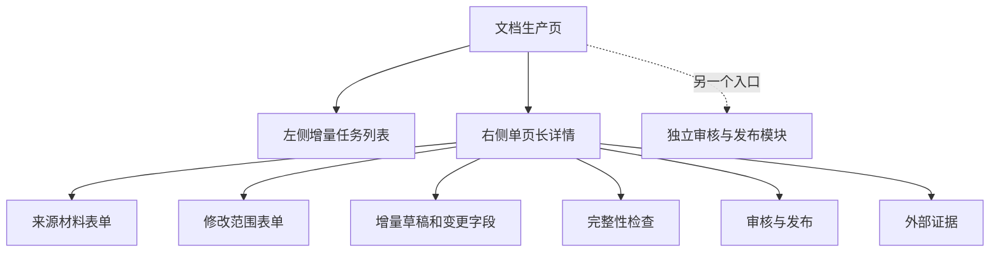
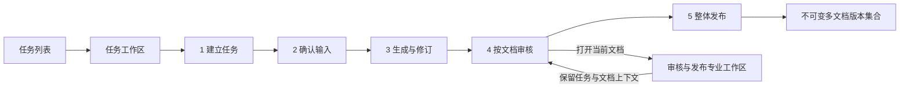
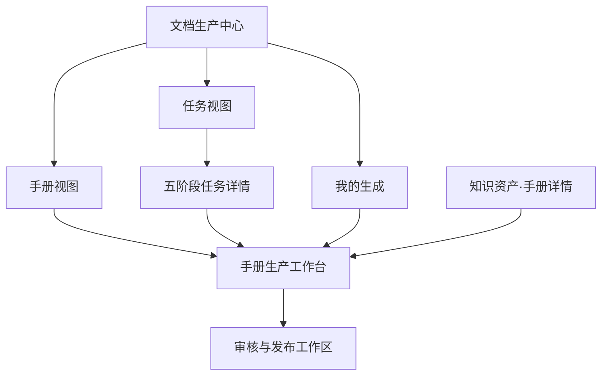

# 知识中心-文档生产-详细设计文档

滚动兼容性引用：采用《知识中心-前端-详细设计文档》的公共视口令牌和滚动契约。正文、桌面目录与辅助区沿用主区滚动，不恢复已取消的局部滚动；窄屏助手、历史与弹窗显式声明局部区域，命令栏声明滚动避让。业务模块不再计算 dvh 高度。

> 文档类型：垂直业务详细设计
> 设计编号：KC-M05-M07-DETAIL
> 上游概要设计：`../02-概要设计/知识中心-文档生产-增量构建垂直业务-概要设计文档.md`
> 关联设计：`./知识中心-平台-详细设计文档.md`、`../02-概要设计/知识中心-知识资产-GitLab手册映射与协作审阅-概要设计文档.md`、`../02-概要设计/知识中心-权限管理-业务角色与资源授权-概要设计文档.md`
> 状态：前端首版已实现（生产视图切换、刷新恢复和任务工作区表单边界有浏览器回归覆盖；全平台 E2E 尚有其他失败；真实业务闭环验收待补）
> 版本：1.4.0
> 更新日期：2026-09-24

本文是文档生产模块唯一详细设计，统一覆盖增量构建任务、变更集、候选版本、评审和平台发布；GitLab MR 交付作为后续目标能力保留设计边界，不属于本次 MVP 完成条件。

## 1. 目标与定位

### 1.1 模块职责

本文档定义知识中心“文档生产”模块的详细设计，覆盖全局生产管理、增量任务编排、手册级编辑下钻、候选审核和平台发布。其完整业务链路为：

```text
从手册或任务进入生产工作台
→ 生成、修订并固化候选版本
→ 显式发起审核
→ 审核人逐条审阅修改点（行级定位 + 前后对比 + AI 推理链）
→ 追加评论、退回修改或通过
→ 全部审核通过后进入待发布
→ 发布者确认基线、执行发布
→ 新版本生效、旧版本退役
→ 可选登记外部交付证据
```

增量任务的产品规则以上游《增量文档构建 MVP 需求》和概要设计为准；手册级编辑器的布局与交互由受控例外设计《手册级文档生成页面-前端详细设计》补充。本文仍是任务、候选、审核、发布及其全局入口的唯一业务详细设计事实源。

### 1.1.1 交付分层与现状

| 能力 | P0（当前可实现） | P1（本设计预留） |
|---|---|---|
| 审核决定 | 每个目标文档一个审核会话；决定规则由权限和审核策略控制 | 1-3 级串行审核、每级最少通过人数 |
| 评论定位 | 行级评论为审核页面 P0 目标；旧接口无锚点时仅允许全局评论降级 | 锚点漂移自动重定位、跨修订覆盖度分析 |
| AI 解释 | 结构化发现、规则引用、证据片段 | 分析任务异步化、全量 8 类检查与修订覆盖度 |
| 发布 | 多文档 `PublicationBatch` 原子发布 | 更复杂的跨手册批次和外部交付联动 |

P1 启用前必须增加版本化 API 字段，不得改变 P0 `Review` 的既有读取含义；前端根据 `capabilities` 判断是否展示层级等扩展操作。行级评论属于本轮 P0 验收项，若后端暂不支持，必须显示“全局评论（兼容模式）”而不得伪装成行级定位。

### 1.2 核心刚性约束

| 约束 | 实现要求 |
|---|---|
| **修改意见清晰可见且可追溯** | P0 行级评论必须绑定锚点、前后对比和旁路解释，并贯穿候选到发布血缘；旧全局评论仅作兼容降级且不得宣称已完成行级定位 |
| **AI 深度嵌入** | AI 作为审核协作者，主动提供参数依赖检查、版本耦合预警、交叉引用验证和术语一致性分析；所有 AI 输出必须附带 Chain-of-Thought 旁路 |
| **数据库专属准确性** | 审核检查必须覆盖 SQL 语法正确性、配置参数依赖完整性、错误码唯一性、运维命令版本适配等数据库文档特有风险 |
| **在线实时协同** | 所有操作在 Web 端完成；多审核人可并行评论，不互相阻塞 |
| **审核不可代替** | AI 通过不代替人工通过；AI 拒绝不代替人工拒绝；最终决定必须由有权限的人作出 |

### 1.3 非目标

- 不实现 OT/CRDT 实时协同编辑；首期采用异步评论 + 编辑锁。
- 不自动合并或自动发布；知识中心不具备自动合并 GitLab MR 的能力。
- 不在审核阶段修改候选正文；审核评论只记录意见，不直接改变冻结内容。
- 不将 PingCode 未连接状态伪装为已接入；审核中引用的来源快照如实标注捕获方式。

## 2. 对象模型与事实关系

### 2.1 审核领域对象总览

```text
ReviewSession（审核会话）
  ├─ ReviewLevel[]（审核层级）
  │    ├─ ReviewerAssignment（审核人分配）
  │    └─ ReviewDecision（层级决定）
  ├─ ReviewComment[]（审核评论）
  │    ├─ CommentAnchor（行级锚点）
  │    │    ├─ nodeId
  │    │    ├─ lineRange
  │    │    └─ charRange
  │    ├─ DiffView（修改前后对比）
  │    │    ├─ beforeSnippet
  │    │    ├─ afterSnippet
  │    │    └─ operationType
  │    └─ AiAnalysis[]（AI 分析记录）
  │         ├─ analysisType
  │         ├─ reasoningSummary + evidenceRefs
  │         ├─ verdict
  │         └─ confidence
  ├─ ReviewVerdict（最终决定）
  └─ LineageRecord（血缘记录）
       ├─ parentCandidateId
       ├─ revisionChain[]
       └─ publicationId

Publication（发布记录）
  ├─ candidateDigest
  ├─ baselineVersionId
  ├─ supersededVersionId
  ├─ content
  ├─ operations[]
  └─ PublicationBatch（发布批次，多文档原子发布）

ExternalDelivery（外部交付登记）
  ├─ deliveryType（gitlab_mr / manual / other）
  ├─ reference
  ├─ status
  └─ evidence[]
```

### 2.2 审核会话

```text
ReviewSession(
  id,
  taskId,                    // 关联增量任务
  targetDocumentId,          // 本审核会话只对应一个目标文档
  candidateDigest,           // 冻结的候选摘要
  handbookId,
  businessVersion,
  flowVersion,               // 审核流程版本（几级审核、通过规则）
  status,                    // pending | in_progress | approved | rejected | withdrawn
  levels[],                  // 有序审核层级
  finalVerdict,              // 最终决定
  createdBy,                 // 提交审核的人
  createdAt,
  updatedAt,
  completedAt
)
```

- 一个目标文档候选对应一个审核会话；候选固化后必须通过 `POST .../reviews` 显式创建。
- 一个增量任务可以包含多个目标文档，因此同一任务可以创建多个审核会话；审核决定按文档保存，任务级发布门禁汇总全部会话结果。
- `flowVersion` 记录创建时使用的审核流程配置；即使后续流程配置变更，已有会话继续按创建时规则执行。
- 审核拒绝后创建修订任务（`revisionOf` 指回原任务），原会话保持 `rejected` 只读。

### 2.3 审核层级

```text
ReviewLevel(
  ordinal,                   // 层级序号，从 1 开始
  levelName,                 // 例如"技术审核"、"责任审核"
  requiredApprovals,         // 该层级需要通过的最少人数
  assignedReviewers[],       // 有权限在该层级作出决定的人
  status,                    // pending | approved | rejected | skipped
  decidedBy,
  decidedAt
)
```

- 知识空间可配置一级或多级审核；P0 固定单级，P1 才启用 1-3 级并记录 `flowVersion`。
- 角色可以由同一用户承担；是否允许提交者参与审核、是否要求其他审核人通过，由审核策略显式配置并记录在 `flowVersion`，不能从角色名称自行推断。
- 层级按 `ordinal` 顺序执行；前一级未通过时，后续层级不进入活跃状态。

### 2.4 审核评论

```text
ReviewComment(
  id,
  sessionId,
  levelOrdinal,              // 属于哪个审核层级
  authorId,
  commentType,               // question | issue | suggestion | approval_note | ai_analysis
  anchor,                    // CommentAnchor，可选
  diffView,                  // DiffView，可选
  body,                      // 评论正文
  aiAnalyses[],              // 附带的 AI 分析记录
  resolved,                  // 是否已解决
  resolvedBy,
  resolvedAt,
  createdAt,
  updatedAt
)
```

- 评论追加保存，不修改候选正文。
- 每条评论可选绑定行级锚点和修改前后对比；不绑定时为全局评论。
- `commentType` 区分人工评论和 AI 分析入口；AI 分析记录在 `aiAnalyses` 中独立存储。

### 2.5 行级锚点

```text
CommentAnchor(
  documentId,                // 目标文档
  nodeId,                    // 稳定节点身份（非标题、非行号）
  anchorKind,                // after_operation | before_operation | baseline
  lineRange,                 // { startLine, endLine }，可选
  charRange,                 // { startChar, endChar }，可选
  contextBefore,             // 锚点前若干字符的上下文指纹
  contextAfter               // 锚点后若干字符的上下文指纹
)
```

- `nodeId` 使用变更操作中的稳定节点身份，不使用标题文本或行号。
- `anchorKind` 明确锚点参考的是基线原文、操作前状态还是操作后状态，避免审核人和作者在视图间混淆。
- `contextBefore/contextAfter` 作为漂移检测指纹；当节点内容因修订变化时，系统可检测锚点是否仍然有效。

### 2.6 修改前后对比

```text
DiffView(
  operationType,             // add | update | delete | move
  beforeContent,             // 基线或操作前的内容片段
  afterContent,              // 操作后的内容片段
  beforeDigest,              // 操作前内容摘要
  afterDigest,               // 操作后内容摘要
  diffHighlight,             // 结构化差异标记（行级增删标识）
  scopeDescription           // 人类可读的变更范围描述
)
```

- `add` 操作 `beforeContent` 为空；`delete` 操作 `afterContent` 为空。
- `diffHighlight` 提供行级增删标记，前端渲染为红绿对比视图。
- `move` 操作同时包含原位置和新位置信息。

### 2.7 AI 分析记录

```text
AiAnalysis(
  id,
  analysisType,              // 见 2.8 节
  modelId,                   // 使用的模型标识
  promptVersion,             // 提示词版本
  reasoningSummary,          // 可审计的结构化推理摘要（旁路解释）
  evidenceRefs[],             // 使用的候选/基线节点、规则和测试证据
  verdict,                   // pass | warn | fail | info
  confidence,                // 0.0 - 1.0
  findings[],                // 结构化发现项
  ruleRefs[],                // 引用的规则版本
  executedAt
)
```

- 每条 AI 分析必须包含可审计的 `reasoningSummary`、`evidenceRefs` 和步骤化 `findings`；前端以可折叠面板展示“推理摘要（Chain-of-Thought 旁路解释）”。不把模型内部不可验证的思维草稿作为接口契约，也不得写入凭证、隐式系统提示词或其他敏感信息。
- `verdict` 只标记 AI 的判断倾向，不代替人工决定。
- `findings` 为结构化数组，每项包含 `severity`、`message`、`affectedNodeId` 和 `suggestedAction`。

### 2.8 AI 分析类型

| `analysisType` | 中文展示 | 检查内容 |
|---|---|---|
| `syntax_check` | SQL 语法检查 | SQL 示例、DDL/DML 语句的正确性 |
| `param_dependency` | 参数依赖检查 | 配置参数的取值范围、互斥和依赖关系 |
| `version_coupling` | 版本耦合预警 | 变更是否影响其他版本的同一参数或命令 |
| `cross_reference` | 交叉引用验证 | 文档间引用链接的有效性 |
| `error_code_unique` | 错误码唯一性 | 新增错误码是否与已有编码冲突 |
| `terminology` | 术语一致性 | 技术术语是否符合术语表 |
| `scope_completeness` | 范围完整性 | 变更集是否覆盖了来源要求的全部修改点 |
| `operation_safety` | 运维安全性 | 运维命令是否包含风险提示和回退步骤 |

### 2.9 发布记录

```text
Publication(
  id,
  handbookId,
  businessVersion,
  targetKey,
  baselineVersionId,
  candidateDigest,
  content,
  operations[],
  publishedBy,
  publishedAt,
  supersededPublicationId,   // 被替代的旧发布记录
  batchId                    // 发布批次 ID（多文档原子发布时使用）
)
```

- 发布时在同一事务中将相同手册和业务版本的旧 `current` 置为 `false`，再将新发布记录置为 `current=true`。
- `supersededPublicationId` 形成显式的版本替代链。

### 2.10 血缘记录

```text
LineageRecord(
  taskId,
  candidateDigest,
  revisionChain[],           // 修订链：[原始任务ID, 第一次修订ID, ...]
  sourceSnapshotIds[],       // 来源快照
  reviewSessionId,           // 审核会话
  publicationId,             // 发布记录
  previousPublicationId,     // 上一个发布版本
  createdAt
)
```

- 血缘记录从任务创建时开始积累，贯穿修订、审核和发布全生命周期。
- 修订任务的 `revisionChain` 继承原任务的链条并追加自身。
- 血缘记录不可修改，只追加。

## 3. 审核流程状态机

### 3.1 审核会话状态

```text
                    ┌────────────────────────────────────────────────┐
                    │                                                │
                    ▼                                                │
[created] ──→ [in_progress] ──→ [approved] ──→ [published] ──→ [superseded]
                    │                  │
                    │                  └──→ [withdrawn]（发布者撤回）
                    │
                    └──→ [rejected] ──→ 创建修订任务 ──→ [新审核会话]
```

| 状态 | 中文展示 | 允许动作 |
|---|---|---|
| `pending` | 待启动 | 分配审核人、开始审核 |
| `in_progress` | 审核中 | 评论、AI 分析、层级决定 |
| `approved` | 审核通过 | 发布、撤回 |
| `rejected` | 审核拒绝 | 创建修订任务 |
| `withdrawn` | 已撤回 | 重新发起审核（新会话） |
| `superseded` | 已替代 | 只读 |

### 3.2 审核层级状态

```text
[pending] ──→ [approved]（该层级通过）
    │
    └──→ [rejected]（该层级拒绝，会话进入 rejected）
              │
              └──→ [skipped]（前级拒绝后，后续层级标记为 skipped）
```

### 3.3 审核决定规则

```text
单级审核：
  requiredApprovals 由审核策略配置
  提交者是否可审核、是否必须由其他人通过，由审核策略和权限共同决定
  满足策略后审核人通过 → approved

多级审核：
  第 1 级全部通过 → 第 2 级激活
  第 N 级全部通过 → 会话 approved
  任一级别有审核人拒绝 → 会话 rejected

角色兼任规则：
  作者、手册负责人、审核人和发布人可以是同一用户
  具体操作必须同时满足该用户的权限角色和当前审核策略
  规则快照记录在 flowVersion，不从角色名称推断是否允许自审
```

## 4. 审核评论交互设计

### 4.1 评论创建流程

```text
审核人在差异视图中选择文本范围
→ 系统自动关联 nodeId 和行范围
→ 生成 CommentAnchor
→ 自动提取 DiffView（该节点的操作前后对比）
→ 审核人输入评论内容
→ 可选触发 AI 辅助分析
→ 提交评论
```

### 4.2 评论类型与行为

| `commentType` | 行为 | 是否触发 AI |
|---|---|---|
| `question` | 对修改内容的疑问，不阻断通过 | 否 |
| `issue` | 发现的问题，需要作者回应 | 可选 |
| `suggestion` | 修改建议，作者可一键采纳 | 可选 |
| `approval_note` | 通过说明，记录审核理由 | 否 |
| `ai_analysis` | AI 自动或触发的分析结果 | 是（本身就是 AI 输出） |

### 4.3 评论解决

- 评论可标记为 `resolved`；解决不删除评论内容，只标记状态。
- 只有任务创建者或当前层级审核人可标记解决。
- 存在未解决的 `issue` 类型评论时，审核人作出 `approve` 决定前系统显示提醒（不阻断）。

### 4.4 评论权限

| 角色 | 可执行动作 |
|---|---|
| 任务创建者 | 回复评论、标记解决、查看全部 |
| 当前层级审核人 | 创建评论、作出层级决定、查看全部 |
| 其他层级审核人 | 查看该层级评论（只读） |
| 平台管理员 | 查看全部评论，不创建评论或决定 |
| 无权限用户 | 按任务不存在处理 |

## 5. AI 审核协作者设计

### 5.1 触发时机

AI 分析在以下时机触发：

| 时机 | 触发方式 | 分析类型 |
|---|---|---|
| 候选固化时 | 自动 | `scope_completeness`、`syntax_check` |
| 审核会话创建时 | 自动 | 全量分析（8 种类型） |
| 审核人手动触发 | 审核人在评论中 @ai 或点击"AI 分析" | 指定类型 |
| 修订任务创建时 | 自动 | 对比原审核意见，检查修订覆盖度 |

### 5.2 AI 分析输出格式

```text
┌─────────────────────────────────────────────┐
│ 🔍 AI 分析：参数依赖检查                      │
│ 置信度：0.87                                  │
│ 判定：⚠️ 警告                                 │
├─────────────────────────────────────────────┤
│ 推理摘要（Chain-of-Thought 旁路解释）：          │
│                                               │
│ 1. 检测到本次修改涉及参数 max_connections       │
│ 2. 查询参数依赖表，发现 shared_buffers 存在     │
│    联动关系：max_connections ≤ shared_buffers   │
│    × 32                                       │
│ 3. 当前文档中 shared_buffers 章节未同步更新     │
│ 4. 结论：修改可能导致参数配置不一致             │
│                                               │
├─────────────────────────────────────────────┤
│ 发现项：                                      │
│ • [警告] max_connections 修改后，              │
│   shared_buffers 章节（node: param-sb-001）    │
│   可能需要联动更新                             │
│ • 建议：在变更集中增加 shared_buffers 章节      │
│   的联动说明，或在参数说明中增加交叉引用        │
├─────────────────────────────────────────────┤
│ 引用规则：参数依赖规则 v2.3 §4.2               │
│ 模型：yashan-doc-reviewer v1.2                │
└─────────────────────────────────────────────┘
```

### 5.3 AI 分析约束

- AI 分析结果以 `commentType=ai_analysis` 的评论形式保存，与人工评论在同一列表中展示；P0 同步生成摘要，P1 可使用异步任务。
- AI 判定 `fail` 不自动阻断审核通过；系统显示强提醒，由审核人决定是否采纳。
- AI 判定 `pass` 不自动代替审核人通过。
- 所有 AI 输出必须附带结构化推理摘要和证据引用，前端默认折叠、审核人可展开查看；摘要不得声称“模型已执行”未实际执行的数据库验证。
- AI 使用的模型标识、提示词版本和规则版本必须记录，支持事后复盘。
- AI 不读取审核人的历史评论作为自身输入的依据，避免确认偏误；AI 分析只基于候选内容、基线内容和平台规则。

### 5.4 数据库专属检查规则

以下检查规则需要数据库领域知识支持，不能由通用文档审核替代：

| 规则 | 检查内容 | 阻断级别 |
|---|---|---|
| SQL 语法正确性 | 示例 SQL 是否可在目标版本执行 | 警告（需人工确认） |
| 参数依赖完整性 | 修改的参数是否有联动参数未覆盖 | 警告 |
| 错误码唯一性 | 新增错误码是否与已有编码冲突 | 阻断 |
| 运维命令版本适配 | 命令是否适用于目标业务版本 | 阻断 |
| 数据类型兼容 | 新增或修改的数据类型是否在目标版本支持 | 警告 |
| 权限语句完整 | GRANT/REVOKE 示例是否覆盖必要权限 | 信息 |

## 6. 差异视图与修改对比

### 6.1 三级差异视图

审核人查看修改时，系统提供三级视图切换：

| 视图层级 | 展示内容 | 适用场景 |
|---|---|---|
| **结构视图** | 文档大纲的增删改标记，折叠显示变更节点 | 快速了解变更范围 |
| **段落视图** | 按变更节点展开，显示操作前后段落对比 | 逐条审阅修改内容 |
| **行级视图** | 类 diff 的行级增删高亮，支持字符级标记 | 精确检查语法和参数 |

### 6.2 差异视图与评论联动

```text
审核人在段落视图或行级视图中：
1. 选中文本范围 → 系统自动计算 nodeId + lineRange
2. 点击"添加评论" → 弹出评论面板，自动填充 DiffView
3. 评论提交后 → 在差异视图中显示评论标记（气泡图标）
4. 点击标记 → 展开评论详情和 AI 分析
```

### 6.3 锚点漂移处理

当修订任务修改了节点内容后，原审核评论的锚点可能漂移：

- 系统使用 `contextBefore/contextAfter` 指纹检测漂移。
- 锚点仍然有效时正常显示。
- 锚点漂移但可自动匹配时，显示"锚点已偏移"提醒并高亮新位置。
- 锚点无法匹配时，评论标记为"锚点失效"，评论内容保留但不再关联具体位置。
- 修订任务的审核人可以看到原评论及其漂移状态，作为审阅参考。

## 7. 版本血缘追溯

### 7.1 血缘链结构

```text
Publication v1.0（已发布）
  └─ 增量任务 T1
       ├─ 来源快照 S1, S2
       ├─ 变更集 C1（add/update/delete 操作列表）
       ├─ 审核会话 R1
       │    ├─ 层级 1：技术审核 → 通过
       │    └─ 层级 2：责任审核 → 通过
       ├─ AI 分析 A1（全量）
       └─ 发布记录 P1
            │
            └─ Publication v1.0.1（已发布，替代 v1.0）
                 └─ 修订任务 T2（revisionOf: T1）
                      ├─ 来源快照 S3
                      ├─ 变更集 C2
                      ├─ 审核会话 R2
                      │    ├─ 原评论漂移检测
                      │    └─ 修订覆盖度检查
                      └─ 发布记录 P2（supersededPublicationId: P1）
```

### 7.2 血缘查询 API

```text
GET /knowledge-center/api/lineage/handbooks/{handbookId}/business-versions/{version}
```

返回：

```json
{
  "handbookId": "DB-001",
  "businessVersion": "23.4",
  "currentPublication": { "id": "P2", "publishedAt": "..." },
  "lineageChain": [
    {
      "publicationId": "P1",
      "taskId": "T1",
      "candidateDigest": "sha256:abc...",
      "reviewSessionId": "R1",
      "publishedAt": "...",
      "supersededBy": "P2"
    },
    {
      "publicationId": "P2",
      "taskId": "T2",
      "revisionOf": "T1",
      "candidateDigest": "sha256:def...",
      "reviewSessionId": "R2",
      "publishedAt": "...",
      "supersedes": "P1"
    }
  ]
}
```

### 7.3 血缘展示要求

- 每个已发布版本页面显示"版本历史"入口，展示完整血缘链。
- 血缘链中每个节点可展开查看：变更摘要、来源快照、审核决定、AI 分析摘要。
- 修订关系用虚线箭头标注，替代关系用实线箭头标注。
- 点击血缘链中的任意节点可跳转到对应的审核会话详情。

## 8. 发布流程

### 8.1 发布前置检查

```text
POST /knowledge-center/api/incremental-tasks/{taskId}/publish

前置检查：
1. 任务内每个目标文档都有状态为 approved 的审核会话，且满足该文档对应的审核策略
2. 所有候选摘要与提交审核时一致（未被篡改）
3. 所有目标文档当前基线 current=true 且与任务创建时一致
4. 发布者具有全部目标文档的发布权限
5. 所有目标文档均无未解决的阻断级检查项
```

### 8.2 发布执行

```text
发布事务（多文档目标，MVP）：
1. 校验全部目标文档的候选、审核、权限、基线和阻断项
2. 为全部目标文档生成不可变版本记录
3. 在同一事务中原子切换全部当前版本指针
4. 写入一个发布批次记录（PublicationBatch）和各文档发布记录
5. 写入各文档血缘记录和统一审计日志
6. 更新任务状态为 published
7. 任一文档失败 → 全部回滚，不留下部分生效版本
```

### 8.3 发布后动作

- 所有目标文档发布成功后，任务状态变为 `published`；任一文档失败时任务进入 `batch_publish_failed`，可在修复后整体重试。
- 发布记录不可修改；如需修改已发布内容，必须创建新的增量任务。
- 发布后可登记外部交付证据（GitLab MR 编号、CI 结果等）。

## 9. 外部交付登记

### 9.1 交付类型

| `deliveryType` | 中文展示 | 含义 |
|---|---|---|
| `gitlab_mr` | GitLab 合并请求 | 已创建或已合入的 MR |
| `gitlab_ci` | GitLab CI 运行 | CI 构建和检查结果 |
| `manual` | 人工登记 | 手动记录的外部交付 |
| `other` | 其他 | 其他外部系统交付 |

### 9.2 交付登记约束

- 只有 `published` 状态的任务能登记外部交付。
- 交付登记不改变发布内容，只记录外部衔接事实。
- GitLab MR/CI 交付在真实连接器接入前只能人工登记，不得显示为系统已自动同步。
- 交付状态包括：`pending`（待确认）、`success`（成功）、`failed`（失败）。

## 10. API 设计

### 10.1 审核会话

```text
POST   /knowledge-center/api/incremental-tasks/{taskId}/reviews
       创建审核会话（从 candidate_ready 进入 under_review）
       Body: { "Idempotency-Key": "..." }
       Response: 201 ReviewSession

GET    /knowledge-center/api/incremental-tasks/{taskId}/reviews/{reviewId}
       获取审核会话详情（含层级、评论、AI 分析）

POST   /knowledge-center/api/incremental-tasks/{taskId}/reviews/{reviewId}/decision
       P0 作出审核决定（与现有服务契约一致）
       Body: { "decision": "approve|reject", "comment": "...", "Idempotency-Key": "..." }

POST   /knowledge-center/api/incremental-tasks/{taskId}/reviews/{reviewId}/levels/{ordinal}/decide
       P1 多级审核层级决定；仅在能力协商返回 `multiLevelReview=true` 时启用
       Body: { "decision": "approve|reject", "comment": "...", "Idempotency-Key": "..." }

POST   /knowledge-center/api/incremental-tasks/{taskId}/reviews/{reviewId}/withdraw
       撤回审核（仅提交者在发布前可操作）
```

### 10.2 审核评论

```text
POST   /knowledge-center/api/incremental-tasks/{taskId}/reviews/{reviewId}/comments
       创建评论
       Body: {
         "commentType": "issue",
         "anchor": { "documentId": "...", "nodeId": "...", "anchorKind": "after_operation", "lineRange": {...} },
         "diffView": { "operationType": "update", "beforeContent": "...", "afterContent": "..." },
         "body": "...",
         "Idempotency-Key": "..."
       }

GET    /knowledge-center/api/incremental-tasks/{taskId}/reviews/{reviewId}/comments
       获取评论列表（支持按层级、类型、锚点文档过滤）

PATCH  /knowledge-center/api/incremental-tasks/{taskId}/reviews/{reviewId}/comments/{commentId}
       更新评论（仅作者可修改正文；仅创建者或审核人可标记 resolved）
       Body: { "resolved": true }
```

### 10.3 AI 分析

```text
POST   /knowledge-center/api/incremental-tasks/{taskId}/reviews/{reviewId}/ai-analysis
       触发 AI 分析
       Body: {
         "analysisTypes": ["param_dependency", "cross_reference"],
         "scopeNodeId": "...",      // 可选，不指定时分析全部变更节点
         "Idempotency-Key": "..."
       }
       Response: 202 { "analysisId": "...", "status": "processing" }

GET    /knowledge-center/api/incremental-tasks/{taskId}/reviews/{reviewId}/ai-analysis/{analysisId}
       获取 AI 分析结果（含 reasoningSummary、evidenceRefs、findings、verdict）
```

### 10.4 发布

```text
POST   /knowledge-center/api/incremental-tasks/{taskId}/publish
       执行发布
       Body: { "Idempotency-Key": "..." }
       Response: 201 Publication

GET    /knowledge-center/api/publications/{publicationId}
       获取发布记录详情
```

### 10.5 血缘

```text
GET    /knowledge-center/api/lineage/handbooks/{handbookId}/business-versions/{version}
       获取版本血缘链

GET    /knowledge-center/api/lineage/tasks/{taskId}
       获取任务维度的血缘（含修订链）
```

### 10.6 外部交付

```text
POST   /knowledge-center/api/incremental-tasks/{taskId}/external-deliveries
       登记外部交付
       Body: {
         "deliveryType": "gitlab_mr",
         "reference": "MR!1234",
         "status": "pending",
         "note": "...",
         "Idempotency-Key": "..."
       }
```

## 11. 前端展示设计

### 11.1 审核工作台布局

```text
┌─────────────────────────────────────────────────────────────────┐
│ 审核工作台                                          [通过] [拒绝] │
├───────────┬─────────────────────────────────────────────────────┤
│           │  差异视图                                            │
│ 审核进度   │  ┌─ 结构视图 | 段落视图 | 行级视图 ──────────────┐   │
│           │  │                                               │   │
│ ▸ 层级 1  │  │  [基线原文]                    [修改后内容]    │   │
│   技术审核 │  │  ───────────────────────────────────────────  │   │
│   ✅ 通过  │  │  - 旧段落内容（红色删除标记）                  │   │
│           │  │  + 新段落内容（绿色新增标记）                   │   │
│ ▾ 层级 2  │  │                                               │   │
│   责任审核 │  │        💬 评论标记                             │   │
│   ● 进行中 │  │                                               │   │
│           │  └───────────────────────────────────────────────┘   │
│           │                                                     │
│ 审核人：   │  ┌─ AI 分析面板（可折叠）──────────────────────┐    │
│ • 张工 ✅  │  │ 🔍 参数依赖检查 · 置信度 0.87 · ⚠️ 警告     │    │
│ • 李工 🔵  │  │ [展开推理过程 ▼]                            │    │
│           │  │ • max_connections 修改后 shared_buffers       │    │
│ 统计：     │  │   章节可能需要联动更新                       │    │
│ 3/5 评论   │  └──────────────────────────────────────────────┘    │
│ 2 已解决   │                                                     │
│ 1 待回应   ├─────────────────────────────────────────────────────│
│           │  评论区                                               │
│           │  ┌─ 评论列表 ──────────────────────────────────┐     │
│           │  │ 💬 张工 · 行 42-45 · issue                  │     │
│           │  │ "这个参数在 23.4 版本已废弃，应使用新参数"    │     │
│           │  │ [查看对比] [回复] [标记解决]                  │     │
│           │  │                                              │     │
│           │  │ 🤖 AI · 术语一致性 · pass                    │     │
│           │  │ "全部术语符合术语表 v3.1"                     │     │
│           │  └──────────────────────────────────────────────┘     │
│           │  ┌─ 添加评论 ──────────────────────────────────┐     │
│           │  │ [类型: issue ▾] [关联节点: auto]             │     │
│           │  │ [评论内容...]              [🤖 AI分析] [提交] │     │
│           │  └──────────────────────────────────────────────┘     │
└───────────┴─────────────────────────────────────────────────────┘
```

### 11.2 血缘追溯视图

```text
┌─────────────────────────────────────────────────────────────┐
│ 版本历史 · DB-001 产品描述手册 · 23.4                         │
├─────────────────────────────────────────────────────────────┤
│                                                             │
│  v1.0 ──── → v1.0.1 ──── → v1.0.2（当前版本）              │
│  2026-06-15   2026-07-20    2026-09-01                      │
│                                                             │
│  ┌─ v1.0.2 详情 ──────────────────────────────────────┐    │
│  │ 任务：增量修改任务-更新安装前检查说明                    │    │
│  │ 修订自：T1（原始任务）                                 │    │
│  │ 审核：R2 · 技术审核✅ + 责任审核✅                     │    │
│  │ AI 分析：8 项检查通过，1 项警告已人工确认               │    │
│  │ 来源：人工录入 × 1                                    │    │
│  │ 发布：2026-09-01 by 王工                              │    │
│  │ 外部交付：MR!1234（已合入）                            │    │
│  │ [查看审核详情] [查看变更集] [对比上一版本]              │    │
│  └──────────────────────────────────────────────────────┘    │
│                                                             │
└─────────────────────────────────────────────────────────────┘
```

### 11.3 前端展示约束

- 所有状态、类型和动作使用中文展示。
- AI 分析面板默认折叠；展开时显示完整 Chain-of-Thought。
- 差异视图中的评论标记不遮挡正文内容。
- 血缘链中的修订关系和替代关系使用不同视觉样式区分。
- 没有真实数据时显示空态，不构造审核、评论或版本记录。
- 外部交付标记为“人工登记”时，不显示为系统已自动同步。

### 11.4 P0 前端实施契约

审核工作台只服务一个判断：审核人是否可以对当前候选版本作出通过或退回决定。默认视图采用“主阅读区 + 上下文侧区 + 固定决策栏”，不同时展开四个同等权重的面板。

| 区域 | 默认内容 | 必须支持的状态 |
|---|---|---|
| 页头 | 手册、业务版本、候选摘要、审核状态、数据更新时间 | 候选摘要变化、读取失败 |
| 摘要带 | 变更文档数、阻断项、警告、未解决评论、基线版本 | 空值显示“0/未知”，不得伪造统计 |
| 主阅读区 | 结构/段落/行级差异；选中文本创建评论 | 行级可用、全局评论兼容模式、锚点漂移/失效 |
| 上下文侧区 | 当前节点的基线、候选、AI 推理摘要、证据和规则版本 | AI 处理中、无分析、分析失败 |
| 评论区 | 全部/我的/阻断/未解决筛选；评论与 `nodeId` 双向定位 | 草稿保留、冲突、无权限 |
| 决策栏 | “退回并说明”“通过审核”；发布另起确认页 | 进行中、成功、失败、冲突 |

P0 必须实现行级定位：评论请求携带 `documentId/nodeId/lineRange/charRange`、锚点上下文指纹和候选摘要。若服务端能力协商不支持锚点，只能进入“全局评论（兼容模式）”，并在页面和审计中明确标注。

发布按钮不与审核决定并列。发布确认必须依次展示候选摘要、当前基线、影响文档、阻断项和外部交付状态，用户二次确认后才提交 `expectedCandidateDigest`。

页面视觉遵循乔布斯式产品原则：高对比正文、稳定网格、单一动作色、无渐变和装饰性大卡片；图标使用 Lucide 并带中文无障碍名称；所有状态同时使用文字、图标和颜色；动画仅用于状态变化且支持 `prefers-reduced-motion`。

## 12. 审计日志

### 12.1 必记事件

| 事件 | 记录内容 |
|---|---|
| 审核会话创建 | 主体、任务、候选摘要、流程版本 |
| 审核人分配 | 层级、审核人、分配者 |
| 层级决定 | 层级、决定类型、审核人、说明 |
| 评论创建 | 作者、类型、锚点、评论 ID |
| 评论修改 | 评论 ID、修改前后正文摘要 |
| 评论解决 | 评论 ID、解决者 |
| AI 分析触发 | 分析类型、触发方式、操作者 |
| AI 分析完成 | 分析 ID、判定、置信度、模型版本 |
| 发布执行 | 发布者、候选摘要、旧版本、新版本 |
| 发布撤回 | 撤回者、原因 |
| 修订任务创建 | 原任务、修订链 |
| 外部交付登记 | 交付类型、引用、状态 |

### 12.2 审计约束

- 审计记录不记录令牌、密码或无必要的敏感正文。
- AI 分析仅保留结构化推理摘要和证据引用；提示词输入中的凭证信息脱敏，模型内部思维草稿不进入审计数据。
- 审计记录不可修改，只追加。

## 13. 测试与验收门禁

### 13.1 审核流程测试

- 单级审核：由权限和 `flowVersion` 审核策略决定提交者是否可以兼任审核人；满足该策略后会话进入 `approved`。
- 多级审核：前级未通过时后续层级不激活；全部通过后会话进入 `approved`。
- 自审场景：提交者是否可以作为审核人，以及是否需要其他审核人通过，由审核策略决定并记录在 `flowVersion`。
- 审核拒绝后可创建修订任务；修订任务的新审核会话独立于原会话。
- 撤回审核后原会话进入 `withdrawn`，可重新发起新会话。

### 13.2 评论与锚点测试

- 评论创建时自动关联 `nodeId` 和行范围。
- 锚点使用 `contextBefore/contextAfter` 指纹；修订后锚点漂移时正确检测和标记。
- 锚点完全失效时评论保留但标记为"锚点失效"。
- 评论类型、层级过滤正确。
- 只有授权角色可创建评论和标记解决。

### 13.3 AI 分析测试

- 候选固化时自动触发 `scope_completeness` 和 `syntax_check`。
- 审核会话创建时自动触发全量分析。
- 手动触发指定类型分析正确执行。
- AI 分析结果以评论形式保存，包含 `reasoningSummary`、`evidenceRefs` 和结构化发现项。
- AI `fail` 不自动阻断审核通过；AI `pass` 不自动代替审核人通过。
- AI 分析不读取审核人历史评论作为输入依据。

### 13.4 发布测试

- 发布前置检查：审核通过、候选摘要一致、基线 current。
- 发布事务原子性：旧版本 `current=false` 和新版本 `current=true` 在同一事务中完成。
- 发布失败不改变原发布基线。
- 发布后可登记外部交付证据。
- 已发布任务创建修订任务时正确继承血缘链。

### 13.5 血缘追溯测试

- 血缘链正确记录从任务到发布的全生命周期。
- 修订任务的 `revisionChain` 正确继承和追加。
- 血缘查询 API 返回完整链条，包含审核和 AI 分析摘要。
- 前端血缘视图正确展示修订和替代关系。

## 14. 增量构建任务与候选版本

- 增量任务固定手册、正式基线、变更范围、责任人和输入证据；任务运行期间不跟随最新大纲或模板漂移。
- 草稿可反复保存，提交时执行完整性检查并固化不可变候选版本；候选包含文档集合、内容摘要、来源、模板和变更集。
- 同一业务命令使用幂等键；任务、草稿和候选写入使用乐观锁。基线变化返回冲突，不覆盖他人修改。
- 候选进入审核后正文不可原地修改；退回修改产生新修订并保留血缘。发布以完整候选集合为单位，禁止部分文档成功后推进正式状态。
- 文件仓储只保存不可变内容产物，数据库保存稳定引用、摘要、状态、关系和审计。正式文档资产仓储未完成前不得把聚合记录宣称为最终基线。

## 15. GitLab MR 交付

```text
已审核候选 → 校验 GitLab 基线 → 创建受控分支
→ 写入结构化变更 → 创建 MR → 人工审核与合并
→ 回读 MR/CI/默认分支事实 → 平台发布前检查 → 登记正式版本
```

- GitLab 默认分支是启用写回后的外部正式文档事实源；平台候选和 MR 分支都不是正式版本。
- 每次写回固定项目、目标分支、基线 SHA、路径、候选摘要和操作者；基线漂移停止写入并要求重新比较。
- 平台不得自动合并 MR，不得以人工填写链接或文字替代真实 MR、CI 和合并状态。
- 重试复用同一交付任务和幂等键；创建分支、提交或 MR 后失败时保存远端对象 ID，恢复流程先查询事实再补偿。
- 用户 GitLab OAuth 权限、平台允许写入范围和候选业务权限取交集，凭据只由平台连接器使用。

## 16. 统一验收门禁

- 使用真实任务完成草稿、完整性检查、候选固化、评论、审核、修订和发布。
- 角色是否可以兼任以及审核是否需要其他人通过，不由页面判断；由服务端按角色权限和 `flowVersion` 审核策略校验。
- 多文档候选发布要么全部成功，要么正式基线和状态均不变化。
- GitLab 写回通过隔离项目真实验证分支、提交、MR、CI、人工合并、失败恢复和重复请求。
- 页面入口、差异、行级评论、全文意见、审核动作和状态恢复在桌面及移动视口通过端到端验证。

## 17. 文档维护边界

任务拆分、评审意见、一次性决策请求和验收记录进入工作流或报告目录，不再放入详细设计目录。本文只保留当前状态机、接口、数据、权限、失败恢复和验收契约。

## 18. 任务视图内的增量 MVP 五阶段流程

### GitLab 映射正文作为增量编辑初稿（2026-10-15 修复）

任务页在确认输入阶段读取手册现有 GitLab 映射、允许的分支和语言路径内的 Markdown 树；用户明确选择文件后读取正文、路径和提交 ID，将正文作为 `local` 来源快照固化，引用记录分支、路径及提交。仓库正文仅为编辑初稿，任务创建时选择的平台已发布基线仍是审核和发布的版本门禁；不得把仓库提交当作平台基线。读取失败、无映射、无权限、空文件或未取得提交标识时不得显示为已固化。已保存草稿不得被重新读取的正文覆盖。

页面信息层级：任务及平台基线 → 手册映射/分支/语言/文件/提交 → 来源快照与目标文档 → Markdown 草稿及变更操作 → 检查、候选、审核、发布状态。选中章节必须具有确定的所属文档 ID；未知映射阻止范围提交。新文档使用 `add` 变更操作，现有节点更新需人工提供真实的基线节点指纹，页面不得伪造。继续复用来源、范围、草稿、检查、候选、审核和发布接口；自动生成、PingCode 正文读取及仓库写回不在本次修复范围。

备选方案是新增服务端“仓库文件直达增量草稿”接口，由服务端冻结 GitLab 修订并计算操作集，操作更短，但需新建映射、差异和冲突契约；本轮采用现有接口以限制改动范围。

手册级单文档编辑页面的布局、目录过滤、草稿编辑、参考资料弹框和评审批次交互不在本模块详细设计中展开，统一见 [手册级文档生成页面前端详细设计](./知识中心-文档生产-手册级文档生成页面-前端详细设计文档.md)。本文只保留这些页面需要遵守的业务状态、权限和审核发布边界。

> 本节的五阶段任务结构已确认，作为第 19 节全局生产中心“任务视图”的内部详情保留，不再独占文档生产模块首页。关联决策见 `../07-决策与风险/知识中心-文档生产-增量构建前端流程骨架-决策记录文档.md`。

### 18.1 设计目标

前端先建立用户能够理解和恢复的完整流程骨架，再按阶段接入来源、生成、审核和发布细节。唯一核心意图是：用户进入一个增量任务后，始终知道任务目前在哪一步、当前要完成什么、哪些文档被阻塞、下一步会产生什么结果。

当前页面基于代码证据的结构如下：



该结构已经具备工程骨架，但把不同阶段的表单同时展开，阶段主任务不突出；审核操作同时出现在文档生产详情和独立审核模块，容易形成两套入口；外部证据不属于本次 MVP，却占据正式进度步骤。

建议结构：



五个阶段表达用户结果，不暴露内部服务步骤：

| 阶段 | 用户要完成的事 | 阶段完成结果 |
|---|---|---|
| 建立任务 | 选择手册、业务版本和一个或多个已发布文档基线 | 形成可恢复的增量任务 |
| 确认输入 | 选择 Markdown/PingCode 来源、目标文档与章节、大纲和双模板 | 形成冻结输入摘要 |
| 生成与修订 | 启动 Agent，查看进度，编辑草稿并解决范围或质量问题 | 各目标文档形成可提交候选 |
| 按文档审核 | 逐文档查看差异、证据和意见，人工或 Agent 修订 | 每个目标文档形成独立审核结果 |
| 整体发布 | 汇总所有文档门禁并确认批量发布 | 全部文档原子切换为新版本，或全部保持原版本 |

### 18.2 桌面界面简图

当前界面：

```text
┌ 文档生产                                      [创建增量任务] ┐
├ 增量任务 | 文档生成工作台                                     ┤
├──────────────┬───────────────────────────────────────────────┤
│ 任务列表      │ 任务标题 + 七步进度                            │
│ 任务 A        ├───────────────────────────────────────────────┤
│ 任务 B        │ 来源表单                                      │
│ 任务 C        │ 范围表单                                      │
│               │ 草稿 + 技术变更字段                            │
│               │ 完整性检查                                    │
│               │ 审核与发布                                    │
│               │ 外部证据                                      │
└──────────────┴───────────────────────────────────────────────┘
```

建议界面：

```text
┌ 文档生产                                      [创建增量任务] ┐
├──────────────┬───────────────────────────────────────────────┤
│ 任务列表      │ 任务名称  当前状态              [当前主操作]  │
│ 搜索/状态     │ 1 建立任务—2 确认输入—3 生成修订—4 审核—5 发布│
│ 任务 A ●      ├──────────────────────────────┬────────────────┤
│ 任务 B        │ 当前阶段主工作区              │ 任务摘要/门禁 │
│ 任务 C        │ 只显示本阶段必须处理的内容    │ 文档状态清单   │
│               │ 多文档时按文档切换            │ 阻断与恢复入口 │
│               │                               │ 来源/版本证据  │
│               ├──────────────────────────────┴────────────────┤
│               │ 上一步 / 保存并继续 / 重试或返回              │
└──────────────┴───────────────────────────────────────────────┘
```

优化收益：

- 删除 MVP 外部证据步骤，避免用户把平台发布与外部交付误认为同一完成条件；外部证据保留为发布后的次要信息，不进入主进度。
- 简化长表单为阶段工作区，同一时刻只有一个清晰主任务；已完成阶段可回看，但不能绕过业务门禁。
- 强化右侧任务摘要和文档级状态，让跨多个文档的审核结果与任务级原子发布条件同时可见。
- 复用独立审核工作区处理差异和评论；文档生产页只展示文档审核状态和“进入审核”动作，避免维护两套审核交互。
- 不要求用户填写文档 ID、节点 ID 或 `beforeDigest` 等内部字段；骨架使用业务名称和结构选择器，接口未接入时显示明确的“能力待接入”状态。

### 18.3 关键页面状态

每个阶段必须区分 `加载中 / 可处理 / 空数据 / 无权限 / 阻断 / 执行中 / 失败可重试 / 已完成`。异步 Agent 运行不得靠浏览器本地计时器伪造进度；没有真实事件契约时展示最后一次服务端状态和手动重新读取入口。

多文档任务使用文档级状态清单：`待生成 / 生成中 / 待确认 / 审核中 / 已退回 / 已通过 / 发布失败 / 已发布`。任务级“待发布”只能由全部文档的真实门禁汇总得出。

### 18.4 响应式和可访问性

- `>= 1200px` 使用任务列表、阶段主区、上下文侧区三栏；`768px–1199px` 将上下文侧区折叠为抽屉；`< 768px` 任务列表与任务详情切换为独立视图。
- 阶段条可横向滚动但不得成为唯一导航；标题同时显示“第 N 步，共 5 步”。
- 主操作、阶段错误摘要和恢复入口必须可键盘访问；表单错误同时出现在字段附近，并由聚焦错误摘要链接到字段。
- 阶段主区内的输入控件不得因固有宽度溢出卡片或覆盖上下文侧区；辅助侧栏、抽屉和 sticky 区域不得拦截主工作区可见按钮的指针事件。
- 状态不能只靠颜色表达；阻断、成功和执行中同时使用文字与图标。

### 18.5 前端骨架实施边界

第一批前端先实施页面路由、阶段导航、任务摘要、多文档状态清单、空/错/无权/待接入状态和现有真实动作的重新编排。对于尚未具备后端契约的能力，入口仍允许用户完成“选择文件、填写链接、确认模板、启动生成、体验发布确认”等界面操作，但只能记录前端意图并明确标注“等待接口接入”，不得写入正式业务事实、伪造成功或改变正式版本。现有 API 行为和正式业务状态不得因视觉骨架调整而改变。

## 19. 全局文档生产中心与手册工作台联动

> 本节采用已确认的“方案三：手册与任务双视图生产驾驶舱”。决策依据见 `../07-决策与风险/知识中心-文档生产-全局生产中心与手册工作台联动-决策记录文档.md`。手册视图首版已实现；任务和待办继续复用现有任务工作区，展示内容以真实接口投影为准。

### 19.1 对象层级与产品意图

全局“文档生产”首先回答“哪些手册正在生产、哪些任务需要处理、我现在应该做什么”，而不是先要求用户选择一个内部生成器。



```text
手册：全局生产管理单元
  → 生成/增量任务：一次可恢复、可审核的生产活动
    → 文档：具体编辑和按文档审核的单元
```

一个任务可跨同一手册的多个文档和多个章节；文档分别审核，所有目标文档门禁通过后一次性原子发布。手册、任务和文档的多个视图必须投影同一组服务端业务事实。

### 19.2 全局生产中心的三个视图

| 视图 | 主要用户问题 | 默认组织方式 | 主操作 |
|---|---|---|---|
| 手册视图 | 每本手册生产到什么程度，下一步要处理什么？ | 按手册展示所属产品、负责人、当前阶段、待处理事项和最近发布 | 点击手册行或卡片进入工作台 |
| 任务视图 | 一次生产活动目前到哪一步？ | 按状态、手册、负责人和更新时间组织任务 | 继续第 18 节的五阶段任务 |
| 我的生成 | 我发起或实际参与的生成运行到了哪一步？ | 按当前用户与生成运行的真实参与关系展示运行、草稿和结果 | 查看生成进度、关联草稿或生成结果 |

手册视图是首次进入的默认视图，之后保留用户最近一次手动选择的视图、筛选和分页。“我的生成”只展示服务端确认由当前用户发起或实际参与的生成运行，不将可读任务、审核、发布、来源确认或冲突处理改名为个人生成记录。
手册视图的列表是可点击的导航区，不再额外放置“进入工作台”按钮。用户点击手册名称、产品信息区或该行的任意非操作子元素均进入同一手册工作台；键盘焦点进入该行时使用 Enter 执行相同操作。

手册视图只展示至少有一个 `state/status=published` 大纲的手册。大纲目录是状态事实源，按 `handbookId`（兼容 `manualId`）关联手册资产；草稿、确认中、已归档或已替代大纲不满足准入条件。目录读取失败时显示错误与重新读取操作，不将未知状态当作已发布。搜索框只按已准入手册名称即时筛选，展示命中数，空结果提供可理解提示；输入不重绘页面，保留焦点和光标，`q` 用于刷新恢复。

### 19.3 桌面界面简图

```text
┌ 文档生产                                                           ┐
│ [手册视图]  [任务视图]  [我的生成]       搜索手册 / 产品 / 负责人   │
├────────────┬──────────────┬──────────────┬──────────────┬─────────┤
│ 手册       │ 所属产品     │ 负责人       │ 当前进展     │ 最近发布│
├────────────┼──────────────┼──────────────┼──────────────┼─────────┤
│ mysql模式  │ YashanDB     │ 张三         │ 生产中 · 2项 │ v6      │
│ 参考手册   │              │              │ 待处理 · 3项 │ 2026-09 │
├────────────┼──────────────┼──────────────┼──────────────┼─────────┤
│ 系统参数   │ YashanDB     │ 李四         │ 已完成       │ v3      │
│ 手册       │              │              │ 无待处理事项 │ 2026-08 │
└────────────┴──────────────┴──────────────┴──────────────┴─────────┘
提示：点击任意手册行进入该手册的生产工作台；不额外增加“进入工作台”按钮。
```

手册列表字段的产品判断：

- **手册名称**：必需，用于识别和进入工作台。
- **所属产品**：合理且建议保留。当不同产品存在同名或相近手册时，帮助用户确认上下文；若产品名称与手册名称始终一一对应，可在视觉上弱化，但不建议删除业务字段。
- **负责人**：合理且建议保留，用于明确当前协作对象和待处理责任；展示服务端返回的业务姓名，不展示账号、内部 ID 或技术角色键。
- **当前进展**：必需，用用户语言表达“生产中、待处理、已完成、未开始”等结果，不显示“阻断”等内部治理术语。若有多个待处理事项，显示数量和可理解的原因，例如“待确认 2 项”“待审核 1 项”“来源待补充”。
- **最近发布**：建议保留，帮助用户判断手册的新鲜度；没有发布事实时显示“暂无发布版本”，不得填充演示版本号。

列表是导航，不是数据详情页。点击整行进入工作台；只有筛选、分页、菜单、复选框等明确的操作控件不触发行导航。进入后浏览器标题和面包屑应明确当前手册，返回时恢复手册列表的筛选、分页和滚动位置。

列表复用公共“显示字段”抽屉。默认显示手册、所属产品、负责人、当前进展和最近发布；用户可以隐藏除“手册”以外的字段、调整字段顺序或恢复默认。手册名称作为核心识别字段始终显示。每次调整立即持久化并完整重绘当前页面，重绘后恢复抽屉、焦点和滚动上下文；旧 `kc-production-handbook-columns` 数组偏好在首次读取时迁移到带用户范围和 Schema 版本的公共存储键。不提供列宽和固定列设置。字段设置只改变展示，不改变服务端查询、权限和事实范围；没有真实字段值时显示“暂无发布版本”“未分配”或“暂不可用”，不得用前端示例数据补齐。

### 19.4 点击手册后的手册生产工作台

```text
┌ 文档生产 / mysql模式参考手册                         [返回手册列表] ┐
│ 所属产品：YashanDB   负责人：张三   当前进展：生产中 · 待处理 3 项   │
│ [全部文档] [只看我负责]                       [创建增量任务]        │
├────────────────┬────────────────────────────────┬───────────────────┤
│ 文档目录       │ 当前文档                         │ 当前任务与引用     │
│                │                                │                   │
│ 1 概述         │ 参数说明                         │ 任务：新增参数说明 │
│ 2 安装         │ [预览] [编辑] [保存]             │ 阶段：确认输入     │
│ 3 配置 ●       │                                │ 来源：3 项         │
│  3.1 参数说明  │ 模板正文骨架 / 已保存草稿         │ 待处理：来源确认   │
│  3.2 连接配置  │                                │ [查看任务详情]     │
│ 4 使用         │ [全局预览]                       │                   │
├────────────────┴────────────────────────────────┴───────────────────┤
│ 页面状态：已保存 · 最近保存 10:32                 [提交评审]        │
└────────────────────────────────────────────────────────────────────┘
```

打开后的信息层级必须遵循：

1. **先确认手册上下文**：标题、所属产品、负责人和当前进展只在页头出现一次。
2. **再处理具体文档**：左侧目录选择文档，中间编辑或预览；不要求用户重新选择产品或手册。
3. **最后处理任务上下文**：右侧只展示与当前文档或当前任务直接相关的来源、阶段和待处理事项；不把技术字段或内部 ID 作为用户操作内容。
4. **主操作固定**：编辑器操作使用“预览、编辑、取消、保存、全局预览”；任务操作使用“查看任务详情”“提交评审”，是否可用由服务端能力和门禁决定。

工作台中的“查看任务详情”打开任务视图，保留 `handbookId`、`taskId` 和 `documentId`；从任务视图返回时恢复当前文档和任务阶段。工作台不复制任务五阶段表单，不在此处重新实现审核差异和发布事务。

切换到“任务视图”后，保留“左侧任务列表 + 中间阶段工作区 + 右侧任务摘要/门禁”结构。方案三仅改变它在全局信息架构中的位置，不取消已确认的阶段、状态和门禁。

### 19.5 两类入口与同一工作台

| 入口 | 已确定上下文 | 进入后行为 | 返回行为 |
|---|---|---|---|
| 文档生产中心 → 手册视图 | 手册 | 打开该手册的生产工作台 | 回到手册视图原筛选、分页和滚动位置 |
| 文档生产中心 → 任务视图 | 手册、任务，可选文档 | 继续五阶段任务，需编辑时下钻同一手册工作台 | 回到原任务和阶段 |
| 我的生成 | 生成运行、手册、任务和可选草稿 | 查看当前生成进度、失败原因或结果 | 回到原生成列表与位置 |
| 知识资产 → 手册详情 → 文档生产 | 手册，可选文档 | 不再重复选择手册，直接打开同一手册工作台 | 回到该手册的知识资产详情 |

所有入口最终使用同一路由和同一状态事实：

```text
/knowledge-center/production/handbook/{handbookId}
  ?taskId={taskId}
  &documentId={documentId}
  &from={assets|production|generation|todo}
```

`from` 只控制面包屑和安全返回目标，不改变数据权限或业务状态。筛选、分页、视图和滚动位置优先通过同源、受控的导航状态恢复；不接受任意外部 `returnTo` URL。刷新或直达时即使缺少来源上下文，仍必须能由 `handbookId/taskId/documentId` 恢复业务上下文。

### 19.6 状态、权限与失败恢复

- 三个视图必须区分 `加载中 / 就绪 / 空数据 / 失败 / 无权限 / 数据已过期`，不得用空卡片代替错误或无权。
- 全局生产视图以 URL 查询参数 `view` 作为唯一恢复事实：`handbooks`（或缺省）表示手册视图，`tasks` 表示任务视图，`generations` 表示我的生成；过渡期访问 `view=todo` 必须规范化为 `view=generations`，不再展示伪个人待办。带 `taskId` 的任务深链进入任务视图。切换页签须同步 URL 和 `aria-selected`，不得再维护一份可能覆盖 URL 的内存视图状态；刷新和直达必须恢复相同视图。
- 手册统计、任务阶段、待办和门禁均由服务端投影；前端不得猜测负责人、审核通过或发布资格。
- 服务端投影中的负责人、版本标签等可选对象字段允许为空；渲染器必须将 `null`/缺失值按“未分配”“未设置”或明确空态处理，不能因可选字段空值抛出客户端异常并中断整页渲染。
- 用户可以同时拥有作者、手册负责人、审核人或发布人角色，具体动作由权限与审核策略决定；提交者不得作为唯一有效通过人。
- 打开的任务或文档已删除、已无权或已被新修订替代时，页面需要说明影响并提供返回原列表或打开最新版本的可恢复动作。
- 没有真实接口的统计、进度或待办必须显示“待接入”及依赖，不得用浏览器本地数据伪造已完成事实。
- 旧文档生成器保留迁移期兼容入口并在新标签页打开；它是辅助入口，不能替代默认手册视图或成为文档生产中心的唯一主流程。任务投影读取失败时，即使当前 URL 请求任务视图，也必须显示明确错误和重新读取动作。

### 19.7 响应式与可访问性

- `>= 1200px` 完整展示三视图切换、筛选和主内容；`768px–1199px` 将次要筛选收入抽屉；`< 768px` 使用单列卡片或列表，不横向压缩桌面表格。
- 视图切换使用标准页签语义，键盘可达，并将当前视图投影到 URL 或等价的可恢复导航状态。
- 手册、任务和待办状态不能只靠颜色表达；下钻和返回后焦点回到原操作项。

### 19.8 与既有设计的冲突与处理

| 既有设计 | 冲突判断 | 处理结论 |
|---|---|---|
| 《旧文档生成器入口收敛需求》要求“文档生产”以唯一子页入口跳转 `/prompt-generator.html` | **直接冲突**：方案三要求“文档生产”本身就是全局生产中心 | 该需求降为过渡兼容要求；实施方案三前必须升级或废止其“正式入口”条款。`/prompt-generator.html` 仅保留旧书签和兼容跳转，退场时间另行决策 |
| 已确认的任务三栏工作区作为生产首页 | **信息架构冲突**：它只能解释任务，无法总览全部手册 | 保留为“任务视图”的内部结构，不再独占模块首页；五阶段、审核衔接和诚实状态规则继续有效 |
| “每本手册一个独立编辑页面、一次编辑一篇文档” | **无冲突** | 作为手册视图、任务视图和知识资产的统一下钻工作台；补充入口来源和返回恢复，不重做编辑器 |

### 19.9 实施边界与验收

第一批已建立全局生产中心的三视图容器、手册列表字段设置、整行下钻和现有手册工作台复用；任务/待办继续复用既有任务工作区。不在全局页重做文档编辑器、差异审核器或发布事务。真实多手册数据、权限投影和浏览器端到端返回恢复仍需在共享环境验收。

可观察验收标准：

1. 文档生产首页可在手册视图、任务视图和我的生成之间切换，我的生成只展示当前用户的真实运行事实，不再以旧生成器跳转作为唯一主内容。
2. 从全局手册视图与从知识资产手册详情进入，打开同一手册、任务和文档时，读取到的草稿、模板、引用、状态和权限一致。
3. 从手册工作台返回后，原视图、筛选、分页和可见列表位置恢复；刷新或深链不丢失手册、任务和文档上下文。
4. 任务视图仍能完成五阶段流转，按文档审核和任务级原子发布规则不因首页改版而改变。
5. 无权、空数据、读取失败、状态过期和能力待接入可见区分，不伪造任务、进度、待办或发布成功。
6. 在 1440px、1024px、768px 和 390px 视口完成键盘、焦点、溢出和主路径验证；视图往返、URL 深链/刷新恢复及可选投影字段为空的场景必须由浏览器回归用例覆盖。
## 20. 审核阅读目录面板页面级规格（2026-09-24）

审核与发布的文档目录是常驻文档导航树，不承担分工过滤或目标选择。默认宽度 260px，可在 220–420px 内拖动；折叠为 48px 窄栏。已有搜索、当前文档和专注阅读能力继续保留。分隔条支持鼠标、方向键、Shift 加方向键、双击恢复默认和 Escape 取消拖动，宽度及折叠状态按 `review` 记忆。

折叠目录不能遮挡正文，专注阅读模式继续隐藏目录；移动端隐藏拖拽条，目录改为不超过 240px 的上方阅读选择区或抽屉。审核目录中的当前文档必须通过 URL 和服务端返回状态恢复，不能依赖浏览器本地选中状态。

## 21. 工作台与“我的生成”业务边界（2026-09-28）

本模块不新增独立的“个人工作台”。平台已经存在统一工作台，负责跨模块总览和当前用户相关的“待我处理”摘要；文档生产模块中的“我的生成”是独立的领域视图，只负责展示当前用户发起或参与的生成运行、草稿和结果。

三者边界如下：

| 视图 | 负责回答 | 事实范围 | 不负责 |
|---|---|---|---|
| 平台工作台 | 平台有哪些风险、进度和与我相关的下一步 | 跨模块摘要投影 | 维护文档生产运行详情 |
| 文档生产中心-我的生成 | 我发起或参与的生成运行到哪一步 | 生成运行、草稿和结果 | 聚合审核、发布等跨模块待办 |
| 手册级生产工作台 | 如何处理某一本手册或某一篇文档 | 当前手册、文档和任务上下文 | 重新定义全局待办 |

### 21.1 平台工作台中的个人摘要规则

- 当前用户对关联对象具有读取权限；
- 当前状态要求当前用户动作；
- 下一动作由权限、审核策略和对象状态共同确认；
- 关联对象存在稳定的手册、任务、文档或审核标识；
- 工作项能够提供原因和恢复路径。

仅因为角色、手册归属、本地未提交状态或依赖失败，不得生成个人待办。

### 21.2 工作项类型

| 类型 | 触发事实 | 下一动作 |
|---|---|---|
| document_edit | 当前用户负责文档且草稿未完成 | 继续编辑 |
| source_confirm | 来源已读取但等待当前用户确认快照 | 确认来源 |
| review_comment | 当前用户作为作者，存在未处理审核意见 | 处理意见 |
| review_decision | 当前用户具有有效审核权限且候选待审核 | 进入审核 |
| publication_confirm | 所有文档门禁满足且当前用户有发布权限 | 确认发布 |
| conflict_resolution | 基线或版本冲突，需要用户选择处理方式 | 查看冲突 |

### 21.3 状态、权限和接口

状态必须区分：

~~~text
loading → ready → empty
                 ↘ unavailable
                 ↘ forbidden
                 ↘ stale
~~~

平台工作台继续使用统一工作台投影接口返回个人摘要，不新增 `personal-workspace` 独立接口。文档生产中心“我的生成”使用生成域接口，例如：

`GET /knowledge-center/api/production/generations?scope=mine`

生成列表返回当前用户的生成运行、草稿引用、结果摘要、失败原因和下一步查看动作；不能把生成记录转换成审核或发布待办。`scope=mine` 必须在服务端使用当前会话用户计算，不接受浏览器传入任意 `userId`。

生成运行的个人关联使用稳定用户标识，按以下规则投影：

- `initiatedBy` 为运行发起人；缺失时仅对旧数据回退为所属任务 `createdBy`，并在投影中标记 `association=task_creator_fallback`。
- `participants` 只记录真实启动、重试或确认使用该生成结果的用户；只具备查看、审核或发布权限不构成生成参与关系。
- 任务不存在持久化 `generationRun`/`generationRuns` 时，不得为了填充列表伪造一次生成运行。
- 运行投影至少包含 `generationId` 、`taskId` 、`handbookId` 、`status` 、`initiatedBy` 、`participants` 、`draftRef` 、`resultSummary` 、`failureReason` 、`nextAction` 和 `updatedAt`；不返回模型密钥、完整提示词或敏感运行上下文。
- 页面分别展示 `loading / ready / empty / unavailable / forbidden / stale`；不使用前端用户名比对代替服务端隔离。

工作项打开使用：

~~~text
/knowledge-center/production/handbook/{handbookId}
  ?taskId={taskId}&documentId={documentId}&from=todo&workItemId={workItemId}
~~~

作者、手册负责人、审核人和发布人可以由同一用户承担，但平台摘要必须由权限、审核策略和对象状态共同产生。完成动作后平台工作台重新读取服务端投影，前端不得直接删除摘要事项。

### 21.4 视图边界

| 视图 | 回答的问题 | 不负责 |
|---|---|---|
| 手册视图 | 哪本手册生产到哪里 | 当前用户所有动作聚合 |
| 任务视图 | 一次生产活动到哪一步 | 复制个人待办 |
| 平台工作台-待我处理 | 当前用户跨模块现在要处理什么 | 维护任务或文档事实 |
| 文档生产-我的生成 | 当前用户发起或参与的生成到哪一步 | 生成审核或发布待办 |
| 手册级工作台 | 如何编辑某篇文档 | 重新定义任务状态 |
| 审核工作区 | 如何审查和决定 | 生成个人待办事实 |

### 21.5 业务验收

- 当前用户只能看到自己的真实工作项；
- 无待办、无权、失败和过期状态互相区分；
- 每个个人摘要事项可以进入已有手册工作台、审核工作区或发布确认上下文；
- “我的生成”中的每条记录可以进入生成运行详情或关联草稿，不直接进入跨模块待办列表；
- 两个浏览器会话读取同一用户时，工作项状态一致；
- 未接入能力不进入个人待办或已完成统计。

## 22. 手册生产共享草稿契约（2026-09-28）

`HandbookProductionDraft` 是手册直接编辑场景的业务事实，不复用必须依附增量任务和变更集的 `IncrementalDraft`。唯一键为 `handbookId + outlineVersionId + branch + documentId`。聚合保存当前工作 revision 指针、不可变 revisions、暂存附件引用、评审 revision 引用和审计时间。

每次保存都校验 `editVersion` 并创建不可变 revision；相同幂等键返回原结果，版本不一致返回冲突且不写入。恢复历史版本同样创建新 revision。服务端对 HTML 做白名单清洗，对 Markdown 和 HTML 快照做规范化后返回，Markdown 始终是发布、差异和审核依据。

附件先暂存后绑定：二进制写入 `runtime` 受控目录，元数据写入草稿聚合；只有扫描状态为 `ready` 的附件可随保存绑定。图片单文件 10MB、普通附件 50MB、单草稿合计 200MB。数据库模式仍由聚合存储维护元数据；二进制不写入 `KC_RECORD`。

暂存附件从创建时起绑定完整草稿上下文。引用其他手册、大纲版本、分支或文档的附件返回 `409 ATTACHMENT_CONTEXT_MISMATCH`，附件尚未绑定 revision 不构成放行条件。

读取草稿和上传附件时，`outlineVersionId` 和 `branch` 从 URL 查询参数解析；保存和恢复时从请求体解析。两条路径必须产生相同的上下文键，缺少任一字段返回 `400 DRAFT_CONTEXT_REQUIRED`。`409 DRAFT_VERSION_CONFLICT` 必须在 `error.details` 中返回预期版本、当前版本和服务器草稿，供前端恢复与人工合并。

手册页面按 22.1 复用增量任务，不再通过孤立评审批次进入主流程。选定 revision 固化为审核候选；后续编辑保存创建新 revision，不自动克隆空工作稿。审核决定以整个候选任务为单位，可按文档提意见；发布将任务内正文作为一次提交创建 GitLab MR。旧 review-batches 接口只作兼容，不作为发布入口。

### 22.1 手册编辑到增量审核的统一流程（2026-10-15，执行约束）

在线评审使用同一送审接口，附加 `reviewMode=online_review`。审核页先读取当前手册已保存 revision 清单，逐篇勾选并确认完整仓库路径、目标分支和合格审核人；当前文档默认勾选，整册范围必须至少选一篇。服务端只信任文档上下文与 revision ID，自行回读冻结正文、目标提交及仓库身份。新候选与 GitLab 基线完全一致时，送审返回 `422 GITLAB_NO_CHANGES` 且不创建任务；既有无差异在线任务仍可阅读，发布返回同一错误且保持原状态，并指向重新编辑送审。

手册文档生成页的“保存草稿”只生成不可变 revision；“发起评审”必须将选定 revision 转换成现有增量任务的来源快照、目标文档、变更集、检查结果和冻结候选，并创建可在审核工作区读取的真实审核任务。转换由服务端完成，客户端不得逐步拼接成功事实。请求需携带手册、大纲版本、分支、文档 ID、revision ID、映射仓库路径及幂等键；服务端重新读取 revision，确认其仍为当前已保存版本，并从手册映射的 GitLab 仓库读取目标分支和目标文件基线。缺失映射、文件路径不唯一、仓库不可读、基线变动、无权限或内容无变更时，阻断提交并返回可恢复原因。任务记录 revision、模板版本、仓库路径、分支、基线提交与正文摘要；后续编辑不得改变审核候选。

当前阶段允许提交者审核自己提交的任务，但仍要求 `review:manage` 能力。审核人选择可以为提交者本人；列表只显示具备审核能力的成员，不因是提交者禁用。后续若恢复职责分离需经产品决策。

此流程中的“发布”专指：审核通过后，把审核过的 Markdown 正文提交到手册映射的 GitLab 仓库的任务分支，并向映射的目标分支创建 Merge Request。MR 创建成功才显示“已提交 MR”和可访问链接；MR 未合并不得显示“仓库正式版本已发布”。失败重试应复用任务分支和既有 MR；不得自动合并、直接写目标分支或提前推进平台已发布基线。仓库变更必须再次核对目标路径与原基线，避免覆盖审核期间的新提交。

执行顺序：①用户保存正文，页面展示已保存版本及清晰的“发起评审”；②确认提交范围、冻结版本、仓库路径、目标分支和审核人；③服务端校验并创建增量审核任务，页面返回任务链接；④审核页对同一候选作出决定，退回意见回到任务；⑤审核通过后有发布权限者创建 MR，页面显示 MR 编号、链接和状态。保存失败、版本冲突、无映射、无审核权限、GitLab 失败分别给出明确提示和重试入口。

执行边界与失败恢复：

- 所选文档路径在确认窗显式确认，服务端限制在手册映射的中文目录、启用分支和 Markdown 文件类型内，同一路径或同一文档不允许重复。未匹配到文件时可指定新文件路径，基线必须为空正文摘要。
- 多篇文档合成一个不可变候选和一个审核会话，任一所选审核人拥有 `review:manage` 时可对整个候选作出决定。选择审核人不授予权限；非所选审核人不能作决定。退回后返回手册编辑、保存并重新发起任务，禁止通过通用修订入口丢失 MR 交付语义。
- 任务保存连接 ID、仓库主机、项目、分支、提交 SHA、原正文与目标正文。发布时复核仓库身份、候选摘要及操作集；目标分支移动时要求重新读基线和评审，不自动覆盖。
- 草稿保存与增量任务库属于不同聚合。先原子完成增量任务转换，再回写草稿链接；链接回写失败可按相同 revision 重试，查回原任务并补链，不重复创建。所有新保存都生成不可变 revision。
- MR 提交可能在任务分支留下提交但未成功创建 MR；此时保持审核通过状态，失败返回可恢复错误，重试复用分支与相同正文。只对获得 MR 编号和链接的结果记录 `mr_submitted`。该状态代表创建时的交付事实，后续合并/关闭状态以 GitLab 为准。
- 平台临时附件尚无仓库打包交付契约；含此类附件的草稿暂时禁止送审，并提示改为有效仓库内链接。保存与附件查看继续可用，不能以带失效链接的 MR 冒充成功。

核心伪代码：`读取已保存 revision → 校验当前版本/路径/审核资格 → 按 SHA 读取 GitLab 基线 → 事务内复用增量命令生成候选并送审 → 回写任务链接 → 所选审核人决策 → 核对映射/候选/基线 → 任务分支原子提交全部正文 → 创建或恢复 MR → 记录 MR 凭据`。


## 23. 审核与发布衔接

审核手册视图、数量下钻完整清单、我的审核与文档阅读交互已移交 [审核与发布模块设计](./知识中心-审核与发布-详细设计文档.md) 及其 [子功能设计](./知识中心-审核与发布-手册视图与我的审核-子功能设计文档.md)。生产模块继续负责 22.1 中 revision 转候选、显式指派、自审资格及 GitLab MR 交付约束。
