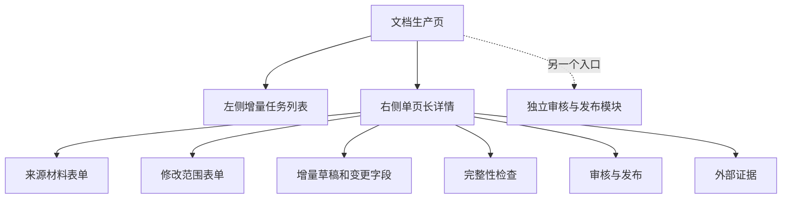
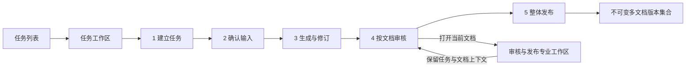
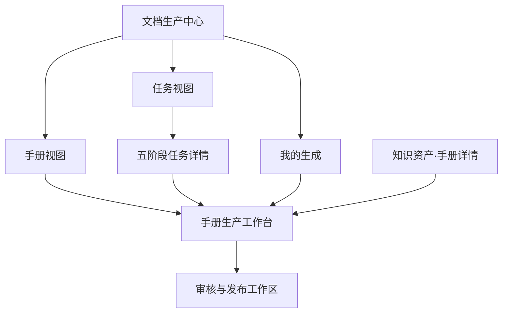

# 知识中心-文档生产-详细设计文档

## 上传预处理产物删除契约（2026-11-05）

`POST /api/document/preprocess` 将解析结果写入隔离的 `doc-processed/<id>.json` 后，列表元数据必须同时保存 `stored_file`。`DELETE /api/document/preprocess/:id` 从同一元数据定位产物，旧元数据缺少该字段时按 `<id>.json` 回退，删除产物和列表项；上传成功后立即删除应返回成功，重复删除返回 404。上传、列表、详情与删除需由真实 HTTP 生命周期测试验收。修复限于该元数据字段，不改变已保存文档的正文或其他模块业务规则。

滚动兼容性引用：采用《知识中心-前端-详细设计文档》的公共视口令牌和滚动契约。正文、桌面目录与辅助区沿用主区滚动，不恢复已取消的局部滚动；窄屏助手、历史与弹窗显式声明局部区域，命令栏声明滚动避让。业务模块不再计算 dvh 高度。

> 文档类型：垂直业务详细设计
> 设计编号：KC-M05-M07-DETAIL
> 上游概要设计：`../02-概要设计/知识中心-文档生产-增量构建垂直业务-概要设计文档.md`
> 关联设计：`./知识中心-平台-详细设计文档.md`、`../02-概要设计/知识中心-知识资产-GitLab手册映射与协作审阅-概要设计文档.md`、`../02-概要设计/知识中心-权限管理-业务角色与资源授权-概要设计文档.md`
> 状态：前端首版已实现（生产视图切换、刷新恢复和任务工作区表单边界有浏览器回归覆盖；全平台 E2E 尚有其他失败；真实业务闭环验收待补）
> 版本：1.5.0
> 更新日期：2026-10-26

本文是文档生产模块唯一业务详细设计，统一覆盖 AI 辅助写作、增量构建任务、变更集、候选版本、评审和平台发布。Agent 分工、阶段契约、权限边界和运行恢复的独立详细设计见[《知识中心-文档生产-Agent架构详细设计》](./知识中心-文档生产-Agent架构详细设计.md)，流程图见[draw.io 架构图](./知识中心-文档生产-Agent流程架构图.drawio)。业务数据与候选/采用事务仍以本文为准。

AI 写作原文来自目标平台文档的 GitLab 映射文件快照；没有 GitLab 仓库、文档映射或对应文件时，初始正文为空白，不以模板内容代替原文。作者未保存编辑作为基线上的工作副本，原文快照与工作副本摘要分别追溯。AI 写作编辑模式提供“当前格式”和“原始 Markdown”两种同步视图，共享同一 Markdown 正文及编辑范围，不因切换自动保存。Job 必须冻结原文 GitLab 定位、快照/内容摘要与草稿修订信息；详细来源契约见[Agent 架构设计](./知识中心-文档生产-Agent架构详细设计.md#原文来源与编辑模式评审补充2026-10-26)。以上双模式与 AI Job 原文绑定当前待实施。

## 1. 目标与定位

### 1.1 模块职责

本文档定义知识中心“文档生产”模块的详细设计，覆盖全局生产管理、增量任务编排、手册级编辑下钻、候选审核和平台发布。其完整业务链路为：

```text
从手册或任务进入生产工作台
→ 生成、修订并固化候选版本
→ 显式发起审核
→ 审核人逐条审阅修改点（行级定位 + 前后对比 + AI 推理链）
→ 追加评论、退回修改或通过
→ 全部审核通过后进入待发布
→ 发布者确认基线、执行发布
→ 新版本生效、旧版本退役
→ 可选登记外部交付证据
```

增量任务的产品规则以上游《增量文档构建 MVP 需求》和概要设计为准；手册级编辑器的布局与交互由受控例外设计《手册级文档生成页面-前端详细设计》补充。本文仍是任务、候选、审核、发布及其全局入口的唯一业务详细设计事实源。

### 1.1.1 交付分层与现状

| 能力 | P0（当前可实现） | P1（本设计预留） |
|---|---|---|
| 审核决定 | 每个目标文档一个审核会话；决定规则由权限和审核策略控制 | 1-3 级串行审核、每级最少通过人数 |
| 评论定位 | 行级评论为审核页面 P0 目标；旧接口无锚点时仅允许全局评论降级 | 锚点漂移自动重定位、跨修订覆盖度分析 |
| AI 解释 | 结构化发现、规则引用、证据片段 | 分析任务异步化、全量 8 类检查与修订覆盖度 |
| 发布 | 多文档 `PublicationBatch` 原子发布 | 更复杂的跨手册批次和外部交付联动 |

P1 启用前必须增加版本化 API 字段，不得改变 P0 `Review` 的既有读取含义；前端根据 `capabilities` 判断是否展示层级等扩展操作。行级评论属于本轮 P0 验收项，若后端暂不支持，必须显示“全局评论（兼容模式）”而不得伪装成行级定位。

### 1.2 核心刚性约束

| 约束 | 实现要求 |
|---|---|
| **修改意见清晰可见且可追溯** | P0 行级评论必须绑定锚点、前后对比和旁路解释，并贯穿候选到发布血缘；旧全局评论仅作兼容降级且不得宣称已完成行级定位 |
| **AI 深度嵌入** | AI 作为审核协作者，主动提供参数依赖检查、版本耦合预警、交叉引用验证和术语一致性分析；所有 AI 输出必须附带 Chain-of-Thought 旁路 |
| **数据库专属准确性** | 审核检查必须覆盖 SQL 语法正确性、配置参数依赖完整性、错误码唯一性、运维命令版本适配等数据库文档特有风险 |
| **在线实时协同** | 所有操作在 Web 端完成；多审核人可并行评论，不互相阻塞 |
| **审核不可代替** | AI 通过不代替人工通过；AI 拒绝不代替人工拒绝；最终决定必须由有权限的人作出 |

### 1.3 非目标

- 不实现 OT/CRDT 实时协同编辑；首期采用异步评论 + 编辑锁。
- 不自动合并或自动发布；知识中心不具备自动合并 GitLab MR 的能力。
- 不在审核阶段修改候选正文；审核评论只记录意见，不直接改变冻结内容。
- 不将 PingCode 未连接状态伪装为已接入；审核中引用的来源快照如实标注捕获方式。

## 2. 对象模型与事实关系

### 2.1 审核领域对象总览

```text
ReviewSession（审核会话）
  ├─ ReviewLevel[]（审核层级）
  │    ├─ ReviewerAssignment（审核人分配）
  │    └─ ReviewDecision（层级决定）
  ├─ ReviewComment[]（审核评论）
  │    ├─ CommentAnchor（行级锚点）
  │    │    ├─ nodeId
  │    │    ├─ lineRange
  │    │    └─ charRange
  │    ├─ DiffView（修改前后对比）
  │    │    ├─ beforeSnippet
  │    │    ├─ afterSnippet
  │    │    └─ operationType
  │    └─ AiAnalysis[]（AI 分析记录）
  │         ├─ analysisType
  │         ├─ reasoningSummary + evidenceRefs
  │         ├─ verdict
  │         └─ confidence
  ├─ ReviewVerdict（最终决定）
  └─ LineageRecord（血缘记录）
       ├─ parentCandidateId
       ├─ revisionChain[]
       └─ publicationId

Publication（发布记录）
  ├─ candidateDigest
  ├─ baselineVersionId
  ├─ supersededVersionId
  ├─ content
  ├─ operations[]
  └─ PublicationBatch（发布批次，多文档原子发布）

ExternalDelivery（外部交付登记）
  ├─ deliveryType（gitlab_mr / manual / other）
  ├─ reference
  ├─ status
  └─ evidence[]
```

### 2.2 审核会话

```text
ReviewSession(
  id,
  taskId,                    // 关联增量任务
  targetDocumentId,          // 本审核会话只对应一个目标文档
  candidateDigest,           // 冻结的候选摘要
  handbookId,
  businessVersion,
  flowVersion,               // 审核流程版本（几级审核、通过规则）
  status,                    // pending | in_progress | approved | rejected | withdrawn
  levels[],                  // 有序审核层级
  finalVerdict,              // 最终决定
  createdBy,                 // 提交审核的人
  createdAt,
  updatedAt,
  completedAt
)
```

- 一个目标文档候选对应一个审核会话；候选固化后必须通过 `POST .../reviews` 显式创建。
- 一个增量任务可以包含多个目标文档，因此同一任务可以创建多个审核会话；审核决定按文档保存，任务级发布门禁汇总全部会话结果。
- `flowVersion` 记录创建时使用的审核流程配置；即使后续流程配置变更，已有会话继续按创建时规则执行。
- 审核拒绝后创建修订任务（`revisionOf` 指回原任务），原会话保持 `rejected` 只读。

### 2.3 审核层级

```text
ReviewLevel(
  ordinal,                   // 层级序号，从 1 开始
  levelName,                 // 例如"技术审核"、"责任审核"
  requiredApprovals,         // 该层级需要通过的最少人数
  assignedReviewers[],       // 有权限在该层级作出决定的人
  status,                    // pending | approved | rejected | skipped
  decidedBy,
  decidedAt
)
```

- 知识空间可配置一级或多级审核；P0 固定单级，P1 才启用 1-3 级并记录 `flowVersion`。
- 角色可以由同一用户承担；是否允许提交者参与审核、是否要求其他审核人通过，由审核策略显式配置并记录在 `flowVersion`，不能从角色名称自行推断。
- 层级按 `ordinal` 顺序执行；前一级未通过时，后续层级不进入活跃状态。

### 2.4 审核评论

```text
ReviewComment(
  id,
  sessionId,
  levelOrdinal,              // 属于哪个审核层级
  authorId,
  commentType,               // question | issue | suggestion | approval_note | ai_analysis
  anchor,                    // CommentAnchor，可选
  diffView,                  // DiffView，可选
  body,                      // 评论正文
  aiAnalyses[],              // 附带的 AI 分析记录
  resolved,                  // 是否已解决
  resolvedBy,
  resolvedAt,
  createdAt,
  updatedAt
)
```

- 评论追加保存，不修改候选正文。
- 每条评论可选绑定行级锚点和修改前后对比；不绑定时为全局评论。
- `commentType` 区分人工评论和 AI 分析入口；AI 分析记录在 `aiAnalyses` 中独立存储。

### 2.5 行级锚点

```text
CommentAnchor(
  documentId,                // 目标文档
  nodeId,                    // 稳定节点身份（非标题、非行号）
  anchorKind,                // after_operation | before_operation | baseline
  lineRange,                 // { startLine, endLine }，可选
  charRange,                 // { startChar, endChar }，可选
  contextBefore,             // 锚点前若干字符的上下文指纹
  contextAfter               // 锚点后若干字符的上下文指纹
)
```

- `nodeId` 使用变更操作中的稳定节点身份，不使用标题文本或行号。
- `anchorKind` 明确锚点参考的是基线原文、操作前状态还是操作后状态，避免审核人和作者在视图间混淆。
- `contextBefore/contextAfter` 作为漂移检测指纹；当节点内容因修订变化时，系统可检测锚点是否仍然有效。

### 2.6 修改前后对比

```text
DiffView(
  operationType,             // add | update | delete | move
  beforeContent,             // 基线或操作前的内容片段
  afterContent,              // 操作后的内容片段
  beforeDigest,              // 操作前内容摘要
  afterDigest,               // 操作后内容摘要
  diffHighlight,             // 结构化差异标记（行级增删标识）
  scopeDescription           // 人类可读的变更范围描述
)
```

- `add` 操作 `beforeContent` 为空；`delete` 操作 `afterContent` 为空。
- `diffHighlight` 提供行级增删标记，前端渲染为红绿对比视图。
- `move` 操作同时包含原位置和新位置信息。

### 2.7 AI 分析记录

```text
AiAnalysis(
  id,
  analysisType,              // 见 2.8 节
  modelId,                   // 使用的模型标识
  promptVersion,             // 提示词版本
  reasoningSummary,          // 可审计的结构化推理摘要（旁路解释）
  evidenceRefs[],             // 使用的候选/基线节点、规则和测试证据
  verdict,                   // pass | warn | fail | info
  confidence,                // 0.0 - 1.0
  findings[],                // 结构化发现项
  ruleRefs[],                // 引用的规则版本
  executedAt
)
```

- 每条 AI 分析必须包含可审计的 `reasoningSummary`、`evidenceRefs` 和步骤化 `findings`；前端以可折叠面板展示“推理摘要（Chain-of-Thought 旁路解释）”。不把模型内部不可验证的思维草稿作为接口契约，也不得写入凭证、隐式系统提示词或其他敏感信息。
- `verdict` 只标记 AI 的判断倾向，不代替人工决定。
- `findings` 为结构化数组，每项包含 `severity`、`message`、`affectedNodeId` 和 `suggestedAction`。

### 2.8 AI 分析类型

| `analysisType` | 中文展示 | 检查内容 |
|---|---|---|
| `syntax_check` | SQL 语法检查 | SQL 示例、DDL/DML 语句的正确性 |
| `param_dependency` | 参数依赖检查 | 配置参数的取值范围、互斥和依赖关系 |
| `version_coupling` | 版本耦合预警 | 变更是否影响其他版本的同一参数或命令 |
| `cross_reference` | 交叉引用验证 | 文档间引用链接的有效性 |
| `error_code_unique` | 错误码唯一性 | 新增错误码是否与已有编码冲突 |
| `terminology` | 术语一致性 | 技术术语是否符合术语表 |
| `scope_completeness` | 范围完整性 | 变更集是否覆盖了来源要求的全部修改点 |
| `operation_safety` | 运维安全性 | 运维命令是否包含风险提示和回退步骤 |

### 2.9 发布记录

```text
Publication(
  id,
  handbookId,
  businessVersion,
  targetKey,
  baselineVersionId,
  candidateDigest,
  content,
  operations[],
  publishedBy,
  publishedAt,
  supersededPublicationId,   // 被替代的旧发布记录
  batchId                    // 发布批次 ID（多文档原子发布时使用）
)
```

- 发布时在同一事务中将相同手册和业务版本的旧 `current` 置为 `false`，再将新发布记录置为 `current=true`。
- `supersededPublicationId` 形成显式的版本替代链。

### 2.10 血缘记录

```text
LineageRecord(
  taskId,
  candidateDigest,
  revisionChain[],           // 修订链：[原始任务ID, 第一次修订ID, ...]
  sourceSnapshotIds[],       // 来源快照
  reviewSessionId,           // 审核会话
  publicationId,             // 发布记录
  previousPublicationId,     // 上一个发布版本
  createdAt
)
```

- 血缘记录从任务创建时开始积累，贯穿修订、审核和发布全生命周期。
- 修订任务的 `revisionChain` 继承原任务的链条并追加自身。
- 血缘记录不可修改，只追加。

## 3. 审核流程状态机

### 3.1 审核会话状态

```text
                    ┌────────────────────────────────────────────────┐
                    │                                                │
                    ▼                                                │
[created] ──→ [in_progress] ──→ [approved] ──→ [published] ──→ [superseded]
                    │                  │
                    │                  └──→ [withdrawn]（发布者撤回）
                    │
                    └──→ [rejected] ──→ 创建修订任务 ──→ [新审核会话]
```

| 状态 | 中文展示 | 允许动作 |
|---|---|---|
| `pending` | 待启动 | 分配审核人、开始审核 |
| `in_progress` | 审核中 | 评论、AI 分析、层级决定 |
| `approved` | 审核通过 | 发布、撤回 |
| `rejected` | 审核拒绝 | 创建修订任务 |
| `withdrawn` | 已撤回 | 重新发起审核（新会话） |
| `superseded` | 已替代 | 只读 |

### 3.2 审核层级状态

```text
[pending] ──→ [approved]（该层级通过）
    │
    └──→ [rejected]（该层级拒绝，会话进入 rejected）
              │
              └──→ [skipped]（前级拒绝后，后续层级标记为 skipped）
```

### 3.3 审核决定规则

```text
单级审核：
  requiredApprovals 由审核策略配置
  提交者是否可审核、是否必须由其他人通过，由审核策略和权限共同决定
  满足策略后审核人通过 → approved

多级审核：
  第 1 级全部通过 → 第 2 级激活
  第 N 级全部通过 → 会话 approved
  任一级别有审核人拒绝 → 会话 rejected

角色兼任规则：
  作者、手册负责人、审核人和发布人可以是同一用户
  具体操作必须同时满足该用户的权限角色和当前审核策略
  规则快照记录在 flowVersion，不从角色名称推断是否允许自审
```

## 4. 审核评论交互设计

### 4.1 评论创建流程

```text
审核人在差异视图中选择文本范围
→ 系统自动关联 nodeId 和行范围
→ 生成 CommentAnchor
→ 自动提取 DiffView（该节点的操作前后对比）
→ 审核人输入评论内容
→ 可选触发 AI 辅助分析
→ 提交评论
```

### 4.2 评论类型与行为

| `commentType` | 行为 | 是否触发 AI |
|---|---|---|
| `question` | 对修改内容的疑问，不阻断通过 | 否 |
| `issue` | 发现的问题，需要作者回应 | 可选 |
| `suggestion` | 修改建议，作者可一键采纳 | 可选 |
| `approval_note` | 通过说明，记录审核理由 | 否 |
| `ai_analysis` | AI 自动或触发的分析结果 | 是（本身就是 AI 输出） |

### 4.3 评论解决

- 评论可标记为 `resolved`；解决不删除评论内容，只标记状态。
- 只有任务创建者或当前层级审核人可标记解决。
- 存在未解决的 `issue` 类型评论时，审核人作出 `approve` 决定前系统显示提醒（不阻断）。

### 4.4 评论权限

| 角色 | 可执行动作 |
|---|---|
| 任务创建者 | 回复评论、标记解决、查看全部 |
| 当前层级审核人 | 创建评论、作出层级决定、查看全部 |
| 其他层级审核人 | 查看该层级评论（只读） |
| 平台管理员 | 查看全部评论，不创建评论或决定 |
| 无权限用户 | 按任务不存在处理 |

## 5. AI 审核协作者设计

### 5.1 触发时机

AI 分析在以下时机触发：

| 时机 | 触发方式 | 分析类型 |
|---|---|---|
| 候选固化时 | 自动 | `scope_completeness`、`syntax_check` |
| 审核会话创建时 | 自动 | 全量分析（8 种类型） |
| 审核人手动触发 | 审核人在评论中 @ai 或点击"AI 分析" | 指定类型 |
| 修订任务创建时 | 自动 | 对比原审核意见，检查修订覆盖度 |

### 5.2 AI 分析输出格式

```text
┌─────────────────────────────────────────────┐
│ 🔍 AI 分析：参数依赖检查                      │
│ 置信度：0.87                                  │
│ 判定：⚠️ 警告                                 │
├─────────────────────────────────────────────┤
│ 推理摘要（Chain-of-Thought 旁路解释）：          │
│                                               │
│ 1. 检测到本次修改涉及参数 max_connections       │
│ 2. 查询参数依赖表，发现 shared_buffers 存在     │
│    联动关系：max_connections ≤ shared_buffers   │
│    × 32                                       │
│ 3. 当前文档中 shared_buffers 章节未同步更新     │
│ 4. 结论：修改可能导致参数配置不一致             │
│                                               │
├─────────────────────────────────────────────┤
│ 发现项：                                      │
│ • [警告] max_connections 修改后，              │
│   shared_buffers 章节（node: param-sb-001）    │
│   可能需要联动更新                             │
│ • 建议：在变更集中增加 shared_buffers 章节      │
│   的联动说明，或在参数说明中增加交叉引用        │
├─────────────────────────────────────────────┤
│ 引用规则：参数依赖规则 v2.3 §4.2               │
│ 模型：yashan-doc-reviewer v1.2                │
└─────────────────────────────────────────────┘
```

### 5.3 AI 分析约束

- AI 分析结果以 `commentType=ai_analysis` 的评论形式保存，与人工评论在同一列表中展示；P0 同步生成摘要，P1 可使用异步任务。
- AI 判定 `fail` 不自动阻断审核通过；系统显示强提醒，由审核人决定是否采纳。
- AI 判定 `pass` 不自动代替审核人通过。
- 所有 AI 输出必须附带结构化推理摘要和证据引用，前端默认折叠、审核人可展开查看；摘要不得声称“模型已执行”未实际执行的数据库验证。
- AI 使用的模型标识、提示词版本和规则版本必须记录，支持事后复盘。
- AI 不读取审核人的历史评论作为自身输入的依据，避免确认偏误；AI 分析只基于候选内容、基线内容和平台规则。

### 5.4 数据库专属检查规则

以下检查规则需要数据库领域知识支持，不能由通用文档审核替代：

| 规则 | 检查内容 | 阻断级别 |
|---|---|---|
| SQL 语法正确性 | 示例 SQL 是否可在目标版本执行 | 警告（需人工确认） |
| 参数依赖完整性 | 修改的参数是否有联动参数未覆盖 | 警告 |
| 错误码唯一性 | 新增错误码是否与已有编码冲突 | 阻断 |
| 运维命令版本适配 | 命令是否适用于目标业务版本 | 阻断 |
| 数据类型兼容 | 新增或修改的数据类型是否在目标版本支持 | 警告 |
| 权限语句完整 | GRANT/REVOKE 示例是否覆盖必要权限 | 信息 |

## 6. 差异视图与修改对比

### 6.1 三级差异视图

审核人查看修改时，系统提供三级视图切换：

| 视图层级 | 展示内容 | 适用场景 |
|---|---|---|
| **结构视图** | 文档大纲的增删改标记，折叠显示变更节点 | 快速了解变更范围 |
| **段落视图** | 按变更节点展开，显示操作前后段落对比 | 逐条审阅修改内容 |
| **行级视图** | 类 diff 的行级增删高亮，支持字符级标记 | 精确检查语法和参数 |

### 6.2 差异视图与评论联动

```text
审核人在段落视图或行级视图中：
1. 选中文本范围 → 系统自动计算 nodeId + lineRange
2. 点击"添加评论" → 弹出评论面板，自动填充 DiffView
3. 评论提交后 → 在差异视图中显示评论标记（气泡图标）
4. 点击标记 → 展开评论详情和 AI 分析
```

### 6.3 锚点漂移处理

当修订任务修改了节点内容后，原审核评论的锚点可能漂移：

- 系统使用 `contextBefore/contextAfter` 指纹检测漂移。
- 锚点仍然有效时正常显示。
- 锚点漂移但可自动匹配时，显示"锚点已偏移"提醒并高亮新位置。
- 锚点无法匹配时，评论标记为"锚点失效"，评论内容保留但不再关联具体位置。
- 修订任务的审核人可以看到原评论及其漂移状态，作为审阅参考。

## 7. 版本血缘追溯

### 7.1 血缘链结构

```text
Publication v1.0（已发布）
  └─ 增量任务 T1
       ├─ 来源快照 S1, S2
       ├─ 变更集 C1（add/update/delete 操作列表）
       ├─ 审核会话 R1
       │    ├─ 层级 1：技术审核 → 通过
       │    └─ 层级 2：责任审核 → 通过
       ├─ AI 分析 A1（全量）
       └─ 发布记录 P1
            │
            └─ Publication v1.0.1（已发布，替代 v1.0）
                 └─ 修订任务 T2（revisionOf: T1）
                      ├─ 来源快照 S3
                      ├─ 变更集 C2
                      ├─ 审核会话 R2
                      │    ├─ 原评论漂移检测
                      │    └─ 修订覆盖度检查
                      └─ 发布记录 P2（supersededPublicationId: P1）
```

### 7.2 血缘查询 API

```text
GET /knowledge-center/api/lineage/handbooks/{handbookId}/business-versions/{version}
```

返回：

```json
{
  "handbookId": "DB-001",
  "businessVersion": "23.4",
  "currentPublication": { "id": "P2", "publishedAt": "..." },
  "lineageChain": [
    {
      "publicationId": "P1",
      "taskId": "T1",
      "candidateDigest": "sha256:abc...",
      "reviewSessionId": "R1",
      "publishedAt": "...",
      "supersededBy": "P2"
    },
    {
      "publicationId": "P2",
      "taskId": "T2",
      "revisionOf": "T1",
      "candidateDigest": "sha256:def...",
      "reviewSessionId": "R2",
      "publishedAt": "...",
      "supersedes": "P1"
    }
  ]
}
```

### 7.3 血缘展示要求

- 每个已发布版本页面显示"版本历史"入口，展示完整血缘链。
- 血缘链中每个节点可展开查看：变更摘要、来源快照、审核决定、AI 分析摘要。
- 修订关系用虚线箭头标注，替代关系用实线箭头标注。
- 点击血缘链中的任意节点可跳转到对应的审核会话详情。

## 8. 发布流程

### 8.1 发布前置检查

```text
POST /knowledge-center/api/incremental-tasks/{taskId}/publish

前置检查：
1. 任务内每个目标文档都有状态为 approved 的审核会话，且满足该文档对应的审核策略
2. 所有候选摘要与提交审核时一致（未被篡改）
3. 所有目标文档当前基线 current=true 且与任务创建时一致
4. 发布者具有全部目标文档的发布权限
5. 所有目标文档均无未解决的阻断级检查项
```

### 8.2 发布执行

```text
发布事务（多文档目标，MVP）：
1. 校验全部目标文档的候选、审核、权限、基线和阻断项
2. 为全部目标文档生成不可变版本记录
3. 在同一事务中原子切换全部当前版本指针
4. 写入一个发布批次记录（PublicationBatch）和各文档发布记录
5. 写入各文档血缘记录和统一审计日志
6. 更新任务状态为 published
7. 任一文档失败 → 全部回滚，不留下部分生效版本
```

### 8.3 发布后动作

- 所有目标文档发布成功后，任务状态变为 `published`；任一文档失败时任务进入 `batch_publish_failed`，可在修复后整体重试。
- 发布记录不可修改；如需修改已发布内容，必须创建新的增量任务。
- 发布后可登记外部交付证据（GitLab MR 编号、CI 结果等）。

## 9. 外部交付登记

### 9.1 交付类型

| `deliveryType` | 中文展示 | 含义 |
|---|---|---|
| `gitlab_mr` | GitLab 合并请求 | 已创建或已合入的 MR |
| `gitlab_ci` | GitLab CI 运行 | CI 构建和检查结果 |
| `manual` | 人工登记 | 手动记录的外部交付 |
| `other` | 其他 | 其他外部系统交付 |

### 9.2 交付登记约束

- 只有 `published` 状态的任务能登记外部交付。
- 交付登记不改变发布内容，只记录外部衔接事实。
- GitLab MR/CI 交付在真实连接器接入前只能人工登记，不得显示为系统已自动同步。
- 交付状态包括：`pending`（待确认）、`success`（成功）、`failed`（失败）。

## 10. API 设计

### 10.1 审核会话

```text
POST   /knowledge-center/api/incremental-tasks/{taskId}/reviews
       创建审核会话（从 candidate_ready 进入 under_review）
       Body: { "Idempotency-Key": "..." }
       Response: 201 ReviewSession

GET    /knowledge-center/api/incremental-tasks/{taskId}/reviews/{reviewId}
       获取审核会话详情（含层级、评论、AI 分析）

POST   /knowledge-center/api/incremental-tasks/{taskId}/reviews/{reviewId}/decision
       P0 作出审核决定（与现有服务契约一致）
       Body: { "decision": "approve|reject", "comment": "...", "Idempotency-Key": "..." }

POST   /knowledge-center/api/incremental-tasks/{taskId}/reviews/{reviewId}/levels/{ordinal}/decide
       P1 多级审核层级决定；仅在能力协商返回 `multiLevelReview=true` 时启用
       Body: { "decision": "approve|reject", "comment": "...", "Idempotency-Key": "..." }

POST   /knowledge-center/api/incremental-tasks/{taskId}/reviews/{reviewId}/withdraw
       撤回审核（仅提交者在发布前可操作）
```

### 10.2 审核评论

```text
POST   /knowledge-center/api/incremental-tasks/{taskId}/reviews/{reviewId}/comments
       创建评论
       Body: {
         "commentType": "issue",
         "anchor": { "documentId": "...", "nodeId": "...", "anchorKind": "after_operation", "lineRange": {...} },
         "diffView": { "operationType": "update", "beforeContent": "...", "afterContent": "..." },
         "body": "...",
         "Idempotency-Key": "..."
       }

GET    /knowledge-center/api/incremental-tasks/{taskId}/reviews/{reviewId}/comments
       获取评论列表（支持按层级、类型、锚点文档过滤）

PATCH  /knowledge-center/api/incremental-tasks/{taskId}/reviews/{reviewId}/comments/{commentId}
       更新评论（仅作者可修改正文；仅创建者或审核人可标记 resolved）
       Body: { "resolved": true }
```

### 10.3 AI 分析

```text
POST   /knowledge-center/api/incremental-tasks/{taskId}/reviews/{reviewId}/ai-analysis
       触发 AI 分析
       Body: {
         "analysisTypes": ["param_dependency", "cross_reference"],
         "scopeNodeId": "...",      // 可选，不指定时分析全部变更节点
         "Idempotency-Key": "..."
       }
       Response: 202 { "analysisId": "...", "status": "processing" }

GET    /knowledge-center/api/incremental-tasks/{taskId}/reviews/{reviewId}/ai-analysis/{analysisId}
       获取 AI 分析结果（含 reasoningSummary、evidenceRefs、findings、verdict）
```

### 10.4 发布

```text
POST   /knowledge-center/api/incremental-tasks/{taskId}/publish
       执行发布
       Body: { "Idempotency-Key": "..." }
       Response: 201 Publication

GET    /knowledge-center/api/publications/{publicationId}
       获取发布记录详情
```

### 10.5 血缘

```text
GET    /knowledge-center/api/lineage/handbooks/{handbookId}/business-versions/{version}
       获取版本血缘链

GET    /knowledge-center/api/lineage/tasks/{taskId}
       获取任务维度的血缘（含修订链）
```

### 10.6 外部交付

```text
POST   /knowledge-center/api/incremental-tasks/{taskId}/external-deliveries
       登记外部交付
       Body: {
         "deliveryType": "gitlab_mr",
         "reference": "MR!1234",
         "status": "pending",
         "note": "...",
         "Idempotency-Key": "..."
       }
```

## 11. 前端展示设计

### 11.1 审核工作台布局

```text
┌─────────────────────────────────────────────────────────────────┐
│ 审核工作台                                          [通过] [拒绝] │
├───────────┬─────────────────────────────────────────────────────┤
│           │  差异视图                                            │
│ 审核进度   │  ┌─ 结构视图 | 段落视图 | 行级视图 ──────────────┐   │
│           │  │                                               │   │
│ ▸ 层级 1  │  │  [基线原文]                    [修改后内容]    │   │
│   技术审核 │  │  ───────────────────────────────────────────  │   │
│   ✅ 通过  │  │  - 旧段落内容（红色删除标记）                  │   │
│           │  │  + 新段落内容（绿色新增标记）                   │   │
│ ▾ 层级 2  │  │                                               │   │
│   责任审核 │  │        💬 评论标记                             │   │
│   ● 进行中 │  │                                               │   │
│           │  └───────────────────────────────────────────────┘   │
│           │                                                     │
│ 审核人：   │  ┌─ AI 分析面板（可折叠）──────────────────────┐    │
│ • 张工 ✅  │  │ 🔍 参数依赖检查 · 置信度 0.87 · ⚠️ 警告     │    │
│ • 李工 🔵  │  │ [展开推理过程 ▼]                            │    │
│           │  │ • max_connections 修改后 shared_buffers       │    │
│ 统计：     │  │   章节可能需要联动更新                       │    │
│ 3/5 评论   │  └──────────────────────────────────────────────┘    │
│ 2 已解决   │                                                     │
│ 1 待回应   ├─────────────────────────────────────────────────────│
│           │  评论区                                               │
│           │  ┌─ 评论列表 ──────────────────────────────────┐     │
│           │  │ 💬 张工 · 行 42-45 · issue                  │     │
│           │  │ "这个参数在 23.4 版本已废弃，应使用新参数"    │     │
│           │  │ [查看对比] [回复] [标记解决]                  │     │
│           │  │                                              │     │
│           │  │ 🤖 AI · 术语一致性 · pass                    │     │
│           │  │ "全部术语符合术语表 v3.1"                     │     │
│           │  └──────────────────────────────────────────────┘     │
│           │  ┌─ 添加评论 ──────────────────────────────────┐     │
│           │  │ [类型: issue ▾] [关联节点: auto]             │     │
│           │  │ [评论内容...]              [🤖 AI分析] [提交] │     │
│           │  └──────────────────────────────────────────────┘     │
└───────────┴─────────────────────────────────────────────────────┘
```

### 11.2 血缘追溯视图

```text
┌─────────────────────────────────────────────────────────────┐
│ 版本历史 · DB-001 产品描述手册 · 23.4                         │
├─────────────────────────────────────────────────────────────┤
│                                                             │
│  v1.0 ──── → v1.0.1 ──── → v1.0.2（当前版本）              │
│  2026-06-15   2026-07-20    2026-09-01                      │
│                                                             │
│  ┌─ v1.0.2 详情 ──────────────────────────────────────┐    │
│  │ 任务：增量修改任务-更新安装前检查说明                    │    │
│  │ 修订自：T1（原始任务）                                 │    │
│  │ 审核：R2 · 技术审核✅ + 责任审核✅                     │    │
│  │ AI 分析：8 项检查通过，1 项警告已人工确认               │    │
│  │ 来源：人工录入 × 1                                    │    │
│  │ 发布：2026-09-01 by 王工                              │    │
│  │ 外部交付：MR!1234（已合入）                            │    │
│  │ [查看审核详情] [查看变更集] [对比上一版本]              │    │
│  └──────────────────────────────────────────────────────┘    │
│                                                             │
└─────────────────────────────────────────────────────────────┘
```

### 11.3 前端展示约束

- 所有状态、类型和动作使用中文展示。
- AI 分析面板默认折叠；展开时显示完整 Chain-of-Thought。
- 差异视图中的评论标记不遮挡正文内容。
- 血缘链中的修订关系和替代关系使用不同视觉样式区分。
- 没有真实数据时显示空态，不构造审核、评论或版本记录。
- 外部交付标记为“人工登记”时，不显示为系统已自动同步。

### 11.4 P0 前端实施契约

审核工作台只服务一个判断：审核人是否可以对当前候选版本作出通过或退回决定。默认视图采用“主阅读区 + 上下文侧区 + 固定决策栏”，不同时展开四个同等权重的面板。

| 区域 | 默认内容 | 必须支持的状态 |
|---|---|---|
| 页头 | 手册、业务版本、候选摘要、审核状态、数据更新时间 | 候选摘要变化、读取失败 |
| 摘要带 | 变更文档数、阻断项、警告、未解决评论、基线版本 | 空值显示“0/未知”，不得伪造统计 |
| 主阅读区 | 结构/段落/行级差异；选中文本创建评论 | 行级可用、全局评论兼容模式、锚点漂移/失效 |
| 上下文侧区 | 当前节点的基线、候选、AI 推理摘要、证据和规则版本 | AI 处理中、无分析、分析失败 |
| 评论区 | 全部/我的/阻断/未解决筛选；评论与 `nodeId` 双向定位 | 草稿保留、冲突、无权限 |
| 决策栏 | “退回并说明”“通过审核”；发布另起确认页 | 进行中、成功、失败、冲突 |

P0 必须实现行级定位：评论请求携带 `documentId/nodeId/lineRange/charRange`、锚点上下文指纹和候选摘要。若服务端能力协商不支持锚点，只能进入“全局评论（兼容模式）”，并在页面和审计中明确标注。

发布按钮不与审核决定并列。发布确认必须依次展示候选摘要、当前基线、影响文档、阻断项和外部交付状态，用户二次确认后才提交 `expectedCandidateDigest`。

页面视觉遵循乔布斯式产品原则：高对比正文、稳定网格、单一动作色、无渐变和装饰性大卡片；图标使用 Lucide 并带中文无障碍名称；所有状态同时使用文字、图标和颜色；动画仅用于状态变化且支持 `prefers-reduced-motion`。

## 12. 审计日志

### 12.1 必记事件

| 事件 | 记录内容 |
|---|---|
| 审核会话创建 | 主体、任务、候选摘要、流程版本 |
| 审核人分配 | 层级、审核人、分配者 |
| 层级决定 | 层级、决定类型、审核人、说明 |
| 评论创建 | 作者、类型、锚点、评论 ID |
| 评论修改 | 评论 ID、修改前后正文摘要 |
| 评论解决 | 评论 ID、解决者 |
| AI 分析触发 | 分析类型、触发方式、操作者 |
| AI 分析完成 | 分析 ID、判定、置信度、模型版本 |
| 发布执行 | 发布者、候选摘要、旧版本、新版本 |
| 发布撤回 | 撤回者、原因 |
| 修订任务创建 | 原任务、修订链 |
| 外部交付登记 | 交付类型、引用、状态 |

### 12.2 审计约束

- 审计记录不记录令牌、密码或无必要的敏感正文。
- AI 分析仅保留结构化推理摘要和证据引用；提示词输入中的凭证信息脱敏，模型内部思维草稿不进入审计数据。
- 审计记录不可修改，只追加。

## 13. 测试与验收门禁

### 13.1 审核流程测试

- 单级审核：由权限和 `flowVersion` 审核策略决定提交者是否可以兼任审核人；满足该策略后会话进入 `approved`。
- 多级审核：前级未通过时后续层级不激活；全部通过后会话进入 `approved`。
- 自审场景：提交者是否可以作为审核人，以及是否需要其他审核人通过，由审核策略决定并记录在 `flowVersion`。
- 审核拒绝后可创建修订任务；修订任务的新审核会话独立于原会话。
- 撤回审核后原会话进入 `withdrawn`，可重新发起新会话。

### 13.2 评论与锚点测试

- 评论创建时自动关联 `nodeId` 和行范围。
- 锚点使用 `contextBefore/contextAfter` 指纹；修订后锚点漂移时正确检测和标记。
- 锚点完全失效时评论保留但标记为"锚点失效"。
- 评论类型、层级过滤正确。
- 只有授权角色可创建评论和标记解决。

### 13.3 AI 分析测试

- 候选固化时自动触发 `scope_completeness` 和 `syntax_check`。
- 审核会话创建时自动触发全量分析。
- 手动触发指定类型分析正确执行。
- AI 分析结果以评论形式保存，包含 `reasoningSummary`、`evidenceRefs` 和结构化发现项。
- AI `fail` 不自动阻断审核通过；AI `pass` 不自动代替审核人通过。
- AI 分析不读取审核人历史评论作为输入依据。

### 13.4 发布测试

- 发布前置检查：审核通过、候选摘要一致、基线 current。
- 发布事务原子性：旧版本 `current=false` 和新版本 `current=true` 在同一事务中完成。
- 发布失败不改变原发布基线。
- 发布后可登记外部交付证据。
- 已发布任务创建修订任务时正确继承血缘链。

### 13.5 血缘追溯测试

- 血缘链正确记录从任务到发布的全生命周期。
- 修订任务的 `revisionChain` 正确继承和追加。
- 血缘查询 API 返回完整链条，包含审核和 AI 分析摘要。
- 前端血缘视图正确展示修订和替代关系。

## 14. 增量构建任务与候选版本

- 增量任务固定手册、正式基线、变更范围、责任人和输入证据；任务运行期间不跟随最新大纲或模板漂移。
- 草稿可反复保存，提交时执行完整性检查并固化不可变候选版本；候选包含文档集合、内容摘要、来源、模板和变更集。
- 同一业务命令使用幂等键；任务、草稿和候选写入使用乐观锁。基线变化返回冲突，不覆盖他人修改。
- 候选进入审核后正文不可原地修改；退回修改产生新修订并保留血缘。发布以完整候选集合为单位，禁止部分文档成功后推进正式状态。
- 文件仓储只保存不可变内容产物，数据库保存稳定引用、摘要、状态、关系和审计。正式文档资产仓储未完成前不得把聚合记录宣称为最终基线。

## 15. GitLab MR 交付

```text
已审核候选 → 校验 GitLab 基线 → 创建受控分支
→ 写入结构化变更 → 创建 MR → 人工审核与合并
→ 回读 MR/CI/默认分支事实 → 平台发布前检查 → 登记正式版本
```

- GitLab 默认分支是启用写回后的外部正式文档事实源；平台候选和 MR 分支都不是正式版本。
- 每次写回固定项目、目标分支、基线 SHA、路径、候选摘要和操作者；基线漂移停止写入并要求重新比较。
- 平台不得自动合并 MR，不得以人工填写链接或文字替代真实 MR、CI 和合并状态。
- 重试复用同一交付任务和幂等键；创建分支、提交或 MR 后失败时保存远端对象 ID，恢复流程先查询事实再补偿。
- 用户 GitLab OAuth 权限、平台允许写入范围和候选业务权限取交集，凭据只由平台连接器使用。

## 16. 统一验收门禁

- 使用真实任务完成草稿、完整性检查、候选固化、评论、审核、修订和发布。
- 角色是否可以兼任以及审核是否需要其他人通过，不由页面判断；由服务端按角色权限和 `flowVersion` 审核策略校验。
- 多文档候选发布要么全部成功，要么正式基线和状态均不变化。
- GitLab 写回通过隔离项目真实验证分支、提交、MR、CI、人工合并、失败恢复和重复请求。
- 页面入口、差异、行级评论、全文意见、审核动作和状态恢复在桌面及移动视口通过端到端验证。

## 17. 文档维护边界

任务拆分、评审意见、一次性决策请求和验收记录进入工作流或报告目录，不再放入详细设计目录。本文只保留当前状态机、接口、数据、权限、失败恢复和验收契约。

## 18. 任务视图内的增量 MVP 五阶段流程

### GitLab 映射正文作为增量编辑初稿（2026-10-15 修复）

任务页在确认输入阶段读取手册现有 GitLab 映射、允许的分支和语言路径内的 Markdown 树；用户明确选择文件后读取正文、路径和提交 ID，将正文作为 `local` 来源快照固化，引用记录分支、路径及提交。仓库正文仅为编辑初稿，任务创建时选择的平台已发布基线仍是审核和发布的版本门禁；不得把仓库提交当作平台基线。读取失败、无映射、无权限、空文件或未取得提交标识时不得显示为已固化。已保存草稿不得被重新读取的正文覆盖。

页面信息层级：任务及平台基线 → 手册映射/分支/语言/文件/提交 → 来源快照与目标文档 → Markdown 草稿及变更操作 → 检查、候选、审核、发布状态。选中章节必须具有确定的所属文档 ID；未知映射阻止范围提交。新文档使用 `add` 变更操作，现有节点更新需人工提供真实的基线节点指纹，页面不得伪造。继续复用来源、范围、草稿、检查、候选、审核和发布接口；自动生成、PingCode 正文读取及仓库写回不在本次修复范围。

备选方案是新增服务端“仓库文件直达增量草稿”接口，由服务端冻结 GitLab 修订并计算操作集，操作更短，但需新建映射、差异和冲突契约；本轮采用现有接口以限制改动范围。

手册级单文档编辑页面的布局、目录过滤、草稿编辑、参考资料弹框和评审批次交互不在本模块详细设计中展开，统一见 [手册级文档生成页面前端详细设计](./知识中心-文档生产-手册级文档生成页面-前端详细设计文档.md)。本文只保留这些页面需要遵守的业务状态、权限和审核发布边界。

> 本节的五阶段任务结构已确认，作为第 19 节全局生产中心“任务视图”的内部详情保留，不再独占文档生产模块首页。关联决策见 `../07-决策与风险/知识中心-文档生产-增量构建前端流程骨架-决策记录文档.md`。

### 18.1 设计目标

前端先建立用户能够理解和恢复的完整流程骨架，再按阶段接入来源、生成、审核和发布细节。唯一核心意图是：用户进入一个增量任务后，始终知道任务目前在哪一步、当前要完成什么、哪些文档被阻塞、下一步会产生什么结果。

当前页面基于代码证据的结构如下：



该结构已经具备工程骨架，但把不同阶段的表单同时展开，阶段主任务不突出；审核操作同时出现在文档生产详情和独立审核模块，容易形成两套入口；外部证据不属于本次 MVP，却占据正式进度步骤。

建议结构：



五个阶段表达用户结果，不暴露内部服务步骤：

| 阶段 | 用户要完成的事 | 阶段完成结果 |
|---|---|---|
| 建立任务 | 选择手册、业务版本和一个或多个已发布文档基线 | 形成可恢复的增量任务 |
| 确认输入 | 选择 Markdown/PingCode 来源、目标文档与章节、大纲和双模板 | 形成冻结输入摘要 |
| 生成与修订 | 启动 Agent，查看进度，编辑草稿并解决范围或质量问题 | 各目标文档形成可提交候选 |
| 按文档审核 | 逐文档查看差异、证据和意见，人工或 Agent 修订 | 每个目标文档形成独立审核结果 |
| 整体发布 | 汇总所有文档门禁并确认批量发布 | 全部文档原子切换为新版本，或全部保持原版本 |

### 18.2 桌面界面简图

当前界面：

```text
┌ 文档生产                                      [创建增量任务] ┐
├ 增量任务 | 文档生成工作台                                     ┤
├──────────────┬───────────────────────────────────────────────┤
│ 任务列表      │ 任务标题 + 七步进度                            │
│ 任务 A        ├───────────────────────────────────────────────┤
│ 任务 B        │ 来源表单                                      │
│ 任务 C        │ 范围表单                                      │
│               │ 草稿 + 技术变更字段                            │
│               │ 完整性检查                                    │
│               │ 审核与发布                                    │
│               │ 外部证据                                      │
└──────────────┴───────────────────────────────────────────────┘
```

建议界面：

```text
┌ 文档生产                                      [创建增量任务] ┐
├──────────────┬───────────────────────────────────────────────┤
│ 任务列表      │ 任务名称  当前状态              [当前主操作]  │
│ 搜索/状态     │ 1 建立任务—2 确认输入—3 生成修订—4 审核—5 发布│
│ 任务 A ●      ├──────────────────────────────┬────────────────┤
│ 任务 B        │ 当前阶段主工作区              │ 任务摘要/门禁 │
│ 任务 C        │ 只显示本阶段必须处理的内容    │ 文档状态清单   │
│               │ 多文档时按文档切换            │ 阻断与恢复入口 │
│               │                               │ 来源/版本证据  │
│               ├──────────────────────────────┴────────────────┤
│               │ 上一步 / 保存并继续 / 重试或返回              │
└──────────────┴───────────────────────────────────────────────┘
```

优化收益：

- 删除 MVP 外部证据步骤，避免用户把平台发布与外部交付误认为同一完成条件；外部证据保留为发布后的次要信息，不进入主进度。
- 简化长表单为阶段工作区，同一时刻只有一个清晰主任务；已完成阶段可回看，但不能绕过业务门禁。
- 强化右侧任务摘要和文档级状态，让跨多个文档的审核结果与任务级原子发布条件同时可见。
- 复用独立审核工作区处理差异和评论；文档生产页只展示文档审核状态和“进入审核”动作，避免维护两套审核交互。
- 不要求用户填写文档 ID、节点 ID 或 `beforeDigest` 等内部字段；骨架使用业务名称和结构选择器，接口未接入时显示明确的“能力待接入”状态。

### 18.3 关键页面状态

每个阶段必须区分 `加载中 / 可处理 / 空数据 / 无权限 / 阻断 / 执行中 / 失败可重试 / 已完成`。异步 Agent 运行不得靠浏览器本地计时器伪造进度；没有真实事件契约时展示最后一次服务端状态和手动重新读取入口。

多文档任务使用文档级状态清单：`待生成 / 生成中 / 待确认 / 审核中 / 已退回 / 已通过 / 发布失败 / 已发布`。任务级“待发布”只能由全部文档的真实门禁汇总得出。

### 18.4 响应式和可访问性

- `>= 1200px` 使用任务列表、阶段主区、上下文侧区三栏；`768px–1199px` 将上下文侧区折叠为抽屉；`< 768px` 任务列表与任务详情切换为独立视图。
- 阶段条可横向滚动但不得成为唯一导航；标题同时显示“第 N 步，共 5 步”。
- 主操作、阶段错误摘要和恢复入口必须可键盘访问；表单错误同时出现在字段附近，并由聚焦错误摘要链接到字段。
- 阶段主区内的输入控件不得因固有宽度溢出卡片或覆盖上下文侧区；辅助侧栏、抽屉和 sticky 区域不得拦截主工作区可见按钮的指针事件。
- 状态不能只靠颜色表达；阻断、成功和执行中同时使用文字与图标。

### 18.5 前端骨架实施边界

第一批前端先实施页面路由、阶段导航、任务摘要、多文档状态清单、空/错/无权/待接入状态和现有真实动作的重新编排。对于尚未具备后端契约的能力，入口仍允许用户完成“选择文件、填写链接、确认模板、启动生成、体验发布确认”等界面操作，但只能记录前端意图并明确标注“等待接口接入”，不得写入正式业务事实、伪造成功或改变正式版本。现有 API 行为和正式业务状态不得因视觉骨架调整而改变。

## 19. 全局文档生产中心与手册工作台联动

> 本节采用已确认的“方案三：手册与任务双视图生产驾驶舱”。决策依据见 `../07-决策与风险/知识中心-文档生产-全局生产中心与手册工作台联动-决策记录文档.md`。手册视图首版已实现；任务和待办继续复用现有任务工作区，展示内容以真实接口投影为准。

### 19.1 对象层级与产品意图

全局“文档生产”首先回答“哪些手册正在生产、哪些任务需要处理、我现在应该做什么”，而不是先要求用户选择一个内部生成器。



```text
手册：全局生产管理单元
  → 生成/增量任务：一次可恢复、可审核的生产活动
    → 文档：具体编辑和按文档审核的单元
```

一个任务可跨同一手册的多个文档和多个章节；文档分别审核，所有目标文档门禁通过后一次性原子发布。手册、任务和文档的多个视图必须投影同一组服务端业务事实。

### 19.2 全局生产中心的三个视图

| 视图 | 主要用户问题 | 默认组织方式 | 主操作 |
|---|---|---|---|
| 手册视图 | 每本手册生产到什么程度，下一步要处理什么？ | 按手册展示所属产品、负责人、当前阶段、待处理事项和最近发布 | 点击手册行或卡片进入工作台 |
| 任务视图 | 一次生产活动目前到哪一步？ | 按状态、手册、负责人和更新时间组织任务 | 继续第 18 节的五阶段任务 |
| 我的生成 | 我发起或实际参与的生成运行到了哪一步？ | 按当前用户与生成运行的真实参与关系展示运行、草稿和结果 | 查看生成进度、关联草稿或生成结果 |

手册视图是首次进入的默认视图，之后保留用户最近一次手动选择的视图、筛选和分页。“我的生成”只展示服务端确认由当前用户发起或实际参与的生成运行，不将可读任务、审核、发布、来源确认或冲突处理改名为个人生成记录。
手册视图的列表是可点击的导航区，不再额外放置“进入工作台”按钮。用户点击手册名称、产品信息区或该行的任意非操作子元素均进入同一手册工作台；键盘焦点进入该行时使用 Enter 执行相同操作。

手册视图只展示至少有一个 `state/status=published` 大纲的手册。大纲目录是状态事实源，按 `handbookId`（兼容 `manualId`）关联手册资产；草稿、确认中、已归档或已替代大纲不满足准入条件。目录读取失败时显示错误与重新读取操作，不将未知状态当作已发布。搜索框只按已准入手册名称即时筛选，展示命中数，空结果提供可理解提示；输入不重绘页面，保留焦点和光标，`q` 用于刷新恢复。

### 19.3 桌面界面简图

```text
┌ 文档生产                                                           ┐
│ [手册视图]  [任务视图]  [我的生成]       搜索手册 / 产品 / 负责人   │
├────────────┬──────────────┬──────────────┬──────────────┬─────────┤
│ 手册       │ 所属产品     │ 负责人       │ 当前进展     │ 最近发布│
├────────────┼──────────────┼──────────────┼──────────────┼─────────┤
│ mysql模式  │ YashanDB     │ 张三         │ 生产中 · 2项 │ v6      │
│ 参考手册   │              │              │ 待处理 · 3项 │ 2026-09 │
├────────────┼──────────────┼──────────────┼──────────────┼─────────┤
│ 系统参数   │ YashanDB     │ 李四         │ 已完成       │ v3      │
│ 手册       │              │              │ 无待处理事项 │ 2026-08 │
└────────────┴──────────────┴──────────────┴──────────────┴─────────┘
提示：点击任意手册行进入该手册的生产工作台；不额外增加“进入工作台”按钮。
```

手册列表字段的产品判断：

- **手册名称**：必需，用于识别和进入工作台。
- **所属产品**：合理且建议保留。当不同产品存在同名或相近手册时，帮助用户确认上下文；若产品名称与手册名称始终一一对应，可在视觉上弱化，但不建议删除业务字段。
- **负责人**：合理且建议保留，用于明确当前协作对象和待处理责任；展示服务端返回的业务姓名，不展示账号、内部 ID 或技术角色键。
- **当前进展**：必需，用用户语言表达“生产中、待处理、已完成、未开始”等结果，不显示“阻断”等内部治理术语。若有多个待处理事项，显示数量和可理解的原因，例如“待确认 2 项”“待审核 1 项”“来源待补充”。
- **最近发布**：建议保留，帮助用户判断手册的新鲜度；没有发布事实时显示“暂无发布版本”，不得填充演示版本号。

列表是导航，不是数据详情页。点击整行进入工作台；只有筛选、分页、菜单、复选框等明确的操作控件不触发行导航。进入后浏览器标题和面包屑应明确当前手册，返回时恢复手册列表的筛选、分页和滚动位置。

列表复用公共“显示字段”抽屉。默认显示手册、所属产品、负责人、当前进展和最近发布；用户可以隐藏除“手册”以外的字段、调整字段顺序或恢复默认。手册名称作为核心识别字段始终显示。每次调整立即持久化并完整重绘当前页面，重绘后恢复抽屉、焦点和滚动上下文；旧 `kc-production-handbook-columns` 数组偏好在首次读取时迁移到带用户范围和 Schema 版本的公共存储键。不提供列宽和固定列设置。字段设置只改变展示，不改变服务端查询、权限和事实范围；没有真实字段值时显示“暂无发布版本”“未分配”或“暂不可用”，不得用前端示例数据补齐。

### 19.4 点击手册后的手册生产工作台

```text
┌ 文档生产 / mysql模式参考手册                         [返回手册列表] ┐
│ 所属产品：YashanDB   负责人：张三   当前进展：生产中 · 待处理 3 项   │
│ [全部文档] [只看我负责]                       [创建增量任务]        │
├────────────────┬────────────────────────────────┬───────────────────┤
│ 文档目录       │ 当前文档                         │ 当前任务与引用     │
│                │                                │                   │
│ 1 概述         │ 参数说明                         │ 任务：新增参数说明 │
│ 2 安装         │ [预览] [编辑] [保存]             │ 阶段：确认输入     │
│ 3 配置 ●       │                                │ 来源：3 项         │
│  3.1 参数说明  │ 模板正文骨架 / 已保存草稿         │ 待处理：来源确认   │
│  3.2 连接配置  │                                │ [查看任务详情]     │
│ 4 使用         │ [全局预览]                       │                   │
├────────────────┴────────────────────────────────┴───────────────────┤
│ 页面状态：已保存 · 最近保存 10:32                 [提交评审]        │
└────────────────────────────────────────────────────────────────────┘
```

打开后的信息层级必须遵循：

1. **先确认手册上下文**：标题、所属产品、负责人和当前进展只在页头出现一次。
2. **再处理具体文档**：左侧目录选择文档，中间编辑或预览；不要求用户重新选择产品或手册。
3. **最后处理任务上下文**：右侧只展示与当前文档或当前任务直接相关的来源、阶段和待处理事项；不把技术字段或内部 ID 作为用户操作内容。
4. **主操作固定**：编辑器操作使用“预览、编辑、取消、保存、全局预览”；任务操作使用“查看任务详情”“提交评审”，是否可用由服务端能力和门禁决定。

工作台中的“查看任务详情”打开任务视图，保留 `handbookId`、`taskId` 和 `documentId`；从任务视图返回时恢复当前文档和任务阶段。工作台不复制任务五阶段表单，不在此处重新实现审核差异和发布事务。

切换到“任务视图”后，保留“左侧任务列表 + 中间阶段工作区 + 右侧任务摘要/门禁”结构。方案三仅改变它在全局信息架构中的位置，不取消已确认的阶段、状态和门禁。

### 19.5 两类入口与同一工作台

| 入口 | 已确定上下文 | 进入后行为 | 返回行为 |
|---|---|---|---|
| 文档生产中心 → 手册视图 | 手册 | 打开该手册的生产工作台 | 回到手册视图原筛选、分页和滚动位置 |
| 文档生产中心 → 任务视图 | 手册、任务，可选文档 | 继续五阶段任务，需编辑时下钻同一手册工作台 | 回到原任务和阶段 |
| 我的生成 | 生成运行、手册、任务和可选草稿 | 查看当前生成进度、失败原因或结果 | 回到原生成列表与位置 |
| 知识资产 → 手册详情 → 文档生产 | 手册，可选文档 | 不再重复选择手册，直接打开同一手册工作台 | 回到该手册的知识资产详情 |

所有入口最终使用同一路由和同一状态事实：

```text
/knowledge-center/production/handbook/{handbookId}
  ?taskId={taskId}
  &documentId={documentId}
  &from={assets|production|generation|todo}
```

`from` 只控制面包屑和安全返回目标，不改变数据权限或业务状态。筛选、分页、视图和滚动位置优先通过同源、受控的导航状态恢复；不接受任意外部 `returnTo` URL。刷新或直达时即使缺少来源上下文，仍必须能由 `handbookId/taskId/documentId` 恢复业务上下文。

### 19.6 状态、权限与失败恢复

- 三个视图必须区分 `加载中 / 就绪 / 空数据 / 失败 / 无权限 / 数据已过期`，不得用空卡片代替错误或无权。
- 全局生产视图以 URL 查询参数 `view` 作为唯一恢复事实：`handbooks`（或缺省）表示手册视图，`tasks` 表示任务视图，`generations` 表示我的生成；过渡期访问 `view=todo` 必须规范化为 `view=generations`，不再展示伪个人待办。带 `taskId` 的任务深链进入任务视图。切换页签须同步 URL 和 `aria-selected`，不得再维护一份可能覆盖 URL 的内存视图状态；刷新和直达必须恢复相同视图。
- 手册统计、任务阶段、待办和门禁均由服务端投影；前端不得猜测负责人、审核通过或发布资格。
- 服务端投影中的负责人、版本标签等可选对象字段允许为空；渲染器必须将 `null`/缺失值按“未分配”“未设置”或明确空态处理，不能因可选字段空值抛出客户端异常并中断整页渲染。
- 用户可以同时拥有作者、手册负责人、审核人或发布人角色，具体动作由权限与审核策略决定；提交者不得作为唯一有效通过人。
- 打开的任务或文档已删除、已无权或已被新修订替代时，页面需要说明影响并提供返回原列表或打开最新版本的可恢复动作。
- 没有真实接口的统计、进度或待办必须显示“待接入”及依赖，不得用浏览器本地数据伪造已完成事实。
- 旧文档生成器保留迁移期兼容入口并在新标签页打开；它是辅助入口，不能替代默认手册视图或成为文档生产中心的唯一主流程。任务投影读取失败时，即使当前 URL 请求任务视图，也必须显示明确错误和重新读取动作。

### 19.7 响应式与可访问性

- `>= 1200px` 完整展示三视图切换、筛选和主内容；`768px–1199px` 将次要筛选收入抽屉；`< 768px` 使用单列卡片或列表，不横向压缩桌面表格。
- 视图切换使用标准页签语义，键盘可达，并将当前视图投影到 URL 或等价的可恢复导航状态。
- 手册、任务和待办状态不能只靠颜色表达；下钻和返回后焦点回到原操作项。

### 19.8 与既有设计的冲突与处理

| 既有设计 | 冲突判断 | 处理结论 |
|---|---|---|
| 历史入口收敛要求将“文档生产”唯一入口跳转 `/prompt-generator.html`；原需求现已重组为[《AI文档生产需求》](../01-需求/知识中心-AI文档生产-需求文档.md) | 历史唯一跳转要求与全局生产中心冲突；新需求定义业务能力，不再规定该跳转 | 兼容与退场沿用全局生产中心联动决策；`/prompt-generator.html` 仅保留旧书签和兼容跳转，退场时间另行决策 |
| 已确认的任务三栏工作区作为生产首页 | **信息架构冲突**：它只能解释任务，无法总览全部手册 | 保留为“任务视图”的内部结构，不再独占模块首页；五阶段、审核衔接和诚实状态规则继续有效 |
| “每本手册一个独立编辑页面、一次编辑一篇文档” | **无冲突** | 作为手册视图、任务视图和知识资产的统一下钻工作台；补充入口来源和返回恢复，不重做编辑器 |

### 19.9 实施边界与验收

第一批已建立全局生产中心的三视图容器、手册列表字段设置、整行下钻和现有手册工作台复用；任务/待办继续复用既有任务工作区。不在全局页重做文档编辑器、差异审核器或发布事务。真实多手册数据、权限投影和浏览器端到端返回恢复仍需在共享环境验收。

可观察验收标准：

1. 文档生产首页可在手册视图、任务视图和我的生成之间切换，我的生成只展示当前用户的真实运行事实，不再以旧生成器跳转作为唯一主内容。
2. 从全局手册视图与从知识资产手册详情进入，打开同一手册、任务和文档时，读取到的草稿、模板、引用、状态和权限一致。
3. 从手册工作台返回后，原视图、筛选、分页和可见列表位置恢复；刷新或深链不丢失手册、任务和文档上下文。
4. 任务视图仍能完成五阶段流转，按文档审核和任务级原子发布规则不因首页改版而改变。
5. 无权、空数据、读取失败、状态过期和能力待接入可见区分，不伪造任务、进度、待办或发布成功。
6. 在 1440px、1024px、768px 和 390px 视口完成键盘、焦点、溢出和主路径验证；视图往返、URL 深链/刷新恢复及可选投影字段为空的场景必须由浏览器回归用例覆盖。
## 20. 审核阅读目录面板页面级规格（2026-09-24）

审核与发布的文档目录是常驻文档导航树，不承担分工过滤或目标选择。默认宽度 260px，可在 220–420px 内拖动；折叠为 48px 窄栏。已有搜索、当前文档和专注阅读能力继续保留。分隔条支持鼠标、方向键、Shift 加方向键、双击恢复默认和 Escape 取消拖动，宽度及折叠状态按 `review` 记忆。

折叠目录不能遮挡正文，专注阅读模式继续隐藏目录；移动端隐藏拖拽条，目录改为不超过 240px 的上方阅读选择区或抽屉。审核目录中的当前文档必须通过 URL 和服务端返回状态恢复，不能依赖浏览器本地选中状态。

## 21. 工作台与“我的生成”业务边界（2026-09-28）

本模块不新增独立的“个人工作台”。平台已经存在统一工作台，负责跨模块总览和当前用户相关的“待我处理”摘要；文档生产模块中的“我的生成”是独立的领域视图，只负责展示当前用户发起或参与的生成运行、草稿和结果。

三者边界如下：

| 视图 | 负责回答 | 事实范围 | 不负责 |
|---|---|---|---|
| 平台工作台 | 平台有哪些风险、进度和与我相关的下一步 | 跨模块摘要投影 | 维护文档生产运行详情 |
| 文档生产中心-我的生成 | 我发起或参与的生成运行到哪一步 | 生成运行、草稿和结果 | 聚合审核、发布等跨模块待办 |
| 手册级生产工作台 | 如何处理某一本手册或某一篇文档 | 当前手册、文档和任务上下文 | 重新定义全局待办 |

### 21.1 平台工作台中的个人摘要规则

- 当前用户对关联对象具有读取权限；
- 当前状态要求当前用户动作；
- 下一动作由权限、审核策略和对象状态共同确认；
- 关联对象存在稳定的手册、任务、文档或审核标识；
- 工作项能够提供原因和恢复路径。

仅因为角色、手册归属、本地未提交状态或依赖失败，不得生成个人待办。

### 21.2 工作项类型

| 类型 | 触发事实 | 下一动作 |
|---|---|---|
| document_edit | 当前用户负责文档且草稿未完成 | 继续编辑 |
| source_confirm | 来源已读取但等待当前用户确认快照 | 确认来源 |
| review_comment | 当前用户作为作者，存在未处理审核意见 | 处理意见 |
| review_decision | 当前用户具有有效审核权限且候选待审核 | 进入审核 |
| publication_confirm | 所有文档门禁满足且当前用户有发布权限 | 确认发布 |
| conflict_resolution | 基线或版本冲突，需要用户选择处理方式 | 查看冲突 |

### 21.3 状态、权限和接口

状态必须区分：

~~~text
loading → ready → empty
                 ↘ unavailable
                 ↘ forbidden
                 ↘ stale
~~~

平台工作台继续使用统一工作台投影接口返回个人摘要，不新增 `personal-workspace` 独立接口。文档生产中心“我的生成”使用生成域接口，例如：

`GET /knowledge-center/api/production/generations?scope=mine`

生成列表返回当前用户的生成运行、草稿引用、结果摘要、失败原因和下一步查看动作；不能把生成记录转换成审核或发布待办。`scope=mine` 必须在服务端使用当前会话用户计算，不接受浏览器传入任意 `userId`。

生成运行的个人关联使用稳定用户标识，按以下规则投影：

- `initiatedBy` 为运行发起人；缺失时仅对旧数据回退为所属任务 `createdBy`，并在投影中标记 `association=task_creator_fallback`。
- `participants` 只记录真实启动、重试或确认使用该生成结果的用户；只具备查看、审核或发布权限不构成生成参与关系。
- 任务不存在持久化 `generationRun`/`generationRuns` 时，不得为了填充列表伪造一次生成运行。
- 运行投影至少包含 `generationId` 、`taskId` 、`handbookId` 、`status` 、`initiatedBy` 、`participants` 、`draftRef` 、`resultSummary` 、`failureReason` 、`nextAction` 和 `updatedAt`；不返回模型密钥、完整提示词或敏感运行上下文。
- 页面分别展示 `loading / ready / empty / unavailable / forbidden / stale`；不使用前端用户名比对代替服务端隔离。

工作项打开使用：

~~~text
/knowledge-center/production/handbook/{handbookId}
  ?taskId={taskId}&documentId={documentId}&from=todo&workItemId={workItemId}
~~~

作者、手册负责人、审核人和发布人可以由同一用户承担，但平台摘要必须由权限、审核策略和对象状态共同产生。完成动作后平台工作台重新读取服务端投影，前端不得直接删除摘要事项。

### 21.4 视图边界

| 视图 | 回答的问题 | 不负责 |
|---|---|---|
| 手册视图 | 哪本手册生产到哪里 | 当前用户所有动作聚合 |
| 任务视图 | 一次生产活动到哪一步 | 复制个人待办 |
| 平台工作台-待我处理 | 当前用户跨模块现在要处理什么 | 维护任务或文档事实 |
| 文档生产-我的生成 | 当前用户发起或参与的生成到哪一步 | 生成审核或发布待办 |
| 手册级工作台 | 如何编辑某篇文档 | 重新定义任务状态 |
| 审核工作区 | 如何审查和决定 | 生成个人待办事实 |

### 21.5 业务验收

- 当前用户只能看到自己的真实工作项；
- 无待办、无权、失败和过期状态互相区分；
- 每个个人摘要事项可以进入已有手册工作台、审核工作区或发布确认上下文；
- “我的生成”中的每条记录可以进入生成运行详情或关联草稿，不直接进入跨模块待办列表；
- 两个浏览器会话读取同一用户时，工作项状态一致；
- 未接入能力不进入个人待办或已完成统计。

## 22. 手册生产共享草稿契约（2026-09-28）

`HandbookProductionDraft` 是手册直接编辑场景的业务事实，不复用必须依附增量任务和变更集的 `IncrementalDraft`。唯一键为 `handbookId + outlineVersionId + branch + documentId`。聚合保存当前工作 revision 指针、不可变 revisions、暂存附件引用、评审 revision 引用和审计时间。

每次保存都校验 `editVersion` 并创建不可变 revision；相同幂等键返回原结果，版本不一致返回冲突且不写入。恢复历史版本同样创建新 revision。服务端对 HTML 做白名单清洗，对 Markdown 和 HTML 快照做规范化后返回，Markdown 始终是发布、差异和审核依据。

附件先暂存后绑定：二进制写入 `runtime` 受控目录，元数据写入草稿聚合；只有扫描状态为 `ready` 的附件可随保存绑定。图片单文件 10MB、普通附件 50MB、单草稿合计 200MB。数据库模式仍由聚合存储维护元数据；二进制不写入 `KC_RECORD`。

暂存附件从创建时起绑定完整草稿上下文。引用其他手册、大纲版本、分支或文档的附件返回 `409 ATTACHMENT_CONTEXT_MISMATCH`，附件尚未绑定 revision 不构成放行条件。

读取草稿和上传附件时，`outlineVersionId` 和 `branch` 从 URL 查询参数解析；保存和恢复时从请求体解析。两条路径必须产生相同的上下文键，缺少任一字段返回 `400 DRAFT_CONTEXT_REQUIRED`。`409 DRAFT_VERSION_CONFLICT` 必须在 `error.details` 中返回预期版本、当前版本和服务器草稿，供前端恢复与人工合并。

### 2026-11-04 共享草稿写入瓶颈与待批准存储方案

何阳专用文档三次真实保存 P50/P95 为 8566.7/8669.6ms，`draft_store` 阶段为 8029/8461/8533ms。当前 `handbook-production/state` 单条记录约 3.6 MB，每次保存读取、克隆、校验并重写整个聚合；异步事务已避免阻塞 Node 事件循环，却没有减少数据库写入量。现有存储服务只有整记录 PUT，不能通过前端延迟反馈掩盖保存未完成。

2026-11-04 局部实现纠偏：写入前的大纲引用差异校验读取旧 CLOB 时，原调用逐流 `readClob`，3.6 MB 的隔离库读取耗时 6.3–9.3 秒；现复用既有 `readRecordClob` 分块读取，隔离对照为 0.31–0.44 秒且内容相等。只替换旧值的读取实现，不改变引用校验、聚合数据格式、乐观锁或事务。下文逐文档存储为更大规模的待批准方案，不作为本次局部性能修复的前提。

异步聚合成功写入后，在进程内保留提交的 payload 与返回 revision；下次读取仍向 Storage 发送 `If-None-Match`，收到 304 才复用该快照，跨进程变更返回新版本。附件元数据写入复用异步聚合事务；HTTP 上传响应增加正文读取与元数据存储耗时，文件与元数据仍按原有先暂存、后登记流程，保存草稿才绑定附件。上述优化不改变 API、数据格式、权限或失败语义。

待批准方案为将每篇草稿按稳定上下文键保存成独立记录，并以同一事务维护对应幂等决定、附件绑定及审计。保存请求仍校验 `editVersion`、当前草稿摘要、附件状态和大纲版本生命周期；审核冻结修订仍通过相同上下文读取不可变版本。旧聚合只读兼容，新旧记录同时存在时优先新记录，迁移状态必须显式标记，不能凭缺失新记录推断草稿不存在。迁移先在隔离库做完整快照和逐篇校验，再单向切换写入；回退先停写并核对新旧版本差异，不自动覆盖较新的草稿。

实施门槛：隔离库证明旧数据完整回读、相同幂等键重复保存只产生一版、并发不同编辑版本只有一方成功、附件和审计与正文同事务、审核冻结正文不变、大纲删除门禁不放宽；再以真实 HTTP 测保存和新读取对象回读。共享库迁移、持久化格式及回退策略命中 Approval Boundary v1 第 3.2、3.5 节，本节仅为待批准设计，不代表已经实施。

手册页面按 22.1 复用增量任务，不再通过孤立评审批次进入主流程。选定 revision 固化为审核候选；后续编辑保存创建新 revision，不自动克隆空工作稿。审核决定按文档记录，范围内每篇均通过才可交付；部分文档通过时任务保持审核中。发布仍将任务内正文作为一次提交创建 GitLab MR。旧 review-batches 接口只作兼容，不作为发布入口。

### 22.1 手册编辑到增量审核的统一流程（2026-10-15，执行约束）

在线评审使用同一送审接口，附加 `reviewMode=online_review`。审核页先读取当前手册已保存 revision 清单，逐篇勾选并确认完整仓库路径、目标分支和合格审核人；当前文档默认勾选，整册范围必须至少选一篇。服务端只信任文档上下文与 revision ID，自行回读冻结正文、目标提交及仓库身份。新候选与 GitLab 基线完全一致时，送审返回 `422 GITLAB_NO_CHANGES` 且不创建任务；既有无差异在线任务仍可阅读，发布返回同一错误且保持原状态，并指向重新编辑送审。

手册文档生成页的“保存草稿”只生成不可变 revision；“发起评审”必须将选定 revision 转换成现有增量任务的来源快照、目标文档、变更集、检查结果和冻结候选，并创建可在审核工作区读取的真实审核任务。转换由服务端完成，客户端不得逐步拼接成功事实。请求需携带手册、大纲版本、分支、文档 ID、revision ID、映射仓库路径及幂等键；服务端重新读取 revision，确认其仍为当前已保存版本，并从手册映射的 GitLab 仓库读取目标分支和目标文件基线。缺失映射、文件路径不唯一、仓库不可读、基线变动、无权限或内容无变更时，阻断提交并返回可恢复原因。任务记录 revision、模板版本、仓库路径、分支、基线提交与正文摘要；后续编辑不得改变审核候选。

当前阶段允许提交者审核自己提交的任务，但仍要求 `review:manage` 能力。审核人选择可以为提交者本人；列表只显示具备审核能力的成员，不因是提交者禁用。后续若恢复职责分离需经产品决策。

直写生成在进入检索阶段前必须完成运行元数据持久化；元数据写入失败与后续检索、生成、写入失败使用同一失败收敛路径，任务状态改为 `failed`，当前步骤记录错误并发出进度事件。不得让后台 Promise 直接拒绝后任务继续显示 `running`。生产模式仍只保留关键过程文件，调试模式可保留完整过程文件。

此流程中的“发布”专指：审核通过后，把审核过的 Markdown 正文提交到手册映射的 GitLab 仓库的任务分支，并向映射的目标分支创建 Merge Request。MR 创建成功才显示“已提交 MR”和可访问链接；MR 未合并不得显示“仓库正式版本已发布”。失败重试应复用任务分支和既有 MR；不得自动合并、直接写目标分支或提前推进平台已发布基线。仓库变更必须再次核对目标路径与原基线，避免覆盖审核期间的新提交。

执行顺序：①用户保存正文，页面展示已保存版本及清晰的“发起评审”；②确认提交范围、冻结版本、仓库路径、目标分支和审核人；③服务端校验并创建增量审核任务，页面返回任务链接；④审核页按文档对冻结候选作出决定，退回意见回到对应文档；⑤范围内每篇通过后有发布权限者创建 MR，页面显示 MR 编号、链接和状态。保存失败、版本冲突、无映射、无审核权限、GitLab 失败分别给出明确提示和重试入口。

执行边界与失败恢复：

- 所选文档路径在确认窗显式确认，服务端限制在手册映射的中文目录、启用分支和 Markdown 文件类型内，同一路径或同一文档不允许重复。未匹配到文件时可指定新文件路径，基线必须为空正文摘要。
- 多篇文档合成一个不可变候选，按`documentId`创建独立审核记录；所选审核人具备`review:manage`且被指派该篇时可作决定，范围内每篇通过才允许交付。审核范围提示显示候选文档总数；独立审核记录明确本次仅审核当前文档、范围内每篇通过才可交付，历史整批记录仍按原记录说明范围。选择审核人不授予权限；非所选审核人不能作决定。退回后返回手册编辑、保存并重新发起任务，禁止通过通用修订入口丢失 MR 交付语义。
- 任务保存连接 ID、仓库主机、项目、分支、提交 SHA、原正文与目标正文。发布时复核仓库身份、候选摘要及操作集；目标分支移动时要求重新读基线和评审，不自动覆盖。
- 草稿保存与增量任务库属于不同聚合。先原子完成增量任务转换，再回写草稿链接；链接回写失败可按相同 revision 重试，查回原任务并补链，不重复创建。所有新保存都生成不可变 revision。
- MR 提交可能在任务分支留下提交但未成功创建 MR；此时保持审核通过状态，失败返回可恢复错误，重试复用分支与相同正文。只对获得 MR 编号和链接的结果记录 `mr_submitted`。该状态代表创建时的交付事实，后续合并/关闭状态以 GitLab 为准。
- 连接器查询到既有 MR 时先核对候选摘要与状态：`opened` 逐篇回读任务分支正文；`merged` 不依赖可能已删除的任务分支，先读取目标分支提交 SHA，按该 SHA 回读全部候选正文，再复核分支仍指向同一 SHA。正文不一致或目标分支在读取期间移动均拒绝复用，不能把恢复查询等同于生产任务完成；正式完成仍需资源摘要和合并事实另行核验。`closed` 直接拒绝恢复。此处不自动合并，也不写目标分支。
- 创建 MR 前及恢复既有 MR 时，同样按任务分支或合并后目标 SHA 对照冻结的仓库相对图片摘要；图片被单独改动时阻断创建或恢复。首批仅允许引用原目标提交中已有的仓库图片，新上传图片的路径落地及原子提交需要独立设计，不能用未冻结资源绕过评审。
- 合并后正文回读与仓库相对图片回读分别记录证据类型；旧任务已有正文证据时，补验图片仍追加资源证据，不能用同类型去重抹掉新的核验事实。任务状态在统一完成投影落地前继续保持 `mr_submitted`。
- 已登记 `mr_submitted` 任务的刷新请求必须重新查询 MR，而不是直接返回创建时凭据。`opened` 只更新远端状态；`merged` 固定目标分支 SHA 回读候选正文及其 Markdown 图片语法引用的仓库相对图片，并二次确认 SHA 后才记录交付回读证据。审核任务创建时，服务端按原始目标 SHA 读取所有相对图片，冻结其路径、字节数和 SHA-256 摘要；缺失、越出手册映射目录或格式不支持时拒绝送审。回读摘要必须与冻结清单逐项一致。外部 URL、HTML 图片、站点托管图片和平台临时附件不属于当前仓库资源摘要，仍不得计入完整资源一致；平台临时附件继续阻断送审。查询失败或正文/资源不一致不改变任务事实；MR创建、合并、目标回读和站点上线分别保存，不能用创建凭据投影为“完成”。
- 平台临时附件尚无仓库打包交付契约；含此类附件的草稿暂时禁止送审，并提示改为有效仓库内链接。保存与附件查看继续可用，不能以带失效链接的 MR 冒充成功。

核心伪代码：`读取已保存 revision → 校验当前版本/路径/审核资格 → 按 SHA 读取 GitLab 基线 → 事务内复用增量命令生成候选并送审 → 回写任务链接 → 所选审核人决策 → 核对映射/候选/基线 → 任务分支原子提交全部正文 → 创建或恢复 MR → 记录 MR 凭据`。


## 23. 审核与发布衔接

审核手册视图、数量下钻完整清单、我的审核与文档阅读交互已移交 [审核与发布模块设计](./知识中心-审核与发布-详细设计文档.md) 及其 [子功能设计](./知识中心-审核与发布-手册视图与我的审核-子功能设计文档.md)。生产模块继续负责 22.1 中 revision 转候选、显式指派、自审资格及 GitLab MR 交付约束。


## 2026-10-22 入口性能专项

- 数据库增量读取采用请求内异步快照：先校验 knowledge:read，使用 repository.readAsync（文件仓储回退 read），再执行原有权限过滤与投影；不修改命令事务，不跨请求缓存业务状态。
- 审核启动的任务快照、资产和审核人查询并行；阅读概览与候选差异复用该请求快照，避免重复存储往返。任务详情和独立差异 GET 同样先异步读取快照。Server-Timing 记录任务、资产、人员及总耗时。
- 文档生产默认入口不读取“我的生成”；首次切换该标签才读取，错误可重试，页面重新加载时重新获取。任务、手册与大纲仍保留原有业务口径。
- 仅更新平台 context 时直接更新平台状态区域，不重建生产与审核正文，保留阅读位置和编辑器实例。
- 先采集真实基线，再用相同场景复测：刷新、侧栏切换、我的生成、审核手册及正文；输出接口耗时/大小/状态、长任务、DOM 数、页面错误。性能预算从命令参数配置，禁止用空数据、失败页面或放宽既有门禁代替验收。


## AI 文档生产目标实施补充（2026-10-22，实施中）

依据 AI 文档生产需求 AI文产-01～16。复用 handbook-production-service 的 AggregateStore、共享草稿及审核链路，扩展可选 aiJobs 字段；旧聚合缺失字段视为空集合，不增加服务或存储类型。模型调用复用 config-manager 和 LLMClient，模板复用 template-store.resolveForGeneration。Skill、MCP、PingCode 与独立测试 Agent 继续按完整需求实施，不视为后续范围。

### 接口与执行契约

在已有手册生产文档路径下兼容新增 `POST ai-jobs`、`GET ai-jobs/:id`、`POST ai-jobs/:id/cancel`、`POST ai-jobs/:id/adopt`，分别创建、查询、取消、显式采用候选。复用当前登录、写权限、手册可见性与大纲有效性校验。

操作为 generate/polish/continue/rewrite/update。范围使用 JavaScript UTF-16 整数偏移，服务端校验并拼接范围外原文；continue 要求起止相同。AI 只返回替换片段，不自动保存草稿。模板由服务端解析并固定版本，来源由服务端固定快照。

```text
start: 校验上下文与范围 -> 用户+上下文+幂等键查重 -> 固定输入 -> queued
execute: queued -> running -> completed/failed；取消后的迟到结果丢弃
cancel: queued/running -> cancelled
adopt: 验证原文摘要和草稿版本 -> 复用 saveDraft -> 保存采用 revision
```

幂等键相同但请求摘要不同返回冲突；不可跨文档读取任务。进程重启遗留任务应明确标为中断后可重试。模型错误返回脱敏错误码。元信息保留内容摘要、模型/Skill/模板版本及可审查依据，不保存隐藏思维链。采用、来源、测试报告和人工编辑的版本关联需分别验收。

Provider 调用异常由 LLMClient 统一归类为认证失败、区域不支持、限流、超时或服务不可用。日志与任务结果不得包含上游原始异常正文，仅记录模型/Provider、HTTP 状态和受控错误码；任务接口提供中文可操作提示。未知异常统一收敛为 `AI_GENERATION_FAILED`。这些错误码仅说明失败原因，不代表真实正文生成已验收。

验收矩阵见开发任务目录 AI 生成实施与验收文档；必须有真实 API、AI、来源、隔离 YashanDB 和浏览器证据才可完成。

### 候选事务与恢复细化

AI 候选和采用记录复用草稿聚合；采用与 saveDraft 共用事务内保存函数，防止候选已标记采用但正文未保存。采用绑定创建时 editVersion 与原文摘要；前端须回传当前编辑正文，不匹配则返回冲突。相同候选重复采用返回原采用结果，改变采用正文则冲突。生成阶段不得调用草稿保存。

任务使用持久化执行租约，租约过期后查询转为 interrupted，可用新幂等键重试；原幂等键仅回读原任务。租约内取消可立即完成状态切换，模型返回时再次检查任务状态及租约，丢弃失效结果。取消不承诺已发送模型请求停止计费。规则和操作提示词位于 content-rules.json#/productionAI，旧配置中其他字段语义不变。模型及模板在执行前固定；未完成来源接入前，不能把客户端提供文本冒充可信来源快照。当前默认生成内容来源类别为模型推理，完整段落引用定位仍须后续实现与验收。

### 工作台 AI 候选交互

复用当前编辑器正文、模板选择与共享草稿版本；以原生 dialog 展示操作、写作要求、正文范围和候选。作者可在只读原文框选择片段或插入光标，明确确认范围后生成；候选框仅编辑替换片段，范围外正文由服务端及客户端双重拼接保护。生成、查询和取消使用现有同源请求封装；轮询仅更新弹窗，避免重建编辑器丢失人工修改。关闭弹窗不自动采用；保留当前任务 ID 供同一会话重新打开查询。采用前重新读取编辑器正文，变化时拒绝采用并保留候选。保存成功回填现有 serverDrafts 和编辑器，接续现有送审入口。候选人工修改在请求期间继续发生时，保留后续修改并提示再次保存。


### AI 引用快照与确认接口（2026-10-22）

#### 来源图片统一解析与托管（2026-10-28）

问题：资料正文的图片仍指向源站。PingCode 公共图片依赖短期令牌，普通网页存在相对地址、懒加载或跨域访问限制；浏览器直接访问不能保证引用快照可读。

统一契约：来源连接器输出 Markdown 和可选 `imageResources`。每项记录引用标识、读取状态、内容摘要、类型、大小和平台 URL；认证连接器可在内部响应提供有界 base64 图片，由平台验证后落盘，base64/凭据不进入最终快照。公共网页的 Markdown 图片通过现有受控 HTTP 请求器逐跳校验和 DNS 固定后读取；HTML 兼容 src、data-src、data-original 和 srcset。PingCode 复用 ContentParser 图片 resolver、extract_images 和授权下载器，以不含令牌的 `source-image:` 标识映射到内部图片结果。

二进制写到 `runtime/agent-runner/handbook-production/source-images`，内容寻址去重，不写数据库正文；元数据随现有 aiSources、自动 MCP 任务来源快照和草稿修订保留。新增 `GET /knowledge-center/api/production/handbooks/{handbookId}/documents/{documentId}/ai-sources/images/{assetId}`，查询参数沿用 outlineVersionId/branch。只允许既有登录、手册读取、来源作者或明确引用该来源的可读草稿修订访问；任意 URL、文件路径不得通过此接口请求。响应使用经过字节签名验证的 PNG/JPEG/GIF/WebP 类型、nosniff 和私有缓存策略。

策略放入 `productionAI.sources.images`：最大图片数、单图字节、总字节、超时、可接受格式。禁止主动 SVG/HTML、非 HTTP(S) 和未授权内网请求。公共网页不转发 Cookie/Authorization；PingCode 凭据仅在原服务会话内使用，图片跳转仅允许同源 `/atlas/files/public/` 或 `/pc-public/` 路径，最多三跳，跨站目标拒绝。下载失败或超额均保留受控状态及替代文本，正文仍可预览；不以图片托管证明图中事实。已有来源不自动回填，重新读取时生成新快照。

预览仅渲染已托管的图片链接，保留 alt、阅读/原文切换和响应式尺寸；显示下载成功与失败数量，加载失败展示文字。历史外链图片保留文本占位，作者可重新读取。

伪代码：preview → 授权/上下文 → connector.read → 提取图片引用 → 有界下载（公共 URL 校验 / PingCode 授权适配）→ 签名校验与内容摘要 → 写 runtime → 替换 Markdown 图片地址 → 原子保存来源及图片清单；GET image → 登录与手册范围 → 来源/修订可见性 → 清单定位文件 → 返回字节。

#### AI 写作资料来源与默认 MCP 检索（2026-10-28）

生成设置固定展示“网页来源 / Pingcode设计文档 / Pingcode测试文档 / 知识库（MCP） / 测试用例集”。其余四种手工来源继续按现有预览、勾选确认与优先级契约运行；知识库默认参与每次生成，不要求作者填写 URL、文档标识或手选服务。旧 `knowledge-mcp` 手工预览 API 暂保留兼容既有调用，但不在新界面暴露。

`productionAI.sources.mcpRetrieval` 是默认查询策略表：版本、输入长度及查询/命中上限、按主题关键词匹配的检索维度与模板、按关键词匹配的知识库名称路由、无主题路由时匹配官方库的默认规则。服务与库必须从已启用且受支持的 `service.json#/mcp` 解析；没有匹配库时仅兼容旧版无显式库单服务的默认路由，其余明确返回未配置，不回退到任意已启用库；规则中的名称只是筛选已有库，不是地址、凭据或库 ID。按写作要求、当前文档主题/选中正文、提纲提取有界关键词；无专有关键词时使用当前主题原文，不能凭模型自由扩展。先规划查询，再选择匹配知识库；每条查询只发往确定的库，记录规则版本、关键词、查询、服务/知识库 ID、命中/失败/空结果。搜索结果按分数、稳定定位符排序并去重，最多读取配置的条数；仅能将 `get_ku_detail` 成功返回的正文作为来源快照，搜索摘要不可伪装原文。正文大小继续受现有来源上限控制。

任务创建时冻结手工确认快照和检索规则。执行中规划阶段之后、证据阶段之前运行 MCP 查询，原子写入自动快照与检索记录，再刷新证据阶段输入摘要与产物。重试复用已经落盘的检索结果及快照，不重复更换路由或重新引用新版本。恢复任务时自动快照仍属于任务的历史依据并显示其检索状态，但不得转成手工 `confirmedSourceIds`；作者从恢复页再次发起新任务时按新任务冻结的策略执行检索。无 MCP 配置、无命中与部分失败均显式记录状态并继续生成，但模型只收到实际取得的快照；所有已路由查询均失败或命中后所有原文均无法读取时任务失败并提示知识库检索失败，不能默默宣称已引用。取消或租约失效后迟到结果不得落盘。自动来源优先级排在手工来源之后，不占手工 `maxConfirmed` 配额。

伪代码：start → 冻结人工来源与 mcpRetrieval 规则 → planner → 从文档上下文生成确定性关键词/查询 → 从已启用 MCP 配置解析路由 → search_ku → 去重和排序 → get_ku_detail → 原子追加自动来源、检索记录、证据产物及输入摘要 → evidence → writer 仅使用冻结来源 → provenance 校验与元信息持久化。

来源读取复用现有 MCPClient 与配置管理器，不接受浏览器传入服务地址、工具名称、凭证或伪造资料正文。网址读取复用 `production-web-reference`，支持公开网页与管理员配置的精确 origin，按跳转次数限制逐跳校验目标和 DNS，不转发认证头；支持 HTML 正文提取、Markdown 和纯文本，约束超时及解压后正文体积。PingCode 网址及页面标识通过已配置服务和授权空间读取，测试用例集通过仓库内受限目录读取；两者沿用已有专用适配与预览确认契约。

兼容增加当前文档 `/ai-sources` GET（可用来源说明）和 POST（拉取预览）接口，沿用手册读取权限、编辑权限及活动大纲校验。快照写入既有草稿聚合 `aiSources`，绑定作者和完整文档上下文，记录来源标识、位置、原始 URL、读取时间、摘要及内容哈希。POST 请求的 `sourceType` 支持 `url`、`knowledge-mcp`、`pingcode-design`、`pingcode-test` 和 `test-case-library`。测试用例库由服务端 `productionAI.sources.testCaseRoot` 指定仓库内目录，仅允许 Markdown、SQL、文本扩展名并拒绝路径穿越。网络错误只返回受控信息，不泄露提供方响应和凭证。

作者预览后通过生成请求 `confirmedSourceIds` 显式确认本次引用；服务端校验快照所有权及文档上下文，固定到任务中，模型接收所确认快照及默认 MCP 检索取得的自动快照。手工列表为空仍会执行默认 MCP 检索；最终没有任何快照时允许生成，但明确依据不足。生成快照元信息与候选一起保留，不把模型推理自动标为引用事实。取消后迟到生成结果不采用。

伪代码：preview → 检查编辑权限及上下文 → 受限来源读取 → 持久化不可变快照 → 返回预览；start → 校验 confirmedSourceIds → 冻结快照到 job → 模型使用冻结资料 → 保存候选及依据。

### AI 元信息随人工修订保留

采用候选后，后续普通保存继承上一修订的生成元信息，并关联来源修订 ID。正文改变时将旧 provenance 保存在历史字段，当前全文保守标记为人工修改、依据需重新核验；旧质量/用例报告仅作为历史，不沿用为当前版本通过结论。正文未变化时保留其元信息。历史修订不可变。此阶段为保守整篇失效标记，细粒度混合来源定位仍需继续实现及验收。


### 续写 Skill 发现、确认与冻结（2026-10-22）

复用企业能力包 `product.json#/skills` 和 platform-profile 资源校验、读取机制；不增加插件执行器，不允许浏览器提供文件路径或脚本。`content-rules.productionAI.skills` 声明面向操作的可选能力（skillId、中文名称、适用范围、operations），资源 ID 必须已登记。新增能力需同时登记资源和适用性；运行中的能力包按既有部署流程重新加载后发现，不擅自重启共享服务。无运行时能力包的隔离入口使用同一个 loadProfile 加载器。

文档路径新增 `GET ai-skills`，沿用手册可见性、读权限和完整文档上下文，返回可选 Skill 的 ID、版本、内容哈希、说明、适用操作及指令预览，不暴露服务器绝对路径。生成请求 `selectedSkills: [{skillId, contentDigest}]` 明确选用；服务端校验唯一性、数量、操作适用性和预览哈希，资源变化返回 409 要求重新确认。未登记、不可读或配置冲突明确失败，不能静默忽略选用能力。

伪代码：list → 读取适用配置 → 已登记资源读取 → 摘要/预览；start → 幂等查重 → 解析并校验选用 Skill → 固定完整指令、版本、引用路径和哈希到 job；execute → 基础系统约束 + 选用 Skill 指令 → 既有 LLMClient → 范围内片段；metadata → 保留 Skill 版本及指令快照；adopt → 既有原子草稿保存。

Skill 是受管理的生成指令，不获得数据库、文件或网络执行权限；资料快照仍作为数据处理。系统原有范围保护、来源核验和人工采用要求优先。恢复任务显示实际使用的冻结能力，不改用当前最新版本。隔离测试验证新增登记能力进入实际消息、改变候选、范围外原文保留、过期选择冲突和采用追溯；真实模型及全平台验收另行保留门槛。

### 同一引用来源版本冲突检查（2026-10-22）

作者可能对同一网址或知识条目先后拉取不同正文。每份快照仍按原样保留；生成前检查确认集合中相同 `sourceType + locator` 的内容摘要，摘要不同返回 `AI_SOURCE_VERSION_CONFLICT`（409），要求作者取消旧版本选择后重试，不调用模型、不建立新任务。相同内容的重复拉取不构成版本冲突。该检查只覆盖可确定的同来源版本冲突，不声称能够判断不同资料间的语义矛盾。

伪代码：confirmed → 校验作者及文档作用域 → 按来源类型和规范定位符归组 → 比较内容摘要 → 冲突拒绝或冻结快照。采用后任务和草稿继续引用已冻结版本；新拉取不追溯改变旧任务。真实 HTTP 验证旧新版本同时确认被拒绝、重新选择后可执行及旧任务依据不变。

### PingCode 设计/测试参考文档主动读取（2026-10-22）

复用资料加工服务的 PingCodeService 单线程浏览器会话、PingCodeAPIClient.get_page 和 ContentParser Slate→Markdown 解析，不复制账号、浏览器登录或新下载任务。兼容新增只读 `GET /api/pingcode/spaces/{space_key}/pages/{page_id}/reference`；先以既有空间目录核对页面归属，再调用远端详情接口。返回正文、标题、空间/页面定位、原始网址，远端确实返回时才记录版本/更新时间。无正文、归属不存在、远端失败分别明确失败，错误响应不返回远端凭据或原始异常文本。不下载附件或图片，正文中的图片引用不当作已验证证据。

平台 AI 来源在现有 `/ai-sources` 兼容增加 `pingcode-design`、`pingcode-test`，由作者声明引用用途；不据此声称远端内容已通过文档类型审核。输入单篇页面网址或 `空间标识/页面ID`，不以空间标识列表限制引用；是否可读由固定 PingCode 资料服务使用其账号权限核验。网址仅接受配置的 PingCode origin 和固定页面路径；下游地址只由现有 PINGCODE_API_HOST/PORT 注入，浏览器不能提供服务地址或凭据。保留手册可见性、编辑权限、来源快照作者/文档隔离、大小与超时限制、预览确认和任务快照冻结。历史配置 `pingcodeSpaces` 仅为兼容旧目录响应保留，不再参与可用性或读取判断。

伪代码：preview → 编辑权限/文档上下文 → 固定两段定位符及来源域名校验 → 固定资料服务只读GET → 目录归属与远端get_page/账号权限核验 → ContentParser → 有界JSON正文 → 快照事务。list → 保留原URL/MCP项目，并在资料服务可用时展示设计/测试来源。前端输入提示说明定位符，不再列举空间白名单。

验证：Python核查真实解析、归属拒绝及失败不泄露；真实BFF HTTP核查来源类型、任意合法空间定位符、固定路径、大小/失败、模型固定快照和权限，并核查测试用例库目录白名单、正文预览和来源冻结。实际外部PingCode读取单独探测，不用隔离替身代替；测试用例库条目仍需在目标环境按同一证据标准验收。

2026-11-10 冷空间首次读取优化：`POSITIVE/bKnkt-Sx` 的知识中心请求在 `pingcode_fetch` 阶段 15.4 秒超时；资料服务于约 4 秒后生成 2968 页的空间索引，后续同页 `include_images=true` 请求约 1 秒返回 200。用户要求优化耗时，不提高超时上限。资料服务启动时异步预热现有账号浏览器会话，不扫描空间或预读页面；首次具体引用仍通过空间目录核验归属，并按原有 15 秒上限等待。伪代码：`lifespan startup → enqueue prewarm(_ensure_api without space) → request read_reference → reuse session → load target space index/tree → verify membership → get_page`。预热失败仅记录无敏感信息的告警，下一次请求照原有路径重建；服务关闭时等待预热任务后清理浏览器。验收：隔离测试证明预热异步、不改变权限与响应，实测冷启动后指定页面读取耗时，保留现有 15 秒和全部来源校验。若首次空间目录同步本身仍超过 15 秒，另行优化目录读取。

重启后验证：资料服务对 `POSITIVE/bKnkt-Sx?include_images=true` 首次请求 HTTP 200、3.58 秒，随后约 0.76 秒；此前无索引的 `CODPUBLIC` 页面首次请求 HTTP 200、1.41 秒。原目标正文 5721 字节、图片资源 10 项。Python 定向参考正文测试 11/11、知识中心来源 Jest 44/44 通过。平台会话接口对无登录请求返回 401，作者身份下的网页点击需由持有会话的用户复验。

### 混合内容生成元信息与人工修订定位（2026-10-22）

复用既有任务、来源快照和草稿修订存储。模型按配置输出 JSON `{markdown, provenance:[{start,end,kind,evidence:[{sourceId,start,end}]}]}`，偏移均为UTF-16半开区间，模型区间相对生成片段、证据区间相对已确认资料正文。kind只允许direct_quote、source_summary、model_inference；人工修改由服务端计算，不接受模型自称人工确认。普通Markdown兼容返回时全部保守标记推理、无可核验来源。

服务端检查区间有效性、非重叠、Unicode边界及证据只引用已确认快照。直接引用须与证据子串逐字一致，只证明文本对应，不证明事实正确；归纳需有有效证据位置，始终待人工核验。无效声明降为推理并记录问题，缺省区间补为推理，不虚构来源。格式损坏的结构化回答拒绝为候选，不把协议JSON保存为正文。输出协议和限制写入内容规则，并冻结到任务。

候选元信息使用完整正文偏移。再次生成保留范围外原有元信息并平移后文区间；人工编辑采用或普通保存时，使用Unicode安全公共前后缀识别受影响区间，保留可确定未变化部分，将改变部分标记human_edit/needs_revalidation，并保留旧版本记录。删除也使当前文档质量结论失效。来源快照随历史合并保留，历史修订不可变。正文规范化后的偏移重新对应，不把旧测试报告用于新摘要。

前端候选提供可展开的内容依据列表，显示区间正文、类型、核验状态及证据原文位置、来源定位和拉取时间；无来源明确提示。采用后的元信息由既有草稿回读返回，保存版本展示入口接续同一渲染组件。模型声明不得作为人工审核通过标志。

伪代码：模型输出 → 解析片段 → 校验/降级声明 → 补齐缺失区间 → 合并范围外历史 → 完整正文候选；人工变更 → 比对公共前后缀 → 保留未变区间/新建人工区间 → 旧依据历史及needs_revalidation → 原子保存。

补充边界：结构化对象只含 provenance 而缺少 markdown 时拒绝；兼容完整 JSON 围栏中的有效协议，但不把协议原文落入正文。每个声明的证据数量同样受区间上限约束。作者尚未保存的原文与当前草稿不同时，先按人工修改映射旧元信息，再执行范围内生成，保留范围外可确定的来源和修改历史。

### 独立 YashanDB 用例质量 Agent（2026-10-22）

质量检查作为文档生成后的独立运行时能力，通过 `production-quality-service` 组合用例提取、YashanDB 执行、结果比对和报告生成四个 Skill。它读取候选或已保存版本的正文，提取 fenced SQL 用例，并以文档版本摘要、测试环境、数据库版本和报告编号建立绑定。没有有权限的测试库时逐条记为 `not_executed`，不得当作通过；执行失败记录受控错误证据。报告通过 `POST/GET .../quality` 接口提供，前端候选在作者采用前可主动触发，后续送审应使用已保存版本的报告。当前隔离适配器已覆盖通过、失败和未执行契约；真实 YashanDB 执行仍需授权测试环境。

### 真实 YashanDB 质量适配器与送审绑定（2026-10-22）

质量 Agent 在数据库模式下通过 `apps/yashandb-storage` 的 HTTP `POST /v1/quality/execute` 执行文档用例，但该端点必须使用独立的 `YASDB_QUALITY_JDBC_URL`、`YASDB_QUALITY_USERNAME`、`YASDB_QUALITY_PASSWORD` 建立测试库连接，不得借用业务存储 JDBC 连接池。质量库地址必须与 `YASDB_JDBC_URL` 不同，账号只授予测试数据的只读权限；配置缺失或指向业务库时拒绝执行。Node 侧只在这些配置齐全时启用质量适配器，并在可见业务 JDBC 地址时预先拒绝相同地址；存储端再次强制核对，否则逐例报告 `not_executed`。存储端仅接受单条查询语句，并以只读连接执行；返回行数仅在实际存在第 `maxRows + 1` 行时标记 `truncated`，恰好达到上限的完整结果可参与比对。执行响应返回独立质量连接的数据库版本，适配器据此将版本、显式配置的测试环境、文档 revisionId 和 contentDigest 写入报告；不能使用业务库 `/health` 的版本冒充测试库版本。报告完成后由服务端原子绑定到对应草稿修订的 `qualityReport` 元数据；正文变化后旧报告不自动沿用。重复检查可传入 `rerunOfReportId`，生成新的不可变报告并保留上一报告的摘要关联，前端按完整候选正文执行检查，避免只检查新增片段。

伪代码：`qualityConfig = 读取独立 JDBC 地址和凭据；若缺失或与业务库相同则不创建适配器/存储端返回不可用；否则以只读测试账号连接 -> 执行 SQL -> 最多收集 maxRows 行 -> 再读取一行判断 truncated -> 返回结果`。


### 质量报告修订绑定完整性（2026-10-22）

绑定前必须核对报告与请求的手册、文档、大纲版本、分支；已指定 revisionId 的报告不能改绑其他修订。草稿修订正文的 SHA-256 必须与报告被测 contentDigest 一致，不接受仅修订编号匹配。上下文或修订不一致返回 409 `QUALITY_REVISION_MISMATCH`，正文不一致返回 409 `QUALITY_CONTENT_MISMATCH`；事务拒绝时保留已有报告和修订元信息。正文摘要按实际存储正文计算，不在校验时改写或归一化正文。复测同样限制在完整文档上下文内。

伪代码：校验上下文 → 查找草稿修订 → 核对报告 revisionId → 计算修订正文摘要并比对 → 原子写入报告关联；任一步失败都不更新关联。


### 文档 SQL 预期结果与执行证据（2026-10-22）

SQL fenced 块后紧邻的 `json quality-expected` fenced 块作为作者可检查的预期结果，结构为 `{ "columns": ["C1"], "rows": [{"C1": 1}] }`。columns 可选，rows 必填且为数组；禁止其他字段，比较数组顺序和值类型，行对象键顺序不影响结果。报告保留预期声明原文位置、实际结果和比对状态。格式错误的声明标为未执行且不调用数据库，不能静默忽略。无声明时保持已有只验证执行的兼容能力，但报告明确 `comparison: not_provided` 及局限，不能声称已核对结果正确性。

读取结果被截断时不可确认完整结果，记为失败且错误码 `QUALITY_RESULT_TRUNCATED`。存储不可用/超时、只读范围拒绝分别记为未执行，不把前提缺失冒充 SQL 结果错误。实际 SQL 错误仍记为失败。

执行伪代码：提取 SQL 与邻接声明及位置 → 校验声明 → 无执行条件则记录未执行 → 执行 → 截断则失败 → 声明存在则严格比对指定字段 → 写入报告。相同 SQL 在正文出现多次时用正文位置区分 caseId。此扩展复用既有报告服务和数据库适配器，不增加客户端提供任意预期结果的独立接口。


### 独立质量 Agent 的可执行 Skill 编排（2026-10-22）

质量服务保持现有 API 与 AggregateStore；内部按提取、执行、比对、报告四个确定性 Skill 编排，不调用生成模型来猜测 SQL 结果。BaseAgent.execute 固定执行 LLM 调用，WorkflowEngine 固定生成工作流并持有另一套运行态，不适合此处确定性 JDBC 校验；直接复用报告服务为独立 Agent 入口、既有企业能力加载器解析资源、现有数据库适配器执行 SQL，避免创建第二套模型或任务系统。

四个 Skill 分别登记企业能力 ID/版本/knowledge 资源，并绑定服务端受信任函数；不执行文档指定的脚本、模块路径或动态代码。资源不可读、版本缺失或重复登记时停止检查，不用假标签补齐。每阶段有独立输入/输出契约：提取输出用例；执行输出逐例实际值或执行错误；比较只读预期和执行记录、产出逐例结论；报告聚合覆盖、限制及数据库元信息。比较阶段无数据库写权限，报告阶段不执行 SQL。

Agent 调用每个函数时记录 invocationId、Skill ID/版本、manifest 摘要、实现摘要、开始/结束时间、输入/输出摘要及状态，并随报告原子保存。不能把未调用的 Skill 标记完成。发生不可恢复的 Skill 错误时停止后续阶段，保存 failed Agent 报告及已发生的调用轨迹，gate 为 not_passed；业务层 SQL 失败和前提缺失仍产出完整 completed 报告。

伪代码：授权及文档上下文校验 → 企业能力资源解析并固定摘要 → Agent 按四阶段执行，每次追加调用证据 → 成功聚合或失败收口 → 原子保存报告。原报告不可被复测覆盖；历史旧报告允许无执行轨迹，不能回填虚构证据。

### Markdown 粘贴预览的无障碍名称（2026-10-22）

粘贴对话框的正文模式按钮和预览区标题不能共用同一严格名称，否则浏览器按无障碍名称定位“预览”时出现多个匹配。预览区标题使用“内容预览”，正文模式按钮继续使用“预览”。验收包含进入手册、打开粘贴对话框及唯一定位正文模式按钮；只调整可访问名称，不改变预览或粘贴行为。


### 工作台已保存草稿质量检查入口（2026-10-22）

AI 助手“检查”复用现有 `POST/GET .../quality`，独立于生成候选弹窗。先读取当前编辑器正文与已保存修订，正文未保存或存在变化时提示先保存，避免报告错误关联。执行使用固定正文、revisionId 和文档上下文；复测保留上一报告 ID。显示逐条 SQL、正文位置、预期与实际结果、通过/失败/未执行、数据库环境、局限和四个 Skill 执行记录，并可下载完整 JSON。执行中显示 busy 状态并禁止重复点击；关闭弹窗不伪称取消后端执行。通过仅代表该版本的用例验证，人工审核仍沿用既有流程。

伪代码：检查入口 -> 读取草稿与编辑器 -> 比较正文 -> 打开弹窗 -> POST quality(revisionId, markdown, context, rerunOfReportId) -> 显示并下载报告 -> 再次执行创建复测报告。


### 质量入口回归与资源基线（2026-10-22）

质量 Agent 新增四个 Skill 后，默认企业包资源应由 31 项增至 35 项；Node/Python 加载器回归同时精确校验数量和五个生产 Skill 的路径及摘要，继续比较跨语言指纹。浏览器验收从实际工作台“检查”按钮进入，保存修订后执行真实测试库用例，验证报告绑定与复测回读。粘贴弹窗复用公共 `--kc-viewport-height`，避免绕过视口兼容策略造成窄屏报告/编辑流程回归。


### 质量 Skill 处理边界与失败轨迹补齐（2026-10-22）

将质量服务内联逻辑拆成与四个登记 ID 对应的受信任处理函数。提取阶段只输出用例，执行阶段只访问数据库并输出原始执行结果或前提错误，比对阶段才根据结果作判定，报告阶段聚合计数和局限。调用器必须在处理前创建 running 记录，完成后写输出摘要与结束时间；异常则记录 failed，不调用后续 Skill，持久化失败 Agent 报告且不通过。记录当前受信任实现文件的 SHA-256，资源摘要与实现摘要分别保留。服务端测试依赖注入可替换受信任处理函数，HTTP 请求不能指定处理函数。保留原 API 和逐例结果兼容。

验收：真实 HTTP 验证原有三种逐例结果不变；单元注入阶段故障验证后续数据库/处理函数未调用、失败轨迹可回读。浏览器工作台真实数据库回归已通过，新实现需再次执行相关统一测试。


### 内容质量检查接续现有 ValidatorAgent（2026-10-22）

2026-11-10 覆盖率回归补充：旧验证入口分别验证预解析对象、JSON 正文、解析失败、非对象和缺失分数字段的基础报告回退，并保留最终正文；生产内容检查入口验证消息上下文、严格 JSON 参数以及四检查项/问题位置协议，不允许基础报告替代生产检查。协议矩阵包含检查项缺失/重复/非法状态、问题级别、UTF-16 范围、空说明、失败项缺少问题和 blocking 对应非 failed；测试不调用真实模型。平台覆盖率仍由固定清单复采判定。

保持用例检查 API 默认兼容，新增明确的 `checkContent:true` 选项用于在 SQL 最后一轮前执行内容检查。复用现有 ValidatorAgent/BaseAgent/LLMClient 和统一模型配置，不另建模型客户端。生产模式使用配置化提示词和严格输出协议，覆盖 structure/template/expression/sources 四项，逐项 passed/failed/not_executed；问题包含正文 UTF-16 半开位置、blocking/warning 等级、原因和处理要求。禁止模型修改正文；不使用旧 ValidatorAgent 的基础规则降级报告冒充模型检查成功。返回格式错误或模型失败均为未执行、检查不通过；SQL 测试仍独立运行并如实报告，内容检查与测试结论分别保留。

依据从服务端已保存修订的 generationMetadata 中读取模板快照、来源快照、生成要求和溯源区间，并绑定正文摘要；无模板/无来源时对应项必须未执行且说明局限。普通手工草稿使用已保存 templateVersionId 解析固定模板版本，不接受请求提供的模板或来源声明作为已核验事实。修订不存在或正文摘要不匹配时拒绝在错误版本上开始检查。候选检查默认仍为 SQL 检查，候选元信息不伪称已保存版本。

调用选项只控制是否执行内容检查，不能指定模型、处理函数、提示词或质量结论；检查结论和逐例 SQL gate 分开，总 gate 在请求内容检查时同时要求内容检查通过。前端提供内容及用例联合检查的明确入口，展示四项状态、问题位置/等级/处理要求、错误和局限，报告下载保留模型/规则元信息。AI 检查不能自动批准送审或发布。

验证通过真实隔离 HTTP 分别覆盖有效结构化回复、格式错误、模型不可用、正文不符、缺少来源/模板和 SQL 独立执行；注入模型只用于协议回归，真实模型通过须另有实际调用证据。


内容质量协议实现复查发现共享 LLMClient.chat 将 response_format 的内容展开到顶层，chatJSON 因而发送 type 字段而非 response_format 对象。此问题直接影响 ValidatorAgent 的真实模型调用，本次局部修复为标准嵌套字段；普通 chat 未传格式时保持原请求。验收增加使用真实 OpenAI SDK 请求本地隔离 Provider 的 HTTP 契约，不把该 Provider fixture 当作真实模型验收。

### 用例报告关联已保存来源（2026-10-22）

用例提取 Skill 从与被测正文摘要一致的已保存草稿修订读取 generationMetadata，不接受请求携带的来源声明。将 SQL 正文区间与 direct_quote/source_summary 区间求交集，再解析其 evidence 到固定来源快照；快照摘要和证据范围必须有效。报告 references 保留来源类型、条目定位、版本/拉取时间、摘要、正文交集位置和资料证据位置，其中 test-case-library 类型即测试用例库条目。直接引用再次核对原文对应，并按交集映射精确来源偏移；归纳保留原证据范围及 unverified 状态，不声称 SQL 与资料相等。推理、人工修改、失效证据、缺少修订或无元信息均不虚构来源，使用 sourceTrace 说明局限。

对能找到的已保存修订，SQL 检查也必须先验证正文摘要，拒绝错版本来源关联；尚未保存的候选仍兼容 SQL 执行，但没有已保存来源证明。前端报告显示引用条目和位置，JSON 下载保留全部关联；报告与修订绑定沿用既有原子校验。验收覆盖重复 SQL 对应不同来源、归纳与引用区分、人工修改不沿用旧依据、错误摘要及客户端伪造元信息拒绝。

### 按模板改写的可观察验收契约（2026-10-23）

“按模板改写”使用与生成相同的候选事务，但操作值固定为 `rewrite`。开始任务时服务端解析并冻结 `templateId` 对应的模板快照（版本、内容和摘要），请求模型的结构化载荷必须同时包含模板内容、原文、指定范围及范围内正文；客户端不能用请求字段伪造模板快照。

候选正文只替换 `range.start` 到 `range.end` 的半开区间，范围外字符逐字保留。采用前必须能够读取候选和模板版本；采用事务校验原文摘要、草稿版本和候选摘要，成功后保存生成元信息并可通过草稿读取接口回读相同正文。模型失败、协议无效、版本冲突或作者放弃均不得覆盖已有草稿。

验收断言：模板结构进入模型载荷；候选按模板重组指定章节；范围外前后文不变；候选状态可查看、可放弃；显式采用后保存版本和正文回读一致。隔离契约命令为 `npx jest --config tests/unit/agent-runner/jest.config.js --runInBand tests/unit/agent-runner/production-ai-service.test.js`；真实模型正文仍需使用获授权 Provider 另行验收。


### 2026-10-23 真实网关与 PingCode URL 适配

模型继续使用既有 Chat Completions 客户端，网关配置 https://ai-green.yasdb.com/v1；不为单数 /response 新增协议。来源配置增加 pingcodeOrigins，URL 命中该 origin 后，wiki 单篇页面调用既有 readPingCode；`/ship/products/{product}/baselines/{baseline}/ideas?category={all|分组短ID}` 基线想法列表交给同一资料服务，使用已登录会话读取产品、基线及全部分页需求。分组短 ID 必须在该基线 `partial-suites` 中唯一匹配，且归属当前产品；分页请求传入解析后的分组内部 ID，`all` 使用空分组。再将工单号、标题和描述转为 Markdown；已核验的空分组保留“共 0 条需求”的有效页面信息。其他路径及未知查询参数拒绝，所有空间仍由连接账号的远端权限决定。列表仅在产品、基线归属和分页数量均核验后固化正文，不能把匿名 SPA 空壳或导航内容当成资料。保留用户网址、sourceType=url 与快照元信息。页面引用先按内部 ID 查空间成员，未命中时按该空间缓存 identifier 唯一解析；以 canonical ID 读取并校验详情，响应 pageId 保留请求标识，增加 canonicalPageId。伪代码：validateOrigin → parsePagePath/parseBaselineIdeasPath → resolveCategoryInBaseline → authenticatedRead → verifyIdentityAndContent → snapshot。验收覆盖短标识、空间越界、详情错配、合法/未知分类、空分组、分页完整性及真实网址正文。

补充核对：原始空间索引字段为 short_id，树响应展示为 identifier；解析同时兼容这两个字段，仍要求空间内唯一匹配。

### 真实质量检查超时配置与验收纠偏（2026-10-23T15:19:18+08:00）

网关真实内容检查两轮均在 30 秒触发 AI_PROVIDER_TIMEOUT。复用 productionQuality.timeoutMs，调整为 120000 毫秒，不修改检查协议、门禁或重试策略。验收必须要求 contentQuality.status=completed、model 非空且四项均实际执行；检查发现问题可以 failed，不能将 not_executed 算成功。SQL 验收故意包含失配和禁止语句，预期整体 gate=not_passed。保留原始超时证据与更正说明。


### AI 辅助写作第一版：正文与助手并列（2026-10-23）

基于用户确认的示意页，实际工作台入口打开两栏写作工作区。左侧显示真实原文、确认选区/插入位置；右侧依次为处理范围、写作操作、资料、要求、更多设置、生成状态。来源定位和能力指令按需展开。复用现有任务、来源快照、模板、质量检查、采用接口；不改变业务规则或接入 ima 私有接口。

- 从 Vditor 保留 DOM 选区，克隆编辑 DOM 后插入唯一边界标记，经同一 Lute 转为 Markdown；剥离标记后须与 getValue 完全一致才能自动继承范围。无法可靠映射则提示手动确认，不猜测选区。续写继承光标或选区末尾；润色等继承非空选区。
- 原文只读用于范围确认；候选生成之前不写草稿。候选提供并列原片段/可编辑候选、资料依据、质量检查和明确采用保存。再次生成沿用原文和已确认范围，按用户调整后的要求重新请求，不暗示对话上下文或实时流式输出。生成失败仍保留上一候选并可恢复对应任务。
- 资料先拉取预览、显式勾选确认，标题优先展示；正文、定位与获取时间收进详情，可移除资料。移除不删除后端快照。更多设置折叠可选能力及模板信息。
- 忙碌期间锁定范围和输入，避免结果绑定错位。关闭仅停止轮询，任务可恢复；Esc 关闭并回到触发入口。移动端单栏，主按钮保持可访问。

伪代码：捕获编辑器选区 → 验证 DOM→Markdown 同一性 → 打开工作区(原文、范围、版本) → 确认资料和要求 → 创建/轮询任务 → 对照并人工修改 → 采用时校验原文/版本 → 原子保存 → GET 重新读取验证；失败保留原文和候选。

验收：真实 HTTP 路由与浏览器覆盖选区、插入、生成、重新生成、取消、恢复、候选人工改写、采用及回读、版本冲突；真实模型至少完成一次写作链路。隔离内存草稿和注入作者会话不代表全站鉴权或生产库验证。1366/390px 检查布局、键盘焦点与横向溢出。


### 沉浸式 AI 写作页面纠偏（2026-10-23）

AI 辅助生成采用主内容区独立页面，不使用 dialog、遮罩或浮层。工作台工具栏提供“AI 辅助写作”，五类生成操作均进入相同页面；URL 使用现有手册、文档上下文并增加 writing=<operation>，支持刷新及浏览器返回。进入时暂存工作台 DOM，隐藏导航，左正文与右写作设置并列。原文允许直接编辑并同步工作台未保存草稿；修改后重新确认范围，执行期间锁定编辑以保证原文一致。候选比较、采用与版本冲突契约保持。

生命周期伪代码：工作台 ready → 捕获选区/上下文 → push 写作 URL → 暂存主区节点 → 挂载页面；后台投影刷新不覆盖活动页面；返回/popstate → 停止轮询 → 恢复主区节点与导航；刷新写作 URL → 草稿 ready → 自动挂载；采用 → 服务端版本校验/保存 → 退出写作 → 更新草稿/渲染。退出不取消后端生成任务，恢复入口仍可回读。

验收：真实平台按钮进入、URL、无 dialog/遮罩、双栏、返回保留编辑、刷新恢复入口；隔离 API 验证生成/采用/回读、重生成失败、取消、版本冲突和手机无溢出。不能仅用模块夹具代表真实平台入口验收。

后续范围收敛：工具统一命名 AI 辅助写作，移除旧 AI 助手/引用资料分裂面板与引用占位弹窗。文档属性以原文工作台折叠信息保留。写作页默认富文本，资料使用真实来源接口形成快照，明确勾选后才随生成提交；展开可见正文、标识与读取时间，可移除、恢复任务时回显。同一来源不新增另一套前端临时引用。


### AI 写作模型选择补充（2026-10-26）

统一模型管理契约见[平台管理设计](./知识中心-平台管理-治理权限与GitLab连接-详细设计文档.md)。写作页读取 `/production/models` 可用目录，生成请求追加 modelSelection（serviceId、model、configVersion）；选择纳入幂等摘要。服务端启动时解析配置并固定本次内存快照，配置失效或模型停用返回409。候选、采用后 generationMetadata 持久化脱敏选择及实际返回 model；任何任务数据不保存 API Key。恢复失效历史模型时保留候选，禁止未明确重选就重新生成。

## 续作前两批业务契约草案（2026-10-28）

本节对应续作T02及竞品转化需求01～07、12～17、30。状态为**设计草案，尚未实施或批准**；沿用本文生产任务、草稿、修订、候选、审核模型。现有单手册接口及权限不因本文草案改变。物理表映射须与存储设计及数据字典评审结果统一。

### 事实身份与引用

| 事实 | 权威来源与引用 | 约束 |
|---|---|---|
| 数据库业务版本 | 已有产品/版本目录的稳定标识，目录权威入口仍待T03核对 | 不以分支名或客户端自由文本自动创建版本；旧任务businessVersion原值保留并标记来源，不批量解释为数据库版本 |
| 来源视图 | 已授权PingCode服务、项目、视图ID及查询条件摘要 | 视图是读取入口；任务绑定选中的工作项快照，不随动态查询结果静默变化 |
| 来源项 | 服务/项目/工作项外部键、源修订或更新时间、内容摘要 | 外部键只在连接器命名空间内唯一；原始定位和平台内部ID分别保留 |
| 生产任务 | 既有任务ID，关联数据库版本与来源快照集合 | 一个任务可包含多手册，不能把两手册拆成互不关联的任务再按四任务统计 |
| 目标文档 | handbookId、outlineVersionId、documentId、branch及正式路径 | 同名不等于同身份；路径与映射版本冻结，分支与数据库版本分列 |
| 草稿与送审修订 | 复用P保存及createReviewBatch的不可变送审副本 | 编辑工作副本可继续变化；审核不能读取变化后的最新正文替代冻结修订 |
| 审核证据 | 文档修订、正文摘要、范围版本、必要检查报告、来源快照摘要 | 内容不匹配时不复用通过结论；跨文档依赖导致的失效范围待决定03 |
| 远端交付 | 仓库身份、目标分支、基线commit、来源分支commit、MR及回读摘要 | commit只证明指定仓库版本的事实；MR创建、合并、站点上线分别保存 |

数据库版本权威目录暂未核实的任务显示“版本待核对”，不以分支名或其他猜测值进入版本覆盖统计。仓库分支保存在独立branch字段；缺版本的既有/兼容评审进入待核对分组，不将历史值静默改写。新一代来源预览和范围确认流程仍须绑定权威数据库版本目录后才可创建。

### 前两批接口提案

以下路径均相对`/knowledge-center/api`，是待实现的版本化扩展，不代表当前服务已支持。实现前先核对既有路由，能扩展既有端点的能力不另建并行服务。

| 操作 | 请求/响应要点 | 失败与权限 |
|---|---|---|
| `POST /production/source-previews` | 输入连接器ID、项目/视图ID、databaseVersionId；返回previewId、捕获时间、逐项摘要、失败项及可重试定位 | 会话+来源读取权限；拒绝客户端任意地址/服务凭据。视图分页拉取未完成时标记incomplete，不返回完整成功 |
| `POST /production/tasks` | 输入previewId、业务版本、选中来源快照ID、名称、责任人、可选splitReason、Idempotency-Key；返回既有任务身份及revision | 服务端重验快照归属和有效性、创建权限；`businessVersion`进入来源身份，跨版本不得复用；同键同请求返回同结果，异请求409；同版本同来源跨请求键默认返回已有任务；仅splitReason明确且通过权限校验时创建拆分任务，并在`handbookSource`保存`sourceSubmissionId`、`splitFromTaskId`和`splitReason`，形成同源历史关联 |
| `GET /production/tasks/:id/scope` | 返回scopeRevision、来源→文档/排除映射、目标映射版本、未覆盖项；正文不在此返回 | 仅在任务与所涉手册授权交集内读取；无权限项不以完整成功隐藏，给出受限状态与下一动作，不泄漏标题/正文 |
| `PATCH /production/tasks/:id/scope` | 输入expectedScopeRevision、目标增删、逐来源落点或排除理由；返回新revision和变化清单 | 责任范围内更新且检查各手册写权限；过期revision409；删除/失效大纲及空排除理由拒绝；送审后改范围规则待决定03 |
| `POST /production/tasks/:id/scope/confirm` | 输入expectedScopeRevision，服务端重算覆盖；返回冻结范围版本及摘要 | 未覆盖来源、失效映射、权限缺失或预览不完整均阻断；排除授权沿既有角色，不能由模型自行批准 |
| 既有文档保存/生成/采用接口 | 按各目标定位进入现有工作台，服务端保存后回读revisionId/contentDigest | 沿用乐观并发及已有权限，不接受前端声明“已保存”作为证据 |
| `POST /production/tasks/:id/review-batches` | 输入scopeRevision及各文档expectedDraftRevision、reviewerIds；返回batch及逐文档冻结引用 | 全部前置校验完成后原子持久化冻结清单；失败不创建半批有效审核；作者和审核成员沿现有授权，自审不另加禁令 |
| `GET /production/tasks/:id/review` | 返回冻结文档清单、逐篇审核状态与阻断、按需diff链接、退回意见 | 复用审核工作台投影；正文/差异独立按需读取；不以任务首篇状态代表全部文档 |
| 既有逐文档审核/退回接口 | 绑定冻结revision及candidateDigest，拒绝过期决定；退回只产生明确修订待办 | 服务端核验分派、审核权限和必要检查；重新送审关联旧批次，不覆盖旧决定 |

接口字段名随实施时公共契约评审定稿；错误响应沿用现有code/message/details格式。新增revision校验应在持久事务或CAS内完成，不能以“先读后写”跨请求裸实现。新增幂等记录与业务写入同事务；失败是否允许复用key沿用既有withIdempotency语义，不用内存缓存冒充跨实例幂等。

### 阶段、冲突与关键伪代码

任务阶段是现有事实的投影，初期不替换旧状态枚举。范围未确认显示“范围待确认”；有效范围内有待写或被退回文档显示“生产/修订”；有待决冻结审核显示“审核”；所需有效审核齐全后才可进入交付准备。范围/审核阻断与交付失败分别展示。决定01已确认：有效范围全部交付项均已合并且目标分支正文/资源摘要回读一致才投影为完成；MR创建、合并、上线保持独立事实。

```text
confirmScope(actor, taskId, expectedRevision):
  transaction:
    task = requireAuthorizedTask(actor, taskId)
    compareRevision(task.scopeRevision, expectedRevision)
    requireAuthoritativeDatabaseVersion(task)
    sources = requireOwnedCompleteSnapshots(task.sourceSnapshotIds)
    targets = resolveCurrentAuthorizedTargets(actor, task.targets)
    coverage = computeCoverage(sources, targets, task.exclusions)
    requireNoUnresolvedSource(coverage)
    freezeScope(task, targets, coverage)  // 摘要包含排除理由和映射版本
    appendAudit(actor, task, beforeRevision, afterRevision)

freezeReviewBatch(actor, taskId, expectedScope, draftRevisions):
  transaction:
    task = requireAuthorizedTask(actor, taskId)
    scope = requireConfirmedScope(task, expectedScope)
    for each target in scope.targets:
      requireCurrentMappingAndPermissions(actor, target)
      draft = requireDraftRevision(target, draftRevisions[target.key])
      requireReviewersAuthorized(target)
      requireExistingQualityGates(draft)  // 不降低当前案例门禁
      collectImmutableRevision(draft, scope.digest)
    persistFrozenBatchAndAssignmentsAtomically()
    appendAuditWithFrozenRevisionRefs()

validateDelivery(task, batch):
  requireAllRequiredDocumentsApproved(batch)
  requireCandidateDigestsMatchFrozenRevisions(batch)
  requireCurrentMappingsAndBaselineCommitsMatch(batch)
  requireCoverageAndQualityStillValid(task, batch)
  // 不创建远端写入；T07依据授权仓库单独执行交付与回读
```

范围变动不能落入“已审核仍无条件有效”的路径。决定03未批准前，不开放已送审任务的跨文档范围修改端点；原工作台新草稿及重新送审仍按当前规则运行。审核后草稿变化可以保留历史冻结审核事实，但不能让变化后的正文使用旧摘要交付。

### 六项决定的具体材料与实施边界

| 决定 | 需要确认的具体输入 | 未确认期间可继续的工作 |
|---|---|---|
| 01 终点 | 已确认合并且目标分支正文/资源回读一致；未经批准不重算历史 | 保存独立远端事实、设计幂等和回读；不重算完成率 |
| 02 拆合 | 已确认默认复用，填写原因允许拆分并保留关联历史；自动合并未授权 | 实现请求级幂等、重复候选预览；不自动合并或吞掉合法请求 |
| 03 重审 | 依赖由人工声明还是已验证分析输出；范围增删时哪些既有结论失效、谁能确认 | 固定逐文档正文摘要校验，输出影响预览；不自动批准范围变更 |
| 04 GitLab | 测试连接ID/仓库、部署版本与套餐、目标保护分支、平台账号可用权限 | 只读核对能力及协议fixture；不向任意企业仓试写 |
| 05 案例 | 文档类型/风险对应必需门禁、可判不适用的既有角色与证明、可用隔离数据库版本 | 保持当前更严格门禁；记录not_executed，不记为passed |
| 06 多仓与责任 | 两手册映射是否同仓、首批是否需跨仓；任务负责人是否已有可复用成员角色 | 读取现有映射并设计逐交付项，不添加平行权限体系 |

决定01/02已获本轮用户确认，其余四项在需求§11保留待确认标记，本节使决策输入可具体核对，不将建议冒充批准。未决项不阻断环境引用检查、隔离浏览器验证、性能整改及只读迁移盘点。

### 可执行验收拆分

前两批至少覆盖：一个完整分页来源预览及单项拉取失败；相同幂等键重放和异体409；V-A/V-B隔离；两手册四文档范围确认与漏项阻断；失效大纲409；范围revision竞争；两名参与者逐篇冻结审核、一篇退回及再送审；审后正文变化与旧摘要交付拒绝；跨手册无权限及成员失效。真实HTTP证明服务端拒绝，浏览器证明入口和提示；仅有状态对象测试不能替代两者。交付与存储并发分别由T07/T09独立验收。

### 审核决定的客户端候选摘要校验（2026-10-28）

2026-10-29用户确认采用逐篇审核：服务端按`documentId`建立审核记录，部分通过保持`under_review`，全部通过才进入`approved`。退回篇修订及变动篇旧结论失效属于完整验收目标，仍须单独验证，不以双篇通过用例代替。下述候选摘要校验继续生效：页面渲染通过按钮和退回表单时绑定当时的`candidateDigest`，点击/提交不再从可能已经刷新过的全局投影猜测摘要。

`POST /incremental-tasks/:taskId/reviews/:reviewId/decision`新增兼容字段`candidateDigest`。事务内先核验读取权限、指派、待决状态和服务端review→candidate引用，再在请求包含该字段时严格比较客户端摘要与当前候选摘要；不匹配、空值或错误类型均返回`409 REVIEW_CANDIDATE_CONFLICT`，不写决定/审计/幂等成功记录。匹配后仍执行既有阻断意见门禁。旧调用方省略字段暂沿既有校验以保持兼容，不能称为所有客户端强制版本绑定；当前审核页面的通过按钮和退回表单均提交字段；无现行渲染入口的旧点击处理器沿旧兼容协议。

幂等仍沿既有事务：同键同请求返回原决定，同键不同摘要或决定409，不再次写审计。审核完成后的新键请求仍返回已决定409。审核不会读取当前草稿替代冻结候选，不改变已有历史结论，也不开放跨文档范围变更。验收使用真实HTTP验证通过/退回的错误摘要零副作用、正确摘要与重放，以及浏览器发出的摘要与所渲染候选一致；夹具不代替真实数据库与GitLab验收。


## 24. 任务完成公共投影（2026-10-28）

生产任务、任务摘要和发布阶段必须消费同一份`completion`投影，不得由页面根据单一`state`自行推断完成。服务端在创建MR后记录`deliveryObservation.state=opened`；后续刷新重新读取GitLab事实。只有同时满足`deliveryObservation.state=merged`、`readback.status=consistent`和`readback.resources=repository_relative_images_verified`时，才返回`completion.status=completed`及`label=已完成`，否则返回`pending`及`待合并回读`。投影同时返回`criteria`和`facts`，供任务列表、详情和发布阶段展示三项门禁。

该投影只表达合并与目标分支回读事实，不代表站点上线；GitLab MR创建、合并回读和站点上线继续分别留存。前端生产任务列表、发布阶段、个人工作台及按数据库版本汇总均复用同一字段，禁止复制判定逻辑。当前源码已实现这些消费入口；13510部署回读仍未验证。

### 2026-10-28续作回归边界

当前工作树定向回归运行9套相关Jest（构建契约、大纲、迁移预检、GitLab HTTP、AI服务、增量API、增量视图、审核工作台契约、增量读取性能），150/150通过；原生API/浏览器契约运行35项，31通过、4项因真实共享登录/数据库/模型前置条件未满足而跳过；隔离初始化、引用审计、正文资源盘点和性能采样器四套本地HTTP测试25/25通过。详细日志保存在`runtime/test-results/continuation-20261029/current-regression/`，不进入正式文档或提交。

本轮没有提供性能目标实例地址和授权账号，故未重新运行30轮浏览器及1/5/10路API性能门禁。历史性能报告只作为既有样本，不能表示当前工作树重新验收。真实模型生成、真实YashanDB质量、13510部署和企业GitLab合并/目标分支资源回读仍分别等待有效OAuth、授权测试库、部署核验和GitLab测试仓库证据；fixture及本地HTTP通过不得替代。

“我的生成”接口在每条生成运行上附带其所属任务的`completion`摘要，页面同时展示生成运行状态与交付状态，避免把“生成完成”误解为生产任务已完成。手册总览按手册聚合任务时优先使用`completion.status`统计待处理数量和当前进展；历史任务没有该投影时才使用兼容状态兜底，并不得把`mr_submitted`视为完成。该接入仅改变展示投影，不改变任务状态转换或完成判定。

数据库版本视图按任务的`businessVersion`分组，聚合任务数、目标文档数、已完成数和待处理数，并在版本行保留最近任务的负责人、下一动作和入口。当前源码已实现该视图，责任字段读取最近任务已有的负责人属性；缺少负责人时如实显示“责任人待确认”，不从创建人臆测负责人。下一动作由公共`completion`及可观察的合并事实推导；缺少事实时展示待处理，不推测平台外部状态。目标文档数按任务冻结的`handbookSource.documents`或已确认目标文档去重计数；不能从任务状态推断完成，也不能把不同版本合并。缺少权威版本的历史任务归入“版本待核对”，不参与版本名称猜测。当前工作树E2E覆盖版本隔离、文档计数、completion、责任人和下一步；13510部署回读待完成。

### 数据库模式手册状态覆盖的异步存储（2026-10-28）

数据库模式下，`manualStatusStore`使用聚合存储的异步API。手册目录、审核工作台资产投影、单手册权限读取、状态修改/冲突处理及相关资产写入都必须沿异步调用链执行；不得从请求处理器回退到同步`read()`或`write()`。状态覆盖仍保持与关系化手册快照分离：读取时将覆盖投影到手册，写状态时只更新覆盖聚合；文件模式沿用现有同步文件存储契约。存储失败需经请求错误处理返回明确失败，不能返回空状态或伪造成功。

回归应使用真实HTTP handler并令数据库模式的覆盖存储同步方法抛错，证明调用方只走异步读接口；并验证状态写入、冲突解决、列表回读、审核工作台加载及存储故障响应。fixture HTTP通过不替代真实YashanDB质量门禁。


### T07资源核验覆盖补充（2026-10-29）

现状缺口：Markdown图片提取器忽略外部/平台绝对地址及HTML图片，不能用空资源清单证明全部图片交付一致。当前切片先实现HTML仓库图片与Markdown图片共用冻结、路径授权、目标提交回读；未具备打包契约的外链、平台链接、内联data图片及响应式图片候选明确拒绝，不静默忽略。该临时阻断不代表通用资源打包已完成，T07继续部分完成。

解析复用marked渲染结果与已有cheerio，以完整DOM解析img/src及picture/source（保留祖先上下文，忽略代码示例）；相对src经HTML实体解码和URL路径解码后进入既有映射授权及摘要流程。srcset候选暂不支持，必须报错防止漏验；没有src、只有懒加载的图片也不得按零资源通过。非HTTP协议、绝对路径、片段与无法定位的图片明确拒绝。错误消息不包含远端令牌或完整外链。冻结、MR写入前校验、既有MR恢复及合并回读均执行同一提取契约，历史候选重试不能绕过。

伪代码：marked.parse → cheerio完整DOM中的img/source → collectReference → 拒绝未支持引用 → 规范化相对仓库路径 → 映射授权 → 按固定commit读取并冻结字节摘要 → MR恢复/交付回读逐项比较。readback scope明确包含Markdown与HTML仓库相对图片，兼容现有resources标识不据此重算历史完成率。资源打包后续仍需不可变资源内容、正式路径改写、正文与资源原子提交、幂等冲突及上传附件交付实现，不开放未冻结外链。

验收：真实本地HTTP送审能冻结HTML图片字节，HTML越出映射拒绝；外链与平台资源送审不创建任务或远端写入；合并回读HTML图片变化、缺失必须失败。代码围栏/行内代码示例不当作图片。已有全部Markdown相对图片场景保持通过。


### T07托管图片原子提交契约（2026-10-29，连接器实施切片）

图片托管与GitLab写入分层：上游负责授权读取、不可变内容摘要及将正文改为仓库相对路径；连接器接收已经冻结的document.resources，新增delivery=create标记允许在目标基线不存在的图片随正文创建。资源路径必须与正文实际引用完全一致；同一路径重复引用只能有相同size/digest，且不得与正文文件路径冲突。连接器只接受进程内可信loadResource(resource, document)返回Buffer，不从HTTP参数、URL或任意文件路径读取。字节不能写入任务JSON或凭据。

提交前按固定目标SHA校验既有资源、读取新资源并核对冻结摘要与大小；不匹配时不创建分支、提交或MR。任务分支上已存在同摘要资源复用，路径冲突拒绝覆盖。正文及新增图片放在同一个GitLab commit actions中；提交响应丢失后重新查询确定性任务分支内容，逐篇正文及逐项资源一致才继续，不重复提交。创建MR之前再次校验全部正文/资源和目标分支SHA。创建MR失败后的恢复仍执行已有候选摘要和回读校验。

当前读取上限沿用连接器5MB，不另造更宽限制；大附件支持须在通用资源策略与readback能力联动后开放。此切片不自动开放平台附件送审，也不等于上游资源路径改写已实现；后续接入必须继续沿用完整上下文和手册授权。验收使用真实本地GitLab HTTP，检查单一commit包含正文和base64图片、丢响应重试无重复commit、字节漂移/路径冲突不产生远端写入。


### T07平台托管图片交付适配（2026-10-29）

仅从服务端保存修订取得正文和附件清单；平台图片链接只接受站内根相对形式。附件须属于同一手册、文档、大纲版本和分支，且在该修订attachmentIds内；来源图片URL携带的完整上下文必须与修订一致，继续由sources.readImage校验用户/共享修订可见性。绝不将外部URL当本地资源或临时匿名下载。非图片附件和未能进入正文的挂载附件仍明确阻断，不能静默丢失。

复用source-image-resources的Markdown语法定位，HTML通过marked的HTML token与cheerio保留位置解析定位src；代码示例不改写，其他正文逐字保留。图片真实字节校验格式与摘要，按content-rules.productionDelivery策略限制数量、单项及总量；生成文档同目录下assets/sha256.ext路径，映射授权后生成相对引用。正文改写后再通过统一资源提取器核对完整清单。

经权限检查的图片固化为runtime附件根下delivery-images/<sha256>，0600不可覆盖；任务只存版本、摘要、大小、目标路径与delivery=create，不存绝对物理路径、原始URL、凭据和字节。发布读取冻结副本并再次核对摘要，原上传文件消失不改变已审核候选；缺快照则失败，不能回退任意读取。正文和资源由同一个commit提交。已有相对仓库图片保持按固定目标SHA冻结；保存正文原修订不被改写，审核看到的是正式交付候选。

伪代码：saved revision → image syntax spans → full context authorization → validate bytes → mapped digest path → rewrite spans → extract all images → freeze managed bytes + repository readback → immutable review candidate → approved publisher reads frozen bytes → connector atomic actions → merged target SHA body/resources readback。

当前实现仅开放支持的PNG/JPEG/GIF/WebP图片；PDF/Office/大附件、直接外链、srcset仍待通用附件策略，不计入此切片完成。快照保留及垃圾回收要结合候选历史和T04盘点；不得按上传24小时有效期删除审核交付快照。验收覆盖真实本地HTTP上传/保存/评审/审核/交付/合并刷新、跨上下文/伪造引用拒绝、资源冻结后原文件丢失和快照篡改。

### T07审核图片预览契约（2026-10-29）

审核正文及手册总览中的仓库相对图片必须指向任务资源读取接口，不得在合并前从目标分支读取新增图片。公共Markdown渲染器接收reviewResourceContext（taskId、candidateDigest、documentId），只生成站内预览URL，不改变冻结正文。普通仓库阅读保持原有分支读取。

GET /knowledge-center/api/incremental-tasks/:taskId/resources?candidateDigest=…&documentId=…&path=…：先执行任务可见性和手册读取权限，再核对当前候选摘要、文档及资源清单成员关系；重新核对仓库映射身份和分支/路径授权。托管图片从不可变本地快照读取，既有仓库图片按任务固定commitSha读取，校验大小、SHA256和支持的图片格式后返回二进制。禁止任意路径、任意摘要和跨任务借读；缺失或漂移明确失败，禁止回退目标分支。响应private,no-store及nosniff，不暴露物理路径和凭据。

伪代码：authorized task → expected candidate digest → frozen document resource membership → current mapping authorization → managed snapshot / pinned repository bytes → digest,size,type verification → binary response。HTTP验收覆盖正常读取、原图删除、未授权、错误文档/摘要/路径、快照缺失/篡改；浏览器必须检查图片decode与naturalWidth，不能仅断言img标签存在。

### T04交付图片只读盘点契约（2026-10-29）

Storage导出必须同时存在`handbook-production/state`、`production-ai-artifacts/state`和`incremental/state`。盘点所有保留的增量任务（包括已结束任务）的`handbookSource.documents[].resources[]`，按`delivery=create`筛选托管图片；候选摘要与保存正文摘要不一致、缺少资源清单、非法路径/摘要/大小及同摘要元数据冲突都登记为异常。清单只包含路径、大小、摘要与交付方式，报告仅输出计数和哈希标识，不输出正文、任务标识、文件路径或凭据。历史任务仍是保留引用，不能只按当前待审任务确定清理候选。

在显式传入附件权威目录后，`delivery-images`作为附件目录下独立受检子目录；普通附件扫描仅允许这个已知目录入口，不能跳过同名链接或其他未知目录。逐字节核对图片大小、SHA-256及格式，登记缺失、篡改和未引用文件；缺少聚合/目录或未指定路径时`complete=false`。未引用仅供人工调查，不触发自动删除。当前扫描不是事务快照，也不构成备份、恢复或GC放行；T04后续仍需权威原附件目录、私有备份/恢复演练及并发一致性核验。
### 2026-10-29 审核工作台投影性能约束补充

审核工作台在数据库配置模式下，先依据已加载的资产快照和待审核任务事实筛选候选手册，再执行 GitLab 映射与资产字段投影。候选集合之外的手册不得触发逐项映射读取；待审核任务对应的手册即使生命周期状态尚未更新，也必须进入候选集合。该优化只改变读取顺序和查询规模，不改变权限过滤、`content_building`/`handbook_published` 状态规则、待审核兜底或资产 API 公共响应结构。

验收要求：审核主体交互 P95 继续以 150ms 为预算；首试失败、重试通过或仓库未授权均须单独记录，不能合并为无波动通过。GitLab 正文与资源回读仍以授权连接为前提，未经授权的 `unauthorized` 结果不计入正文可读完成。


### 2026-10-29 退回后按篇重新送审的关联与有效结论保留

在既有手册送审请求上兼容增加可选 `revisionOfTaskId`，由调用方明确选择退回任务，不根据时间、标题或相似正文猜测。省略字段仍为原有新送审语义。服务端事务内要求前任务属于本人、可读、处于 rejected、有冻结手册候选且未被其他修订接续；核对手册、业务版本、分支、仓库身份、评审模式及完整文档范围（文档ID、文件路径、大纲版本）。范围变化须另行确认，不在本次自动承接。

创建新冻结候选及逐篇待审记录后，每篇按正文、基线正文/摘要、文件操作、模板版本、排序归一后的资源路径/大小/摘要及审核人集合计算审核对象摘要。前任务当前候选中有且仅有一条该篇 approved 记录，决定人为新分派中的审核人，且审核对象摘要相同，才复制有效通过结论到新记录；记录 `carriedFrom={taskId,reviewId,candidateDigest}`，原任务、原决定和原评论不修改。原评论仍可从血缘引用查阅，不作为新候选评论复制。未通过、已改正文/图片/路径/模板/审核人、仓库提交变动的篇一律待审。新任务 `revisionOf` 指向前任务，全部有效通过方为 approved，否则 under_review；重放不重复创建或继承。无有效关联时保守重新审核，不自动放行。

伪代码：校验关联与上下文 → 同事务创建新候选/逐篇记录 → 比较单篇审核对象 → 承接匹配通过结论并写审计 → 汇总全部篇状态 → 提交。错误不留半个任务。HTTP测试覆盖两篇一过一退、只改退回篇、已通过篇变更、图片及分派变化、上下文隔离、重复接续和幂等重放。此后还须补齐页面关联入口、隔离数据库和真实浏览器验收，不能将服务端完成记为T06全部完成。

### 逐篇审核提示优先级修正（2026-10-29）

写作页审核提示先取当前文档 `reviewStatus`，缺失时才回退 `taskState`。整批 rejected 不得覆盖本篇 approved/pending；同样整批 approved 不得覆盖本篇 pending。保持单篇评审版本与工作草稿版本展示。此修正只影响提示，不改变审核、接续或交付权限。验收覆盖一过一退、待审与批状态冲突以及旧数据缺单篇结果的回退。


### 同实例同任务并行交付请求约束（2026-10-29）

已复现同一已审核任务同时发布时，两个请求先读到approved，远端操作后第二次登记被APPROVAL_REQUIRED拒绝。单个知识中心handler中按taskId排队整个发布流程，包括读取最新任务、权限/摘要/映射校验、远端对账或写入、状态登记。每个请求独立执行鉴权与幂等处理，不共享其他用户响应；任务不同可并行，失败必须释放队列名额，后续请求重新核对远端与最新状态。

伪代码：authorize → enqueue(taskId) → read latest task → validate → reconcile/submit → persist → finally release(taskId)。队列只保护当前handler实例，不提供跨进程互斥；多实例交付的数据库租约/CAS及远端竞争恢复仍需独立设计验收，不能据此宣布已覆盖。


## 2026-10-30T09:25:25+08:00 MR 交付状态补齐

审核页在已有 MR 链接下展示交付进度：已提交待人工合并、已合并待回读或已完成。完成仅依据服务端 completion.status，不依据 MR 链接或 task.state 推断。复用现有审核证据卡样式。

接口保持 POST /incremental-tasks/:id/publish：mr_submitted 状态仅观察既有 MR 和目标分支，不创建新 MR，不执行合并。投影新增 capabilities.canRefreshDelivery，由 publish:manage 权限、handbookSource、mr_submitted 和已登记 MR 决定。页面刷新按钮复用该接口和候选摘要，刷新失败显示重试提示；只读用户可见进度但不可刷新。

伪代码：有 MR → 展示 completion 与 deliveryObservation；canRefreshDelivery → 刷新按钮；点击 → 禁用按钮 → POST publish → 重载审核投影；异常 → 保留任务及 MR，允许重试。验收：浏览器提交 MR 后仍 pending，点击刷新后 MR 数与提交数不变，无合并请求；权限不足不显示刷新入口。企业 MR 禁止合并，本轮企业验证不得以完成作为预期。


### 2026-10-30T09:37:01+08:00 GitLab 授权范围不足的故障恢复

真实GitLab用例已证实：OAuth已连接且可读取不代表可创建分支。上游403且error=insufficient_scope时，公共连接器返回GITLAB_INSUFFICIENT_SCOPE及中文重新授权指导，保留403；普通403仍为GITLAB_FORBIDDEN。审核交付提示开通所需API权限并重新授权，保留审核任务，不诱导重复创建MR。无需变更OAuth配置或扩权。验收通过真实HTTP上游及平台API核对错误分类；企业只保留拒绝证据，不调用合并接口。


### 2026-10-30 MR 关闭状态的展示修正

已登记MR的观察结果为closed时，审核页必须明确提示“MR已关闭且未合并，任务尚未完成”，指导核对GitLab关闭原因，再返回写作重新送审；不得显示等待人工合并。只修正展示，不自动创建后继任务或MR，不改变完成规则。伪代码：completion.completed优先；否则deliveryObservation.state===closed显示关闭及恢复指引；merged显示待回读；其他保留等待提示。验证使用Chromium点击正式刷新接口，模拟上游MR关闭和重新打开，核对任务始终pending、无新提交或MR、合并调用为0。

2026-11-10 决策更新：上述“重新打开旧 MR 后继续刷新”的历史测试口径不再作为恢复路径。已观察为 closed 的旧 MR 固定保留为历史；服务端拒绝其 reopened/merged 回读覆盖。负责人须修订正文并重新送审，通过后建立新 MR。服务端校验实际修改和原审核范围，旧任务通过 `revisionOf` 关联新审核；异常回流全景见《知识中心-文档任务-异常回流与重新流转-概要设计文档》。

补充服务契约：recordMergeRequestDelivery允许opened/closed/merged三种真实观察状态；closed仅登记观察与审计，不产生交付证据，completion仍pending。首次浏览器验证暴露服务端只允许opened/merged，需同步修正；未知状态及MR编号不匹配仍拒绝。


### 2026-10-30 关闭MR跨页面一致性

T08联动：服务端completion.status保持pending，观察状态closed时completion.label为“MR已关闭，待处理”，摘要/详情及我的生成均复用此标签。生产任务页closed提示关闭原因核对和返回写作重新送审，不能描述为等待合并；mr_submitted默认进入publish阶段。此为既有状态事实修正，无新增业务状态或自动恢复动作。验收：浏览器刷新关闭MR后，从审核页进入生产任务默认页，实际API返回closed及pending，页面显示发布与回读和关闭提示，再回审核页观察重新打开。


### 版本汇总的未完成任务优先契约

版本行以公共completion.status计算完成和待处理数量；只要还有未完成任务，当前进展、责任占位、下一步以及点击入口都取最近更新的未完成任务。全部任务完成才取最近更新任务并显示等待后续变更。更新时间属于当前展示任务，列名使用“当前进展”。不把任务创建者推定为业务负责人，不改变任务状态和完成定义。


### 2026-10-30 MR人员对等映射

业务表现：点击“创建 GitLab MR”，显示本候选逐篇审核人对应的 GitLab Reviewers，并选择一名合入负责人，对应 GitLab Assignees。任一审核人无法映射时阻止创建，并显示具体原因。设置负责人不授予合并权限，不自动合并。

身份契约：按平台人员 id/userId/principalId 解析唯一人员，再以 loginName 精确匹配目标项目可访问用户（GET /projects/:id/users）中的活跃 username；禁止按显示姓名猜测或把平台数字ID当GitLab ID。多个平台身份别名、同名冲突与缺失账号均明确处理。分页大小与上限由 content-rules.json 配置。真实GitLab已证实全局管理员可能没有成员关系但具有项目访问权，因此不使用members/all或固定角色等级作为映射前提。项目访问资格只代表候选可指派，不承诺受保护分支合并权限。

接口：GET /api/incremental-tasks/:id/mr-participants 返回 candidateDigest、reviewers（逐篇审核指派去重后的映射/错误）、assignees（唯一匹配的可选平台人员）、canSubmit。要求发布权限、可读手册、审核通过、仓库身份未改变。POST publish 对手册候选增加 assigneeId（平台人员ID），服务端重新解析当前审核指派及项目可访问用户，不信任客户端GitLab ID。已创建MR的刷新仍只读，不要求重选负责人。

伪代码：authorize → resolve frozen repository → list platform users + paged project accessible users → map task review assignments → validate selected assignee → submit(assignee_ids, reviewer_ids) → GET MR verify role ID sets → record MR plus personnel snapshot. 精确校验新建、响应丢失恢复、重复调用；角色不符报冲突，不静默更新既有MR。发布失败保留已建分支/MR用于重试对账，不重复创建。不改变逐篇审核和完成判定。

验收：正式HTTP覆盖principal别名、审核人去重、重名/缺失/无项目访问权、跨项目、提交前零写入、创建后人员回读、既有MR冲突、幂等恢复；Chromium覆盖选择负责人、审核人摘要、取消和错误提示。真实企业验证仅在用户实际选择人员后进行，不默认修改!660。

## 网页参考资料读取契约（2026-11-05）

公开网页逐跳校验 HTTP(S) 地址与 DNS 结果，并绑定已校验地址。`webMaxResponseBytes` 限制解压后原始响应，`maxBytes` 限制最终可引用 Markdown。无语义正文容器时从正文候选区域提取；动态空壳仅在受控浏览器中回退，所有子请求仍须经过相同地址校验、时间和资源限制，不转发任意 Cookie、Token，也不调用通用 SSR/API 代理。
动态空壳识别包含仅有加载提示文字的 `#app`、`#root` 和 `#__next` 容器；加载提示不能作为成功提取的正文。浏览器渲染后仍按正文与大小规则校验。

最终地址或正文是验证码、微信验证、登录墙或访问限制页时，预览 API 返回 `AI_SOURCE_ACCESS_RESTRICTED`（422），不保存快照。保留输入网址为 `originalUrl`，只以实际文章地址作为 `locator`。已有错误快照不删除，列表标记不可用；生成前服务端再校验并拒绝引用。前端提示重新读取或上传已合法取得的本地文档。渲染后仍无正文返回 `AI_SOURCE_EMPTY`（422）。

### 图片交付覆盖率验收矩阵（2026-11-10）

公开边界为 `createProductionResourceDelivery().prepare/readFrozen`。以 runtime 隔离目录中的真实文件验证 Markdown 与 HTML 同图去重、代码示例保留、来源摘要与上下文、附件修订归属、无引用附件阻断、路径授权、逐图/总量/数量配额、冻结快照重复写入及损坏回读。策略从仓库配置或测试注入取得；测试中的图片和策略是夹具，不成为产品默认规则。没有 src 的 HTML 图片按当前资源回读契约返回 `GITLAB_RESOURCE_DELIVERY_UNSUPPORTED`。既有真实 HTTP 测试负责路由流程，此矩阵负责模块边界。

定向 38 项通过，模块 106/106 行、96/101 分支（95.04%）。报告 `runtime/test-results/resource-delivery-directed-20261110/coverage-summary.json`；此结果不能替代固定清单的平台总覆盖率验收。

### 上传解析 Worker 补充验收矩阵（2026-11-10）

HTML 上传通过真实 `parseUpload` Worker 验证正文提取、危险/导航内容去除、站外链接保留、锚点和相对链接降为文本、无效 HTML 拒绝；同一 Worker 分支在 Jest 隔离上下文复验以记录插桩计数。DOCX 使用最小真实 OOXML 嵌入图片，分别验证图片可用、单张过大、累计过大和超数量省略；明确比较文本、图片状态及 Base64 字节。资源限制与解析输出契约保持原样，不依赖真实模型或网络。

上传解析定向14项通过，模块56/56行、49/50分支（98%）。Worker 错误与无结果退出另以边界替身验证 Promise 拒绝、单次终止及迟到消息不重复结算；真实 Worker 成功解析场景继续保留。报告 `runtime/test-results/upload-parser-directed-20261110/coverage-summary.json`。

### AI 来源读取公开边界覆盖矩阵（2026-11-10）

通过 `createProductionAISources` 的公开方法验证来源列表、预览、上传、已确认快照及图片读取，使用 runtime 隔离聚合存储、用例目录和图片目录。PingCode 与 MCP 上游使用真实本机 HTTP，核对规范化 locator、请求参数、JSON-RPC 工具参数和服务/知识库身份；外部网页传输及自动检索允许在模块外部边界注入确定性返回，但不替换本模块验证或图片托管逻辑。

| 路径 | 验收 |
|------|------|
| 来源列表与用例库 | 服务/知识库停用过滤、可用性、策略回退；目录逃逸、缺失条目、非文件和非法扩展拒绝 |
| PingCode | 简写/带pages/规范网址、来源域/空间校验、响应身份与类型、正文空/超限、非成功及坏JSON映射；诊断阶段保留 |
| MCP | 选择缺失/停用/未知适配拒绝；真实初始化与get_ku_detail读取，JSON和纯文本均保留既定契约 |
| 上传 | Buffer/大小/格式/解析错误、空正文、解析后与托管后大小；正常快照摘要、文件名净化与MIME回退 |
| 确认与图片 | 重复/超量/跨人/跨上下文/版本冲突/访问限制页面拒绝；优先级与快照复制；本人、自动检索和共享修订图片授权回读及损坏拒绝 |

不扩大来源配置、服务权限或外部网络授权，定向覆盖率仍不能替代固定平台清单验收。
