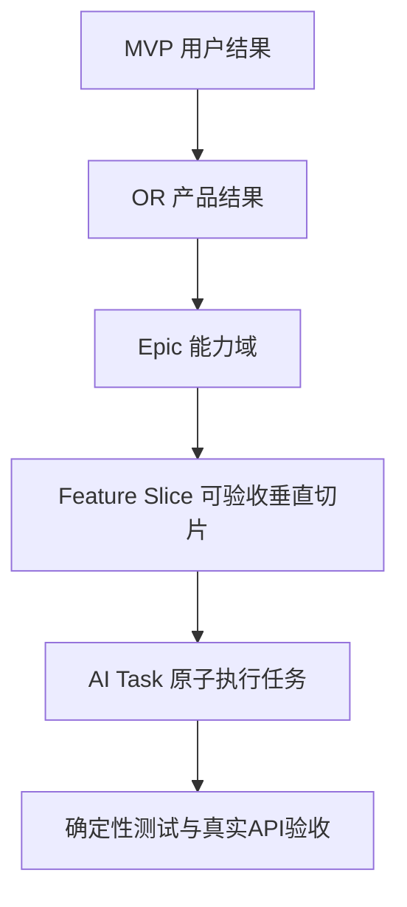
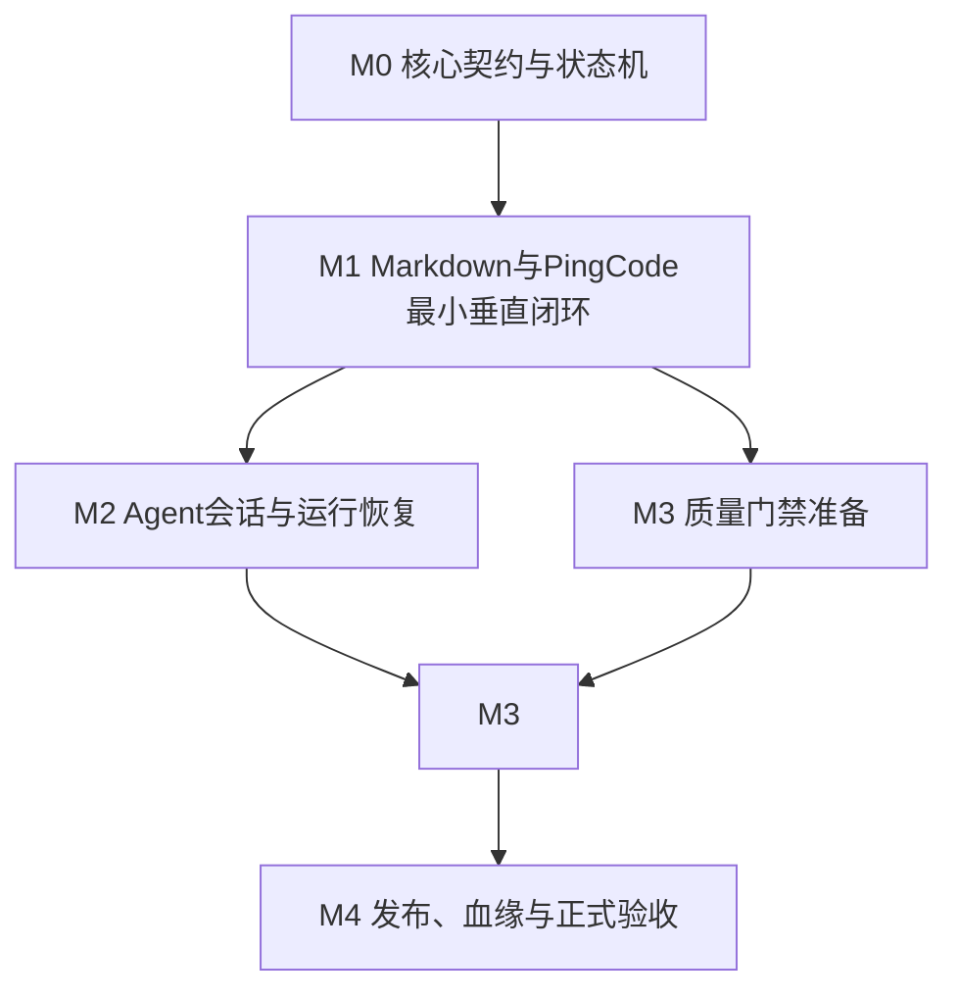

# 知识中心-文档生产-增量文档构建 MVP-开发任务文档

> 任务类型：跨模块标准开发
> 状态：待执行
> 版本：1.1.0
> 更新日期：2026-09-22
> 上游需求：`../01-需求/增量文档构建MVP需求.md`
> 上游设计：`../02-概要设计/知识中心-文档生产-增量构建垂直业务-概要设计文档.md`、`../03-详细设计/知识中心-文档生产-详细设计文档.md`、`../03-详细设计/知识中心-文档生产-手册级文档生成页面-前端详细设计文档.md`

## 一、任务目标

将资料清洗的来源接入能力、文档生成器的 Agent Workflow 能力和知识中心的增量审核发布能力，通过统一业务契约组成可持续运行的增量文档闭环。

本文件承载工程实施拆分；需求文档只维护用户结果、产品规则和验收口径。

## 二、任务组织方法



| Epic | 能力域 |
|---|---|
| P0-A | 正式事实与来源 |
| P0-B | 生成上下文与约束 |
| P0-C | Agent 生产 |
| P0-D | 审核反馈修订 |
| P0-E | 发布、血缘和验收 |

每个 AI Task 必须具备单一可观察行为、明确输入输出、唯一事实源、有限修改范围、确定性测试、真实 API 验证、明确失败行为以及幂等或回退规则。

## 三、总体依赖



允许并行的前提：输入输出契约已经冻结、不修改同一事实源、不争用同一核心文件、有独立测试环境，且合并顺序不会改变业务规则。

## 四、M0：核心契约与状态机

目标：统一资料清洗、文档生成器和知识中心之间的业务语言，暂不提前实现上传或生成界面。

| 任务 | 输出 | 验收 |
|---|---|---|
| CON-01 增量来源快照契约 | 不可变来源快照及 `preparing/ready/failed` 状态 | Schema、映射和错误样例契约测试通过 |
| CON-02 生成方案和运行契约 | 冻结基线、大纲、双模板、来源、范围和能力版本 | 相同输入形成稳定摘要，敏感信息不进入摘要 |
| CON-03 草稿和变更契约 | 草稿及 `add/update/delete/move` 操作 | 每项操作绑定稳定文档或章节标识和前后证据 |
| CON-04 修订和发布血缘契约 | Revision 与 PublicationLineage | 发布版本可反查候选、草稿、运行、审核和来源 |

M0 完成门禁：契约归属明确；资料清洗和知识中心不共同写同一业务事实；文档生成器不能直接创建正式发布版本；设计、机器契约和契约测试先于 M1 功能实现完成。

## 五、M1：Markdown 与 PingCode 最小垂直闭环

## 五A、手册级文档生成页面 Feature Slice

目标：先打通“进入一本手册、选择一个文档、人工修改、保存草稿、选择多个文档并提交评审”的前端可验收路径。页面实现不得伪造来源读取、草稿保存或评审批次成功。

| 任务 | 用户可观察行为 | 事实源/接口边界 | 验收 |
|---|---|---|---|
| UI-HB-01 | 从手册资产进入独立文档生成页面 | `handbookId` 和服务端权限 | 深链、刷新和返回保持手册上下文 |
| UI-HB-02 | 查看当前手册目录 | 大纲和责任映射事实 | 只显示当前手册文档 |
| UI-HB-03 | 切换全部文档/只看我负责 | 当前会话用户与责任映射 | 过滤不越权，空结果有说明 |
| UI-HB-04 | 选择一个文档并编辑正文 | 正式正文和草稿事实 | 文档切换时正文、责任人和版本正确 |
| UI-HB-05 | 手动保存草稿并处理冲突 | 草稿保存接口、版本指纹 | 保存失败不丢输入，冲突不静默覆盖 |
| UI-HB-06 | 打开参考文档弹框 | 资料清洗来源能力 | 支持 PingCode 链接和 Markdown 入口，未接入时明确提示 |
| UI-HB-07 | 将来源绑定到当前文档 | 当前文档来源绑定契约 | 不绑定到整个手册，不生成空引用 |
| UI-HB-08 | 选择多个已修改文档并提交 | 评审批次创建接口 | 一个批次、多份文档级审核对象，失败保留选择 |
| UI-HB-09 | 提交后进入审核页面 | 审核路由和批次上下文 | 手册、批次和文档上下文可恢复 |
| UI-HB-10 | 桌面、移动端和键盘操作 | 前端总设计规范 | 无横向滚动，弹框焦点和状态可访问 |

对应 E2E：`E2E-HB-01` 手册级编辑黄金路径、`E2E-HB-02` 责任人过滤、`E2E-HB-03` 未保存/冲突/来源失败/提交失败恢复。


### 5.1 来源切片

- `SRC-MD-01`：复用资料清洗真实上传会话，仅允许 Markdown；
- `SRC-MD-02`：通过资源标识读取元数据和正文，不访问内部绝对路径；
- `SRC-MD-03`：将资源投影为不可变增量来源快照，重复确认保持幂等。
- `SRC-PC-01`：复用资料清洗空间、页面树和状态接口，真实选择 PingCode 页面；
- `SRC-PC-02`：真实读取页面正文，展示标题、更新时间、地址、内容和摘要；
- `SRC-PC-03`：投影为统一来源快照，远端后续变化不修改旧快照。

### 5.2 生成切片

- `GEN-MD-01`：建立并冻结增量生成方案；
- `GEN-MD-02`：将生成方案适配到现有 Planner、Retriever、Generator、Validator；
- `GEN-MD-03`：持久化运行步骤、进度、错误和输出引用；
- `GEN-MD-04`：Workflow 完成后创建增量草稿，不直接创建候选或发布版本；
- `GEN-MD-05`：比较基线与草稿并生成结构化变更操作；
- `GEN-MD-06`：确定性检查未授权章节变化并阻断候选提交。

### 5.3 页面与 E2E

- `UI-MD-01`：完成上传、预览、确认、生成、进度、草稿和差异查看的最小页面闭环；
- `E2E-SOURCE-01`：真实调用 Markdown 上传和 PingCode 读取 API、知识中心 API 和测试环境 Agent Workflow，验证两类来源形成相同快照契约且发布基线未被修改。

M1 完成门禁：分别完成一次真实 Markdown 和 PingCode 增量生成；一个任务可以包含多个目标文档；Agent 输出进入各文档草稿；能展示文档级差异；越界修改能够阻断。

## 六、M2：持久 Agent 会话与运行恢复

- `SES-01`：以用户和增量任务为隔离键保存会话、消息、运行引用和上下文摘要；
- `RUN-01`：服务重启后可恢复任务查询，中断状态不冒充成功；
- `RUN-02`：取消保留历史证据，重试创建新 attempt，同一幂等键不产生重复草稿。

M2 完成门禁：页面关闭、重新登录和服务重启后能够继续任务；同一用户和任务的会话可恢复；不产生重复草稿或运行事实。

## 七、M3：质量、审核与反馈修订

- `QA-01`：检查来源引用、范围、模板、章节完整性、占位符、未授权删除和基线漂移；
- `REV-01`：结构化审核意见，记录严重程度、定位、正文、状态、提出人和时间；
- `REV-02`：从退回候选创建人工 revision 草稿；
- `REV-03`：将审核意见和冻结上下文装配为 Agent 修订输入，生成新 revision；
- `REV-04`：作者查看差异、标记意见处理结果并确认重新提交；
- `REVIEW-01`：按权限和审核策略校验角色兼任、审核决定和候选变化；候选变化使旧审核失效。

M3 完成门禁：人工和 Agent 修订均按文档形成新草稿；不覆盖原候选；作者未确认不能重新提交；实际是否允许自审由权限和审核策略验证。

## 八、M4：发布、血缘与正式验收

- `PUB-01`：发布前复检全部文档基线、候选摘要、质量、阻断意见、各文档审核决定和权限；
- `PUB-02`：创建不可变新版本集合，保存替代关系，多文档发布原子成功或整体失败；
- `LIN-01`：串联来源资源、来源快照、生成方案、运行、草稿、变更、审核、修订和发布；
- `AUDIT-01`：记录操作者、时间、对象、动作、结果和追踪标识，不记录敏感信息；
- `E2E-MVP-01`：以真实 Markdown 和真实 PingCode 页面分别完成多文档生成、按文档审核、退回、修订、整体原子发布和反向追溯。

M4 完成门禁：两类来源均通过真实端到端验证；状态没有断链；发布失败不产生半完成版本；完整 lineage 可查询；旧能力兼容回归通过。

## 九、AI Task 统一模板

```text
任务编号：
所属 OR / Feature Slice：
用户可观察行为：
任务目标：
输入：
输出：
事实源：
允许修改范围：
禁止修改范围：
接口或状态变化：
异常行为：
幂等、重试与回退：
前置依赖：
需要真实调用的 API：
设计和文档更新：
单元测试：
集成测试：
端到端验收：
预期产物：
完成定义：
```

AI 在契约、范围和验收明确时自治执行；发现扩大产品范围、改变业务规则、改变事实源或触及人工审批边界时停止对应受限操作并升级。不得以模拟成功替代真实后端验证，也不得把测试通过等同于正式业务发布完成。
## UI-NAV：导航树统一改造任务状态（2026-09-24）

### 本轮 P0 已完成

- `UI-NAV-01`：新增公共目录面板控制器，支持鼠标拖动、键盘调宽、双击恢复、Escape 取消、折叠和本地偏好。
- `UI-NAV-02`：审核与发布接入公共控制器，目录范围调整为默认 280px、220–420px。
- `UI-NAV-03`：大纲文档总览接入目录搜索、240–380px 拉伸和 48px 折叠；删除“待分领域”目录筛选入口，状态保留在结构表。
- `UI-NAV-04`：手册级文档生产接入目录搜索、220–360px 拉伸和 48px 折叠。
- `UI-NAV-05`：补充公共契约单元测试和大纲/手册生产浏览器验收用例。
- `UI-NAV-06`：大纲分工管理接入层级过滤目录，支持搜索、祖先展开、当前过滤范围与责任分派表联动，目录宽度 200–340px、折叠为 44px。
- `UI-NAV-07`：GitLab 仓库阅读接入文件导航树，支持搜索、当前文件定位、目录宽度 220–420px 和折叠为 48px；真实正文读取仍由 OAuth 能力决定。
- `UI-NAV-08`：GitLab 映射树搜索改为基于真实树重渲染，清空后恢复搜索前展开状态，避免仅隐藏叶节点导致祖先路径缺失。

### P0 完成情况（无未完成项）

- 无。2026-09-24 通过仓库统一测试入口运行了隔离 `test_hy` 的全量 E2E：导航树 P0 专项 14/14（Chromium/Firefox）通过；7 个定向单元测试套件 97/97 通过；Node 语法检查通过。截图证据位于 `runtime/test-results/navigation-pane-p0/`。
- 全量 E2E 不是全绿：Playwright 报告为 162 通过、19 失败、1 项重试后通过。失败分布于资料清洗、知识中心入口、GitLab 标签、增量业务路径、人员 CAS、审核完整业务闭环和组合框断言，不属于本导航树 P0 验收项；在对应任务修复前不得引用本轮结果声称全仓 E2E 通过。完整日志：`runtime/test-results/e2e/20260924-145248-754372-e2e/details/tasks/001-e2e-playwright.log`。

### P1 待完成

- 完整键盘 TreeView 行为、搜索祖先展开、当前项滚动可见和移动端抽屉 E2E。
- GitLab OAuth 授权成功后的分支、文件正文和 URL 路径恢复 E2E。

### P2 待完成

- GitLab 映射弹框补齐目标选择树的双语言选择摘要和非法状态说明。
- 移动到目录弹框补齐当前目录子树禁用原因和目标路径预览。
- 清理旧递归树函数、重复 CSS 和未使用的 `outline-tree-*` 样式；清理前先完成引用扫描和回归测试。
