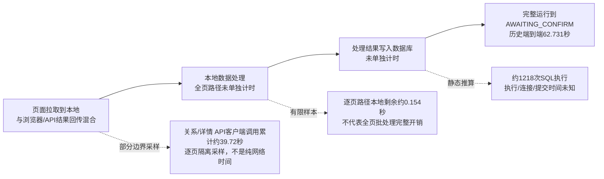

# 知识中心 PingCode 同步耗时诊断

日期：2026-11-17（Asia/Shanghai）

## 测量边界

用户所说的“同步任务列表”在当前插件上对应两个独立动作：同步按钮启动 PingCode 来源采集；差异页上的“同步任务列表”按钮确认快照并写入任务管理。来源工作区的“已确认任务”列表则是第三种读取动作。三者不能合并成一个耗时指标。

本次使用真实后端 HTTP 做了在线可达性检查。`GET /knowledge-center/api/platform/plugins/pingcode/sources` 返回 HTTP 401、1.406ms，响应为 `AUTH_REQUIRED`；健康路径 `/health` 为 404、2.262ms（此实例不提供该路径）。因此没有管理员会话，不能对共享任务管理服务发起真实采集、确认或列表读取。

另通过本机隔离 PingCode API 服务 `127.0.0.1:18010` 和认证浏览器会话，对 `Yq_yJCzT` 做了一次只读全量采样；只读取上游，没有创建同步运行、写 Storage 或确认任务。API 返回 6 页、255 条 IR、319 条 SR，外层 HTTP 耗时 59.135 秒、响应体 937,608 字节。服务端阶段日志总耗时 58.680 秒。该样本用于更新聚合阶段的现状，不含逐请求耗时。

## 执行链路耗时图

历史完整运行来源：`27.7.1 需求基线`，revision 10，255 条 IR、6 页、319 个唯一 SR、6 条未关联 IR；从启动到 `AWAITING_CONFIRM` 共 62.731 秒。按用户要求把链路重分为三个边界。当前只有端到端总时间和部分隔离采样，三块尚未得到可相加的实测拆分，图中不虚构比例。

历史连接器日志总计 56.575 秒；真实浏览器从点击同步到差异可用为 66.780 秒。约 6.2 秒是 `AWAITING_CONFIRM` 与连接器日志时长之差，**不能视为数据库写入时间**；它还可能包含 Node 数据加工、HTTP 请求和响应、Storage 事务及终态校验。浏览器点击到可操作页面多出的约 4.05 秒还涉及轮询、并行回读和渲染。

| 大阶段 | 当前测量证据 | 当前结论与缺口 |
| --- | --- | --- |
| 页面拉取到本地 | 逐页隔离样本中，关系 API 调用累计 26.738 秒、详情 API 调用累计 12.981 秒；读分页累计 4.138 秒，元数据累计约 2.707 秒 | 慢主要出现在浏览器 API 调用边界，但该边界包含上游等待、响应体、JSON 解析和 Playwright 结果回传；没有逐请求分布，未拆成纯拉取耗时 |
| 对本地数据进行信息处理 | 逐页接口 6 页的未计时本地剩余约 0.154 秒 | 只覆盖单页接口的关系校验/去重、字段映射、Markdown 转换和对象组装；全页批处理路径未单独计时，不能将 0.154 秒外推到完整同步 |
| 处理后的数据写入数据库 | 无独立写入耗时。代码按 255 IR、319 首次出现 SR 静态推算至少约 1,218 次 SQL 执行 | 连接池等待、每类 SQL 执行、提交、finish 校验均未实测；约 6.2 秒残差不能用于判断数据库是否为瓶颈 |

旧报告中的 39.859 秒关系阶段和 13.434 秒详情阶段是跨阶段混合计时，不应直接命名为“纯查询耗时”。2026-11-17 全页隔离采样为服务端 58.680 秒、外层 HTTP 59.135 秒；历史端到端 62.731 秒的 3 秒目标仍未达成，但现有分段不能支撑修复归因。

历史并发 10/50 的只读连接器样本为 68.205/64.183 秒；并发 50 完整运行到 `AWAITING_CONFIRM` 为 62.731 秒。2026-11-17 新样本全量读取服务端为 58.680 秒，外层 HTTP 为 59.135 秒。这确认完整读取链路持续很慢，但现有指标无法可靠地在“拉取、本地加工、数据库写入”三段间分摊时间。每条请求延迟、实际在途数、响应状态/大小分布、本地全页加工时间和 Storage 分段计时都缺失，因此三段中的最终根因仍未定位。

## 瓶颈拆分与证据缺口

当前聚合计时的实际代码范围如下，故阶段名不能直接当作网络 API 耗时：

| 计时字段 | 计时实际覆盖 | 尚未区分 |
| --- | --- | --- |
| 批量全页路径 `task_source_pages.*DurationMs` | `relationDurationMs` 包括关系 API 批次、响应校验、关系索引和按 SR 短编号去重；`detailDurationMs` 包括详情 API 批次、最新基线复查、详情映射/校验、Markdown 转换和结果组装 | 两个 API 批次内部的逐请求等待/响应体/JSON 解析；详情阶段内各本地步骤耗时 |
| 单页路径 `task_source_page.relationDurationMs` / `detailDurationMs` | 分别只包住 `get_idea_work_items_batch` 与 `get_work_items`，可与单页总耗时比较 | API 调用内部的 PingCode 服务、网络、浏览器解析和 Playwright 结果回传占比 |
| 端到端剩余约 6.2 秒 | `AWAITING_CONFIRM` 减连接器阶段日志 | Node 页数据转换、请求体构造/传输、Storage 取连接/SQL/提交、finish 校验、轮询和状态观察，全部未拆分 |

代码证据：批量全页路径的关系聚合计时在关系循环和完整性校验之后结束；详情计时在 `details_by_short_id` 映射、最新基线复查及 `pages` 构造循环之后结束。单页路径则把两个计时器分别限定在 API 客户端调用周围。Storage `stagePage` 对每页每条 IR/SR 逐项操作；以 255 IR、319 个首次出现 SR、无图片资源的全新运行静态推算，至少包含 255 次 IR 插入、319 次 SR 快照查询、319 次快照插入、319 次 IR-SR 关系插入和 6 次页游标更新，合计约 1,218 次 SQL 执行；另有每页运行/来源读取、finish 校验查询和提交。该数量是按代码和本次数据规模推算，未用 JDBC 执行计数器实测。它说明“小数据量”仍可能触发大量数据库往返，但没有每类 SQL、连接等待和提交耗时，不能把历史端到端差值归为数据库慢。

### 单页真实采样

对同一只读来源分别调用 6 次单页接口，每次读取该页的 IR→SR 关系和 SR 详情，结果如下。阶段耗时来自 `task_source_page.completed` 服务端日志；外层页总耗时来自 HTTP 客户端。`本地剩余` 为页总耗时减元数据、页面读取、关系和详情 API 调用时间的近似值，包含同步函数中未单独计时的校验、转换、对象组装及计时舍入误差。

| 页 | IR | SR | 关系 API 批次 | 详情 API 批次 | 本地剩余 | 页总耗时 |
| ---: | ---: | ---: | ---: | ---: | ---: | ---: |
| 0 | 50 | 60 | 5.835 秒 | 3.007 秒 | 0.029 秒 | 10.435 秒 |
| 1 | 50 | 75 | 5.790 秒 | 3.230 秒 | 0.040 秒 | 10.313 秒 |
| 2 | 50 | 55 | 5.283 秒 | 2.364 秒 | 0.028 秒 | 8.949 秒 |
| 3 | 50 | 61 | 4.897 秒 | 2.036 秒 | 0.023 秒 | 7.982 秒 |
| 4 | 50 | 63 | 4.426 秒 | 2.098 秒 | 0.031 秒 | 7.634 秒 |
| 5 | 5 | 5 | 0.507 秒 | 0.246 秒 | 0.003 秒 | 1.415 秒 |
| 合计 | 255 | 319 | 26.738 秒 | 12.981 秒 | 0.154 秒 | 46.728 秒 |

这组数据强力支持：关系/详情阶段的耗时集中在 API 客户端调用边界；该边界包含浏览器请求、响应体 JSON 解析及把结果从 Playwright 返回 Python，并非纯网络计时。单页路径中，校验关系、去重、`_task_description` Markdown 转换和对象组装共约 154ms/255 IR，不能解释全页约 46.7 秒。对前五个 50 IR 页，关系批次需要 4.43–5.84 秒；详情批次需要 2.04–3.23 秒。样本存在连续读取顺序和可能的缓存/负载变化，不能据此推出单请求 P95。

全页路径一次读取 255 条关系的聚合 `relationDurationMs` 为 39.955 秒；此前逐页路径 6 批（50/50/50/50/50/5 条）关系 API 调用累计为 26.738 秒，相差 13.217 秒。对应的全页端到端是 58.680 秒，逐页顺序请求合计 46.728 秒。这组历史数据不是受控 A/B，现已在下文补做同会话交替采样；新样本显示分段用时更短，但响应摘要变化，仍不能证明数据逐项等价。需后续在固定来源快照下比较请求延迟、批次墙钟和浏览器/驱动 CPU，区分并发突发、上游排队和批次回传成本。

另一次完整全页调用为 56.2 秒；从 `/proc` 每秒采集服务进程及浏览器子进程 CPU 时间，合计约 53.3 CPU 秒，其中 Python 服务 27.05 秒、Chromium renderer 13.73 秒、Playwright 驱动进程 7.64 秒、浏览器网络服务 2.83 秒、其他 Chromium 进程 2.04 秒。进程树在调用期间约占满一个 CPU 核。这说明本地浏览器/Playwright/服务端工作也有显著 CPU 成本，但进程级 CPU 不能直接映射到具体 API 阶段；需避免把它误当成某一个 JSON.parse 的耗时。

### 2026-11-17 分段 A/B 与全量复测

在同一个隔离服务、同一认证浏览器会话中，重新读取 255 条 IR 后交替调用关系端点：单次提交 255 条、并发 50；或拆成 50/50/50/50/50/5 条、每批并发 50。共 5 轮，单批/分段用时（秒）分别为：49.781/29.022、39.156/28.342、43.231/29.687、37.678/28.895、41.666/30.632。两组中位数是 41.666 秒和 29.022 秒，分段样本约少 30.3%。所有请求都返回 255 个关系结果。

这不是严格的结果等价 A/B：逐轮对 255 个原始关系响应计算的摘要均不同，说明上游关系响应内容在采样过程中变化，可能是实时数据变化或响应顺序/字段变化；没有冻结来源快照。因此不能仅凭此认定输出逐项等价或把 30.3% 作为生产收益。它支持“单次大批量调用的浏览器/Playwright 调用形态值得保留并进一步测量”，而不是证明根因一定是回传。此前一次完整调用为 50.481 秒（255 IR、319 SR、6 未关联 IR）；详情阶段 13.165 秒。关系抓取与校验为 30.092 秒，其中本地校验仅 1.4 毫秒。该全量响应仍将网络、响应 JSON、Playwright 回传混在 API 调用边界内。

加载新计时代码后再次只读全量读取，HTTP 200，外层 44.739 秒，响应体 930,484 字节；255 IR、319 SR、6 页、6 条未关联 IR。服务端全阶段 44.700 秒：元数据 0.392 秒、IR 分页 2.649 秒、关系抓取 28.935 秒、本地关系校验 1.5 毫秒；SR 详情 API 调用 12.509 秒，末尾基线复核 66.6 毫秒，本地详情映射/Markdown/组装 146.7 毫秒，详情阶段总计 12.722 秒。三项详情子阶段相加为 12.722 秒（存在四舍五入误差）。这直接排除了 Python 本地映射是十几秒瓶颈；关系与详情的主要耗时仍在 API 调用边界，其内部尚不能分成 PingCode 服务端、网络、响应 JSON 和 Playwright 回传。数据库写入依旧没有真实运行计时。

### 下一轮测量要求

1. 在浏览器请求 worker 内记录每个请求的 `fetch` 到响应头耗时、读取完整响应体耗时、`JSON.parse` 耗时、状态码、字节数和实际最大在途数；只记录分位数/总量，不记录 URL、编号、正文或凭据。分关系与详情两个批次，至少采集两轮冷/热样本，以区分 PingCode 服务、网络、浏览器处理和结果回传。
2. 冻结来源快照或对每轮响应按稳定关系键规范化后，再复测单批与 50 条分段。当前分段结果摘要发生变化，性能数字仅是方向性信号；下一轮须记录稳定输出摘要、每批最大在途、请求延迟和浏览器/驱动 CPU。
3. Python 端单独计时关系校验/索引构建、基线二次读取、字段映射、`_task_description` 和 Markdown 转换；单页样本已显示这些步骤总量约 154ms，仍需批量路径独立计时验证两条读取路径的等价性。
4. Node 端记录解析上游响应、`markdownPage`、JSON 序列化/请求体大小和 Storage HTTP 往返；使用同一 `runId` 或关联 ID 串起每页和 finish。
5. Storage 端按请求记录连接池等待、`stagePage` 校验、本地 SHA-256、各 SQL 类别执行次数/累计耗时、commit 和 `finishRun`；不输出绑定参数、正文或编号。用个人开发库数据验证，不连接共享库。
6. 每阶段至少重复 5 次，报告中位数/P95/max，并保留样本数、输入规模、并发和环境。只有阶段指标可以闭合到外层总时长（允许报告明确的测量误差）后，才据此选择修复。

本轮尝试以复制运行中的 468 MB 浏览器 profile 启动独立细粒度探针；复制在完成前中止，没有产生请求级指标，也未附着或停止现有浏览器。改用隔离 API 已有单页计时和 `/proc` 只读 CPU 采样取得了上述分阶段数据，仍未测每个请求的网络/响应体/JSON 分位数。

## 任务列表读取与确认写入

来源工作区“已确认任务”首次可用会并行请求来源摘要和一页已确认任务，服务端 Storage 分页读取；差异页“同步任务列表”则 POST 确认接口，执行事务写入/投影，随后回读来源及第一页任务。其后浏览任务管理页列表又是单独的 `GET /api/document-tasks` 请求。当前已有仓库报告中记录过其它任务列表单次 123ms、对应 Server-Timing 约 97ms，但那不是 PingCode 确认后的专属场景，不能作为本功能结果。

本轮没有管理员登录态，因而“打开来源任务列表”“确认写入”和“进入任务管理列表”都没有本次真实鉴权请求数据。不得把同步耗时 62.7 秒套用为列表耗时，也不得把历史其它页面的 123ms 当成本功能实测。

## 已实施的等待反馈

- 采集阶段展示已运行秒数；Storage 回读到分页后展示页数、IR 数和 SR 数。首个页面结果尚未返回时，文案说明正在读取来源分页、关系和详情。
- 时长估算仅用同来源最近成功完整运行的中位数，并显示样本数；没有历史样本时明确显示暂无估算。不显示无数据支持的完成百分比或 ETA。
- “同步任务列表”确认写入显示独立的已运行秒数和当前操作说明，不冒充采集进度。
- 运行中的数字随现有 600ms 状态轮询更新；页面计时每秒原位更新，不额外触发网络请求。

估算会受来源规模、上游延迟和网络变化影响，不是 SLA。更细的关系/详情阶段实时进度需要后端在长时间连接器调用期间向运行状态发布阶段事件；当前阶段日志仅在采集器完成/失败后可查，尚不能向浏览器实时透传。

## 验证

- 真实在线只读 HTTP：来源列表 401/1.406ms，证明此会话缺管理员认证；未触发业务写入。
- 隔离 PingCode 服务只读全量采样：255 IR/319 SR/6 页，外层 HTTP 59.135 秒、937,608 字节；服务端 58.680 秒（元数据 2.324 秒、分页 3.343 秒、关系阶段 39.955 秒、详情阶段 13.058 秒）。此次没有读取 Storage 或写入同步数据。
- 隔离 PingCode 服务只读单页采样：按页读完 255 IR/319 SR，关系 API 批次累计 26.738 秒，详情 API 批次累计 12.981 秒，本地未单计时部分约 0.154 秒；外层 6 页顺序读取共 46.728 秒。
- 进程树只读 CPU 采样：56.2 秒全量请求消耗约 53.3 CPU 秒，Python 服务约 27.05 秒，Chromium renderer 13.73 秒，Playwright 驱动进程 7.64 秒；不包含请求级 CPU/网络分布。
- 历史完整采集链路：引用 2026-11-13 实例运行及真实浏览器 66.780 秒证据；并更正为 Storage 部分是端到端残差，非独立计时。
- 真实 Chromium 隔离 HTTP 浏览器回归：`node --test tests/e2e/agent-runner/pingcode-sync-plugin.node.cjs`，7/7 通过。覆盖来源工作区完整同步、同来源 60 秒估时、1/2 页与 1/2 IR/SR 计数、确认接口等待期间计时、错误/空态、来源切换竞态及详情/确认流程。
- `node --check apps/knowledge-center-web/frontend/knowledge-center/modules/platform-admin/pingcode-sync.js`：通过。
- `git diff --check`：通过。

## 假设状态

1. 关系 API 客户端调用是最大单阶段：全量和逐页证据支持；调用边界内的上游、网络、JSON/浏览器处理与 Playwright 结果回传尚未拆开。
2. SR 详情 API 客户端调用次之：全量和逐页证据支持；同样未拆开调用边界内部因素。
3. Python 本地关系校验/去重/详情转换不是几十秒瓶颈：单页6次相加约 0.154 秒支持；批量路径仍应补独立计时。
4. Storage 是否慢：尚无独立计时；原“约 6.2 秒”是端到端差值，不能用于判断。
5. 页面可操作尾段有额外约 4 秒：一次真实浏览器与后端终态对照支持，但样本量不足以给出分位数。
6. 已确认任务列表是否慢：未测，在线管理员认证缺失；需要以登录态分别测量来源列表 GET、确认 POST 和任务管理 GET，并记录 HTTP、Storage、浏览器首个可操作时间。
