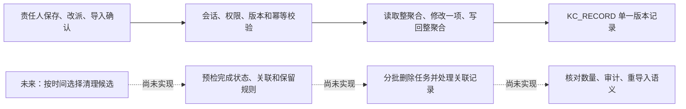

# 任务管理耗时链路全景与瓶颈清单

日期：2026-11-02。范围：本机实际平台 `192.168.130.180:13510/knowledge-center/document-tasks` 的只读页面操作、真实存储读取及代码链路。原始数字与测量边界见[页面与按钮耗时评估](./知识中心-任务管理-页面与按钮耗时评估-20261102.md)和 `runtime/diagnostics/task-performance-20261102/`。本报告区分“实测”“代码确认”“尚未测量”；没有修改产品或删除任务数据。

## 1. 全景：一次任务管理操作经过哪里

**实测位置**：HTML约6–10ms，DOMContentLoaded约165–224ms；任务接口的等待主要在首字节前。Storage整包读取2.940–3.445s，响应2,168,277字节，首字节2.911–3.405s，网络接收约22–33ms，Node JSON解析约7–10ms。Storage内部的连接等待、SQL、CLOB读取、Java解析和序列化未分段测量，不能从总时长推断其中哪一项占主导。

网关同时读取人员和手册，时间未单独测。实际任务路由在13510网关进程执行，不能把它画成必经14110代理。图中的返回箭头表示响应路径，不表示再次读库。

## 2. 页面等待的关键路径

同一次导航的成对样本：`/context` 共3.124s、首字节3.113s、响应4578字节；列表共6.044s、首字节6.033s、响应48419字节。**两次请求时间重叠，不能将3.124s与6.044s相加作为页面耗时**；页面等待较慢的那条。代码确认两个路由均调用同步 `store.read()`，从而存在同进程串行阻塞；成对样本只证明这一轮的请求时序，不证明每次都是 `/context` 先完成。单独顺序请求中位数：列表3.042s、上下文2.978s、详情3.143s。

| 用户操作 | 页面实测中位数 / P95 | 主要请求与等待关系 | 判断 |
|---|---:|---|---|
| 直接进入 | 6.095 / 7.131s | 列表和上下文并发；等待两者 | 超过建议的冷入口2s预算 |
| 导航进入 | 7.087 / 7.502s | 同上；样本含页面切换时后台竞争 | 超过建议的1s数据操作预算 |
| 刷新、翻页 | 约6.0 / 6.3s | 两个GET均重新读取整份聚合 | 不合理 |
| 搜索筛选 | 6.312 / 6.503s | 同上；筛选/分页在读后内存执行 | 不合理 |
| 打开详情 | 3.338 / 3.822s | 单独读取整份聚合 | 不合理 |
| 打开开始/结束日历 | 3.315 / 3.832s；3.315 / 3.332s | 先取最新详情和版本，才允许保存 | 不合理；版本校验不能直接省略 |
| XLSX预览530行 | 3.324 / 3.347s | 文件解析、整包读取、逐行比较 | 略超建议的3s预算；内部占比未测 |
| 本地弹窗、页签、月份切换 | 约0.03–0.06s | 不经任务整包读取 | 本轮合理 |

上述P95是5或10次样本中的最大值，不是长期SLA，也不是500人在线或50人同时操作的成绩。真实共享数据库的保存、改派、配置写入、导入确认和删除均未测；隔离文件存储约0.1s不能代替数据库写入指标。

## 3. 重要瓶颈清单

| 优先级 | 瓶颈或风险 | 证据与影响 | 还缺什么测量 |
|---|---|---|---|
| 1 | **所有任务读取共享整份聚合** | 列表仅显示20条、上下文只需配置、详情只需一条，均读取530条任务及审计、历史、幂等组成的2.17MB记录；单次Storage读约3s，是当前最直接的等待证据 | Storage内部阶段；冷读与写后读 |
| 2 | **同步读取阻塞网关事件循环** | `AggregateStore.read()`经`execFileSync(curl)`；并行页面请求成对出现约3s和6s，用户等待约6s。影响同进程其他请求的范围尚未压测 | Node事件循环延迟、队列等待、并发吞吐 |
| 3 | **前端重复读取任务状态** | 进入、刷新、翻页、筛选都同时读列表和上下文；选中详情后刷新还会再取详情。每个任务路由读取整份聚合，放大瓶颈1 | 各操作的完整请求瀑布和状态更新后的请求数 |
| 4 | **首字节前3秒未细分** | 整包响应首字节2.911–3.405s，接收体与Node解析仅几十毫秒；不能据此断言数据库SQL、连接池或CLOB是唯一根因 | 连接借用、SQL、CLOB、Java处理及网关排队的Server-Timing |
| 5 | **分页和交付投影在整包读取后** | 路由先过滤/投影全部可见任务，再筛选排序和切20条；交付关联可能逐篇读取审核结果。这是代码确认的容量风险，尚未证明造成当前3s | 每阶段耗时、关联审核数量下的样本 |
| 6 | **写入集中在单一版本记录** | 一条任务或配置写入需整包事务，所有任务共享revision；50人同时操作时可能冲突，但当前没有共享库写入或并发结果 | 写入P50/P95、冲突率、重试次数及数据量曲线 |
| 7 | **缺少按时间清理路径** | 当前任务聚合包含任务、全局审计、任务历史和幂等数据；任务路由未见按时间删除能力。无限增长会持续扩大上述成本 | 保留期、时间字段、可清理状态、关联数据量和清理耗时 |

现有Storage对同一记录的ETag条件读取，5次304耗时6.3–21.4ms。这只证明未变更记录可快速判定，**不是**当前页面或修改后页面的实测成绩；也无法解决冷读、频繁写入或容量增长。

## 4. 写入与时间清理的全景边界

容量目标为**最多需支持100万条保留中的工单、500人在线、50人同时操作**，并非永久累计100万条。按时间清理应成为数据生命周期的一部分：定义依据哪个业务时间字段、保留多久、未完成/审核中/MR未合并的任务能否清理；预检候选数和关联；受控分批执行、记录结果与失败重试；分别规定任务历史、操作审计、幂等记录的保留；避免误删已有文档、GitLab MR或交付证据。删除后相同PingCode编号再次导入是恢复旧任务还是创建新任务，也须确定。具体时间字段、期限和删除/归档规则尚未获确认，本报告不擅自固化；当前也没有执行删除。

## 5. 用于下一版设计的结论

当前主问题是**页面所需数据很小，但每个请求走整聚合冷读，且同步读与重复请求叠加**。先取得各段耗时和真实并发/写入数据，再决定每层改造的权重。下一版端到端设计至少要同时覆盖列表与详情查询、网关异步调度、人员/资产上下文、写入与冲突、交付关联，以及按时间清理和重导入。仅调整浏览器按钮或只添加热缓存，不能证明冷读、写后读取和百万条保留容量达标。

本轮未实测100万条、500在线、50同时操作。50人同时操作不等于50 RPS；不能从当前530条的单人数据外推服务容量。完整设计与验收还需要一个有界的保留期、真实数据形态、冷热读比例、操作模型和分段计时。

## 2026-11-02 整改结果索引

后续实施及同口径复测见[任务管理性能整改与前后耗时对比](./知识中心-任务管理-性能整改与前后耗时对比-20261102.md)。本文保留为整改前证据，不用后续成绩覆盖基线；当前530条工单的原18项实际页面操作均达到建议P95预算；共享库写入、容量和时间清理的未完成项见整改报告。
