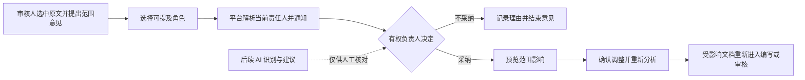

# 审核意见提及责任人与范围处理：业界方案调研

日期：2026-11-12。对应《知识中心-需求列表.xlsx》需求编号 25。本文件是产品研究与建议，不表示方案已经在平台实现。

## 一句话说明

审核人发现“这篇文档的编写范围可能不对”时，应在原文附近留下意见，让合适的人看到；负责人决定是否采纳。采纳后，平台才调整范围并重新分析；不采纳时，写明原因并结束意见。单纯在评论里写 `@姓名`，既不能证明对方收到了，也不能代替范围决定。

本项目需覆盖三类可提及对象：手册负责人、文档首次责任人、知识中心负责人。文档首次责任人指首次正式确认分派时的责任人，即使之后改派也保留该身份；知识中心负责人由平台管理配置为一人。具体谁可被提及、谁能决定范围，以服务端规则和当前任务事实为准。

## 官方产品的做法

| 官方资料 | 可直接确认的做法 | 对本需求的启示 |
|---|---|---|
| [GitLab：评论与讨论串](https://docs.gitlab.com/user/discussions/) | `@username` 或群组会触发通知及待办；讨论串可以解决。 | 提及应产生可追踪的通知；通知与意见解决是两个事实。 |
| [GitLab：合并请求审核](https://docs.gitlab.com/user/project/merge_requests/reviews/) | 审核人分派会产生待办；审核意见可回复、解决或重新打开；审核结论另有通过和要求修改。 | “被提及”不能自动等于“审核负责人”或“审核通过”。 |
| [GitHub：拉取请求审核](https://docs.github.com/en/pull-requests/reference/pull-request-reviews) | 评论、批准、要求修改是不同审核结论；请求审核会通知指定人员。 | 意见状态与整篇审核结论需要分别保存。 |
| [GitHub：处理反馈](https://docs.github.com/en/pull-requests/how-tos/review-pull-requests/incorporating-feedback-in-your-pull-request) | 可应用具体修改建议；超出当前拉取请求范围的反馈可另建事项跟踪。 | 超范围意见不能直接、静默地改写原任务范围。 |
| [GitHub Copilot：代码审核](https://docs.github.com/en/copilot/how-tos/use-copilot-agents/use-code-review) | AI 可给出分级评论和修改建议；默认留下评论，不提交“批准”结论，用户可查看、回复、解决。 | AI 适合辅助发现、分类和起草理由，不能替代范围负责人作决定。 |

上述是代码审核产品的公开能力，不表示它们已有本项目的“手册范围重新分析”功能。后者是本平台需要自行设计的业务环节。

## 三种方案

| 方案 | 用户实际操作 | 优点 | 主要缺口 | 判断 |
|---|---|---|---|---|
| 一：简单提及通知 | 审核人评论中选人；平台通知；对方在线下或评论里回复。 | 改动小，能尽快找到人。 | 采纳、范围改动、重新分析和关闭原因没有结构化证据；难以证明闭环。 | 只能作过渡。 |
| 二：结构化意见与单独的范围决定 | 审核人选文字、选问题类型及可提及角色；平台解析当前人员并发待办；负责人选择采纳/不采纳。采纳后预览影响、确认范围并重新分析。 | 责任、决定与范围变化各有记录；失败可重试；可与现有审核和任务流程衔接。 | 需要跨审核、任务范围和通知三个模块建立契约。 | 推荐作为首期目标。 |
| 三：在方案二上增加 AI 辅助 | AI 根据意见、原文和当前任务范围建议“可能影响哪些手册/文档”、建议通知对象及理由；人确认后执行方案二。 | 大量意见时减轻查找和归类成本。 | 可能猜错人员或范围；要提供依据、置信度、模型和规则版本，还需评估误报/漏报。 | 适合第二阶段试点。 |

## 推荐的分层落地

1. **先保证准确闭环**：意见绑定文档版本与原始选区；提及目标使用角色及对象标识保存，服务端解析实际接收人。改派后仍能追溯当时发给谁。通知发送失败必须可见、可重试；不应把“待配置”显示成“已送达”。
2. **把决定和执行拆开**：评论可提问、回复或结束；范围采纳是有权限的独立决定。采纳时展示新增、移除和受影响的文档，确认后再重新分析；不采纳留下理由。提及本身不改变范围，也不改变逐篇审核结论。
3. **再试点 AI 建议**：以已决定的历史意见构建脱敏评估集，分别测分类准确率、错误通知率、范围漏判率和人工接受率。AI 的输出只填建议草稿；保存与执行仍调用同一权限校验和确定性范围接口。

## 验收重点

- 三类角色均能在允许的意见场景中正确选到；重名、空缺、改派和无权用户不会误通知。
- 被提及用户从待办进入原意见和正确文档版本；投递状态与实际渠道结果一致。
- 不采纳有理由并能结束；采纳需确认影响后才改变范围，重新分析结果可回读。
- 已解决意见、审核结论、范围任务各有自己的状态；任何一个状态都不能由另一个状态推断。
- AI 试点如未达到事先约定的误报、漏报阈值，只显示人工流程，不自动执行范围改动。
