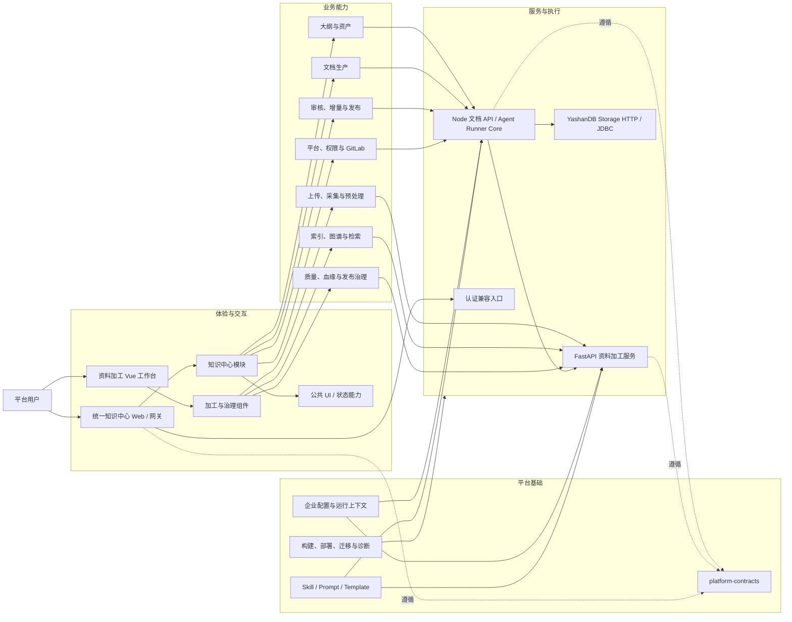

# Understand Anything 平台特性全景与公共模块重构分析

> 分析基线：工作区当前状态，Git HEAD `e51a78ab6052edff77ff80a5554131ac8985a71b`。本文是重构决策输入，不表示建议已经实施。原始图谱产物位于 `runtime/architecture-review/20261013/understand-anything/`，`.ua` 是 Understand Anything 的兼容入口。

## 1. 结论摘要

本仓库是由统一知识中心、文档生产服务、资料加工平台、YashanDB 过渡存储、共享契约、知识资产和工程工具组成的平台型仓库。Understand Anything 正式扫描了 528 个文件，过滤 3537 个依赖、测试、运行时、外部仓库及知识参考正文文件，得到 505 条内部导入关系；合并图谱包含 1878 个节点和 2617 条关系。

| 结论 | 优先级 | 判断 |
| --- | --- | --- |
| 统一前端 HTTP transport、错误模型、认证事件和幂等策略 | P0 | **应提炼**。知识中心至少 7 套近似请求封装并存 |
| 收敛 Node 到 Storage 的传输实现 | P0 | **应提炼**。同步 curl、异步 curl、原生 fetch 并存 |
| 固化资料加工跨语言产物、身份、血缘和幂等契约 | P0 | **共享契约，不立即合并实现**。Node/Python 管线运行模型不同 |
| 统一列表查询状态、分页、过滤和竞态控制 | P1 | **提炼无 DOM 状态模型**，字符串模板与 Vue 保留各自 renderer |
| 统一 Drawer/Dialog 生命周期与可访问性 | P1 | **提炼行为控制器**，视图内容仍归业务模块 |
| 滚动、视口、目录树、可调整导航 | 已有 | **保留并治理**，不重复创建 |
| 把所有仓储或状态机合并为万能模块 | 禁止 | 领域语义、权限、revision 和发布状态不同，强行合并会制造高耦合 |

## 2. 范围、方法与可信度

正式范围包含 `apps/`、`packages/`、`tools/`、`config/`，以及 `knowledge/skills`、`knowledge/prompts`、`knowledge/templates` 和根目录关键清单。排除 `external/`、`runtime/`、`tests/`、`docs/`、`.codex/`、依赖/vendor、知识参考正文、企业实例数据和 Office/PDF 二进制样例。设计和测试作为人工复核证据，但不进入正式代码图谱。

证据分为三级：

- **L1 代码证据**：函数、类、路由、导入和契约由当前工作区定位。
- **L2 运行证据**：2026-10-13 只读 GET 探测；前端、文档 API、PingCode API、Storage 均为 200，未带会话的业务 API 为 401。
- **L3 建议目标**：公共模块边界、性能预算与迁移阶段，是可实施设计，不是已完成功能。

API 探测每个端点只有一次请求，只证明连通性和结构，不能作为吞吐量或时延基线。登录态业务、写路径和浏览器黄金流程仍需在重构阶段验证。

## 3. 特性全景图



主要调用链：

```text
浏览器
├─ /knowledge-center/* → frontend-server → knowledge-center routes → store → YashanDB
├─ /knowledge-center/api/cleaning/* → 契约白名单 → FastAPI /api/*
└─ /pingcode-materials/* → Vue 工作台 → FastAPI → repository/index/graph

内容流水线
源资料 → 上传/采集 → 格式识别 → 清洗/分块 → 元数据 → 训练/治理
      → 关键词/正式知识 → 索引/图谱 → 评测 → 发布 → 检索与文档生产
```

## 4. 功能特性树

```text
YashanDB 知识库构建平台
├─ 统一知识中心
│  ├─ 身份与会话：CAS、管理员登录、会话、退出、角色与权限
│  ├─ 平台概览：运行上下文、能力投影、健康与配置状态
│  ├─ 知识资产：列表、过滤、分页、详情、停用历史
│  ├─ 大纲治理：目录、导入、详情、版本、领域分工、删除保护
│  ├─ 模板治理：搜索、版本、导入、草稿恢复、启停和权限
│  ├─ 文档生产：共享草稿、修订、附件、评审人、评审批次
│  ├─ 审核与发布：基线、差异、评论、决定、证据和发布
│  ├─ GitLab：连接、OAuth、映射、分支、目录、文件和提交
│  └─ 平台管理：人员、CAS 绑定、角色、团队、数据库连接
├─ 资料加工平台
│  ├─ 来源接入：本地分块上传、PingCode 空间、下载任务
│  ├─ 材料准备：扫描、格式识别、Office/PDF/归档预处理
│  ├─ 清洗与元数据：Markdown 清洗、结构化元数据和预览
│  ├─ 训练与审核：任务、模型预检、审核项、日志和 SSE
│  ├─ 关键词治理：规则、Skill、过滤批次、证据、决定和应用
│  ├─ 正式知识：实体关系、证据、ACL、质量门禁和发布状态
│  ├─ 索引：目录索引、倒排索引、知识点查询和统计
│  └─ 图谱：构建、版本、差异、探索、质量、可观测和修复
├─ 文档与 Agent 执行内核
│  ├─ 工作流：规划、检索、生成、比较、验证和步骤执行
│  ├─ 预处理：适配、清洗、分块、分类、过滤和图像描述
│  ├─ 检索：向量、分层、混合检索、查询构建和同义词扩展
│  ├─ 增量构建：来源、候选、检查、评论、修订和发布
│  └─ 文档生产：草稿、revision、附件和 review batch
├─ 存储与数据治理
│  ├─ 通用 revision record
│  ├─ 手册、人员、大纲、技术领域和构建任务
│  ├─ 团队、认证用户与 GitLab 连接
│  ├─ Schema migration、连接池和事务
│  └─ 文件模式到数据库模式的兼容与导出
└─ 平台工程
   ├─ 版本化 API/错误/任务/事件/流式下载契约
   ├─ 企业 profile、配置校验和密钥引用
   ├─ Skill、Prompt、模板、领域词表和规则
   ├─ 构建、部署、诊断、迁移、导出和回滚
   └─ 兼容入口、P0 基线和契约防漂移门禁
```

## 5. 模块功能清单

| 模块 | 主要职责 | 关键实现 | 边界判断 |
| --- | --- | --- | --- |
| `knowledge-center-web` | 统一入口、网关、字符串模板 UI、模块编排 | `frontend-server.js`、`app.js`、`modules/*` | 做体验编排，不承载领域持久化规则 |
| `knowledge-center-api` | 文档/Agent 入口、WebSocket、健康和上下文 | `server.js` | 保持薄入口，执行能力下沉 core |
| `knowledge-center-auth` | 认证兼容启动入口 | `auth-server.js` | 认证内核同进程化后，兼容入口可渐进退役 |
| `pingcode-web` | Vue 资料加工、图谱治理和可观测工作台 | `App.vue`、`components/*`、`api.js` | 共享无 DOM 契约，不与字符串模板 UI 强行合并 |
| `pingcode-api` | 上传、准备、训练、关键词、索引、图谱、发布 | `main.py`、service/repository | 拆分大路由入口，领域服务保持 Python 边界 |
| `yashandb-storage` | JDBC、迁移、revision、领域投影 | `Main.java`、Repository、migration | HTTP 为过渡适配；Handler 与 repository 继续拆分 |
| `agent-runner-core` | 工作流、文档生产、增量构建、预处理、网关、仓储 | `lib/*`、`routes/*` | 平台共享内核，避免继续堆入单一路由文件 |
| `pingcode-core` | PingCode 抓取、下载、解析、索引构建 | Python package | 与 API 采集能力明确 owner，收敛重复入口 |
| `platform-contracts` | API、错误、任务、事件、企业 profile、兼容基线 | JSON Schema/OpenAPI | 跨语言共享正确位置，不依赖 UI 或数据库实现 |
| `knowledge` | Skill、Prompt、模板、领域模型和生成规则 | `skills/`、`prompts/`、`templates/` | 内容资源版本化，规则不散落硬编码 |
| `tools` | 构建、部署、迁移、诊断和知识处理 | `deployment/`、`repository/`、`knowledge-processing/` | 只编排公开接口，不反向依赖应用私有实现 |

## 6. 相同能力组件与公共化审查

机器可读明细见 `baseline/understand-anything-duplicate-capabilities.json`。

| 能力 | 重复位置 | 实质差异 | 决策 | 目标边界 |
| --- | --- | --- | --- | --- |
| JSON HTTP 请求 | 6 个知识中心 API 文件及 `pingcode-web/src/api.js` | base URL、envelope、401/403、幂等、上传/SSE 不同 | P0 提炼 | transport 只负责请求、解析、错误、取消和追踪；adapter 决定 endpoint/envelope |
| 幂等键 | 增量、手册、GitLab、团队、上传 | pending command 复用、随机 UUID、时间戳并存 | P0 提炼 | 按 actor+operation+resource+payloadDigest 定义生命周期 |
| Storage 传输 | `domain-store`、`aggregate-store` | 同步 curl、异步 curl、fetch，错误和 timeout 不同 | P0 提炼 | 原生 fetch、deadline、统一 envelope、metrics |
| 列表/分页/过滤 | assets、templates、principals、GitLab、Vue PaginationControls | UI 技术栈不同，query 状态相同 | P1 部分提炼 | 共享 query-state/schema；保留 renderer adapter |
| 目录树 | outlines/repository/review 的 `directory-tree.js`；Vue DirectoryTree/VirtualTree | DOM 和虚拟化规模不同 | 已部分公共化 | 固化 tree model/identity/selection；虚拟化按规模选择 |
| Drawer/Dialog | 资产、人员、数据库、评审、证据 | 焦点、关闭和草稿保护不一致 | P1 提炼 | focus trap、Escape、restore focus、dirty guard、scroll lock |
| Markdown | 知识中心 renderer/enhancer 与 Vue MarkdownWorkbench | 安全、数据库语法和编辑模式不同 | 共享规则 | 统一 sanitizer/extension contract 和 fixture，不共享 UI |
| 滚动与视口 | 公共 runtime 与历史局部 CSS | 公共能力已存在，局部 overflow 仍可能冲突 | 已公共化 | 用 data contract 和诊断测试约束新增页面 |
| 文档预处理 | Node `preprocessing/*` 与 Python ingestion/preparation | Node 偏文档生产，Python 偏上传训练治理 | 暂不合并 | 先共享 artifact/identity/lineage/schema 和 golden fixture |
| 索引/图谱 | Node indexers/stores 与 Python indexing/graph | 规模、治理版本、查询 API 不同 | 共享契约 | index manifest、graph snapshot、evidence ref、capability negotiation |
| 运行上下文 | Node/Python `/api/platform/context` | 字段来源和包装不同 | 契约统一 | `enterprise-profile/v1` additive projection |
| 大型入口 | `app.js`、`main.py`、`Main.java`、`knowledge-center.js` | 分别混合 UI、路由、HTTP/JDBC、领域逻辑 | 拆分而非公共化 | route/controller/query/command/projection/repository 垂直切片 |

### 6.1 前端 transport 建议接口

```js
request({
  baseUrl, path, method, headers, body, signal,
  responseMode: 'json' | 'text' | 'blob' | 'raw',
  envelope: 'success-data' | 'data-content' | 'raw',
  authEvents: true,
  idempotency,
})
```

公共层不得包含“大纲”“GitLab”“草稿”等业务文案。错误统一为 `{status, code, message, details, requestId, retryable, cause}`，业务 adapter 再把稳定错误码转换为中文文案。XHR 上传进度、SSE 和下载流保留专用 transport，通过同一错误模型衔接，禁止被 JSON transport 缓冲。

### 6.2 不应提炼的边界

- `handbook-production-service` 与 `incremental-build-service` 是不同状态机，不合并为通用 workflow helper。
- File/Database AggregateStore 可共享 transport 和 revision contract，但文件原子替换与数据库事务不能伪装成相同保证。
- Node 与 Python Pipeline 不因名称相同而合库；跨语言重复先用契约和一致性测试解决。
- 字符串模板 UI 与 Vue 不共享具体 DOM 组件，只共享数据模型、状态转换和可访问性契约。

## 7. 兼容性实施方案

### 7.1 API 与数据

1. 冻结 `platform-contracts` 当前快照；新增字段只做 additive change，旧字段至少保留一个发布周期。
2. transport 支持 `{success,data}`、`{data|content}` 和 raw payload，由业务 adapter 显式声明，不做全局猜测。
3. 为 401/403、HTML 代理错误、空 body、非 JSON、429、5xx、AbortError 建立契约 fixture。
4. 状态枚举在服务边界规范化为小写 canonical value，同时保留未知值并记录 telemetry。
5. 旧 `/api/*`、`/pingcode-api/*`、SSE、下载和深链在流量与兼容测试未归零前保留。
6. 写操作统一传递 Idempotency/Request/Correlation ID；revision/If-Match 冲突继续返回 409，不自动覆盖。

### 7.2 浏览器

- 保持 `100vh` fallback，支持时用 `100dvh`，通过 `visualViewport` 修正；现有 viewport runtime 已实现。
- `ResizeObserver`、`crypto.randomUUID`、`AbortSignal.timeout` 必须 feature detect 并提供 fallback，禁止仅靠 UA。
- dialog 不可用时使用 `role=dialog`、`aria-modal=true` 兼容层，验证焦点圈、Escape 和焦点恢复。
- 桌面主区和窄屏 document 只允许一个滚动 owner；新增页面声明 scroll data contract 并通过诊断测试。
- 支持基线应覆盖当前生产 Chromium/WebView 主版本及前两个企业支持版本，具体版本由生产资产清单固化。

### 7.3 数据与部署

- 保留 `file|database` 双读但只允许一个权威写源；采用“影子读对账 → 单主写 → 旧读降级 → 退役”。
- 每批迁移记录数量、稳定摘要、revision、失败清单和回退点；大对象只保存引用。
- Storage HTTP 端口退役前，所有 Node caller 完成 native adapter、事务语义和故障注入验证。

## 8. 性能实施方案

### 8.1 基线与预算

本次单次健康探测不能证明性能达标。应在相同数据集、身份和冷/热缓存条件下记录：

| 场景 | 指标 | 首阶段建议预算 |
| --- | --- | --- |
| 平台首屏 bootstrap | p50/p95、请求数、字节、长任务 | p95 ≤ 1.5s，关键请求 ≤ 6 |
| 资产/人员/模板列表 | p95、SQL 次数、序列化大小 | p95 ≤ 500ms，禁止逐项 N+1 |
| 大纲详情 | list/detail/handbook 聚合 | p95 ≤ 800ms，切路由无陈旧投影 |
| Storage 单记录读写 | event-loop delay、p95、timeout | 本机 p95 ≤ 150ms，同步子进程调用归零 |
| 大批量预处理 | files/s、MB/s、RSS、恢复 | 吞吐不回退 >10%，内存有硬上限 |
| 图谱探索 | 查询 p95、节点/边数量 | 默认分页/上限，禁止无界全图返回 |

预算是验收目标；若首次基线明显偏离，应按生产规模调整并记录理由。

### 8.2 优化顺序

1. **消除阻塞 I/O**：先迁 Storage 读路径到共享 native fetch，采集 event-loop delay，再迁带 revision 的写路径。
2. **去 N+1**：列表直接返回只读展示投影，批量加载 handbook/permission/count。
3. **有界并发**：预处理、附件和图谱写入按资源配置 concurrency/queue limit，取消信号贯穿下游。
4. **竞态治理**：每个 route/query 使用 key、sequence 或 AbortController，只提交当前 key 结果；大纲已有模式可抽取。
5. **缓存分域**：key 包含 user/role/enterprise/branch/language/version；权限和 mutation 错误不做负缓存。
6. **流式不缓冲**：SSE、下载、预览、上传绕开 JSON transport，保留 backpressure/range/content-type/取消。
7. **体积与虚拟化**：树和图超过阈值使用 VirtualTree/VirtualPageList，接口使用 projection。

## 9. 可持续演进方案

目标依赖方向：

```text
UI / Route Adapter
        ↓
Application Query & Command
        ↓
Domain Contract / State Machine
        ↓
Port (Repository / Transport / Model Gateway)
        ↓
Infrastructure Adapter
```

禁止反向依赖：contract 不依赖 app；knowledge 资源不导入 runtime；工具不修改应用私有状态；UI 不编码数据库状态值。

### 9.1 大文件拆分切口

- `knowledge-center/app.js`（约 4747 行）：route/query coordinator、bootstrap projection、module lifecycle；事件按模块迁入 controller。
- `pingcode-api/app/main.py`（约 1955 行）：拆 upload、material、training、governance、graph、index router，以 service container 注入依赖。
- `training_service.py`（约 7151 行）：拆 admission、keyword governance、formal knowledge、publish 用例，稳定 schema 先行。
- `yashandb-storage/Main.java`（约 3178 行）：只保留 bootstrap；Handler、JSON codec、错误映射下沉，扩展已有 Repository。
- `routes/knowledge-center.js`（约 1618 行）：拆 assets/templates/platform/production/review route，共享 auth/envelope/proxy middleware。

### 9.2 治理机制

- 公共模块必须有 owner、公开 API、错误契约、兼容矩阵和删除策略，不接受无边界 `common/utils`。
- 跨模块能力先写 ADR：问题、候选、共享理由、明确不承担的职责、迁移和回退。
- 增加依赖门禁：app 可依赖 package/contract，package 禁止依赖 app；Node/Python 通过 schema/HTTP/fixture 协作。
- Prompt 与规则继续存放 `knowledge/` 或配置，硬编码例外登记待办和替换条件。
- 图谱与重复能力矩阵做季度复查，跟踪重复 transport、跨层 import、大文件增长率。

## 10. 分阶段迁移、回退与验收

### P0：冻结行为并提取基础设施（1–2 个迭代）

1. 为现有请求封装建立契约 fixture；实现 `http-transport`，先迁只读 auth/GitLab/template。
2. 实现 `storage-http-client`，先迁 handbook/catalog/principal/aggregate read，以 feature flag 保留旧实现。
3. 发布 artifact/identity/lineage/idempotency v1 schema，Node/Python 对同一 golden fixture 生成等价结果。
4. 记录 API p50/p95、event-loop delay、请求数、错误码、构建和测试耗时基线。

验收：旧新 transport 契约等价；401/403/409/HTML/timeout/abort 覆盖；无新增同步读；无需迁数据即可切回旧 adapter。

### P1：收敛查询与交互模型（2–3 个迭代）

1. 提取 query coordinator、分页/过滤 state、drawer/dialog controller。
2. 迁 assets/templates/principals，再迁 outlines/review；逐模块发布。
3. 对 `app.js` 和 `knowledge-center.js` 做垂直切片，保持 URL、DOM 契约和 API 不变。

验收：快速切路由无陈旧数据；键盘/焦点/滚动 E2E 通过；请求数不增加；关键 p95 不回退超过 10%。

### P2：领域边界与跨语言契约（3–5 个迭代）

1. 拆 FastAPI routers、训练用例服务和 Java handlers；仓储保留领域专用接口。
2. 用 capability negotiation 决定 Node/Python 执行方，禁止双写权威产物。
3. 完成文件到数据库的影子读、摘要对账和单主写切换，再评估 Storage HTTP 退役。

验收：数量/摘要/revision 全量对账；故障注入下无静默双写；旧路径连续两个发布周期零流量后才删除；回滚演练成功。

## 11. 风险清单

| 风险 | 触发条件 | 控制措施 |
| --- | --- | --- |
| 公共层吞掉业务差异 | transport 包含业务 endpoint 或文案 | 公共 API review，业务错误映射留在 adapter |
| 一次性 async 化破坏调用栈 | 同步仓储直接全量替换 | 读→写、叶子→入口分批迁移 |
| 双管线产物漂移 | Node/Python 各自生成身份或血缘 | canonical JSON、golden fixture、摘要对照 |
| 缓存越权 | key 不含身份/权限/版本 | 统一 cache-key schema，权限变更强制失效 |
| 兼容入口提前删除 | 仅凭代码判断无消费者 | access log、contract test、两周期零流量 |
| 大文件拆分成为文件搬家 | 无依赖方向和用例边界 | 先定义 port/use-case，禁止循环依赖 |

## 12. 验证证据与限制

- Understand Anything：528 个文件、505 条内部 import、46 个语义批次；合并结果 1878 节点、2617 关系。
- 只读 API 证据：`runtime/architecture-review/20261013/api-probes.json`。
- 现有契约：`packages/platform-contracts/knowledge-center/v1/` 与 `knowledge-platform-compatibility/v1/baseline.json`。
- 当前工作区包含其他未提交修复；本报告基于当前工作区，没有覆盖或回退这些改动。
- 测试目录未进入图谱，但用于人工识别已有 scroll、contract、projection、performance 门禁。
- 本次不实施业务重构；性能预算、目标模块名和周期需在正式开发任务中形成 ADR 和任务卡。
